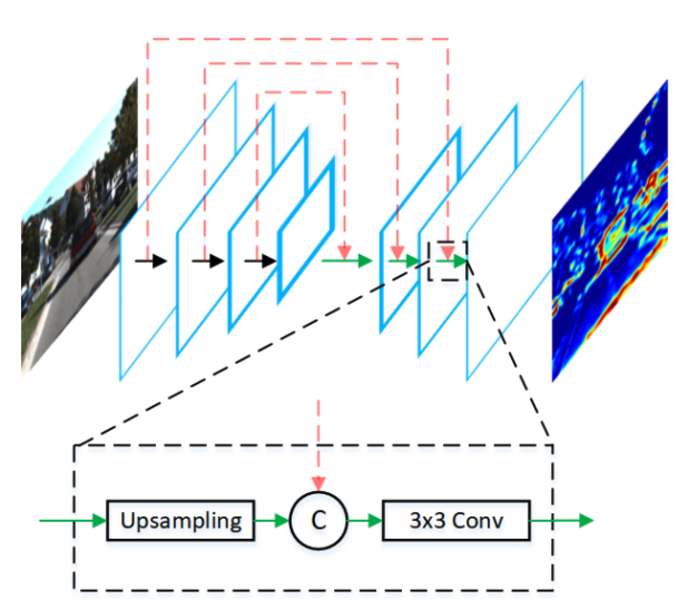

# Contents

1.  [Preface](#org2bf16eb)
2.  [Basic Paper Information](#org985bb71)
3.  [Motivation and Ideas](#orgd5f326c)
4.  [Algorithm Pipeline](#org989a304)
5.  [Experimental Analysis](#orgf1dde18)
6.  [Personal Summary](#org961c653)

# Preface

AVOD is a 3D detection algorithm based on fusing camera and lidar information, and it is one of the few open-source state-of-the-art (SOTA) algorithms available today. Related resources:

[KITTI leaderboard](http://www.cvlibs.net/datasets/kitti/eval_object.php?obj_benchmark=bev)

[AVOD paper](https://arxiv.org/pdf/1712.02294.pdf)

[AVOD source code](https://github.com/kujason/avod)

[AVOD source code walkthrough](https://blog.csdn.net/sunny0660/article/details/104078746)

# Basic Paper Information

First author:

Jason Ku, a graduate student at the University of Toronto, working on perception algorithms for autonomous driving

Other related work:

`IROS 2019`

`Improving 3D Object Detection for Pedestrians with Virtual Multi-View Synthesis Orientation Estimation`

Ranked 5th on KITTI pedestrian detection; a lidar + camera early-fusion approach

`CVPR 2019`

`Monocular 3D Object Detection Leveraging Accurate Proposals and Shape Reconstruction`

Monocular 3D object detection
Current KITTI SOTA:  `Car` ranked 112, `Pedestrian` ranked 44, `Cyclist` ranked 38

Citations: 175

Corresponding author:

`Steven L. Waslander`
Associate professor at the University of Toronto; research areas: `Unmanned Aerial Vehicles`, `SLAM`, `Object Detection`, `Motion Planning`

Citations: 4741

# Motivation and Ideas

-   Three current approaches to fusion in autonomous-driving perception:
    -   Image based:
    Represented by `Frustum PointNets`: first run 2D detection on the camera image, then project into 3D space, extract features from the frustum, and then detect. The features are cascaded, so performance is limited by the 2D detector. `Deep Manta` predicts depth from the camera, and its 3D localization performance is poor.
    -   `BEV` (Bird's eye view) based: represented by `MV3D`, which projects the point cloud onto the `BEV` to generate `proposal`s, and then uses `ROI crop` to extract the corresponding camera regions for fusion in order to correct the predicted boxes. It makes little use of height information, so it may lose some 3D information.
    -   3D based: fuse directly in 3D space. Fusion in this direction is difficult, so there are currently few papers on it. It is computationally expensive.
-   The representative `BEV`-based work, `MV3D`: the basic idea of `MV3D` is to first obtain a `3D Proposal` from the `BEV` view, project it onto the FV view and the camera view to obtain the `ROI` on each image, fuse the three kinds of features, and finally perform the final box classification and regression on the fused features.
    

-   Shortcomings:
    -   During `backbone` feature extraction, downsampling makes the information of small objects unrecoverable: for example, a pedestrian is `8\*6pixel` on the `BEV` map, and after three rounds of `downsampling` it is less than 1 pixel, so the information is lost and small objects are detected poorly
    -   The eight-vertex `Encoding` lacks `Constraint`s of a cuboid, and the regression of `orientation` is not specified (`AVOD` notes that `MV3D` takes the orientation to be the direction of the long side of the cuboid's plane), so a box can easily be flipped upside down:
        

# Algorithm Pipeline

-   Pipeline diagram:
    

-   Main improvements:
    -   The `feature extractor` borrows the `FPN` structure and fuses shallow and deep features to form a `high-resolution feature map`
    -   `crop and resize`: the generated `3D proposal`s are projected onto their respective `plane`s and then `bilinearly resized` to an `n\*n feature map`:
        

    -   A constrained `box coding` is used, which reduces the parameter dimension from `24d->10d` and regresses the plane rotation vector:
        

-   Other details:
    -   The `BEV` is a 6-channel feature: 5 heights (5 equal slices on the Z axis) + `density information`
    -   `1\*1Conv`: the `RPN` outputs a large number of `anchors`, so the output feature map has too many dimensions and needs a lot of GPU memory; a 1x1 convolution is used to reduce the dimension
    -   `3D Proposal Generation`: the `background box` is not included in the regression loss. The IoU threshold for car is slightly higher than for the other two classes (0.5→0.45). The NMS threshold is 0.8. The number of training proposals is 1024, and 300 at inference
    -   `Second Stage Detection Network`: the orientation is taken to be the candidate closest to the regressed vector (four directions are selected in advance, based on the corner positions)

# Experimental Analysis

-   Evaluation metrics:
    -   `3D AP`: `3D IOU`: the ratio of the intersection volume of two 3D cuboids in the camera coordinate system to the total volume of the two cuboids
    -   `BEV AP`: `2D IOU`: the `overlap` of the objects projected onto the ground in the camera coordinate system, that is, the ratio of the intersection of the two boxes to the total area of the two boxes in the `bird eye view`
    -   `AHS` (Average Heading Similarity): `3D IOU and global orientation angle`
-   `KITTI`: on test-set performance (which could not be reproduced), `AVOD` is slightly worse than `Frustum PointNets` on Cyclist, wins some and loses some on Pedestrian, and is better on car, while also being faster:

-   `RPN Recall`: on the validation set, RPN recall is higher than that of other comparable algorithms. The improvement for car is not obvious, possibly because cars are large and their features are fairly distinct, so performance is already at a high level. In addition, there is no comparison data for MV3D:

-   `AHS`: validation-set performance (3D AP); orientation performance is clearly better:
    

-   `Ablation Study`: the Base Network is the reference network, a VOD network that uses vgg-net as the backbone. On validation-set performance (3D AP), `BEV Image` fusion and the `Feature Pyramid Extractor` give no obvious improvement on car, but clearly improve Pedestrian and Cyclist. However, in my reproduction I could only use the small sample of the train-split set (Pedestrian and Cyclist are already scarce) and also used path drop, which may cause large fluctuations. The paper also mentions that no paper has so far published Pedestrian and Cyclist performance on the validation set.

# Personal Summary

-   Strengths: compared with the earlier MV3D, it is more refined, mainly in:
    -   The fusion of multi-level features with `FPN`
    -   The regression strategy for `3D Box orientation`
    -   The use of `Crop and Resize`
-   Shortcomings:
    -   Plane extraction (used to generate the BEV map) depends on how dense the point cloud is
    -   During proposal generation, the image and lidar data are kept separate, and `ROI Fusion` is already fusion of high-level features. `MMF` (`Multi-Task Multi-Sensor Fusion for 3D Object Detection`) implements fusion at both the `roi-wise` and `point-wise` levels and performs better (the code is not open-sourced)
    -   `ROI-Fusion` has the problem that the `Image feature` and the `BEV feature` are not aligned
    -   The BEV view gives a high recall in the first stage, but refining the 3D position later is more accurate using the original 3D point cloud (this requires dealing with the sparse distribution of the raw point cloud, for example by fusing key areas through sampling or clustering)
