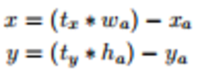

# Contents

1.  [Preface](#org21296b6)
2.  [Basic Paper Information](#orgd06f330)
3.  [Motivation and Ideas](#org02246b9)
4.  [Algorithm Pipeline](#org1c91967)
5.  [Experimental Analysis](#org8136767)
6.  [Personal Summary of YOLOv1](#org9421cbe)
7.  [Improvements: YOLOv2](#org1210da1)
    1.  [Motivation](#org12ccb89)
    2.  [Improvements](#org59cd54b)
    3.  [Results](#orgd9d9db5)
8.  [Improvements: YOLOv3](#org1c82c5a)
    1.  [Motivation](#orgeb1e145)
    2.  [Improvements](#org6c0b5b5)
    3.  [Results](#org8fbd907)

# Preface

YOLO is the earliest one-stage detection framework, and it keeps a fast, lightweight model while maintaining good performance. The iterations from YOLOv1 to YOLOv3 also show clearly how the author thought about and carried out performance improvements.

# Basic Paper Information

Author: Joseph Redmon, PhD at the University of Washington, author of YOLOv1 through YOLOv3; his other work includes XNOR-Net.

[YOLO website](https://pjreddie.com/darknet/yolo/)

[YOLOv1_Paper](https://arxiv.org/abs/1506.02640)

[YOLOv2_Paper](https://arxiv.org/abs/1612.08242)

[YOLOv3_paper](https://arxiv.org/abs/1804.02767)

# Motivation and Ideas

YOLOv1 is designed on the observation that human perception of an image is both fast and accurate: one scan of the whole image is enough to quickly get the categories and positions of objects. That is You Only Look Once. Other mainstream object detection algorithms, such as DPM (deformable parts models), use sliding windows and run a classifier at every evenly spaced local position to perform detection. The RCNN family uses two stages, and RCNN and Fast RCNN cannot be trained end to end.

YOLOv1 was the first to perform object detection in one stage, treating the whole task as a regression problem over bounding box positions and classes. The figure below briefly describes how YOLOv1 works: it predicts positions and classes by applying a convolutional network directly to the whole image. The advantages of this approach are: it is fast and needs no complicated pipeline design (standard YOLO runs at 45 FPS and Fast YOLO at 155 FPS, and at the time YOLO's detection mAP was more than twice that of other real-time systems); YOLO makes better use of global information, which reduces background errors; and YOLO generalizes better.

# Algorithm Pipeline

YOLOv1:

-   Unified Detection:

YOLO divides the image into an S\*S grid, and each grid cell is responsible for objects whose center falls inside it. Each grid cell predicts B bounding boxes, each with confidence information and position information: x, y, w, h. The confidence is expressed in the form of a conditional probability: `confidence=Pr(Object)\*IOU`. That is, if the bounding box predicts no object, then `Pr(object)=0` and the confidence is 0; if it predicts an object, the confidence is the IOU between the predicted box and the ground truth (gt). Here x, y give the position of the predicted bounding box center relative to the grid cell boundary, and w, h give the bounding box's width and height as a fraction of the whole image. In addition, each grid cell also predicts the c-class `conditional confidence:Pr(Class_i|Object)`, and during inference `Pr(Class_i|Object)\*Pr(Object)\*IOU` is used as the class confidence of a bounding box. Note that the class confidence applies only to the c classes, while the bounding box confidence applies to each box.

-   Network Design:

The YOLO network is inspired by GoogleNet, replacing the Inception structure with 1\*1 and 3\*3 convolutional layers. The standard YOLO network has 24 convolutional layers followed by two fully connected layers, while Fast YOLO has only 9 convolutional layers. The output tensor of YOLO is 7\*7\*30, which matches the size of the prediction.

-   Training:

The network is first pretrained on the ImageNet 1000-class classification task, using the first 20 convolutional layers of the network above followed by an average-pooling layer and a fully connected layer. The pretrained first 20 layers are then used as the front part of the detection network, and 4 more convolutional layers and two fully connected layers are added; the last layer predicts the `class probility` and the `bounding box coordinates`. Here w, h, x, y need to be normalized to 0-1, so that w and h are no larger than the image size and the position lies within the boundary of the specific grid cell.

-   Loss design
    The loss is a sum-squared error loss, but different terms are weighted differently:
    -   The coordinates error needs a higher weight
    -   Grid cells without objects are a large share, so their loss would be large; the weight of the no-object loss needs to be reduced to lower its contribution to the network
    -   The error tolerance for large and small objects should differ: an offset of a small object affects IOU more, so the author uses the square root of the original height and width instead of the raw values

During training, several boxes may predict the same object. Only the predictor with the largest IOU is used for the final prediction. The final loss is designed as follows:

# Experimental Analysis

-   PASCAL VOC 2007 results: Faster-RCNN VGG-16 has a higher mAP than YOLO, but YOLO is more than 6 times faster; Faster-RCNN ZF is slower than YOLO and also has a lower mAP.

-   VOC2007 error analysis: compared with Fast RCNN, YOLO has larger localization error but smaller background error. YOLO predicts positions with grid cells, which loses a lot of detail and makes localization inaccurate.

-   VOC 2012: YOLOv1 performs about as well as RCNN-VGG; it is mainly worse than RCNN on small objects

# Personal Summary of YOLOv1

The shortcomings of YOLOv1 are fairly obvious:

-   Each grid cell predicts only 2 bounding boxes, and the predictions of different cells are mutually exclusive, so it works poorly for objects that are close together.
-   The size of the default box has to be learned from the training data. It depends heavily on the object sizes in the training data, and with no prior size the network is harder to train.
-   The final output feature of the network is 7\*7, so a lot of small-object information is lost and small-object detection is poor.

# Improvements: YOLOv2

## Motivation

YOLOv2 (YOLO9000) improves on YOLOv1 along three dimensions: `Better, Faster, Stronger`. Among them, Stronger mainly uses classification data for training so that more categories can be detected.

This article focuses on the first two. The two main shortcomings of YOLOv1 are a large number of localization errors and a lower recall than proposal-based approaches. A common way to improve a detector is to use a larger, deeper network, but that hurts the speed of the model. So instead of simply widening and deepening the network, the author adopted a better representation so the network can learn better (mainly the design of the box and its loss), together with a series of tricks and fixes for problems in the original YOLOv1.

## Improvements

The author's improvements are as follows:

-   BN layers: adding BN layers to all convolutional layers improves mAP by 2%
-   High Resolution Classifier: YOLOv1 trains the classification network with an input size of 224X224, but the detection network takes 448X448 input, which means the detection network has to learn the larger input size during training. YOLOv2 first fine-tunes the classification network at 448X448 input and then fine-tunes the detection network, which improves mAP by 4%
-   Convolutional With Anchor Boxes: bounding boxes are predicted with anchor boxes. The fully connected layers of YOLOv1 are removed and replaced with convolutional layers, and the last pooling layer is removed to enlarge the output size. The input image size changes from 448X448 to 416X416, so that the output is 13X13, an odd number, which keeps a single grid cell at the center of the image (the author believes this helps predict large objects in the middle of the image). The class prediction of a box still follows the YOLOv1 strategy. The gain of this approach is a 7% increase in recall, but accuracy drops: 69.5mAP@81%recall->69.2mAP@88%recall.
-   Dimension Clusters: K-means is used to cluster the boxes. Under the same conditions, it gives a higher Avg IOU than hand-picked boxes.

    
    

-   Direct location prediction: the default prediction of the bounding box center point is:

The problem with this scheme is that the maximum offset depends on the size of the anchor box and has no other constraint, so the center point can end up anywhere in the image, which makes training unstable. So the author keeps the original YOLO way of predicting position:

Dimension Clusters and Direct location prediction together improve the anchor version by 5% mAP, as illustrated below:

-   Fine-Grained Features: through pass-through (stacking adjacent features into different channels), an earlier feature layer (26X26) is concatenated with the original feature map, fusing multi-scale information and improving mAP by 1%.
-   Multi-Scale Training: to make YOLOv2 more robust to the input size, a new image size is chosen as input every 10 batches during training: {320,352,&#x2026;,608}.
-   Faster: `Darknet-19` is designed: 5.58 billion operations, `72.9% top1 accuracy`, `91.2% top5 accuracy` on ImageNet:

## Results

Improvements from YOLOv1 to YOLOv2:

PASCAL_VOC2007: a good trade-off between speed and performance:

PASCAL_VOC2012 comparison: performance is about the same, but YOLOv2 is faster:

COCO comparison: COCO has more small objects. At IOU=0.5, performance is about the same as Faster-RCNN and SSD300, but YOLOv2 is faster:

# Improvements: YOLOv3

## Motivation

YOLOv2 did not combine multi-scale features for prediction. Although the pass-through approach fuses shallow features, it also changes the spatial distribution of the features. The YOLOv2 backbone, Darknet-19, also had room for improvement.

## Improvements

YOLOv3 borrows more from the strengths of SSD, Faster-rcnn, and FPN. The main improvements are:

-   Predictions Across Scales: following the FPN design, the original 13X13 output feature is upsampled to obtain 26X26 and 52X52 features, which are concatenated with shallow features and finally passed through convolutional layers for prediction. K-means uses 9 clusters.
-   Feature Extractor: the backbone is made deeper and the residual structure of Resnet is introduced, which gives good performance at a low computational cost:

## Results

Performance on the COCO dataset: YOLOv3 performs about the same as SSD but is 3 times faster than SSD. It is lower than RetinaNet, but RetinaNet's inference time is 3.8 times that of YOLOv3, and at 0.5 IOU the two are close.

