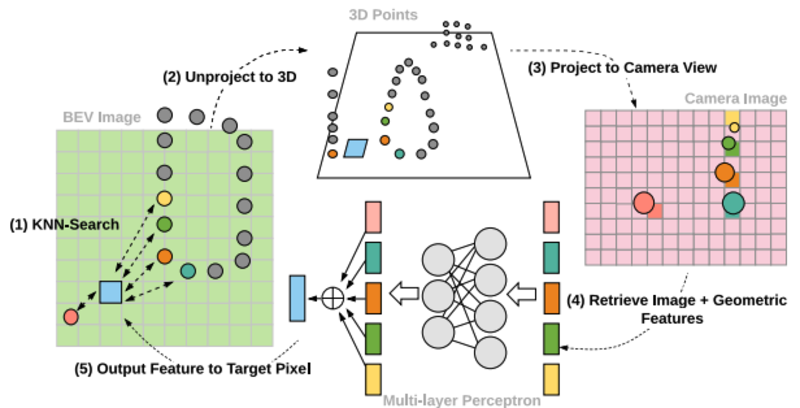

# Contents

1.  [Background and Core Idea](#org0fd639c)
2.  [Algorithm Pipeline](#org28170ad)
3.  [Algorithm Details](#orgaa02989)

[Deep Continuous Fusion for Multi-Sensor 3D Object Detection](http://openaccess.thecvf.com/content_ECCV_2018/papers/Ming_Liang_Deep_Continuous_Fusion_ECCV_2018_paper.pdf)

# Background and Core Idea

Motivation: the authors argue that the difficulty in fusing lidar data with image data is how to combine sparse, continuous 3D point cloud information with image data that is semantically rich but discrete. They propose a point-wise fusion based on continuous convolution for deep fusion of the BEV and the image.

# Algorithm Pipeline

-   Core:
    -   Building the Fusion Layers: the inputs are the image features output by the four blocks of resnet18, which are combined through an FPN. For fusion, the K nearest points of a target pixel are found on the BEV 2D plane, then mapped to the corresponding 3D points in 3D space; the 3D positions and the image features (obtained by interpolation) are then fed into an MLP to get the fused feature
    -   The last feature layer of the BEV branch is used for the final classification and prediction, and it combines the features of the previous three blocks (similar to FPN)
-   Algorithm framework:

# Algorithm Details

-   Key points:
    -   Point-fusion is applied to every block during feature extraction
    -   The input BEV has higher dimensions: 512\*448\*32
    -   Negative sample strategy: randomly sample 5% and take the top-k
-   Paper results: the authors report that detection at long range (>60m) improves, because the sparse point cloud information at a distance is supplemented by image information

