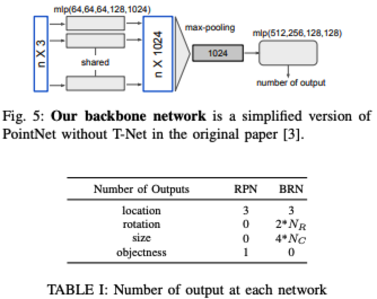

# Contents

1.  [Background and Core Idea](#org0da6097)
2.  [Algorithm Pipeline](#org940fe0a)
3.  [Algorithm Details](#orgf014bef)

[RoarNet: A Robust 3D Object Detection based on RegiOn Approximation Refinement](https://arxiv.org/pdf/1811.03818.pdf)

# Background and Core Idea

Motivation: the idea is similar to Frustum ConvNet. The authors argue that obtaining 3D proposals directly from the 2D image is inaccurate and can also be affected by time desynchronization between different sensors, so they propose spatial scattering to expand the proposal region.

# Algorithm Pipeline

-   Algorithm idea:

    The overall idea of RoarNet is somewhat similar to Frustum PointNets and Frustum ConvNet. A 2D detector first extracts ROIs from the 2D RGB image, and after the ROIs are extracted, RoarNet uses a Det+Pose CNN to further predict a 3D box in 3D space, giving a roughly estimated 3D box.

    Because the 3D position estimated directly from the RGB image is imprecise, the authors use spatial scattering (shrinking and enlarging the predicted box to some degree, which produces a series of box estimates at different distances and sizes, similar to the frustum in Frustum ConvNet). The point cloud data of these proposals is then extracted (sample 256 point clouds for training, 512 for prediction) to predict the position of the final 3D box. Unlike the run-twice operation in Frustum ConvNet (the paper shows that this also improves performance), this paper uses two simplified PointNet networks with the same structure: the first estimates the location and objectness of the 3D box, and the second refines the location and estimates the rotation and size.

-   Algorithm framework:
    
    
    

-   Core points:
    -   RoarBNet_2D is designed to roughly estimate the 2D boxes and poses of all objects in the image
    -   3D proposals are obtained and expanded through the projection relationship and spatial scattering
    -   A two-stage PointNet regresses and predicts the 3D box

# Algorithm Details

-   Key points:
    -   A front-end 2D detector is designed
    -   It is verified that a two-stage approach works better for predicting the 3D position from the point cloud
        -   AP of the three approaches: 54.3%, 59.9%, 74.02%:
            

    -   Spatial scattering can mitigate the loss of prediction accuracy caused by time desynchronization

-   Experimental results:
    
