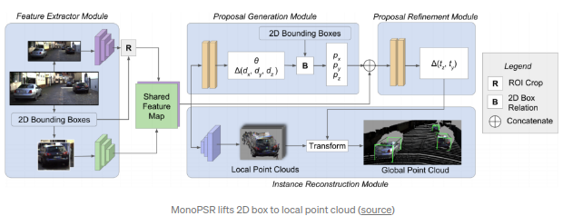
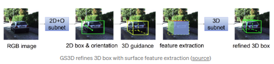

- [Preface](#sec-1)
- [Algorithm Survey (Relatively Complete)](#sec-2)
- [Lifting 2D to 3D](#sec-3)
  - [Representation transformation: BEV, Pseudo-Lidar](#sec-3-1)
  - [Keypoints && Shape](#sec-3-2)
  - [Distance estimation from 2D/3D constraints](#sec-3-3)
  - [Directly generating 3D proposals](#sec-3-4)
- [Key Takeaways](#sec-4)

# Preface

Translated from: [Monocular 3D Object Detection in Automnonmous Driving-A Review](https://towardsdatascience.com/monocular-3d-object-detection-in-autonomous-driving-2476a3c7f57e)

Updates to the monocular 3d object detection algorithms covered:

-   Add RTMD(01/15/2020)
-   Add Virtual Camera from Mapillary(02/16/2020)
-   Add Decoupled Structured Polygon(02/21/2020)
-   Add Refined MPL(03/22/2020)
-   Add MonoPair(06/04/2020)
-   Add SMOKE(06/05/2020)
-   Add The Earth ain't Flat(06/28/2020)
-   Add D4LCN(08/22/2020)
-   TODO: Add (PseudoLidar V3, ZoomNet, ApolloCar3D, 6D-VNet and PartParse)

3D detection is an extremely important task in autonomous driving. Many tasks in this field, such as decision making, path planning, and motion control, all need a good 3D spatial perception and representation of the surroundings of the self-driving vehicle.

In recent years, algorithms based on 3D Lidar (such as the important work PointNet, which uses a neural network to extract features from point cloud data) have greatly improved the accuracy of 3D object detection. But 3D Lidar has drawbacks: it is expensive, and it is easily affected by weather and the environment. 3D detection based on RGB camera data can make the detection system more robust, especially when other, more expensive modules fail. So how to achieve reliable and accurate 3D detection from single or multiple cameras is particularly important.

Monocular 3D object detection (mono 3DOD) is not a new direction in itself; it has only recently become a hot topic. I look forward to more ideas appearing in 2020, because for now the gap between lidar-based and image-based algorithms is still large.

# Algorithm Survey (Relatively Complete)

The figure below shows recent progress in monocular 3D, covering the papers up to 2019/11 (it will keep being updated). So this article is a relatively complete summary of mono 3DOD algorithms, which can be roughly divided into 4 schools: representation transform, keypoints and shape, geometric reasoning based on 2D/3D constraints, and direct generation of 3D bounding boxes. It is worth mentioning that a single paper usually involves several ideas, so this division into schools is rather loose. Links to the related papers can be found at: [Github_DL_Paper](https://github.com/patrick-llgc/Learning-Deep-Learning)

# Lifting 2D to 3D

Doing 3D detection directly from 2D images is hard, because in theory it is an ill-posed problem: the depth information in a 2D image is missing. But in certain specific scenes and with strong priors, the task is still achievable. In autonomous driving in particular, some of the objects of greatest interest, such as motor vehicles, are rigid bodies with relatively stable sizes, so the 3D information of a vehicle can be obtained from a monocular image.

## Representation transformation: BEV, Pseudo-Lidar

In autonomous driving, the camera is usually mounted on the roof, or in a way similar to a common dashcam. So the image the camera provides is always a front view. This view is consistent with the real driving view, but it has two problems: occlusion, and object size that varies with distance.

One way to alleviate the drawbacks of the front view is to convert it into a bird's-eye view (BEV). In the BEV, vehicle size is consistent and independent of the distance to the ego vehicle, and vehicles do not overlap one another (on the premise that, under normal conditions, vehicles are not stacked on top of each other). Inverse perspective mapping (IPM) is usually used to generate BEV images. Its prior is that all generated pixels lie on the ground plane and that the precise intrinsic/extrinsic parameters of the camera are consistent. In practice, however, IPM requires very accurate extrinsic parameters and needs real-time online calibration.

The idea of [BEV IPM OD(IV 2019)](https://ieeexplore.ieee.org/abstract/document/8814050) is to calibrate the extrinsic parameters online using IMU data, thereby obtaining more accurate IPM images, and to do object detection on top of them. The demo is here: [yotube](https://www.youtube.com/watch?v=2zvS87d1png&feature=youtu.be).

[Orthographic Feature Transform(OFT)(BMVC 2019)](https://arxiv.org/abs/1811.08188) also converts the front view to a BEV image, but within a deep learning framework. The algorithm uses an orthographic feature transform (OFT) to turn front-view features into orthographic BEV features. The front-view features are extracted with ResNet-18. Voxel-based features are obtained by accumulating image-based features (similar to the back-projection step in CT image reconstruction). The voxel-based features are projected along the vertical direction to produce features orthogonal to the ground plane. Finally, a ResNet-like topdown network performs object detection on the BEV map.

The idea of OFT is simple and effective. The back-projection step could still be improved with heuristics that initialize the voxel-based features more sensibly; for example, a large 2D detection box in the image cannot map to a very distant object. In addition, the algorithm still depends on accurate extrinsic parameters, which are usually hard to obtain online.

Another way to convert the front view to BEV is [BirdGAN(IROS 2019)](https://arxiv.org/abs/1904.08494), which uses a GAN to perform the BEV transformation. The method achieves fairly good results, but according to the paper, its transformation to BEV space works well only within 10-15m ahead, so its range of application is limited.

The next topic is pseudo-lidar. The idea is to predict depth information from images and thereby produce point cloud information, which benefits from recent progress in monocular depth estimation (itself a hot topic in autonomous driving). Previously, RGBD image data was usually handled by feeding the depth dimension in as a fourth channel, using a conventional network with only the first-layer input adjusted. [Multi-Level Fusion(MLF, CVPR2018)](https://openaccess.thecvf.com/content_cvpr_2018/papers/Xu_Multi-Level_Fusion_Based_CVPR_2018_paper.pdf) is one of the first works to extend predicted depth into 3D space. The algorithm uses the predicted depth information (with the [MonoDepth](https://github.com/mrharicot/monodepth) parameters as a fixed network) to map each pixel of the RGB image back into 3D space, and the resulting point cloud data is then fused with image features to regress 3D detection boxes.

[Pseudo-lidar(CVPR2019)](https://arxiv.org/pdf/1812.07179.pdf) is probably the best-known work in this field. It was inspired by [MLF](https://openaccess.thecvf.com/content_cvpr_2018/papers/Xu_Multi-Level_Fusion_Based_CVPR_2018_paper.pdf) and used a more direct way of validating the idea: directly applying the best-performing SOTA lidar-based 3D detection algorithms. The authors' view is that the way data is represented matters, and that convolutional networks do not work well on depth maps because, even for pixels that are very close together, the depth difference in 3D space can be large. The authors later proposed [Pseudo-lidar++](https://arxiv.org/pdf/1906.06310.pdf). Its main improvement is that the algorithm can work with pseudo-lidar data generated from low-cost lidar data with fewer beams. Generating dense 3D point clouds from camera images, and doing depth prediction based on point clouds, has strong practical potential in autonomous driving.

Later work based on pseudo-lidar is mainly an optimization of the original algorithm. [Pseudo-Lidar Color(CVPR 2019)](https://arxiv.org/abs/1903.11444) fuses depth and RGB information, either by directly using concatenation to turn (x,y,z) into (x,y,z,r,g,b), or by using an attention-based approach to selectively pass in the RGB information. The paper also uses a simple and efficient point cloud segmentation method, mainly borrowed from [Frustum PointNet(CVPR 2018)](https://arxiv.org/abs/1711.08488), using the average depth within the frustum. [Pseudo-Lidar end2end(ICCV 2019)](https://arxiv.org/abs/1903.09847) argues that the bottlenecks of pseudo-lidar are twofold: the matching error caused by depth estimation error (local misalignment), and the long tail of the lidar data caused by abrupt depth changes at object edges. That paper uses a semantic segmentation mask rather than the bbox in Frustum PointNet, and introduces a consistency loss between 2D and 3D boxes.

[ForeSeE](https://arxiv.org/abs/1909.07701) makes a similar point, and further argues that in the depth estimation task not all pixels are equally important. Instead of using an off-the-shelf depth estimation model, the algorithm trains two separate depth estimation models that predict the depth of the foreground and the background respectively, and selectively fuses the depth maps during inference.

[RefinedMPL](https://arxiv.org/abs/1911.09712) examines the problems caused by the point cloud density in pseudo-lidar. The paper points out that the point cloud density of pseudo-lidar is much higher than that of the point cloud data from a real 64-beam lidar. In particular, the extra background points cause more false positives and also increase the amount of computation. So the paper proposes two steps to sparsify the structure of the point cloud: first identify the foreground points, then sparsify. The foreground points are obtained in two ways: supervised and unsupervised. The supervised way trains a 2D detector and uses the masks of the 2D bboxes it produces as the foreground mask to remove background points. The unsupervised way uses LoG (Laplacian of Gaussian) features for keypoint detection together with a nearest neighbor algorithm (k=2), and takes the resulting points as foreground points. The foreground points obtained are then divided into fixed depth regions (depth bins) and sparsified uniformly. RefinedMPL points out that even with only 10% of the points, 3D object detection performance does not get worse, and is even slightly better than the original baseline. The paper also notes that the performance gap between pseudo-lidar and real lidar comes from its inaccurate depth estimation.

Overall, the approach above is the more feasible one. It means that only an accurate estimate of the foreground objects is needed (a dense point cloud is not), and this can be obtained with sparser depth measurement, such as a low-cost 4-beam lidar.

## Keypoints && Shape

Vehicles and similar objects are usually geometric rigid bodies made up of known object parts, so detection, classification, and recognition can usually be done with landmarks/keypoints. In 3D detection, especially in autonomous driving, the size and keypoints of objects such as vehicles and pedestrians are also roughly known. So size information can serve as a basis for estimating distance.

Based on this principle, most related work detects keypoints on top of current 2D object detection frameworks (one-stage, such as YOLO/RetinaNet, or two-stage, such as Faster RCNN).

[Deep MANTA(CVPR 2017)](https://arxiv.org/abs/1703.07570) is a pioneering work in this line. In stage one (training && inference), a cascaded Faster RCNN produces the 2d bbox, the classification result, 2d keypoints, visibility, and template similarity. The template similarity is derived from the 3d bbox parameters (w,h,l). In stage two (inference only), the template similarity is used to find the best-matching 3D CAD model, and the 3D position and orientation are then reconstructed through 2D/3D matching ([EPnP algorithm](https://en.wikipedia.org/wiki/Perspective-n-Point#EPnP)).

[The Earth ain't Flat(IROS 2018)](https://arxiv.org/abs/1803.02057) aims to reconstruct vehicles in 3D from a monocular camera on non-flat roads. The core of the framework is estimating 3D shape and 6DOF pose from a monocular image. The keypoint detection framework still uses MANTA's 36-point detection scheme. The difference is that it no longer simply picks the best match among 3D templates, but obtains a set of basis vectors and deformation parameters that capture the final vehicle shape. This idea of a set of basic shapes combined with deformation parameters is similar to 3D-RCNN and RoI-10D. The keypoint detection model is trained on a synthetic dataset of 2.4 million 3D CAD model renderings from ShapeNet (rendered from 900 3D CAD models), and the authors found that it generalizes to some extent to real-world scenes. This mono3DoD approach has also been used in other work, such as [Multi-object Monocular SLAM(IV 2020)](https://arxiv.org/abs/2002.03528).

[3D-RCNN(CVPR2018)](http://openaccess.thecvf.com/content_cvpr_2018/papers/Kundu_3D-RCNN_Instance-Level_3D_CVPR_2018_paper.pdf) is designed on top of Faster RCNN. It can predict the shape, pose, and size parameters of vehicles, and renders the scene at the same time. The resulting mask is used to compute a "render-and-compare" loss against the GT in the depth map. PCA (Principal Component Analysis) is used to extract the principal features of the size space (10-d). The pose and size parameters are obtained from the RoIPooled features (unlike the original RoI Pooling, here an underlying 2D transformation is proposed that takes the characteristics of 3D space into account) by regression based on classification results (for example, dividing distance into several intervals and obtaining the distance from the classification result). The input of this scheme is rather complex: 2D bbox, 3D bbox, 3D CAD model, 3D semantic segmentation result, and camera intrinsics. Also, the "render-and-compare" loss has to be computed with OpenGL, which takes some engineering skill.

[RoI-10D(CVPR 2019)](https://arxiv.org/abs/1812.02781): its name, 10D, refers to the 6DoF pose + the 3DoF size of the 3D bbox (w,h,l), and the extra dimension refers to the shape space. Like 3D RCNN, RoI-10D obtains 6-d features of the shape space and uses a 3D auto-encoder. The features obtained from RGB are augmented with the estimated depth information, and RoIPooled (see 3D-RCNN) regression then yields the rotation q (quaternion), the relative 2D center position of the RoI (x,y), the depth (z), and the size parameters (w,h,l). With these parameters, the 8 vertices of the 3D bbox can be estimated. The corner loss can be computed from the 8 predicted vertices and the GT. The GT for shape is annotated offline on KITTI3D data by minimizing a re-projection loss. The use of shape is quite engineering-heavy.

[Mono3D++(AAAI2019)](https://arxiv.org/abs/1901.03446) obtains 3DOD from the consistency of 3D and 2D, mainly through landmark points and shape. The paper builds a morphable wireframe model from 14 landmark points. The low-dimensional representation of shape is obtained from the 2D landmarks with [EM-Gaussian](https://en.wikipedia.org/wiki/Expectation%25E2%2580%2593maximization_algorithm). The algorithm is similar to 3D RCNN and RoI 10D. The paper also estimates depth and the ground plane, using them to obtain consistency losses across several prediction branches. But many key details of the algorithm are not disclosed in the paper.

[MonoGRNet(AAAI2019)](https://arxiv.org/abs/1811.10247) can regress the projected 3D center point, the coarse instance depth, and the rough 3D position between the two. The paper emphasizes the difference between the 2D bbox center and the 3D bbox center projected onto the 2D image. The projected 3D center can be regarded as an additional keypoint, similar to [GPP](https://arxiv.org/abs/1811.06666). Unlike other algorithms, the paper does not regress the relatively easy observation angle, but directly regresses the relative offsets of the 8 vertices from the 3D center point.

[MonoGRNet V2](https://arxiv.org/abs/1905.05618) regresses keypoints in the 2D image and uses 3D CAD models to infer depth. Training is based on 3D CAD models (there are few 3D KP annotations), and the 2D KP points are obtained semi-automatically from 3D bboxes (similar to Deep MANTA). The overall framework resembles Mask RCNN, with two extra head branches added. One branch regresses the 2D KP points, visibility, and its own rotation angle; the other, the CAD && shape branch, selects the CAD model and regresses the 3D size offsets. The object distance is obtained from the height of the windshield (the original Mask RCNN object detection branch takes part in training because it stabilizes training, but is not used during inference. The KP points are regressed by fully connected layers that regress the keypoint coordinates directly, rather than first producing a heatmap as in the original paper).

Besides 3D CAD models, Deep MANTA also obtains 3D keypoints semi-automatically by placing CAD models into the 3D bbox gt. Deep MANTA annotates 36 keypoints on 103 CAD models. MonoGRNet V2 annotates 14 keypoints on 5 CAD models. Mono3D++ also annotates the same 14 keypoints.

In general, dense keypoint annotation of a large number of vehicles is very complex and time-consuming. Baidu's ApolloScape, especially ApolloCar 3D, a sub-dataset derived from the main dataset, is the only one that provides dense keypoint and shape annotations in the form of point clouds.

[Ground Plane Polling(GPP)](https://arxiv.org/abs/1811.06666) generates virtual 2D KP points from 3D bbox annotations. The algorithm predicts more attribute values than are needed to obtain the 3D bbox (over-determined), with the goal of computing the closest fit from all the predicted values, similar to the RANSAC algorithm, which makes the algorithm more robust to outliers.

[RTM3D(real-time mono-3D)](https://arxiv.org/abs/2001.03343) also uses virtual keypoints. The algorithm uses a CenterNet-like framework to directly detect all eight vertices and the center point of the 3D cuboid. The paper also directly regresses distance, angle, and size. All the regressed attribute values can serve as priors to initialize an offline optimizer that produces the 3D bbox, rather than producing the 3D bbox directly. The paper claims to be the first real-time monocular 3D object detection framework (0.055 sec/frame).

[MonoPair](https://arxiv.org/abs/2003.00504) draws a lot of inspiration from CenterNet and improves the final detection results using the spatial relationships between pairs of vehicles. Compared with CenterNet, which predicts the 3D bbox directly, it also predicts virtual constraint points between paired, matched vehicles. The matching keypoints are defined as the pair of center points of the two nearest objects. These "relationship keypoints" are similar to the definition in [Pixels to Graphs(NIPS 2017)](https://arxiv.org/abs/1706.07365). The starting point of MonoPair is global optimization: model performance can be improved by including the uncertainty of the depth estimation process in the prediction. MonoPair also uses the rotational change in the absolute positions between objects to ensure viewpoint invariance in the local coordinate system. MonoPair also reaches real-time performance of 57ms/frame.

[SMOKE(CVPRW2020)](https://arxiv.org/abs/2002.10111) is also inspired by CenterNet, and no longer regresses the 2D bbox but regresses the 3D bbox directly. Its 3D bbox encoding uses the projected center point of the 3D cuboid, with other parameters (size, distance, rotation angle) as supplementary parameters. The loss is the 3D corner loss (L1 loss), taken from [MonoDIS](https://arxiv.org/abs/1905.12365). This loss formulation, as opposed to predicting the 7DoF parameters by taking a weighted sum of various loss functions, instead implicitly weights the contribution of the different losses to the overall 3D bbox prediction. Its performance is a distance error within 5% up to 60m, making it a SOTA algorithm for monocular depth prediction. The code is open source: [code](https://github.com/lzccccc/SMOKE).

[Monocular 3D Object Detection with Decoupled Structured Polygon Estimation and Height-Guided Depth Estimation(AAAI 2020)](https://arxiv.org/abs/2002.01619) is the first to propose that the 2D projection estimation of the 3D vertices can be decoupled from depth estimation (called the Structured Polygon in the paper). It uses a scheme similar to RTM3D to obtain the projected cuboid vertices, and uses the virtual edge height as a strong prior to estimate distance. In this way a coarse 3D detection box can be obtained. This 3D box serves as the initial position in the BEV (which can be obtained with a method like [Pseudo-Lidar](https://arxiv.org/pdf/1812.07179.pdf)), and fine-tuning can then be done from that position. This scheme achieves better results than monocular Pseudo-Lidar.

[Monoloco(ICCV 2019)](https://arxiv.org/abs/1906.06059) differs from the algorithms above in that its focus is the position of pedestrians. Obtaining the 3D position of pedestrians is usually more challenging than for vehicles, because pedestrians are usually non-rigid objects with different poses and deformations. The algorithm uses a keypoint detection model (a top-down framework such as Mask RCNN, or a bottom-up framework such as Pif-Paf) to obtain human keypoints. Similar to how MonoGRNet V2 and GS3D predict depth, the distance from the shoulder to the midpoint of the hip (~50cm) can be used to predict depth, and the result can serve as a baseline. The paper finally takes the lengths of all keypoint segments as input and predicts depth with several fully connected layers, with performance clearly better than the baseline. The paper also builds an uncertainty model to predict uncertainty, which is especially important in safety-critical scenarios such as autonomous driving.

Overall, obtaining 2D keypoints directly from 2D images and deriving 3D information from them, without supervision from lidar 3D GT, has some potential. But the problem with this approach is that keypoint annotation is expensive, and the conversion to 3D models is usually complex and labor-intensive.

## Distance estimation from 2D/3D constraints

Work in this direction lifts 2D to 3D through 2D/3D consistency. The pioneering work is [deep3DBox(CVPR2016)](https://arxiv.org/abs/1612.00496). Like the keypoint/shape schemes above, this work also adds branches on top of the original 2D object detection framework to regress the rotation angle in the local coordinate system (also called the observation angle) and the deviation from the average size of the sub-category. With this geometric constraint information, the algorithm can solve an over-constrained optimization problem to obtain the 3D position, converting the 2D bbox into a 3D bbox.

The disadvantages of Deep3DBox are the following two points:

-   The algorithm depends on accurate 2D bbox coordinates: a small error in the 2D detection box often causes a larger error in 3D
-   The optimization relies purely on the size and position of the bounding box, and does not use the image information.

[FQNet(CVPR 2019)](https://arxiv.org/abs/1904.12681) extends the idea of Deep3DBBox so that it is no longer limited to tight-fitting constraints. On top of Deep3DBox, the algorithm adds an optimization step: it densely samples around the estimated initial 3D position (the initial 3D position is obtained from the tight 2D/3D constraints), and then scores the 2D region using the rendered wireframe positions of the sampled 3D boxes. But dense sampling is time-consuming and computationally inefficient.

[Shift R-CNN(ICIP 2019)](https://arxiv.org/abs/1905.09970) avoids dense sampling of proposals by actively regressing the offset of the Deep3DBox proposal. The algorithm takes all the known 2D/3D bbox information as input and refines the final 3D position with a simple fully connected network (called ShiftNet).

[Cascade Geometric Constraints](https://arxiv.org/abs/1909.01867) predicts the 3D bbox by predicting the ground center point of the 3D bbox and classifying the viewpoint. It can also use the 3D information obtained during inference to remove false positives from the 2D detection results, for example using the depth order of the bottom faces of the detection boxes, and adjacent 2D detection boxes with similar depth.

[MVRA(Multi-View Reprojection Architecture, ICCV 2019)](http://openaccess.thecvf.com/content_ICCVW_2019/papers/ADW/Choi_Multi-View_Reprojection_Architecture_for_Orientation_Estimation_ICCVW_2019_paper.pdf) implements the spatial 2D/3D constraints directly in the neural network and uses an iterative approach to handle truncated cases. The algorithm introduces a 3D reconstruction layer to lift 2D to 3D, instead of using over-constrained equations as before. The network loss has two parts: 1) the front-view IoU loss, which is the IoU loss between the projected 3D bbox and the original 2D bbox; 2) the BEV loss, which is the L2 loss between the predicted depth and the GT depth in the BEV. The paper also points out that deep3DBox does not handle truncated cases well, because the four sides of the 2d box do not correspond to the physical edges of the real vehicle. The paper uses iterative optimization for the rotation angle of truncated cases: the original 4 constraints are no longer used, and instead xmin (left truncation) or xmax (right truncation) is dropped, so that the optimization uses only 3 constraints. In addition, the global yaw angle is obtained by two iterations with intervals of pi/8 and pi/32, found by trial and error according to the size of the error.

[MonoPSR(CVPR2019)](https://arxiv.org/abs/1904.01690): the author is also the author of AVOD, another early-fusion algorithm. The paper's approach is to first generate 3D proposals and then reconstruct the point cloud of the corresponding moving object in the local coordinate system. The centroid acquisition module mainly relies on the 2D box height and the regressed 3D object height to predict depth, thereby mapping the center of the 2D box to the corresponding depth position in 3D space. This stage is both practical and accurate (absolute depth error of about ~1.5m). The reconstruction branch regresses the local point cloud, and regresses by comparing it with the real point cloud and with the point cloud projected into the camera view. The paper restates the view of MonoGRNet and [TLNet](https://arxiv.org/abs/1906.01193): predicting the depth of the whole scene is overkill for the 3D object detection task, while focusing on the midpoint of the detected object makes the task simpler and avoids large-range depth regression.

[GS3D(CVPR 2019)](https://arxiv.org/abs/1903.10955) is largely based on the Faster RCNN framework, with an additional angle regression head added on top. It obtains a coarse 3D position from the angle in the local coordinate system and the 3D depth estimated from the 2D detection box. The depth is estimated with a statistical prior from the training set: the height of the projection of the 3D detection box onto the 2D image is about 0.93 times the height of the 2D bbox. It also uses a module that extracts features from the object surface (an affine module extended from RoIAlign) to refine the 3D detection box.

In summary, this line of work is the most practical direction for extending 2D object detection to 3D detection results. Among them, the pioneering work of Deep3DBox has had the most far-reaching influence.

## Directly generating 3D proposals

One of the pioneering works in this direction is [Mono3D(CVPR16)](https://www.cs.toronto.edu/~urtasun/publications/chen_etal_cvpr16.pdf) from Uber ATG. The algorithm aims to directly generate dense 3D proposals, with the prior that vehicles are placed on the ground. After the proposals are obtained, the algorithm scores each proposal with a series of hand-crafted features, and obtains the final detection results through non-maximum suppression (NMS). In some sense, this scheme is similar to [FQNet](https://arxiv.org/abs/1904.12681): scoring 3D bbox proposals by back-projecting 3D wireframes. But FQNet's 3D proposals are derived from the original position given by Deep3DBox.

[MonoDIS(ICCV 2019)](https://arxiv.org/abs/1905.12365) directly regresses 2D and 3D detection boxes based on an extended RetinaNet framework. The paper proposes to no longer supervise every parameter of the 2D/3D outputs directly, but to start from the regressed bbox as a whole, using a 2D (signed) IoU loss and a 3D corner loss. Training directly on these losses is difficult, so the paper proposes a decoupled approach: train only one group of parameters at a time while fixing the other groups to gt, then compute the loss, so that during training only the model parameters of the unfixed part are trained. This selective training process cycles until all the required parameters have been trained and updated, and the final loss is also accumulated within a single prediction. This decoupled training lets the model train the 2D/3D detection boxes end to end, and it can be extended to other applications.

The authors of MonoDIS later also borrowed the idea of [Virtual Cameras](https://arxiv.org/abs/1912.08035) to improve the performance of the algorithm further. The core idea is that a model can learn the features of vehicles at different distances, but it lacks generalization to vehicles outside its training range. To get a larger detection range, the model's ability to detect distant vehicles must be improved and the corresponding training data increased. Virtual Camera can divide the whole image into several image patches, each containing at least one complete vehicle with a limited range of depth variation. During forward inference, a pyramid-like image is generated, in which each row of the image corresponds to a fixed range of depth, and different positions in the same row mean changes in lateral distance.

[CenterNet](https://arxiv.org/pdf/1904.07850.pdf) is a highly extensible and versatile algorithm framework that can be extended to many detection-related tasks, such as keypoint detection, depth prediction, and rotation angle prediction. It first regresses a heat map (a confidence heat map of object center points) and uses it to regress the other object attributes. Extending CenterNet to a 2D/3D object detection framework is simple and intuitive.

[SS3D](https://arxiv.org/abs/1906.08070) uses a CenterNet-like detection framework: the algorithm first obtains the center positions of the proposals and then regresses the coordinates of the 2D and 3D detection boxes. The regression task often regresses more parameters to refine the 2D/3D box coordinates. The algorithm involves 26 groups of parameters related to the 2D/3D detection boxes. So the final loss is the weighted sum of 26 groups of losses, where the loss weights are learned dynamically. During training, the loss may converge to a local optimum, so a good initial state obtained with heuristics is important.

[M3D-RPN(ICCV 2019)](https://arxiv.org/abs/1907.06038) can regress 2D and 3D detection box parameters at the same time through precomputed 3D means for each 2D anchor box. The 2D/3D detection box parameters it finally regresses number 11+num_class, similar to SS3D (which obtains 26 groups of parameters). The highlight of the paper is the proposal of 2D/3D anchor boxes. In particular, the 3D anchor boxes are generated from 2D anchor boxes, so a 3D anchor box is essentially a 2D anchor box endowed with 3D attributes. The 3D attributes of a 3D anchor box are derived from the 2D anchor box position and prior information. M3D RPN uses separate convolution kernels for different rows of the feature map (depth-aware convolution), because depth information often differs greatly between rows, especially in autonomous driving.

[D4LCN(CVPR2020)](https://arxiv.org/abs/1912.04799) borrows the depth-aware convolution idea of M3D-RPN and goes further by introducing a dynamic filter prediction branch. The extra branch takes the predicted depth as input and generates filter features, which are used to generate the convolution parameters at a given position, including the weights and the dilation rate (the parameter of atrous convolution). D4LCN also follows the 2D/3D anchor boxes of M3D-RPN and regresses 2D/3D detection boxes as well (35+4 classes of parameters per anchor box).

[TLNet(CVPR 2019)](https://arxiv.org/abs/1906.01193) focuses mainly on stereo images, but it also has a fairly solid monocular baseline. The monocular baseline places 3D anchor boxes inside the frustum corresponding to the 2D detection box. The paper reiterates the view of MonoGRNet: pixel-level depth maps are too difficult, or even a luxury (too expansive), for the 3DOD problem, and object-level depth is enough. Following [Mono3D](https://www.cs.toronto.edu/~urtasun/publications/chen_etal_cvpr16.pdf), it places 3D anchor boxes in the range [0, 70m] (at 0.25m intervals) with angles of 0/90 degrees. Each class has its own anchor boxes, with the average size of that class. Finally, the 3D proposals are projected to 2D to get RoIs, and the RoIpooled features are used to regress the position and size offsets.

Overall, placing 3D anchor boxes in 3D space is still difficult, because there are a huge number of positions where they could be placed. An anchor box is essentially a sliding window, and exhausting the positions in 3D space is tricky. So heuristics, or 2D object detection, are usually used to generate 3D detection boxes, for example: vehicles are placed on the ground plane, and the 3D detection box of a vehicle lies within the frustum facing the corresponding 2D detection box.

# Key Takeaways

-   Monocular 3D object detection is itself an ill-posed problem. However, we can predict the position in 3D or BEV space by combining the local rotation angle, keypoint information, and 2D detection box from the 2D image with geometric relationships. The keypoints include not only some real keypoints, such as the headlights and the edge of the windshield, but also some artificially added keypoints generated from the 3D detection box, such as the center point or the top and bottom face points of the 3D detection box.
-   The consistency between 2D and 3D points can be used to regularize the joint training of 2D and 3D points. Once the existing geometric relationships are available, the prediction of the 3D detection box can be treated as a post-processing problem after the 2D prediction box.
-   Monocular depth estimation has made great progress in recent years. Dense depth estimation can turn RGB images into pseudo-lidar point cloud data, so that more SOTA algorithms based on point cloud data become applicable.
-   Doing 3d object detection in the front view is usually difficult. Converting the front view to a BEV usually makes the detection task easier, because in the BEV the visible size of vehicles does not change with distance.
-   The prior of all the algorithms above is that the camera intrinsics are known. If the camera intrinsics are unknown, most algorithms are still feasible, but their results need to be multiplied by a scale factor.
