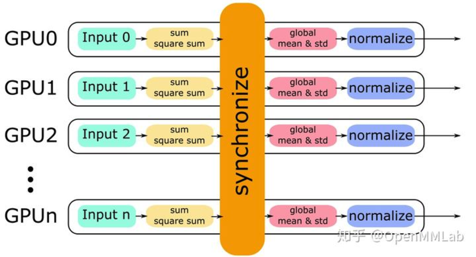

# Contents

1.  [Preface](#org309e32d)
2.  [torch.autograd: Gradient Computation](#orga1164fa)
3.  [BN & SyncBN: BN and Multi-GPU Synchronized BN](#org15a7aa6)
4.  [torch.utils.data: The Full Data-Processing Pipeline](#org3d3b613)
5.  [nn.Module: The Core Network Module Interface](#org0922dff)
6.  [DP & DDP: Model Parallelism and Distributed Training](#org69d7f8e)
7.  [torch.optim: Optimization Algorithm Interface](#org62c086e)
8.  [torch.cuda.amp: Automatic Mixed Precision](#orga911203)
9.  [cpp_extension: The Full Flow of Implementing and Calling C++/CUDA Operators](#orge28e334)


<a id="org309e32d"></a>

# Preface

Main reference: [MMLab source code walkthrough on Zhihu](https://zhuanlan.zhihu.com/p/328674159)


<a id="orga1164fa"></a>

# torch.autograd: Gradient Computation

Gradient computation mainly involves the following modules:

-   `torch.autograd.function` (backpropagation of a function)
    A module such as `nn.Module` in `PyTorch` usually wraps an `autograd function` and uses it as the part that does the real work. For example, `nn.ReLU` actually uses `torch.nn.functional.relu(F.relu)`:
```python
        from torch.nn import functional as F

        class ReLU(Module):
            __constants__ = ['inplace']
            inplace: bool

            def __init__(self, inplace: bool = False):
                super(ReLU, self).__init__()
                self.inplace = inplace

            def forward(self, input: Tensor) -> Tensor:
                # the function wrapped by F.relu is a builtin_function_or_method
                # it defines forward and backward, which describe the forward and backward passes of the gradient
                # usually implemented in C++ (for example ATen)
                return F.relu(input, inplace=self.inplace)
```

    Using the `Function` class defined in `torch.autograd.function` as the base class, you can implement a custom `autograd function`:
```python
        class Exp(Function): # this layer computes e^x

            @staticmethod
            def forward(ctx, i): # forward pass
                result = i.exp()
                ctx.save_for_backward(result) # save what backward needs; the tensors are kept in the saved_tensors tuple. Only tensors can be saved this way. Other types (int and so on) can be stored as attributes of ctx

            @staticmethod
            def backward(ctx, grad_output): # backward pass
                result, = ctx.save_tensors # unpack the result saved in forward
                return grad_output * result


            # example
            x = torch.tensor([1.], requires_grad=True) # requires_grad must be True
            ret = Exp.apply(x) # call the custom autograd Function through apply
            print(ret) # (tensor[2.7183], grad_fn=<ExpBackward>)
            ret.backward() # backpropagate
            print(x.grad) # tensor([2.7183])
```

-   `torch.autograd.functional` (backpropagation over the computation graph)
    The `backward` method of the Tensor class actually calls the `torch.autograd.backward` interface. In PyTorch's implementation, autograd records all the operations that produced a variable and builds a directed acyclic graph (DAG) from them. During backpropagation, autograd traces back along the graph from the current variable (the root node F), and can compute the gradients of all leaf nodes with the chain rule. The following simple implementation runs autograd on the computation graph:
```python
        # this example only covers ops with a single output, and it is slow
        def autograd(grad_fn, gradient):
            auto_grad = {}
            queue = [[grad_fn, gradient]]
            while queue != []:
                item = queue.pop()
                gradients = item[0](item[1])
                functions = [[x[0] for x in item[0].next_functions]]
```

-   `torch.autograd.gradcheck` (numerical gradient checking)
-   `torch.autograd.anomaly_mode` (detects the path that produced an error during automatic differentiation)
-   `torch.autograd.grad_mode` (sets whether gradients are needed)
-   `model.eval and torch.no_grad()`
-   `torch.autograd.profiler` (provides function-level statistics)


<a id="org15a7aa6"></a>

# BN & SyncBN: BN and Multi-GPU Synchronized BN

A brief look at the advantages of BN (batch normalization):

-   Prevents overfitting: combined with mini-batch training, it avoids overfitting to a single sample
-   Speeds up convergence: this is the effect of BN's normalization itself
-   Prevents vanishing/exploding gradients: normalization keeps the input distribution in the non-saturated region of the activation function (in the saturated region the activation output is very small, which easily causes vanishing/exploding gradients)

The BN formula:


BN implementation details:

-   BN turns on `track_running_stats` by default, so every forward pass updates running_mean and running_var using the statistics of the current minibatch. The update is controlled by the momentum parameter (0.1 by default):
    

Since PyTorch 0.4.1, the num_batches_tracked attribute has been added to count how many minibatches BN has run forward on. When momentum is set to None, num_batches_tracked controls the relative weight of the historical statistics and the current minibatch:
  

BN's performance depends heavily on the batch size. The larger the batch size, the more accurate BN's statistics. But when the input data is large, the batch size on a single GPU is usually small. One solution is SyncBN: all GPUs share one BN and obtain global statistics.
PyTorch's SyncBN is implemented in `torch/nn/modules/batchnorm.py` and `torch/nn/modules/_functions.py`. The former mainly checks that the input is valid, passes arguments according to settings such as momentum, and calls the latter. The latter computes the per-GPU statistics and handles communication between processes.
In the implementation, BN on a single GPU computes the mean and variance of that GPU's input and then normalizes; SyncBN instead obtains global statistics, in the following steps:

-   Each GPU computes the sum and square sum of its own input
-   All GPUs are synchronized to obtain and share the global mean & std
-   Each GPU normalizes its own input with the global mean & std
    

For backward, the gradients of `weight` and `bias` are computed, and the gradient of x is computed from `dy` and `dy/du`. The basic steps are:

-   all reduce to compute the sum of the gradients
-   compute the average of the gradients from the total size
-   backward computes the gradients


<a id="org3d3b613"></a>

# torch.utils.data: The Full Data-Processing Pipeline

The core of torch's data module is the iterator. Its key components include:

-   Dataset: wraps the raw data source. There are usually two kinds, map-style datasets and iterable datasets: the former fetches data through `__getitem__`, the latter through `__iter__`. Map-style datasets are used more often; iterable datasets fit cases where random reads are very expensive or even impossible, and the batch size depends on the data fetched. Other Dataset types are also included: ConcatDatasets/ChainDataset/SubSet/TensorDataset, etc.
-   Sampler: provides a way to traverse the indices of all elements in a dataset. It can be customized or provided by PyTorch.
-   DataLoader: the core of PyTorch data loading. It handles the complex loading work, supports both map-style and iterable-style Dataset, supports single-process and multi-process loading, and lets you set the loading order, batch size, pin memory, and other parameters.
-   How the three relate: DataLoader does the overall scheduling, tells the Sampler how to define the traversal indices, and then uses the indices to fetch elements from the Dataset.

Several key points:

-   Batching (True by default): implemented through collate_fn, which mainly arranges the input samples into a batch. It generally does the following three things:
    -   Adds a new batch dimension
    -   Converts Numpy arrays and Python numbers into PyTorch tensors
    -   Preserves the original data structure.
-   Multi-process:
    -   Single process: num_workers is 0, which gives more readable error traces and is useful for debugging.
    -   Multi-process: controlled by num_workers. The dataset, collate_fn, and worker_init_fn are all passed to each worker, and each worker uses its own process. For map-style data, shuffling is done in the main process, and the indices produced by the Sampler are passed to each worker. For iterable-style data, every worker has a copy of the same data and performs different operations in each process, so you need get_worker_info() to help avoid each process emitting duplicate data. In addition, because using CUDA and sharing CUDA tensors across multiple processes can cause problems, it is recommended to use pin_memory=True so data can be transferred quickly to a CUDA-enabled GPU, and it is not recommended to return CUDA tensors when using multiple threads.
-   Memory Pinning:
    -   Page-locked memory: the content of page-locked memory is never swapped with virtual memory (here virtual memory means the disk). Non-page-locked memory puts data into virtual memory when memory runs short. With `pin_memory=True`, transferring a Tensor from memory to GPU memory is faster.
-   Prefetch:
    -   DataLoader prefetches data by specifying `prefetch_factor` (2 by default). It applies to multi-process loading.


<a id="org0922dff"></a>

# nn.Module: The Core Network Module Interface

First, a few key terms in PyTorch: parameter/buffer, quoted from [Zhihu's PyTorch walkthrough](https://zhuanlan.zhihu.com/p/89442276). A parameter is something that needs to be updated by the optimizer during backpropagation; a buffer is something that does not need to be updated by the optimizer during backpropagation.
An overview of how torch's components relate:

Several common characteristics of how torch modules are organized and implemented:

-   The base class defines the interface, and inheritance handles inputs of different dimensions
-   Every class has a corresponding `nn.functional` function; in the forward function, the arguments/parameters are passed to the corresponding `nn.functional` function, which does the forward work.
-   A module that inherits `nn.Module` mainly overrides the `init` / `forward` / `extra_repr` functions, and a module with parameters also implements the `reset_parameters` function to initialize them.

The `nn.Module` implementation:

-   Common interfaces:
    -   `__init__`: initializes a series of important member variables
    -   State switching: `self.training` distinguishes the training and evaluation states
    -   Parameter conversion/transfer: this includes moving between CPU and GPU and converting between types, and it is mainly implemented through `self._apply` (function). `self._apply` has three steps: `self.children()` makes the call recursive; the parameters in `self._parameters` and their gradients are processed through the function; the buffers in `self._buffers` are processed one by one through the function.
-   Adding, deleting, modifying, and looking up attributes:
    -   Attribute modification involves three functions: `add_module` (adds a child neural network module) / `register_parameter` (adds a parameter updated through BP) / `register_buffer` (adds a buffer not updated through BP). The usual way to add or modify an attribute is `self.xxx = xxx`, which in essence calls the `__setattr__` function overridden by `nn.Module`. Note, however, that `self.xxx = torch.Tensor()` is discouraged, because the attribute added this way does not belong to `self._parameters`/`self._buffers` but is treated as an ordinary attribute; during state conversion self.xxx is then missed, causing bugs where the device or type differs.
    -   Attribute deletion: implemented by `__delattr__`, which checks `self._parameters`, `self._buffers`, `self._modules`, and ordinary attributes one by one and removes the name from them.
-   Forward & Backward
    -   Hooks: the nn.Module class implements 3 general hook registration functions, used to register hooks that apply globally. The three functions register into 3 global OrderedDicts: `_global_backward_hooks` / `_global_forward_pre_hooks` / `_global_forward_hooks`. `nn.Module` also supports registering forward/backward hooks that apply to itself: `self._backward_hooks` / `self._forward_pre_hooks` / `self._forward_hooks`. The order in which the hooks are called is as follows:
        
-   Saving and loading modules:
    -   Hooks: `_register_state_dict_hook`: modifies the state_dict exported by the module at the very end of `self.state_dict()`; `_register_load_state_dict_pre_hook`: runs first in `_load_from_state_dict`.
    -   Implementation details:
        -   `state_dict()` can be used to get the model's current state. The version information (`_version`) is stored in the metadata. Data is saved through `_save_to_state_dict()`, and what gets saved includes `self._parameters` and the persistent buffers in `self._buffers`.
        -   The `load_state_dict()` function is used to read a checkpoint. In essence it calls the `_load_from_state_dict` function to load the needed weights. Each submodule can redefine its own `_load_from_state_dict` function to avoid problems such as `BC-breaking` (backward compatibility).


<a id="org69d7f8e"></a>

# DP & DDP: Model Parallelism and Distributed Training

-   DP:
    -   Basic usage: `model=nn.DataParallel` (model).
    -   Principle: DP works on a single machine with multiple GPUs, where device[0] is responsible for gradient aggregation and propagation. It has three core steps: each GPU computes its loss and accuracy; all gradients are aggregated onto device[0]; device[0] updates the parameters, and the other GPUs pull device[0]'s parameters to update theirs. The computation of loss and accuracy on each GPU runs in parallel.
    -   Implementation: in the forward pass, the Scatter function distributes and copies the data from device[0] to the different GPUs, then the Replicate function copies the model from device[0] to the different GPUs, and then each GPU calls forward to compute its loss and gradients. In the backward pass, the gather function collects the gradients onto device[0], and the parameters are updated on device[0].
-   DDP:
    -   Basic usage:

```python
# initialize the backend
torch.distributed.init_process_group(backend='nccl', world_size=ws, init_method='env://')
torch.cuda.set_device(local_rank)
device = torch.device(f'cuda:{local_rank}')
model = nn.Linear(2, 3).to(device)

# one process per GPU, selected by device_id
model = DDP(model, device_ids=[local_rank], output_device=local_rank).to(device)
```
    -   Principle: DDP is also a form of data parallelism, in which every GPU holds the model and its input. It manages gradient synchronization through a Reducer. Gradient synchronization is done by registering autograd hooks at construction; when a gradient has been computed, the corresponding hook notifies DDP to reduce it. When a gradient fills up (corresponding to a single bucket), the Reducer launches an asynchronous allreduce to compute the average across all processes. Throughout this process, DDP can compute and communicate at the same time, which improves efficiency. After the gradients of all buckets have been computed, the Reducer waits for all allreduce operations to finish and then updates with the resulting gradients: it writes them to param.grad.
    -   Implementation: the backend is usually NCCL, though it only supports communication of GPU Tensors. It consists of three main parts:
        -   constructor: broadcasts the state_dict() of rank 0 so that the networks start in the same state; initializes the buckets and controls the reverse order of parameters in the buckets to make bucket communication more efficient; adds a grad_accumulator to each parameter and registers an autograd_hook in the autograd_graph, which is responsible for gradient synchronization during backward
        -   forward: includes the normal forward operation and a check for unused_parameters: at the end of forward, DDP traverses the autograd graph to find parameters that were not used and marks them as ready. This is expensive, but it is necessary with dynamic graphs, because a dynamic graph may change.
        -   autograd_hook: hooked into the autograd graph, responsible for gradient synchronization during backward.
```

<a id="org62c086e"></a>

# torch.optim: Optimization Algorithm Interface

Basic concepts:

-   Components:
    Optimizer: the update strategy for the model's learnable parameters during training.
    Learning rate: lr
-   Call sequence: `optimizer.zero_grad()` clears the gradients -> `loss.backward()` backpropagates -> `optimizer.step()` updates the model parameters.

A simple example:
```python
    import torch
    import numpy as np
    import warnings
    warnings.filterwarnings('ignore') # ignore warnings

    x = torch.linspace(-np.pi, np.pi, 2000)
    y = torch.sin(x)

    p = torch.tensor([1, 2, 3])
    xx = x.unsqueeze(-1).pow(p)

    model = torch.nn.Sequential(
        torch.nn.Linear(3, 1),
        torch.nn.Flatten(0, 1)
    )
    loss_fn = torch.nn.MSELoss(reduction='sum')

    learning_rate = 1e-3
    optimizer = torch.optim.RMSprop(model.parameters(), lr=learning_rate)
    for t in range(1, 1001):
        y_pred = model(xx)
        loss = loss_fn(y_pred, y)
        if t % 100 == 0:
            print('No.{: 5d}, loss: {:.6f}'.format(t, loss.item()))
            optimizer.zero_grad() # zero the gradients
            loss.backward() # backpropagate to compute gradients
            optimizer.step() # update parameters by gradient descent
            No.  100, loss: 26215.714844
            No.  200, loss: 11672.815430
            No.  300, loss: 4627.826172
            No.  400, loss: 1609.388062
            No.  500, loss: 677.805115
            No.  600, loss: 473.932159
            No.  700, loss: 384.862396
            No.  800, loss: 305.365143
            No.  900, loss: 229.774719
            No. 1000, loss: 161.483841
```

Implementation details:

-   optimizer:
    -   Supported optimizers: SGD/ASGD/Adadelta/Adagrad/Adam/AdamW/Adamax/SparseAdam/RMSprop/Rprop/LBFGS
    -   Base class Optimizer: its common methods include add_param_group/step/zero_grad/state_dict/load_state_dict. The step method is implemented by the subclass (the specific optimizer class).
-   lr_scheduler:
    -   Supported lr_schedulers: StepLR/MultiStepLR/ExponentialLR/ReduceLROnPlateau/CyclicLR/OneCycleLR/CosineAnnealingLR/CosineAnnealingWarmRestarts/LambdaLR/MultiplicativeLR
    -   Base class _LRScheduler: its common methods include step/get_lr/get_last_lr/print_lr/state_dict/load_state_dict. get_lr must be implemented by the subclass, and state_dict and load_state_dict may be overridden by subclasses. The step function is the core method, and its logic is: increment last_epoch, call the subclass's get_lr method to get the learning rate for that epoch, update it into the optimizer's param_groups attribute, and finally record the last adjusted learning rate in `self._last_lr`.


<a id="orga911203"></a>

# torch.cuda.amp: Automatic Mixed Precision

Automatic mixed precision training: when training an FP32 model, some operators run in FP16 and the rest run in FP32, and amp decides automatically which operators use FP16 and which use FP32. The advantage is that, without changing the model and without lowering the model's training accuracy, it can **shorten training time and reduce storage requirements**. It can therefore support training with larger batch sizes, larger models, and larger inputs.

1.  The mixed precision training mechanism
    -   The amp mechanism has two core functions: automatically choosing the appropriate numeric precision, and providing a gradient scaling operation to deal with numeric overflow of FP16 gradients.
    -   autocast is used as a Python context manager and decorator to specify a region of a script, or certain functions, that should run with automatic mixed precision. The process is as follows (during training the model is copied to an FP16 model, FP16 operators work on FP16 data, the inputs and outputs of FP32 operators are still FP6, but their computation precision is FP32; backpropagation under mixed precision then yields FP16 gradients, and finally the FP16 gradients and the FP32 parameters are used to update the parameters):
        
    -   Scaling: the representable range of FP16 is narrow, so a large number of non-zero gradients run into overflow. The solution is to multiply the gradients by a factor of 2<sup>N factor</sup>, called the scale factor, to shift the gradients into the representable range of FP16. This is implemented by GradScaler, which multiplies the loss by the scale factor before backpropagation and then unscales before the gradient update. The final amp training flow can be summarized as:

        -   Maintain a copy of the model in FP32 precision
        -   In each iteration
            -   Copy and convert it to an FP16 model
            -   Forward pass (FP16 model)
            -   Multiply the loss by the scale factor s
            -   Backward pass (FP16 model parameters and parameter gradients)
            -   Multiply the parameter gradients by 1/s (unscaling)
            -   Use the FP16 gradients to update the FP32 model parameters

        Dynamic strategy for choosing the scale factor: it changes dynamically according to the loss. GradScaler multiplies the scale factor by a coefficient greater than 1 every N iterations and then scales the loss; before each update it also checks for overflow (inf/nan). If there is any, it multiplies the scale factor by a coefficient less than 1 and skips the parameter update for that iteration; if there is none, it updates the parameters normally. The training flow is as follows:

        -   Maintain a copy of the model in FP32 precision
        -   Initialize s
        -   In each iteration
            1.  Copy and convert it to an FP16 model
            2.  Forward pass (FP16 model parameters)
            3.  Multiply the loss by the scale factor s
            4.  Backward pass (FP16 model parameters and parameter gradients)
            5.  Check whether any parameter gradients contain inf/nan
                -   Yes: reduce s and go back to step 1
                -   No: continue to step 6
            6.  Multiply the parameter gradients by 1/s
            7.  Use the gradients to update the FP32 model parameters
2.  Implementation details
    -   API usage; the basic operations are as follows:
```python
            # amp depends on Tensor Cores, so model parameters must be CUDA tensors
            model = Net().cuda()
            optimizer = optim.SGD(model.parameters(), ...)
            # GradScaler scales gradients automatically
            scaler = GradScaler()

            for epoch in epochs:
                for input, target in data:
                    optimizer.zero_grad()
                    # run forward inside the autocast region
                    with autocast():
                        # the model runs forward on an FP16 copy
                        output = model(input)
                        loss = loss_fn(output, target)
                    # scaler scales the FP16 loss; backward produces scaled FP16 gradients
                    scaler.scale(loss).backward()
                    # scaler.step unscales the gradients before updating parameters
                    # if there is a nan or inf, the step is skipped
                    scaler.step(optimizer)
                    # update the scale factor
                    scaler.update()
```

3.  The autocast class: used as a context manager and decorator, it automatically arranges for operators to run in FP16 or FP32. There are three categories of autocast operators: FP16, FP32, and operators that run in the wider of FP16 and FP32. An FP16 variable **computed** inside an autocast-enabled region must be explicitly converted to FP32 inside that region. In addition, when autocast is used as a decorator (usually for data parallel models), it is designed to be "thread local", so setting an autocast region on the main thread does not work. The correct way is to decorate forward:
```python
        class MyModel(nn.Module):
            ...
            @autocast()
            def forward(self, input):
                ...
```

    Or set the autocast region inside the forward function:
```python
        class MyModel(nn.Module):
            ...
            def forward(self, input):
                with autocast():
                    ...
```

    For a user-defined autograd function, you need to decorate forward with `amp.custom_fwd` and backward with `amp.custom_bwd`.

4.  The GradScaler class: its key methods include scale(output)/step/update:
    -   scale: multiplies the outputs by the scale factor and returns them; if enable=False, it returns them unchanged.

    -   step: unscales the gradients, if the unscale method was not called manually beforehand; checks for gradient overflow, and if there is no nan/inf it runs the optimizer's step, otherwise it skips it.

    -   update: called at the end of each iteration. If the parameters were updated it does nothing; otherwise it multiplies the scale factor by backoff_factor. When it is time to grow, it multiplies the scale factor by growth_factor, or it updates the scale factor directly with new_scale. A simple usage example:
```python
            # Gradient clipping
            scaler = GradScaler()

            for epoch in epochs:
                for input, target in data:
                    optimizer.zero_grad()
                    with autocast():
                        output = model(input)
                        loss = loss_fn(output, target)

                    scaler.scale(loss).backward()

                    # unscale the gradients so clipping uses the real threshold
                    scaler.unscale_(optimizer)

                    # clip gradients
                    torch.nn.utils.clip_grad_norm_(model.parameters(), max_norm)

                    # unscale_() was already called, so step updates normally and skips the update on nan/inf
                    scaler.step(optimizer)
                    scaler.update()
```

<a id="orge28e334"></a>

# cpp_extension: The Full Flow of Implementing and Calling C++/CUDA Operators

PyTorch's C++/CUDA extensions can speed up functional modules. Below, the implementation of nms (non-maximum suppression, NMS) is used to explain how a C++/CUDA operator is called.
An example of calling nms is as follows:
```python
    from mmcv import _ext as ext_module
    from torch.autograd import Function

    def nms(boxes, scores, iou_threshold, offset=0):
        inds = NMSop.apply(boxes, scores, iou_threshold, offset)
        dets = torch.cat((boxes[inds], scores[inds].reshape(-1, 1)), dim=1)
        return dets, inds

    class NMSop(torch.autograd.Function):
        @staticmethod
        def forward(ctx, bboxes, scores, iou_threshold, offset):
            inds = ext_module.nms(
                bboxes, scores, iou_threshold=float(iou_threshold), offset=offset)
            return inds

        @staticmethod
        def symbolic(g, bboxes, scores, iou_threshold, offset):
            pass # ONNX export
```

The core part of NMSop calls `mmcv._ext.nms`, which lives in the `mmcv/_ext.cpython-xxx.so` file and is built with `MMCV_WITH_OPS=True python setup.py build_ext --inplace`.
The entry point of setup.py is the `setup` function. One of its main arguments is `ext_modules`, which is obtained from the `get_extensions` function. Depending on the environment, C++ or CUDA, that function calls different extensions: CppExtension/CUDAExtension. The two extension functions add the libraries and header files in the system directories to the default compile search path, fill in other build information, and finally generate the gcc/nvcc commands:
```python
    setup(
        name='mmcv',
        install_requires=install_requires,
        # C++/CUDA extensions to compile
        ext_modules=get_extensions(),
        # cmdclass sets the behavior of python setup.py build_ext
        cmdclass={'build_ext': torch.utils.cpp_extension.BuildExtension}
    )
```

After the build, the C++/CUDA binary has to be connected to Python, which is mainly done with the pybind11 library, a library for creating Python bindings from C++ code. The core code in pybind.cpp is as follows:

```c++
    #include <torch/extension.h>
    // declaration; the implementation is in another file
    Tensor nms(Tensor boxes, Tensor scores, float iou_threshold, int offset);

    // TORCH_EXTENSION_NAME is passed as _ext on the compile command, declaring a Python module named _ext
    // nms is a function of the _ext module
    PYBIND11_MODEL(TORCH_EXTENSION_NAME, m) {
        m.def("nms", &nms, "nms (CPU/CUDA)", py::arg("boxes"), py::arg("scores"),
              py::arg("iou_threshold"), py::arg("offset"));
    }
```

Next comes the actual C++/CUDA operator implementation. The following example is the C++ implementation:

```c++
    #include <torch/extension.h>
    using namespace at; // ATen (A Tensor Library) declares and defines tensor operations for the C++ extension
    Tensor nms_cpu(Tensor boxes, Tensor scores, float iou_threshold, int offset) {
        // only the core of the implementation is shown
        for （int64_t _i = 0; _i < nboxes, _i++） {
                // iterate over boxes; each one is the primary box
                if (select[_i] == false) continue;
                for (int64_t _j = _i + 1; _j < nboxes; _j++) {
                    // for each primary box, iterate over the other boxes
                    // the upper triangle is enough, which saves work
                    if (select[_j] == false) continue;
                    auto ovr = inter / (iarea + area[j] - inter);
                    // if the secondary box overlaps the primary box too much, drop the secondary box
                    if (ovr >= iou_threshold) select[_j] = false;
                }
            }
        return order_t.masked_select(select_t);
    }
```
