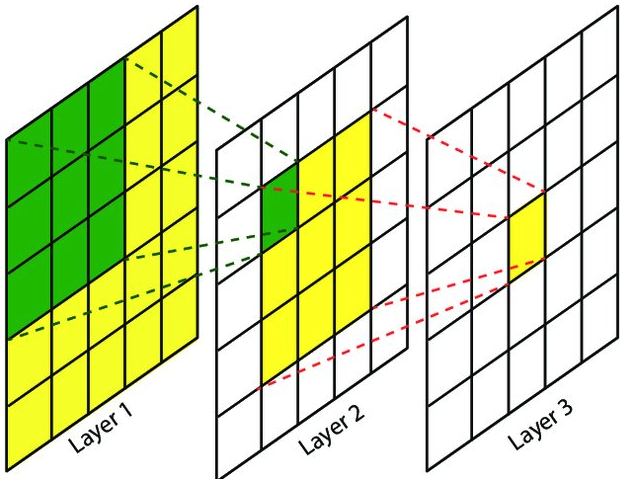

- [Preface](#sec-1)
- [Convolutional Layers](#sec-2)
  - [Standard Convolution](#sec-2-1)
  - [Separable Convolution](#sec-3)
  - [Transposed Convolution (Deconvolution)](#sec-2-3)
  - [Dilated Convolution](#sec-2-4)
  - [Deformable Convolution](#sec-2-5)
- [Activation Functions](#sec-3)
  - [sigmoid](#sec-3-1)
  - [tanh](#sec-3-2)
  - [ReLU and Its Variants](#sec-3-3)
  - [swish](#sec-3-4)
- [Pooling Layers](#sec-4)
- [`BN` Layer](#sec-5)
  - [`GN` Layer](#sec-5-1)
  - [`FRN` Layer](#sec-5-2)
- [Dropout Layer](#sec-6)
- [Fully Connected Layers](#sec-7)
- [Receptive Field Calculation](#sec-8)

# Preface

Deep learning has made striking progress in every area of CV (Computer Vision), which has produced a wide variety of network architectures. Yet even the most complex architectures are still assembled from a small set of basic components, and customized structures can be regarded as variants of those basic structures. The following briefly introduces several basic deep learning structures used in CV:

-   Convolutional layers
-   Activation functions
-   Pooling layers
-   `BN` layer
-   Dropout layer
-   Fully connected layers

# Convolutional Layers

A convolution operation is similar to a filtering operation: the original image can be convolved to extract image features (such as canny edge features). Different convolution kernels extract different features. The core of CV is to extract features layer by layer with learnable convolution kernels, and then perform the specific task on the high-level features.

## Standard Convolution

A convolutional layer usually means a 2D convolutional layer. Others include 1D convolutional layers (usually used for data such as single-dimension time series) and 3D convolution (often used for video processing and 3D data processing; 3D convolution usually has a large amount of computation and is time-consuming). Diagram of 2D convolution: 

Diagram of 3D convolution: 

`padding` modes: when performing a convolution, padding is usually applied. There are two common padding modes:

-   `valid`:  no padding is applied, and the rightmost columns (bottom rows) are discarded

    Output shape of the `valid` mode:

    $$
    W_{out} = ceil(\frac{W_{in} - K_w + 1}{S_w})
    $$

    $$
    H_{out} = ceil(\frac{H_{in} - K_h + 1}{S_h})
    $$

- `same`: padding is applied as evenly as possible on the top, bottom, left, and right. If the number of columns/rows to add is odd, the `same` mode puts the extra column on the right/bottom. The number of rows/columns to add is computed so that the output shape stays consistent with the input shape

  $$
  W_{out} = ceil(\frac{W_{in}}{S_w})
  $$

  $$
  H_{out} = ceil(\frac{H_{in}}{S_h})
  $$

## Separable Convolution

Separable convolution was first proposed in [mobilenet ](https://arxiv.org/abs/1704.04861). Its core idea is to split a standard convolution into two parts: a depthwise convolution and a 1X1 pointwise convolution.

Suppose the input `featuremap` of the convolution has size $D_F\*D_F$, the output feature map has size $D_F\*D_F\*N$, and the convolution kernel is $D_K$. For a standard convolution, the number of parameters is $D_K\*D_K\*N\*M$ and the amount of computation is $D_K\*D_K\*M\*N\*D_F\*D_F$.

Depthwise convolution first applies a separate $D_K\*D_K\*1$ convolution to each `channel` of the input features, then concatenates the results into a $D_F\*D_F\*M$ feature map, and then uses N kernels of $1\*1\*M$ to obtain the final $D_F\*D_F\*N$ output feature map. Its number of parameters is $D_K\*D_K\*M+N\*1\*1\*M$ and its amount of computation is $D_K\*D_K\*M\*D_F\*D_F+1\*1\*M\*D_F\*D_F\*N$. The ratio of parameters and computation before and after is $1/N+1/(D_K\*D_K)$. With a kernel size of 3, the ratio is close to 1/9.

Diagram of depthwise convolution:

In addition, `Depthwise Convolution` can in fact be regarded as a special case of `Group Convolution`.

`Group Convolution` divides the input `feature map` into G groups and convolves each group (suppose the total number of output channels is C; then the output of each group has C/G channels):

Suppose the number of feature maps is N and their size is $H\*W$. Then the kernel size is $C/G\*K\*K$, and the total number of kernel parameters is $\frac{N\*C}{G\*K\*K}$ (which is $\frac{1}{G}$ of the parameters of the original convolution). When $G=N=C$, `Group Convolution` is equivalent to `Depthwise Convolution`.

## Transposed Convolution (Deconvolution)

The role of transposed convolution (deconvolution) is to go from a low-resolution (small) feature map to a high-resolution (large) one. There are generally two ways to upsample:

-   Direct resize
-   Transposed convolution

A transposed convolution can be regarded as the reverse operation of a convolution, i.e. a convolution with stride 1. The general steps are:

-   Pad the input
-   Perform a convolution

Example of a normal convolution:

For a transposed convolution with a stride other than 1, zeros need to be inserted between the feature map elements:

## Dilated Convolution

Dilated convolution can enlarge the receptive field of a kernel without changing the number of parameters, and can be used to capture multi-scale information. There are generally two ways to implement dilated convolution:

-   Pad the kernel with zeros
-   Sample the input at equal intervals

The number of gaps between the kernel elements of a dilated convolution is called the **dilation rate** (**diation rate**).

## Deformable Convolution

Deformable convolution paper: [Deformable Convolutional Networks](https://arxiv.org/abs/1703.06211). The core idea of deformable convolution is:

On top of the standard convolution, add a branch that learns position offset weights for the kernel, so as to obtain a kernel of irregular shape. Deformable convolution works well for extracting features of irregularly shaped targets. Example of deformable convolution:

# Activation Functions

If a complex network consisted only of linear units such as convolutional layers, its output would always be linearly related to its input.

Activation functions are designed to turn the linear relationship into a nonlinear one, so that arbitrary functions can be fitted. Various activation functions can be found at: [wiki_activication](https://link.zhihu.com/?target=https%253A//en.wikipedia.org/wiki/Activation_function)

## sigmoid

sigmoid was the most widely used activation function in the early days. Its output range is (0,1), and the formula of the activation function is:

Diagram of the activation function's mapping:

The drawback of the sigmoid function is that when the value of Z is very large or very small, the derivative tends to zero, i.e. the gradient of the weights tends to 0. This is the \\*vanishing gradient\\* phenomenon.

## tanh

The tanh function is similar to the sigmoid function. It maps the values in (−∞,+∞) to (-1,1). The formula of the tanh function is:

Diagram of the activation function's mapping:

## ReLU and Its Variants

ReLU, also known as the Rectified Linear Unit, is a nonlinear function that alleviates, to some extent, the vanishing gradient problem of functions such as sigmoid. The formula of ReLU is as follows:

Diagram of ReLU:

The advantage of ReLU is that there is no vanishing gradient when the input is positive, and it runs fast (it is linear). But when the input is negative, the gradient vanishes. There are many variants of ReLU, such as Leaky ReLU and Parameteric ReLU, which solve the vanishing gradient problem of ReLU for negative inputs. The Leaky ReLU formula:

Diagram of Leaky ReLU:

## swish

swish is an activation function found by NAS search. It can be regarded as a smooth function between the linear function and the ReLU function, and performs better than ReLU. The swish function formula is as follows: the swish function has no upper bound but has a lower bound, and is smooth and non-monotonic.

# Pooling Layers

The role of a pooling layer is to reduce the size of the feature map, which reduces the number of parameters in later parts of the network and also prevents overfitting. It can also be seen as a downsampling operation. Pooling layers generally come in two kinds: average pooling (avg pooling) and maximum pooling (max pooling). avg pooling takes the average value of the feature map region, while max pooling takes the maximum value. Diagram of avg pooling:

Diagram of max pooling:

# `BN` Layer

``BN`` stands for `Batch Normalization` and was proposed in 2015: [batch normalization: accelerating deep network traning by reducing internal covariate shift](https://arxiv.org/abs/1502.03167).

The background of ``BN`` is that, for deep learning, the search for the optimal solution is smoother and converges more easily on normalized data. However, if normalization is applied only at the input of the data.

During network training, as the parameters are updated, the data distribution of every layer changes. For adjacent layers, the phenomenon where the data distribution of an earlier layer causes the data distribution of a later layer to change is called "\*\*internal covariate shift\*\*".

This phenomenon makes the data distribution of each layer prone to falling into the saturation region during training, which slows down the convergence of the network. ``BN`` is designed precisely to solve the convergence problem caused by the data distribution of each layer.

The idea of the ``BN`` layer is to normalize the input data of every layer. Compared with the most basic normalization, the ``BN`` layer adds a transform and reconstruction step: it introduces learnable parameters, mainly to apply a scale (`scale`) transform and a shift (`shift`) transform to the normalized values. The key function is as follows:

During training, the data mean and variance are both computed from each batch, and the scale and shift are also learned per batch. During infer, the parameters of `BN` are fixed: the data mean and standard deviation are the mean and standard deviation over all mini batches seen in training (where the standard deviation uses the unbiased estimate):

The `BN` layer has three advantages:

-   Alleviates vanishing gradients: the `BN` layer keeps the data distribution out of the saturation region and decouples the layers, which speeds up network convergence
-   Simplifies tuning: the `BN` layer makes network training less sensitive to parameters, so tuning is easier and a larger learning rate can be used, which accelerates convergence
-   Prevents overfitting: because the data mean and variance during training are generated from each batch, this is equivalent to adding some random noise, which can partly replace dropout and l2 regularization

Drawbacks of the `BN` layer:

-   The performance of the `BN` layer depends on the batch size. A larger batch size is generally slightly better than a small one, but a large batch size usually needs a lot of GPU memory. For example, faster r-cnn can usually only use a batch size of 1/2.
-   Because the mean/variance of the training data is used at test time, the model depends strongly on the training data when it is tested

## `GN` Layer

The `GN` layer comes from a 2018 paper by Facebook: [group normalization](https://arxiv.org/abs/1803.08494).

The core idea is to split the n channels of the features into g groups and compute the mean and variance within each group to normalize the samples. The principle is that the features expressed by different channels are not unrelated, and several groups of features often have the same distribution, so normalizing within a group is reasonable. The different normalization methods are as follows:

When the batch size becomes small, `GN` stays fairly stable and performs much better than `BN`.

## `FRN` Layer

Although the `GN` layer performs better when the batch size becomes small, at a normal batch size its accuracy is not as good as `BN`. Next, Google proposed [`FRN`](https://arxiv.org/abs/1911.09737) in 2019.

`FRN` has two parts: `FRN` + `tlu`. `FRN` performs the data normalize operation. Suppose the input shape is `(b,c,h,w)`, which are the batch size, number of channels, and height and width of the feature map.

The normalize operation of `FRN` no longer uses the mean/variance. Instead it computes the mean of squares over the $h\*w$ feature values: `v^2`, and then normalizes as follows:

The problem with the above normalize is that the mean is not subtracted, so the normalized feature values are not zero-symmetric. If `relu` is used as the activation function, this causes errors (for example, many zero values), so relu needs to be modified by introducing a learnable threshold `tau`:

In detail, because the `FRN` layer has no mean centering, it is fairly sensitive to the choice of learning rate. The author suggests adjusting it with `warm-up` (see: [csdn-blog](https://blog.csdn.net/sinat_36618660/article/details/99650804)).

# Dropout Layer

The principle of `Dropout` is: during forward propagation, the activation of a neuron stops working with a certain probability p, which makes the model generalize better. At prediction time, the weights of every neuron are multiplied by the probability p. The effect of `Dropout` is as follows:

The roles of the `Dropout` layer are:

-   Averaging over multiple models: similar to a majority-vote strategy
-   Reducing complex co-adaptation between neurons

# Fully Connected Layers

In object detection algorithms, the role of the convolutional network is to extract image features from local to global, while the fully connected layer maps the high-dimensional features obtained by convolution to the label space of a specific dimension, in order to compute the loss or output the prediction.

The problem with fully connected layers is that they have too many parameters and easily overfit. Later, many scenarios also use a global pooling layer (`GAP`, `Global Average Pooling`) to replace the fully connected layer. The advantages of `GAP` are: it reduces the number of network parameters and the degree of overfitting, removes the restriction on the network input size, and gives each featuremap some semantics. The difference between a fully connected layer and `GAP` is as follows:

# Receptive Field Calculation

Reference calculator: [fomoro ai](https://fomoro.com/research/article/receptive-field-calculator)

Receptive field (`receptive field`):

Formula: where $R_n$ is the receptive field of layer n, $f_(n-1)$ is the kernel size of layer n, and $s_i$ is the stride of layer $i$
