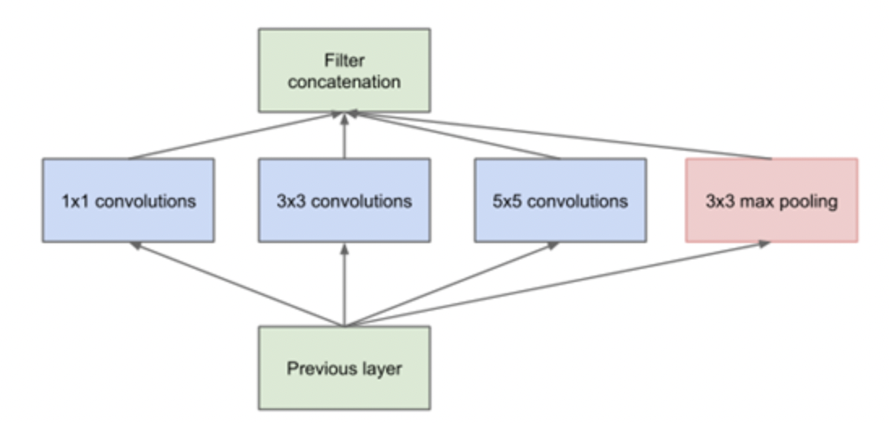
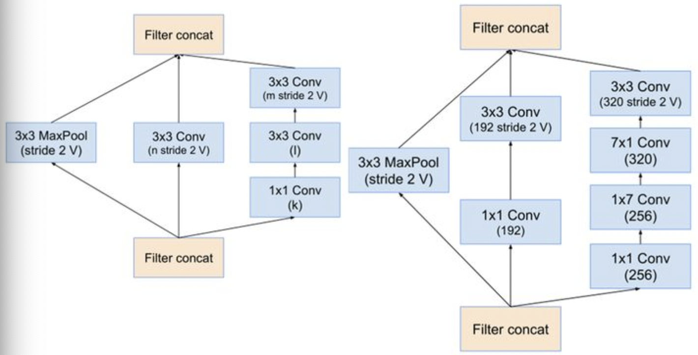

- [Preface](#sec-1)
- [VGG-Net](#sec-2)
- [Inception](#sec-3)
    - [Inception V1](#sec-3-0-1)
    - [Inception V2 && V3](#sec-3-0-2)
    - [Inception V4](#sec-3-0-3)
    - [Inception ResNet V2](#sec-3-0-4)
- [ResNet](#sec-4)
- [DetNet](#sec-5)

# Preface

A brief introduction to the backbone networks commonly used in 2D-detection scenarios:

-   VGG-Net
-   Inception
-   ResNet
-   FPN
-   DetNet

# VGG-Net

The VGG network was proposed by the `Visual Geometry Group` at Oxford. Its value lies in exploring the relationship between convolutional network depth and performance: it achieved good results with smaller convolution kernels and a deeper network. It can be regarded as a fairly important network in terms of convolutional structure, and it is still widely used in scenarios that require a flexible, fast network.

 VGG-Net uses 3X3 convolution kernels almost everywhere. Compared with a 5X5 kernel, a stack of 3X3 kernels has the same receptive field with fewer parameters, and the fitting ability of combined 3X3 kernels is stronger than that of a single 5X5 kernel. The structure of the VGG network is as follows:

The drawback of the VGG structure is that it has a very large number of parameters (mainly in the fully connected layers), and as the network gets deeper, VGG-like structures gradually hit a training bottleneck.

# Inception

The Inception series includes Inception V1, Inception V2, Inception V3, Inception V4, Inception-ResNet-V2, and so on.

### Inception V1

Inception V1 was proposed in the same year as VGG. Whereas VGG deepens the network, Inception V1 widens it: convolution kernels are merged (`Bottleneck Layer`):

The core of the structure above is that a single block uses convolution kernels of different scales and merges features at different degrees of sparsity, which improves the network's adaptability to scale/receptive field. However, this structure still has a large amount of computation. It can be optimized further by using 1X1 convolution kernels for dimensionality reduction, which reduces the number of parameters. The block structure finally adopted is as follows:

### Inception V2 && V3

Inception V2 improves on the Inception V1 structure as follows:

-   Uses BN
-   Replaces a 5X5 convolution with two 3X3 convolutions
-   Introduces asymmetric 1\*n and n\*1 convolutions to replace the symmetric n\*n convolution

The final structure of Inception V2 is as follows:

Inception V3 changes little relative to V2. The main improvement is a parallel dimensionality-reduction structure:

In addition, Inception V3 also uses the RMSProp optimizer and label smoothing.

### Inception V4

The main improvement of Inception V4 is to replace the sequentially connected convolution and pooling at the front with a stem module. The structure of the stem module is as follows:

After the stem structure come the inception structure and the reduction structure:

The final Inception V4 structure:

### Inception ResNet V2

Inception-resnet has two versions, V1 and V2. V2 performs better and is more complex, so only V2 is discussed. Its key design is the introduction of the residual structure:

The reduction-resnet module is similar to the Inception V4 module:

The resulting Inceotion-renset V2 module is as follows:

# ResNet

VGG and Inception above use deeper/wider networks, but as the network gets deeper/wider, training becomes harder and harder. On the one hand, "vanishing gradients" occur; on the other hand, the gradients returned by deeper networks are less correlated.

[Resnet](http://cn.arxiv.org/pdf/1512.03385.pdf) solves this problem fairly well. Its idea is to introduce a residual structure. The concrete structures are as follows (the left side is the residual structure for shallow models, and the right side is the residual structure for deep models):

Its core has three parts:

-   Bottom-up: the forward infer pass of the network, which does not include feature fusion between upper and lower layers
-   Top-down and lateral connections: fuse features between upper and lower layers. High-level features are upsampled 2x and then fused with shallow features (the shallow features first go through a 1X1 convolution kernel so that the numbers of channels match). The fusion is element-wise addition, and the fused feature map then goes through a 3X3 convolution to remove the aliasing effect of upsampling.
-   Intermediate layers: before fusion, features first pass through a 1X1 convolution kernel for linking, in order to reduce the number of feature maps

# DetNet

Most earlier backbones were designed for classification tasks, and applying them directly to feature extraction for detection tasks causes some problems:

-   Pretrain problem: the pretraining of a backbone is usually based on classification datasets such as ImageNet. But when it is applied to detection tasks, the backbone usually has other designs. For example, FPN and RetinaNet add extra steps to optimize detection at different scales, but these extra parts have not been pretrained
-   Weak visibility of large objects: in a detection network, large objects are usually detected in later stages on smaller feature maps, because later feature maps usually have larger receptive fields. However, because the stride of deeper feature maps is too large, the edges of objects become too blurry, and accurate regression in detection becomes harder.
-   Invisibility of small objects: as the number of layers grows and the spatial resolution drops, the information of small objects is progressively weakened. FPN improves performance on small objects to some extent, but the shallow information is still not rich enough, so performance hits a bottleneck.

To address these problems, DetNet makes a series of improvements (based on ResNet50), mainly in the following aspects:

-   The original stage5 uses a specially designed bottleneck structure, and its input size is kept the same as stage4. A 3X3 convolution with a dilation of 2 replaces the convolution with stride 2, so that it still has a large receptive field while keeping the feature map size unchanged
-   Stage6 is introduced to extract higher-level features for object detection
-   The FPN structure is kept. Because the feature maps of stage4 to stage6 have the same size, the information loss and computation of upsampling are avoided, which also benefits small object detection

The bottleneck structure after adopting dilated convolution is as follows:

The overall structure of DetNet is as follows:

