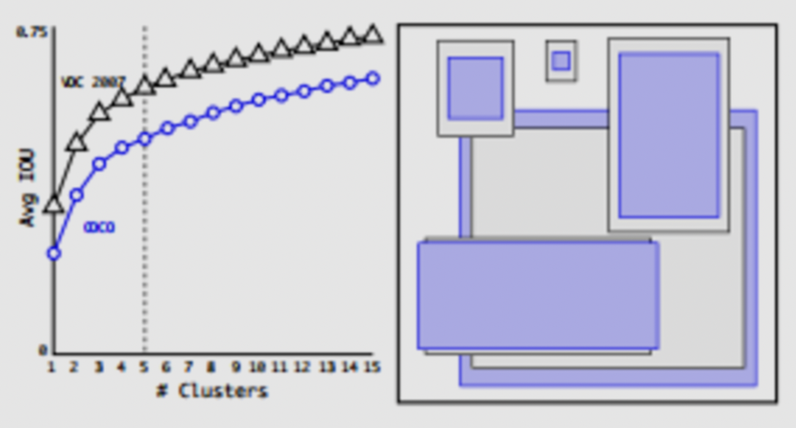
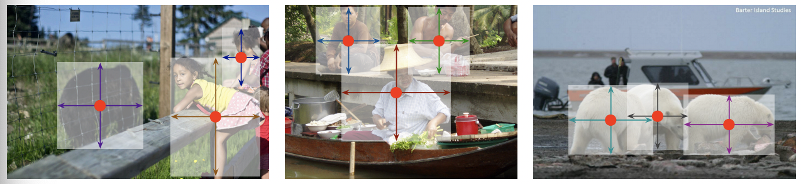
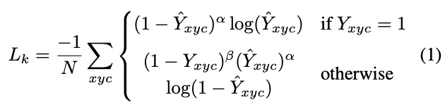
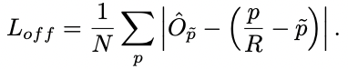

- [Preface](#sec-1)
- [Two-Stage Algorithms](#sec-2)
  - [The RCNN Series](#sec-2-1)
    - [Faster-RCNN Overview](#sec-2-1-1)
    - [Algorithms Improving on Faster-RCNN](#sec-2-1-2)
- [One-Stage Algorithms](#sec-3)
  - [SSD](#sec-3-1)
  - [YOLO](#sec-3-2)
    - [YOLO V1](#sec-3-2-1)
    - [YOLO V2](#sec-3-2-2)
    - [YOLO V3](#sec-3-2-3)
    - [YOLO V4 && YOLO V5](#sec-3-2-4)
- [Anchor-Free Algorithms](#sec-4)
  - [FCOS](#sec-4-1)
  - [CenterNet](#sec-4-2)

# Preface

This article briefly describes the classic algorithm frameworks among 2D detection algorithms. Many papers and frameworks have appeared in this field in the past, and it is impossible to track them all. But most new algorithms are still derived from and extend the classic frameworks. In terms of algorithm flow, current object detection frameworks fall mainly into two camps: One Stage and Two Stage. The representative One Stage algorithms are YOLO and SSD; Two Stage is dominated by the RCNN series. Performance results of the mainstream detection algorithms implemented by Google with Tensorflow: 

Effect of the backbone on performance: 

Effect of object size: 

Overall, Faster-RCNN has the highest accuracy, and the gain from a better backbone is also larger. The fastest combination is SSD+MobileNet, but SSD performs poorly at detecting small objects. Some frameworks based on `Anchor Free` were proposed later, and they are also briefly introduced here.

# Two-Stage Algorithms

## The RCNN Series

The RCNN series evolved from RCNN to Fast RCNN to Faster RCNN. The final Faster RCNN can be regarded as the culmination of Two Stage, so only the algorithm design of Faster RCNN is introduced here.

### Faster-RCNN Overview

In terms of functional modules, Faster-RCNN can be divided into 4 parts:

-   Feature extraction network (backbone): the input image goes through the backbone to obtain a feature map.
-   RPN module: the region proposal generation module. Its role is to generate good proposal boxes, using the strong prior of the anchor. The RPN contains 5 submodules:
    -   Anchor generation: the RPN generates 9 anchors for every point on the feature map. The 9 anchors differ in width and height, and can cover almost all object sizes in the original image. The job of the RPN is to select better proposal positions from them.
    -   RPN convolutional network: the 9 anchors at a single point on the feature map pass through a convolutional network to obtain a predicted score and an offset for each anchor
    -   Computing the RPN loss: label assignment for anchors in the RPN stage has only positive and negative samples. The RPN loss for the prediction of each anchor has two parts: the classification loss for positive/negative samples and the loss for the predicted offset. In computing the loss, the RPN by default randomly selects 256 anchors, with no more than 128 positive samples; if there are more than 128, 128 are chosen at random.
    -   Generating proposals: use the anchor scores and offsets obtained in the preceding steps to get a good set of proposals
    -   Selecting proposals to get the final RoIs: during training, the number of proposals is still too large (after NMS deduplication and sorting by score, 2000 by default), so the proposals need to be filtered further to get the RoIs used to compute the loss (256 by default). During infer, this module is not needed, and the proposals are used directly as RoIs (300 by default). The selection process in training is similar to computing the RPN loss. The criteria for positive and negative samples: if the maximum IoU is greater than 0.5, the sample is positive; if the maximum IoU is greater than 0 and less than 0.5, it is negative. The total number of positive and negative samples is 256, with positives to negatives controlled at 1:3, i.e. 64 positive samples and 192 negative samples.
-   RoI Pooling: the role of RoI Pooling is to convert RoI regions of different sizes into fixed-size feature inputs. It was first used in SPPNet; in Fast RCNN the pooling process was simplified with a nearest-neighbor interpolation algorithm; and in the later Mask RCNN, RoI Align improved the accuracy of the algorithm. Compared with RoI Pooling, RoI Align no longer rounds: the resulting RoI region has floating-point boundaries, i.e. the region does not match the feature map grid. For regions that do not match, the maximum of the four point values of each bin is taken as the feature value of that bin. The feature values of the four points are obtained by interpolating the surrounding feature map values: 

-   RCNN module: after RoI Pooling (RoI Align), fixed-size features are obtained, and then classification and regression predictions can be computed through fully connected networks. The RCNN loss is computed similarly to the RPN loss, except that the classification loss is the loss over the GT label, rather than the simple positive/negative sample loss.

The algorithm framework of Faster-RCNN is shown below: 

### Algorithms Improving on Faster-RCNN

Faster-RCNN, as a Two-Stage network, has fairly good performance. But it still has some drawbacks:

-   The RCNN module uses fully connected networks, i.e. all RoIs go through the fully connected layers, which makes the computation heavy and the network slow
-   Post-processing strategy: NMS post-processing is unfriendly to crowded/occluded scenes and easily causes missed detections
-   Selection of positive and negative samples: the current positive/negative sample ratio is a hyperparameter of 1:3, but whether this parameter is universal for other scenarios still needs discussion

1.  R-FCN

    Faster RCNN uses two fully connected networks to extract features, and they account for most of the network's parameters. But if the fully connected layers are simply removed, detection performance drops sharply, mainly because the basic convolutional network is translation invariant but not sensitive to position information. R-FCN obtains position-sensitive score maps (position-sensitive score maps) through a fully convolutional network, which makes it sensitive to position. The algorithm framework of R-FCN is shown below: 
    
    The algorithm flow of R-FCN is as follows:
    
    -   The network backbone extracts image features
    -   A fully convolutional network generates a score bank of position-sensitive maps from the feature map. Suppose the number of relative positions of the target is k^2; then the number of score maps is k^2*(C+1), where C is the number of classes
    -   The RPN is used to get the RoI, which is then divided into k^2 regions, and the sub-regions are used as score maps
    -   When all k^2 sub-regions have a match value for some class, the average over the sub-regions is taken, giving the score of each class in the same way, and finally voting yields a (C+1)-dimensional feature
    -   Softmax regression is applied to the remaining (C+1)-dimensional vector for classification
    
    The advantage of R-FCN is that, with the same accuracy, it is clearly faster than Faster-RCNN.

2.  Cascade RCNN

    Cascade RCNN explores in some depth the effect of the IoU threshold on detector performance. The authors point out that the original Faster RCNN has a mismatch problem in the RPN stage:
    
    -   In the training stage, since gt is known, samples with iou greater than 0.5 can be taken as positive samples
    -   In the infer stage, gt is unknown, so all proposals can only be treated as positive samples, and positive and negative samples are judged by score
    
    So the input distribution of bbox regression differs between the training stage and the infer stage. This missmatch is not a big problem at threshold=0.5. But when the threshold is raised, on one hand the missmatch becomes more severe, and on the other hand the model overfits because the number of positive proposals during training decreases. Therefore, raising the IoU threshold directly is not a reasonable way to improve localization accuracy. The authors' improvement is based mainly on two points:
    
    -   A detector performs better when the IoU of the proposals themselves is close to the threshold used to train the detector
    -   After regression, the IoU between the candidate boxes and the GT improves.
    
    The algorithm design of Cascade RCNN is as follows:
    
    -   It uses a multi-stage algorithm framework, where each detection stage uses a different IoU threshold, and the IoU threshold increases stage by stage
    -   The output boxes of the previous regression network are used as the input of the next detector for further regression, iterating three times in total
    
    The overall algorithm framework is as follows: 

# One-Stage Algorithms

## SSD

SSD algorithm framework: 

The SSD model consists mainly of the following parts:

-   `Multi-scale feature maps for detection` : the backbone uses a basic network structure (VGG). The paper modifies the last few layers of the backbone and introduces extra convolutional layers to extract features at different scales
-   `Convolutional predictions for detection` : for each feature map (suppose its size is mxnxp), a 3x3 convolution kernel generates the predicted values, including the relative values of the predicted position (relative to the position in the original image corresponding to the feature map pixel) and the confidence, etc.
-   `Default boxes and aspect ratios` : each layer's feature map is given default boxes of default sizes and aspect ratios. Each position on the feature map estimates the relative position and size and the class score based on the default boxes. For a feature map of size mxn, the final prediction is (c+4)xkxmxn, where c is the number of classes, 4 is the position offsets and size offsets, and k is the number of default boxes (k differs between feature maps of different scales; for example conv10_2 and conv11_2 use k=4 and the rest use 6).

Algorithm details:

-   `Base network` : a series of changes are made on top of VGG: fc6 and fc7 are replaced with convolutional layers, pool5 changes from 2x2-s2 to 3x3-s1 and uses dilated convolution, and all drop-out layers and the fc8 layer are removed.
-   `Matching strategy` : unlike [MultiBox](https://arxiv.org/pdf/1312.2249.pdf), SSD treats every default box whose IOU with a GT is greater than 0.5 as positive, i.e. the relationship between default boxes and a GT is many-to-one, instead of the one-to-one relationship in MultiBox that takes the maximum IOU
-   `Loss` design: the Loss has two main parts, the localization loss and the confidence loss: 
    
    Here, N is the number of matched boxes, and if N=0 then loss=0. The localization loss uses the `L1 loss, localization loss` covers (cx,cy,w,h), i.e. the four parts of center position and width and length, and the confidence loss uses the `softmax loss`.
-   `Choosing scales and aspect ratios for detection` : feature maps of different scales have different receptive fields, so default boxes of different sizes should be designed ( **a key point affecting performance** ). The default box sizes used by SSD are designed as follows: 
    
    Here, s_min is 0.2 and s_max is 0.9, and the aspect ratios are designed as $a_r={1,2,3,1/2,1/3}$
-   `Hard negative mining` : the strategy is to sort by confidence loss and keep positive and negative samples at 1:3
-   `Data augmentation` : the ramdom crop strategy is used ( **very important** ):
    -   Input an image at its original size
    -   Sample a patch from the input image such that the minimum jaccard overlap with the objects is 0.1, 0.3, 0.5, 0.7 or 0.9
    -   Randomly sample a patch: the size of the sampled patch is [0.1,1], with an aspect ratio of 1/2 or 2, and the boxes whose center is inside the sampled patch are kept. The resulting patch is resized to a fixed size, and augmentations such as horizontally flip (probability 0.5) and photo-metrix distortions are applied.

SSD, as a One-Stage network, still has a number of algorithmic limitations:

-   Poor performance at detecting small objects
-   The size and width of the PriorBox depend on manual settings and need some tuning (there are in fact many algorithms about anchor design; some classic papers: [ATSS](https://arxiv.org/pdf/1912.02424.pdf), [FSAF](https://arxiv.org/pdf/1903.00621.pdf); I may also write a brief summary when I have time)

## YOLO

The development of the YOLO series up to 2021/2: v1->v2->v3->v4->v5. v4 and v5 are not by the original YOLO authors, and later work is more of a stacking of algorithm tricks, so the focus here is on v1/v2/v3, with v4/v5 (updated on 8/29/2021)

### YOLO V1

YOLOv1:

-   `Unified Detection` :

    YOLO divides the image into an S*S grid, and each grid cell is responsible for objects whose center falls inside it. Each grid cell predicts B bounding boxes, with confidence information and position information: x,y,w,h.
     
    The confidence information is expressed as a conditional probability: $confidence=Pr(Object)\*IOU$. That is, if the bounding box predicts no object, then $Pr(object)=0$ and the confidence is 0; if it predicts an object, the confidence is the IOU between the predicted box and the gt. 
    
    Here, x,y represent the position of the center of the predicted bounding box relative to the grid cell boundary, and w,h represent the width and height of the bounding box as a proportion of the whole image.
    
    In addition, each grid cell also predicts the conditional confidence of c classes: $Pr({Class_i}\|Object)$. During infer, $Pr({Class_i}\|Object)\*Pr(Object)\*IOU$ is used as the class prediction confidence of the bounding box.
    
    Note that the class confidence here is only for the c classes, while the bounding box confidence is for each box:
     
    

-   `Network Design`: 

    The YOLO network borrows from GoogleNet, replacing the Inception structure with $1\*1$ and $3\*3$ convolutional layers. The standard YOLO network has 24 convolutional layers followed by two fully connected layers, while Fast Yolo has only 9 convolutional layers. The output tensor of YOLO has size $7\*7\*30$, matching the size of the prediction. 

-   `Training`: first pretrain the network on the ImageNet 1000-class classification task, using the first 20 convolutional layers of the network above, followed by an average-pooling layer and a fully connected layer. The first 20 layers obtained from pretraining are used as the front part of the detection network, and 4 more convolutional layers and two fully connected layers are added; the last layer predicts the class probility and the bounding box coordinates. The w,h,x,y need to be normalized to 0-1, to ensure that w,h are smaller than the image size and that the position lies within the boundary of a specific grid cell.
-   `Loss design` The loss uses the `sum-squared error loss`, but different weights are used for different kinds of loss:
    -   The coordinates error needs a higher weight
    -   The number of no-object grid cells is large, so their share of the loss is very large; the weight of the no-object loss needs to be lowered to reduce its contribution to the network
    -   The error tolerance for large and small objects should differ, because an offset of a small object affects IOU more; the authors use the square root of the original height and width in place of the original values
    -   During training, multiple boxes may predict the same object; only the predictor with the largest IOU is kept for the final prediction. The final loss design is as follows: 

### YOLO V2

The authors' improvements are as follows:

-   `BN layer` : after adding BN layers to all convolutional layers, mAP improved by 2%
-   `High Resolution Classifier`: YOLOv1 used an input size of 224X224 when training the classification network, but the detection network uses an input of 448X448, which means the detection network has to relearn a larger input size during training. YOLOv2 first finetunes the classification network at an input of 448X448 and then finetunes the detection network, which improves mAP by 4%
-   `Convolutional With Anchor Boxes`: bounding boxes are predicted with anchor boxes (obtained by k-means clustering). First, the fully connected layers of YOLOv1 are removed and replaced by convolutional layers, and the last pooling layer is removed to increase the output size. The input image size changes from 448X448 to 416X416, in order to keep the output at an odd 13X13 so as to retain the grid cell at the very center of the image (the authors believe this helps predict large objects in the middle of the image). In addition, the class prediction of a box still follows the YOLOV1 strategy, and the position prediction directly predicts the center point and size, where the center point prediction uses a sigmoid function to constrain the predicted bbox to lie within the corresponding anchor. The benefit of this scheme is a 7% increase in recall, but accuracy drops: 69.5mAP@81%recall->69.2mAP@88%recall.
-   `Dimension Clusters`: K-means is used to cluster the boxes, and under the same conditions this gives a higher Avg IOU than hand picked boxes. 

-   `Direct location prediction`: the default prediction scheme for the center point of the bounding box:
    
    $$
    x = (t_x * w_a) - x_a
    $$
    
    $$
    y = (t_y * h_a) - y_a
    $$

    The problem with this scheme is that the maximum offset depends on the size of the anchor box with no other constraint, so the position of the center point can land anywhere in the image, which makes model training unstable. So the authors kept the original YOLO way of predicting position. In addition, through Dimension Clusters and Direct location prediction, the authors improved the anchor-version by 5% mAP. The diagram is as follows: 
    
    

-   `Fine-Grained Features`: through pass-through (`stacking adjacent features into diffrent channels`), the earlier feature layer (26X26) is concatenated with the original feature map, fusing multi-scale information, which improves mAP by 1%.
-   `Multi-Scale Training`: to make YOLOv2 more robust to input_size, during training a new image size is chosen every 10 batches: {320,352,&#x2026;,608}.
-   `Faster`: Darknet-19 was designed: 5.58 billion operations, 72.9% top1 accuracy, 91.2% top5 accuracy on ImageNet.

### YOLO V3

The improvements of YOLOv3 borrow more from the strengths of SSD, Faster-rcnn, and FPN. The main improvements are as follows:

-   Predictions Across Scales: following the FPN design, the original 13X13 output feature is upsampled to obtain features of size 26X26 and 52X52, which are concatenated with shallower features and finally passed through convolutional layers for prediction. K-means uses 9 clusters.
-   Feature Extractor: the backbone is deepened and the Resnet residual structure is introduced, achieving good performance at a low amount of computation:
    

### YOLO V4 && YOLO V5

YOLO V5/V4 integrate SOTA structures on top of YOLO V3, further improving the performance of One-Stage algorithms based on the YOLO framework. Reference: [Zhihu article](https://zhuanlan.zhihu.com/p/161083602) A brief summary:

-   Data Augmentation 

    YOLOV4:
    
    -   Random Erase: replace an image region with a random value / the mean pixel of the training set
    -   Cutout: cut out square blocks and mask them
    -   Hide and Seek: split the image into SXS grid cells, and then hide some at random
    -   Gide Mask: mask the image using Grid Mask
    -   MixUp: blend and overlay images/labels
    -   Cutmix: cut out part of an image and paste it
    -   Mosaic data augmentation: combine four images in certain proportions
    -   Self-adversarial training (SAT): change the image information through backpropagation for augmentation (here the network parameters are not changed by the reverse pass)
    -   Lable Smoothing: encode the class label so that the original one-hot-label is converted into a soft-label.
    
    YOLOV5:
    
    -   Scaling
    -   Color space adjustment
    -   Mosaic data augmentation
-   Backbone 

    YOLOV4/YOLOV5 both use CSPDarknet as the backbone: 
    
    
    
    Its core, based on the idea of Densnet, is to keep extracting deep features through dense blocks, reuse network features by copying operations from earlier layers, and use cross-stage feature fusion and truncated gradient flow to enhance the variability of the features learned between different layers.
-   Neck 

    YOLOV4/YOLOV5 both use PANET as the neck to aggregate features. Its structure is as follows: 
    
    
    
    Its core is an FPN structure with an added bottom-up path, which improves the propagation of low-level features, together with Adaptive feature pooling to aggregate the features of the corresponding regions of each feature map.
-   Det-Head 

    YOLOV4/YOLOV5 use the same detection head (Det-Head) as YOLOV3.
-   Loss: the loss of the YOLO series includes the objectness loss / class probility loss / bounding bbox regression loss. YOLOV5 uses cross-entropy/Focal loss for the classification loss and GIoU Loss as the regression loss; YOLOV4 uses CIoU loss as the regression loss.
-   Comparation: according to current material, the two are very close in performance. YOLOV4 is better in the numbers and is more customizable; YOLOv5 trains very fast and provides a series of lightweight networks, which makes deployment easy.

# Anchor-Free Algorithms

In fact, listing Anchor Free algorithms alongside Two Stage algorithms is not very reasonable, because in essence they can still be classified as One Stage algorithms, only freed from the constraint of anchors in how proposals are obtained. The starting point of Anchor Free algorithms is certain inherent defects of Anchor Based approaches:

-   Algorithm accuracy depends on the anchor design. The size distribution of objects differs across scenarios, so the anchor design has to adapt to it, and in extreme scenarios different anchor designs can differ greatly in accuracy
-   Anchors involve some redundant computation. For example, a single bbox often corresponds to multiple anchors, but only one of them can match the target, which means the others are redundant matched boxes, and to some extent this also brings competition among positive samples during training
-   NMS is introduced: designing multiple anchors inevitably produces many matched boxes for positives, and the usual fix is nms. But on one hand nms is sometimes time-consuming, and on the other hand in some scenarios nms may filter out some positives (crowded scenes)

So Anchor Free algorithms usually have a simpler and more efficient network design that is easy to deploy, but their performance ceiling is not high. This article mainly introduces two classic Anchor Free algorithms widely used in industry: FCOS and CenterNet. As for the gap in performance and accuracy between Anchor Free and Anchor Based algorithms, the paper [ATSS](https://arxiv.org/pdf/1912.02424.pdf) explains it in considerable detail, and interested readers can refer to it.

## FCOS

[FCOS](https://arxiv.org/pdf/1904.01355.pdf) was published at ICCV 2019, and its code is open-sourced at [FCOS_Github](https://github.com/tianzhi0549/FCOS). Like `mmdetection`, it integrates the relevant algorithms.

When FCOS was released, its accuracy surpassed all earlier Anchor Free algorithms (I verified that it still has some gap to carefully designed Anchor based algorithms, but the gap is small). Its advantage is that it avoids the hyperparameter design of anchors and the network is faster, and some of its algorithm designs also prompt some thinking (`Centerness`). 

The problem with Anchor Free algorithms is: without the prior anchor design, how should positive and negative samples be assigned sensibly? In fact the YoloV1 framework has no anchor design. Its scheme for assigning positives is: if the center point of the Target falls in a grid cell (Yolov1 divides the feature map into 7*7 cells), the positive belongs to that cell, which is responsible for predicting it. But the problem with this scheme is that a cell can only predict one positive, so it performs poorly in crowded scenes; and it cannot adapt to scenarios with multiple feature maps (such as `FPN`), so it performs poorly on small objects. 

The core idea of FCOS is: feature maps of different sizes are responsible for predicting objects of different sizes, assigned during training by the length and width of the GT box; at the same time `Centerness` is introduced to improve the quality of the matched boxes. The algorithm framework of FCOS is as follows: 

Algorithm details:

-   `Backbone` : it uses the backbone of RetinaNet, characterized by an FPN design that outputs 5 feature maps of different sizes, P3 to P7; the layers are produced from one another by convolutions with stride 2, and features of upper and lower layers are fused.
-   `Anchor assignment strategy` :
    -   Target definition: the prediction strategy of FCOS is to predict objects with the center point (x,y) and an offset vector (l,t,r,b): 
    
    -   Assignment within the same layer: the target is predicted by the box in which its center point (x,y) lies; if there are multiple targets, the one with the smallest area is taken.
    -   Assignment across layers: design the range of targets each layer is responsible for. For example, the size ranges $(m_{i-1}, m_{i})$ corresponding to P3 to P7 are: (0, 64), (64, 128), (128, 256), (256, 512), (512,+∞). Suppose the target GT is (x*,y*) (l*,t*,r*,b*); then assignment follows the formula below: 

-   `Head design` : different feature maps use a Head with shared weights. The structure of the Head is `Multi Convs + Classification/Regression/Centerness`
    -   Clafication + Regression: the classification task is implemented with C binary classifiers, with `focal loss` as the loss; the regression task mainly predicts the 4 offset vectors l/t/r/b, with `IoU loss` as the loss: 
    
    -   Centerness: the starting point of Centerness is to find the grid cell closest to the center of the target (with the best quality) for prediction and regression. Centerness is defined as follows: 
        
        During training, the BCE loss can be used:
        
        
    -   Loss combination: the final Loss has the following three parts: 

Algorithm summary:

-   Advantages
    -   A fully convolutional network structure; the overall structure is very simple and efficient; it avoids the anchor parameter design, and the accuracy is also considerable
    -   The multi-layer anchor assignment strategy solves the problem of Target conflicts
    -   The introduction of Centerness is similar to an IoU branch, and the takeaway is that introducing an estimate of box prediction quality is effective.
-   Drawbacks / room for improvement
    -   In essence it is still an anchor-based object detection scheme (it can be regarded as a single-anchor variant), with no fundamental innovation at the algorithm level; ATSS actually thinks about this class of problems one step further
    -   In dense scenes at the same scale, there are conflicts in positive sample prediction (FCOS does not resolve conflicts of positives within the same layer)
    -   At the Loss level: Centerness could be replaced by IoU (with better results?); in addition, the IoU loss can also be replaced by GIoU Loss: [Generalize Focal Loss](https://arxiv.org/pdf/2006.04388.pdf)

## CenterNet

There are actually two CenterNet papers: [CenterNet: Keypoint Triplets for Object Detection](https://arxiv.org/pdf/1904.08189.pdf) and [Objects as Points](https://arxiv.org/pdf/1904.07850.pdf) 

The idea of the first comes from keypoint prediction, and a similar earlier work is [CornerNet](https://arxiv.org/pdf/1808.01244.pdf). Its core idea is to predict the object center point and the top-left + bottom-right corner points through two branches, and thereby obtain the final detection box. 

This article mainly introduces the second one, Objects as Points. The main reason is that this method has a very simple and efficient structure and is highly extensible. On top of it one can extend to: 2D detection / 3D detection / human pose estimation / Tracking algorithms ([Tracking Objects as Points](https://arxiv.org/pdf/2004.01177.pdf)). It also removes the NMS operation to some extent (using max_pool instead), and has many inspiring highlights.

Here is a brief description of its algorithm design on the 2D Detection task (the other tasks are in fact very similar): the core idea of CenterNet is to obtain detection boxes by predicting key-points. Unlike approaches like CornerNet, where Cornet predicts center points/box edge points and then associates the points through `grouping`, which on one hand adds extra computation and on the other hand introduces error, CenterNet's method is simple and direct: based on the predicted center point, it directly predicts the center point offset and the width and height of the detection box. The prediction results are as follows: 

CenterNet algorithm details:

-   `BackBone` : CenterNet obtains the object center point from a heatmap, so its network structure is close to that of keypoint/segmentation networks, an encoder-decoder type network. The paper uses three backbones: Resnet-18 with up-convolutional layers / DLA-34 / Hourglass-104, with accuracy increasing and speed decreasing in that order. It also uses a large feature map (downsampling factor of 4), because it predicts from a single feature map, and if the feature map is too small, small objects cannot be predicted: 

-   `Positive/negative sample assignment` : CenterNet has no concept of anchors, only the heat points of the heatmap predict positives. So during training the GT values of the detection boxes need to be converted, generating a GT heatmap in the same way, which can be done with Gaussian filtering: 

-   `Loss design` : the predictions of CenterNet have three parts: center point / center point offset / detection box width and height. The center point offset is predicted because the heatmap is obtained by downsampling, so the center point has error. Note that when computing the center point loss, the problem of imbalance between positive and negative samples arises. Anchor Based schemes such as SSD alleviate the imbalance by the ratio of positive and negative losses or by Focal loss. CenterNet also adopts a similar scheme: 

    
    
    L1 Loss is used for both the center point offset and the width/height loss: 
    
    
    
    
    
    The final combined loss is: 
    
    

-   `Post-processing` : post-processing refers to the prediction stage. CenterNet does not use NMS; instead it obtains 100 heat points (by sorting) through a 3X3 max pooling, then applies a class score (heat point probability) threshold to get the final center points, and combines the center point offsets and widths/heights to get the final detection boxes: 

Algorithm summary:

-   Advantages
    -   The structure is very simple and straightforward, yet it works; and this simple structure adapts strongly, so it can be applied to many tasks
    -   Almost entirely convolution/pooling operations, so the network structure is very efficient and suitable for deployment
-   Drawbacks
    -   It is still limited by the drawbacks of One Stage networks: it cannot solve the overlap problem, and because it has no multi-layer feature maps, this is even more pronounced. Note that when generating the GT Heatmap, for overlapping Gaussian points the algorithm simply replaces them (taking the larger Gaussian point within the overlap), which limits the algorithm's upper bound
