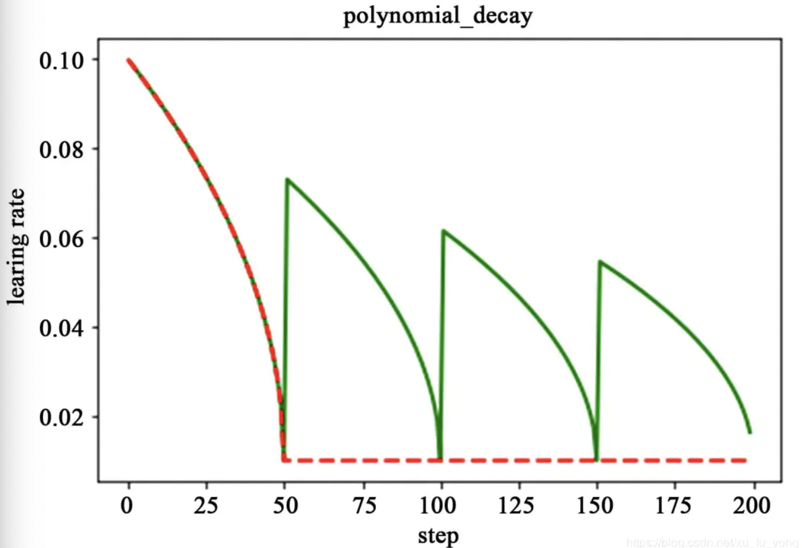
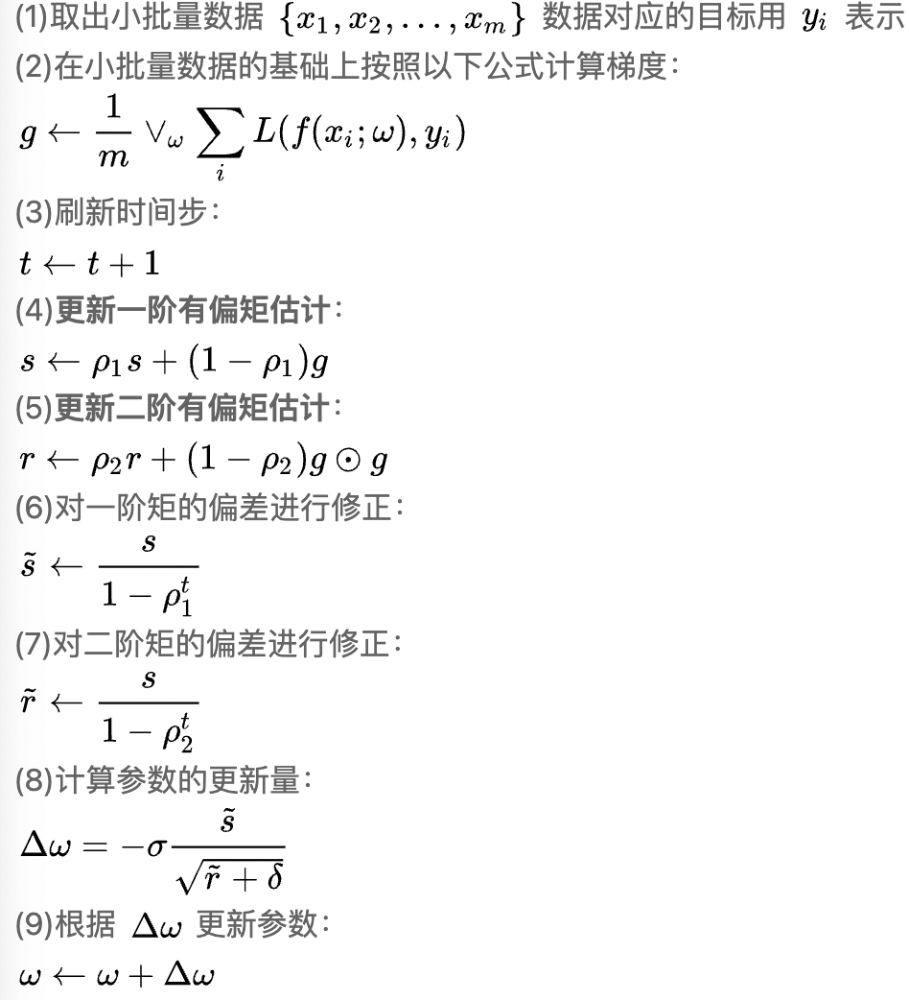
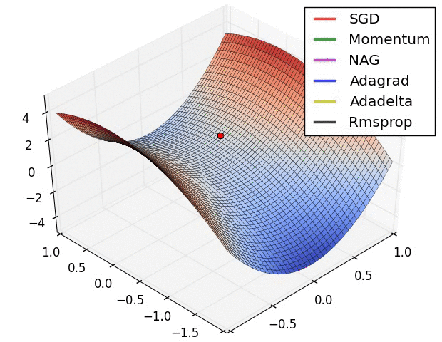

- [Preface](#sec-1)
- [Details](#sec-2)
  - [Learning Rate Strategies](#sec-2-1)
  - [Optimizer](#sec-2-2)
  - [Positive && Negative Assigner](#sec-2-3)

# Preface<a id="sec-1"></a>

This article focuses on some basic parameter settings in deep learning and on commonly used tricks.

# Details<a id="sec-2"></a>

## Learning Rate Strategies<a id="sec-2-1"></a>

The `learning rate` controls the "step size" of the weight updates as the deep learning model gradually converges, which further improves model accuracy. The basic process of updating weights with gradients is as follows:


$$
weight_{new} = weight_{existing} - learning\_rate * func(gradient)
$$


Below are several commonly used `learning rate` update strategies:

- Warmup

   `Warmup` means "preheating". The model first trains with a fairly small learning rate at the start, the learning rate then gradually increases, and after a few epochs of this "warmup" training, formal training proceeds with a gradually decreasing learning rate. The motivation is that for a model that is not pretrained, the weights are all random, so using a large learning rate right from the start adds uncertainty to training. Starting with a small learning rate and raising it slowly makes training more stable.

   

-   Decay
    
     The `Decay` strategy lowers the learning rate as the number of training steps grows. Here are several commonly used learning rate decay strategies:
    
    1. Piecewise decay: the intervals for different learning rates are set by hand. It allows fine parameter tuning for different tasks, and any `learning rate` value can be set after any number of steps.
    
        
    
    2. Exponential decay: the learning rate has an exponential relationship with the number of training steps:
    
       
       $$
       decayed\_learning\_rate = learning\_rate * decay\_rate^{global\_step/decay\_step}
       $$
       
    
       
    
    3. Polynomial decay: it is obtained by setting an initial learning rate and a minimum learning rate, and the learning rate is updated as follows:
    
       
       $$
       global\_step = min(global\_step, decay\_step)
       $$
    
       $$
       decayed\_learning\_rate = (learning\_rate - end\_learning\_rate) * (1 - \frac{global\_step}{decay\_step})^{power} + end\_learning\_rate
       $$
    
       
    
       When the learning rate reaches its minimum value there are two mechanisms: 1 is to keep updating with the minimum learning rate; 2 is to use a cyclic raise-then-decay learning strategy, which prevents the network from getting stuck in a local minimum: 
    
       
    
    4. Cosine decay: the learning rate is decayed in a cosine-related way, and the decay trend is close to a cosine function. The common update is as follows:
    
       
       $$
       global\_step = min(global\_step, decay\_step) 
       $$
    
       $$
       cosine\_decay = 0.5 * (1 + cos(\pi * \frac{global_step}{decay_step})) 
       $$
    
       $$
       decayed = (1 - \alpha) * (cosine\_decay) + \alpha
       $$
    
       $$
       decayed\_learning\_rate = learning\_rate * decayed
       $$
    
       

## Optimizer<a id="sec-2-2"></a>

The `optimizer` defines how weights are updated from the computed gradients and the learning rate. Here are several commonly used `optimizer`s:

- Gradient descent: gradient descent finds an extremum by moving along the direction of descending gradient, and is the basic optimization method. Its drawbacks are that training is slow and it easily falls into a local optimum: 

  
  $$
  \theta _{t+1} = \theta _{t} - \alpha * \Delta _{\theta}J(\theta)
  $$
  

- Momentum optimization

  The idea of momentum optimization comes from:

  momentum in physics, where a moving object keeps its original direction of motion to some extent. For parameter updates in deep learning, this means each update keeps the previous update direction while fine-tuning the direction with the current batch. The advantage is that when the gradient direction changes, the parameter update slows down, which reduces oscillation; when the gradient direction stays the same, the parameter update speeds up, which accelerates convergence. The update is as follows:

  
  $$
   sum\_of\_gradient = u * gradient + previous\_sum\_of\_gradient * decay\_rate
  $$

  $$
  delta = -learning\_rate * sum\_of\_gradient
  $$

  $$
  theta += delta
  $$

- Adaptive learning rate optimization

  The optimizers above depend on hyperparameter design, such as the learning rate. Adaptive learning rate optimization uses adaptive algorithms to update the learning rate, which makes the training process more adaptable. Commonly used adaptive algorithms include AdaGrad/RMSProp/Adam. Here we focus on the `Adam` algorithm, which combines the advantages of momentum and the `RMSProp` algorithm. Its parameter update process is as follows:

  First define the initial parameters: the global learning rate &sigma; , the exponential decay rates of the moment estimates $\rho_1$/$\rho_2$, the initial parameters $\omega$, a small constant $\varepsilon$, the first-order and second-order variables $s$ and $r$, and a time-step counter $t$. The update procedure is as follows:

   

A comparison of some classic `optimizer`s is as follows:

 

## Positive && Negative Assigner<a id="sec-2-3"></a>

For detection networks, the assignment of positive and negative samples is a very important step of model training (especially for `Anchor-based` detection networks).

First, a brief introduction to how a conventional detection network matches objects based on `Anchor`s and computes the `loss`:

anchor_generator (generates anchors from the configured hyperparameters) -> target_assigner (computes predicted boxes from the predicted offsets, then assigns positive and negative examples according to the predicted boxes) -> sampler (samples from all positive and negative examples) -> loss (computes the final loss from the positive and negative examples; for details see [2D_Detection-Loss](https://johneyzheng.top/posts/2D_Detection-Loss/))

 A brief introduction to the `Anchor generator`: it lays out `anchor`s according to preset `anchor` hyperparameters. For these hyperparameters, K-means clustering over the training set is commonly used: first collect the width/height of all GT bboxes in the training set, remove the extreme values, take the averaged region centers as the initial points, and optimize with the K-Means algorithm, using the IoU distance as the evaluation function. For a simple implementation of K-means anchor clustering, see [kmeans](https://github.com/lars76/kmeans-anchor-boxes/blob/master/kmeans.py). As for the `Anchor generator`, most networks generate anchors in much the same way. Taking `SSD/YOLO` as examples: `SSD` uses every point of the `featuremap` as the center of a `base anchor` and, depending on whether `scale_major` is set, generates `anchor`s of different sizes and aspect ratios from the `scale/aspect` distribution (both are relative values), then directly regresses the position offsets and size offsets. `YOLO` generates `anchor`s in a similar way to `SSD`, with a slightly different configuration: YOLO configures the width/height of the Anchor directly. An excerpt of the `mmdetection` configuration:

```python
# SSD
anchor_generator=dict(
    type='SSDAnchorGenerator',
    scale_major=False,
    input_size=input_size,
    basesize_ratio_range=(0.15, 0.9),
    strides=[8, 16, 32, 64, 100, 300],
    ratios=[[2], [2, 3], [2, 3], [2, 3], [2], [2]]),
# YOLO
anchor_generator=dict(
    type='YOLOAnchorGenerator',
    base_sizes=[[(116, 90), (156, 198), (373, 326)],
                [(30, 61), (62, 45), (59, 119)],
                [(10, 13), (16, 30), (33, 23)]],
    strides=[32, 16, 8]),
```

At the `Target Assigner` and `sampler` level there are usually many algorithm design tricks. The most basic `Target Assigner` is the `Max Iou Assigner`: it matches GT BBoxes and Predicted BBoxes by IoU. The pipeline is: compute the IoU between Predicted BBoxes and GT BBoxes, `assign` each bbox to the GT with the largest IoU (the relationship between GT and bbox is one-to-many), and then assign positive and negative labels by thresholds. The Assigners of common networks such as SSD/YOLO are all `MaxIouAssigner`. An excerpt of the mmdet pipeline:

```python
'''
1. assign every bbox to the background
2. assign proposals whose iou with all gts < neg_iou_thr to 0
3. for each bbox, if the iou with its nearest gt >= pos_iou_thr,
   assign it to that bbox
4. for each gt bbox, assign its nearest proposals (may be more than
   one) to itself
'''
```

Here are several classic `Target Assigner` approaches:

-   MaxIouAssigner_TopK: following the idea of [OPMP](https://arxiv.org/pdf/2003.09163.pdf), a single Anchor matches multiple GTs (TopK), so that a single Anchor can predict multiple results.
-   GridAssigner: the Assigner used by YOLO. It is similar to MaxIoUAssigner, with the only difference that it restricts the range of the GT center point: only a GT whose center point falls inside a grid cell is assigned as the target of that cell.
-   HungarianAssigner: following the idea of [OneNet](https://arxiv.org/pdf/2012.05780v1.pdf) (or [Detr](https://arxiv.org/pdf/2005.12872.pdf)), it achieves one-to-one matching of gt-bbox. It uses a `min-cost` approach, where the cost usually contains the cls loss and bbox loss, and the matching method is the Hungarian algorithm.
-   [ATSS](https://arxiv.org/abs/1912.02424): the overall pipeline is fairly complex. First compute the IoU and the center-point distance between all bboxes and the gts; choose the k bboxes whose centers are closest, compute the mean/std of these bboxes, and use mean+std as the threshold for selecting bboxes; those above the threshold are positive candidates; finally, a candidate is a positive example only if its center point lies inside the corresponding bbox (if there are multiple positive examples, take the one with the largest IoU).
-   Others:
    -   [FSAF](https://arxiv.org/pdf/1903.00621.pdf): tries to solve the problem of anchor assignment across different featuremap levels. The way it does so: each feature map level gets an additional anchor-free branch, which assigns each GT to a level according to the GT's loss on the different levels (Focal Loss + IoU Loss), and then regresses the loss; in joint training, the losses of the anchor-based and anchor-free levels are combined. At test time the results of the two are merged and then nms is applied.

For the `sampler`, in essence it is just a sampling process and usually needs to work together with the preceding `Target Assigner`. Its overall algorithm design is relatively simple. Here are several commonly used `sampler` strategies:

-   SSD sampler/faster rcnn sampler: the SSD sampler first takes all positive cases, then takes negative examples according to a pos/neg ratio (such as 1:3), choosing the negatives with a `hard data mining` strategy, that is, the negatives with the largest loss. Because the input batch size of faster rcnn's second stage is fixed (256), it generally takes the positives first, uses `random sample` to pick the needed positives if there are too many, and fills the rest with negatives, also by `random sample`.
-   random sampler: if the number of pos/neg exceeds `expected_num`, `random sample` is applied; otherwise all are returned.
-   ohem sampler: if the number of pos/neg exceeds `expected_num`, a forward pass is run to get the loss of the corresponding cases and the topk (k=expected_num) are taken; otherwise all are returned.
-   iou_balanced_neg_sampler: from [Libra R-CNN](https://arxiv.org/pdf/1904.02701.pdf). Its positive sampling strategy is the same as the random sampler. Its negative sampling strategy splits the negatives' IoU into equal bins and then samples based on the bins, which in essence raises the sampling probability in some IoU intervals.
