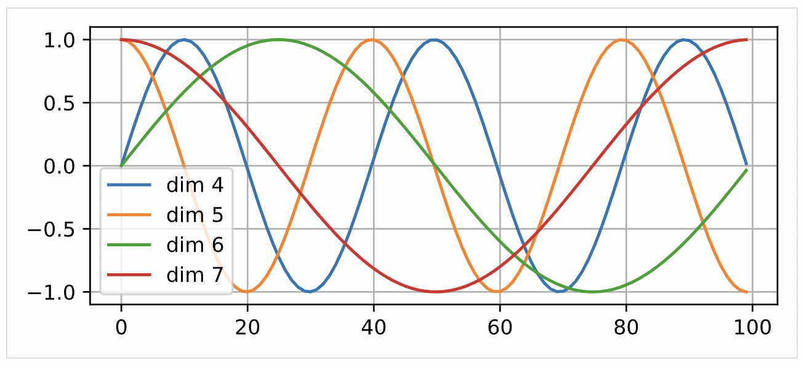
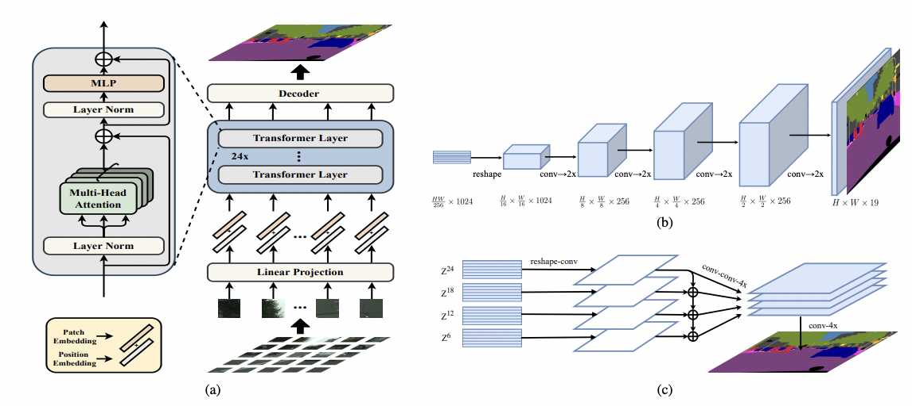

- [Preface](#sec-1)
- [Introduction to the Transformer](#sec-2)
- [Transformer for CV](#sec-3)
- [Deploying Transformer-Style Networks](#sec-4)
- [References](#sec-5)

# Preface

A brief discussion of the principles of the `Transformer`, its basic applications, and some thoughts on model optimization.

# Introduction to the Transformer

The **Transformer** first appeared in the 2017 Google paper [Attention is all you need](https://proceedings.neurips.cc/paper/2017/file/3f5ee243547dee91fbd053c1c4a845aa-Paper.pdf). The Transformer architecture does away entirely with the traditional recurrent "encoder-decoder" structure and replaces it with a "self-attention" structure. The problem with the traditional recurrent structure is that it is sequential: the input of the next step depends on the output of the previous step. Because of this inherent property, the "encoder-decoder" structure cannot run inference in parallel, and is therefore inefficient. The "Attention" structure solves this problem well. Its basic structure is as follows:

 

The core of the self-attention mechanism above is to compute the attention weight of every position of a sentence directly during encoding, and then compute the hidden vector representation of the whole sentence as a weighted sum. The self-attention mechanism is the "Scaled Dot-Product Attention" in the paper. Its core is the process of mapping a query and a set of key-value pairs to an output; the output vector is essentially a weighted sum of the values, where the weights are obtained from the query and the keys:

Given the structure above, the inputs are Q/K/V, and the output vector is:

$$ Attention(Q,K,V) = softmax(\frac{QK^T}{\sqrt{d_k}})V $$

Here $Q/K/V$ correspond to three input matrices whose dimensions are $d_q,d_k,d_v$. $Q/K/V$ can be regarded as three input vectors obtained from the input vectors through different `embedding` methods (that is, different mappings of the input obtained with different weights). $QK^T$ gives the attention weights between the different elements of the sequence, and applying these attention weights to $V$ gives the final encoded output. In addition, $d_k$ is introduced mainly to keep the gradient from becoming too small after the softmax; this is the `scaled` step. The advantage of this structure is that the encoded vector of each element of the input sequence can be obtained directly through a few matrix transformations.

However, a series of problems remain. First, the problem with the "self-attention mechanism" above is that when the model encodes the information at the current position, it puts too much of its attention on its own position. In addition, the encoding mechanism is insensitive to position: if the order of the input elements changes, the encoded values stay the same, and only the output positions stay aligned with the input positions. In other words, it cannot capture the differences in meaning caused by the input order.

For the first problem, the authors use the "Multi-Attention" structure. As the structure below shows, the original input sequence is processed by several groups of self-attention, the results of all the groups are concatenated, and one linear transformation produces the final output. The core of the multi-head structure is to decompose the original high-dimensional single-head structure into several low-dimensional results obtained with different weights (although the two are equivalent in terms of computation). The advantage of multiple heads is that they improve the expressive power of the model (similar to the design of multiple groups of filters in CV). Empirically, they increase the attention weight on information at other positions and ease the problem of paying too much attention to the model's own position. On the other hand, the multi-head design increases the parallelism of the model.

For the problem of input position, the authors add a `Positional Embedding` feature that describes the differences in the order in which the data is input. The figure below illustrates the `Positional Embedding`. The horizontal axis represents the position of each element in the input sequence, and different positions can be mapped through a formula to specific output values.

With the `Multi-Attention` structure introduced, we can see that the `Encoder` consists mainly of two parts: `Multi-Attention` and `Feed Forward` (a two-layer fully connected network). Each part has the form `LayerNorm(x+Sublayer(x))`, and each includes a `Dropout` operation. For the `Feed Forward` part, the computation can be summarized as:

$$ FFN(x) = max(0, xW_1 + b_1)W_2 + b_2 $$

The Decoder is similar to the Encoder overall. The difference is that it has an additional multi-head attention that interacts with the Encoder output (the memory input gives K/V, and Q comes from the input of the decoder itself). The core idea is to use the memory weight information obtained from the Encoder in the decoder's own decoding.

Finally, let's discuss the masking mechanism of the `Transformer`:

During real prediction, the decoder has to use the output of the previous time step as the input for decoding the next time step, decoding one time step after another. Clearly, it would be very time-consuming to train in the same way. Therefore, during training the decoder, like the encoder, receives the inputs of all decoding time steps at once and computes on them together. This has two benefits. First, computing multiple samples in parallel speeds up the training of the network. Second, feeding the decoder the correct results during training, rather than the predictions of the previous time step (which may be wrong during training), trains the network better. Given this, the "masking mechanism" solves the problem well. Its principle is to add a mask on top of $QK^T$: $QK^T + attention\_{mask}$. Its effect is to ensure that when decoding time step $t$, the attention can only be placed on the first $t$ positions.

# Transformer for CV

The `Transformer` is usually applied to fields such as NLP, where the input is typically a sequence, which matches its model structure. However, a lot of research has since gone into applying the `Transformer` to CV. Compared with the usual convolution kernel, the advantages of the `Transformer` are:

-   It can break through the limit of positional distance (receptive field), because for a `Transformer` the number of operations needed to relate two positions does not grow with their distance.
-   The `self-attention` structure is more interpretable: you can inspect the attention distribution of each `attention head`.
-   Stronger modeling ability: the core of the Transformer is to describe the relationship between "query" and "key". It can be applied to the relationship between pixel values and positions (similar to convolution), and can equally describe relationships among other kinds of input. The Transformer structure can therefore be applied to more fields, or put differently, it can connect different fields and build more general models.
-   Parallel computation: high computational efficiency (this is debatable, because Transformer-style network structures are often unfriendly to memory access in hardware implementations, so for a model with the same amount of computation, a Transformer-style network may be much slower).
    
    For CV, the core idea of using a `Transformer` is to **encode the image as a sequence**. The general steps are:
    
    1.  Feature extraction (usually based on a CNN) and downsampling (dimensionality reduction)
    
    2.  Combine `position encoding` with the image features to obtain the input sequence
    
    3.  Feed the sequence into the `transformer block`
    
    4. Design a specific `task head`: for tasks such as classification, detection, and segmentation
    

Below are a few classic applications and their network structures:

1. Classification: [Vision Transformer (ViT)](https://arxiv.org/pdf/2010.11929.pdf) applies the `Transformer` to image classification. Its core network structure is shown in the figure below, and the algorithm flow is:
   -   Image patching: split the original HxWxC image into PxPxC patches and flatten them into a sequence of length $Nx(P^2xC)$, where N is the number of patches.
   -   Patch embedding: similar to the embedding operation in NLP, this actually converts high-dimensional vectors into lower-dimensional vectors. A fully connected layer is used here, and the resulting dimension is ND. A classification vector is also appended, mainly to describe the classification information of the patches. Finally, position encoding information is added.
   -   Feed the embedded sequence into the `encoder-decoder` structure.
   -   Classification head: implemented with an MLP.
   
   

1.  Detection
    
    [DEtection TRansformer (DETR)](https://www.ecva.net/papers/eccv_2020/papers_ECCV/papers/123460205.pdf). Its algorithm structure is shown in the figure below, and the core steps are as follows:
    
    -   Similar to ViT, first split the image into patches, then obtain the input sequence from a CNN and positional encoding.
    
    -   Use the resulting input sequence as the input of the transformer structure.
    
    -   Detection head: the core structure, called `FNN` in the paper. For the outputs of the decoders, the different FFNs actually share weights. The internal structure has two parts: a three-layer perceptron with ReLU activation for bounding box prediction, plus a linear layer and Softmax for class prediction.
    
    -   Matching mechanism and loss design: the prediction of the network is actually a set (of size N) whose elements are $(probs, bbox)$, representing the class probabilities and the coordinates of a detection box. When matching against the ground truth (GT) to compute the loss, the matching mechanism is the [Hungarian algorithm](https://zh.wikipedia.org/wiki/%E5%8C%88%E7%89%99%E5%88%A9%E7%AE%97%E6%B3%95), and the loss is the `Hungarian Loss`, whose core is to minimize the matching cost.
    
    

1.  Segmentation
    
    [SEgmentation TRansformer (SETR)](https://openaccess.thecvf.com/content/CVPR2021/papers/Zheng_Rethinking_Semantic_Segmentation_From_a_Sequence-to-Sequence_Perspective_With_Transformers_CVPR_2021_paper.pdf). Its algorithm structure is shown in the figure below. Overall, the steps are much the same as before:
    
    -   Construct the input: obtain the features of each patch, then encode the spatial information and combine everything into the final sequence.
    
    -   Feed it into the `transformer` structure.
    
    -   A further decoder produces the final segmentation result. The paper describes two decoder structures: (b) reshape to the image dimensions and then upsample repeatedly with convolutions; (c) extract the features of different layers and merge them to form the final input (multi-level feature aggregation).
    
    

1.  General backbone
    
    [Swim-transformer](https://arxiv.org/pdf/2103.14030.pdf) can to some extent be regarded as the culmination of `transformer`-type networks. Its network structure is shown in the figure below. Networks based on `Swim-transformer` reach state-of-the-art (SOTA) accuracy on all kinds of tasks. Besides the usual vision tasks (object detection, semantic segmentation, and so on), it also performs impressively on other tasks, such as video action recognition, self-supervised learning, image restoration, and ReID. In my opinion the algorithm design of `Swim-transformer` is highly innovative, and the paper also won the 2021 ICCV Best Paper award (the last time MSRA won a Best Paper award, you have to go back to ResNet).
    
    First, let's look at the shortcomings of the earlier `Vit`-based network structure:
    
    -   The input dimension based on patches is very high: $patch^2$, so the time complexity is high.
    
    -   The input sequence length is single: for CV tasks, multi-scale information is often important.
    
    `Swim-transformer` solves the problems above to a certain extent:
    
    -   It reduces the time complexity to linear.
    
    -   It can extract multi-scale information.
    
    The blog post [Swim Transformer's dimensionality-reducing strike against CNNs](https://zhuanlan.zhihu.com/p/360513527) describes `Swim-transformer` in considerable detail. Here is a brief summary of its core algorithm flow:
    
    -   The input is the original image, which goes into the `Patch Partition` module. This module handles the patch processing of the image input: it splits the input image into 4x4 pieces to obtain an input of $\frac{H}{4}*\frac{W}{4}*48$, where 48 corresponds to $48=4*4*3$.
    
    -   The input goes into Stage 1, which is `Linear Embeding` + `Swim transformer Block`. The `Linear Embeding` module reduces the dimension from 48 to C, and the result goes into the `Swim transformer Block`. The latter is the core module of the algorithm and consists of two consecutive parts: a structure built around W-MSA and a structure built around SW-MSA. The W-MSA structure splits the input into different windows and computes self-attention only within each window (which reduces the computational complexity), but this loses the information interaction between windows to some extent. The SW-MSA structure addresses the information interaction between different windows; its core is to shift and stitch the patches so that connections are introduced between windows that are not adjacent.
    
    -   The input then goes into the following structures, Stage 2 to Stage 4: `Patch Merging` + `Swim transformer Block`. The difference lies mainly in the preceding `Patch Merge` module, which merges the input in 2x2 groups, similar to a pooling operation. This enlarges the receptive field of the features and extracts features at different scales.
    
    

Additional notes:

-   The W-MSA structure. Its algorithm diagram is below, where the red areas are windows and the gray areas are patches. For hxw patches (with patch size MxM), the W-MSA structure performs self-attention only inside each single Window, so its computational complexity is $4hwC^2 + 2M^2hwC$, which is linear in the number of patches (hxw). For the Vit-style computation, the computational complexity is $4hwC^2+2(hw)^2C$, which is quadratic in the number of patches.
    
    

-   The SW-MSA structure. Its algorithm diagram is below, and its core is the `cyclic shift` and `reverse cyclic shift` operations.
    
    

# Deploying Transformer-Style Networks

[Offline Transformer Deployment: GPU Optimization Strategies](https://johneyzheng.top/posts/Transformer%E7%A6%BB%E7%BA%BF%E9%83%A8%E7%BD%B2-GPU%E4%BC%98%E5%8C%96%E7%AD%96%E7%95%A5/)

# References

[Peeling Back the Layers of the Transformer](https://bbs.cvmart.net/articles/5657)

 [Transformer in CV](https://zhuanlan.zhihu.com/p/341790423)
