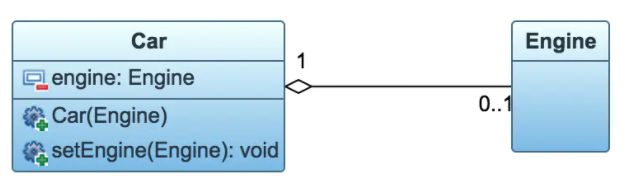

- [Preface](#sec-1)
- [UML Class Diagrams](#sec-2)

# Preface

`UML` is short for `Unified Modeling Language`. It provides a standardized modeling language made up of a set of diagrams, which helps system developers clarify, design, and build software systems. UML diagrams generally fall into two groups: structural diagrams, such as class diagrams, component diagrams, and deployment diagrams, and behavioral diagrams, such as use case diagrams, activity diagrams, and sequence diagrams. The most widely used is the class diagram, which is commonly used in system software design.

# UML Class Diagrams

The most common relationships in UML class diagrams are generalization, realization, composition, aggregation, association, and dependency. In order of strength: generalization = realization > composition > aggregation > association > dependency.

1. Generalization

  Generalization describes an inheritance relationship. It expresses the relationship between the general and the specific, that is, how a subclass specializes all the features and behaviors of its parent class. An example is the relationship between mammals and cats/dogs.

2. Realization

  Realization describes the relationship between a class and an interface: the class implements all the features and behaviors of the interface. For example, a dog is a mammal, and now we need to provide interactions between an owner and a dog. We can define an IDog interface that represents the interaction between an owner and a pet, and the dog has to implement this interface.

3. Composition

  Composition describes a whole-part relationship in which the parts cannot exist on their own once they are separated from the whole. An example is the relationship between a human body and its head and legs.

4. Aggregation

  Aggregation describes a whole-part relationship in which the parts can exist on their own apart from the whole, so it is weaker than composition. Examples are the relationship between a company and its employees, or between a vehicle and its engine and tires.

5. Association

  Association describes an "owns" relationship: one class knows the attributes and methods of another class. An association can be one-way or two-way. For example, the relationship between a book and its reader is two-way, while the relationship between a book and its author is one-way.

6. Dependency

  Dependency describes a "uses" relationship: the implementation of one class needs the help of another class, so two-way mutual dependencies should be avoided where possible. An example is the relationship between a driver and a car: being a driver depends on the existence of a car.

