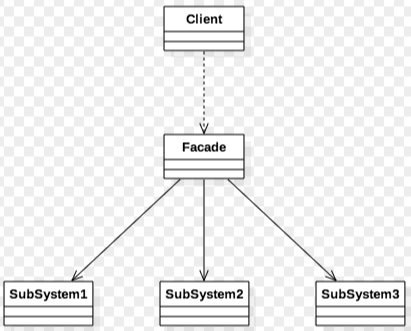

- [Concept](#sec-1)
- [Worked Example](#sec-2)

# Concept<a id="sec-1"></a>

The Facade pattern is the simplest and most commonly used pattern. It has two roles:

-   Facade: encapsulates a unified external interface for the subsystem, like the front of the subsystem. This class is not responsible for the concrete business logic, which is done by the subsystem.
-   Subsystem (SubSystem): a subsystem with a specific function made up of multiple classes. It can be a third-party library, your own base library, or a sub-service, and it provides a specific function or service to the whole system.

The class diagram of the Facade pattern is as follows: 



Its advantages are:

-   It loosely couples the subsystem and the client, so changes in the subsystem do not affect the calling relationships above it.
-   It makes the subsystem easier for the client to use: the client does not need to know how the subsystem is implemented, and only needs to interact with the facade.
-   It can give different users a unified calling interface (integrating different subsystems), which makes the system easier to manage and maintain.

Its drawback is:

-   Unifying the calling interface reduces the flexibility of the system's functionality to a certain extent.

Common use cases are:

-   Providing a simple interface to a complex system.
-   When there is heavy dependence between client programs and the subsystems: introducing a facade class decouples the subsystems from the clients and from other subsystems, and improves the independence and portability of the subsystems.
-   In a layered structure, the layers do not need to be directly connected and can be managed through facade classes, which reduces the coupling between the layers.

# Worked Example<a id="sec-2"></a>

Scenario: compressing and decompressing files, providing a unified calling interface for files of different formats:

```python
from os import path
# 引入path进行相关文件处理
import logging
# 引入logging，进行日志处理


class ZipModel():
    """Zip模块，负责Zip文件的压缩片和解压缩：这里只进行简单模拟"""
    def compress(self, src_file_path, dst_file_path):
        print("Zip模块正在进行"%s"文件的压缩..." % src_file_path)
        print("文件压缩成功，已保存在"%s"" % dst_file_path)

    def decompress(self, src_file_path, dst_file_path):
        print("Zip模块正在进行"%s"文件的解压缩..." % src_file_path)
        print("文件解压缩成功，已保存在"%s"" % dst_file_path)


class RarModel():
    """Rar模块，负责rar文件的压缩片和解压缩：这里只进行简单模拟"""
    def compress(self, src_file_path, dst_file_path):
        print("Rar模块正在进行"%s"文件的压缩..." % src_file_path)
        print("文件压缩成功，已保存在"%s"" % dst_file_path)

    def decompress(self, src_file_path, dst_file_path):
        print("Rar模块正在进行"%s"文件的解压缩..." % src_file_path)
        print("文件解压缩成功，已保存在"%s"" % dst_file_path)


class ZModel():
    """7z模块，负责rar文件的压缩片和解压缩：这里只进行简单模拟"""
    def compress(self, src_file_path, dst_file_path):
        print("7z模块正在进行"%s"文件的压缩..." % src_file_path)
        print("文件压缩成功，已保存在"%s"" % dst_file_path)

    def decompress(self, src_file_path, dst_file_path):
        print("7z模块正在进行"%s"文件的解压缩..." % src_file_path)
        print("文件解压缩成功，已保存在"%s"" % dst_file_path)


class CompressionFacade():
    """压缩系统的外观类"""
    def __init__(self):
        self.__zip_model = ZipModel()
        self.__rar_model = RarModel()
        self.__7z_model = ZModel()

    def compress(self, src_file_path, dst_file_path, type):
        """根据不同的压缩类型：压缩成不同的格式"""
        # 获取文件名
        ext_name = "." + type
        full_name = dst_file_path + ext_name
        if type.lower() == "zip":
            self.__zip_model.compress(src_file_path, full_name)
        elif type.lower() == "rar":
            self.__rar_model.compress(src_file_path, full_name)
        elif type.lower() == "7z":
            self.__7z_model.compress(src_file_path, full_name)
        else:
            logging.error("Not support this format:" + str(type))
            return False
        return True

    def decompress(self, src_file_path, dst_file_path):
        """从src_file_path获取后缀，根据不同后缀名，进行不同格式的解压缩"""
        base_name = path.basename(src_file_path)
        ext_name = base_name.split(".")[1]
        if ext_name == "zip":
            self.__zip_model.decompress(src_file_path, dst_file_path)
        elif ext_name == "rar":
            self.__rar_model.decompress(src_file_path, dst_file_path)
        elif ext_name == "7z":
            self.__7z_model.decompress(src_file_path, dst_file_path)
        else:
            logging.error("Not support this format:" + str(ext_name))
            return False
        return True


def testCompression():
    facade = CompressionFacade()
    facade.compress("test.md",
                    "test.zip")
    facade.decompress("test.zip",
                      "test.md")

    facade.compress("test.pdf",
                    "test.rar")
    facade.decompress("test.rar",
                      "test.pdf")

    facade.compress("test.doc",
                    "test.7z")
    facade.decompress("test.7z",
                      "test.doc")
```
