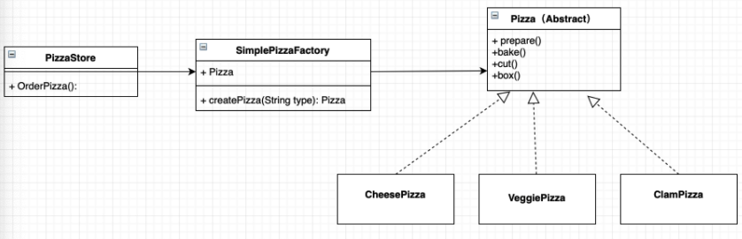

- [Concept](#sec-1)
- [Example](#sec-2)

# Concept<a id="sec-1"></a>

The factory patterns aim to build a general "factory class" that produces instances of different classes. There are three factory patterns, each more advanced than the last: Simple Factory, Factory Method, and Abstract Factory.

-   Simple Factory: creates instances of different classes depending on the input parameter. It defines an interface for creating objects and uses a parameter to decide which class to instantiate. 

    

-   Factory Method: defines an interface for creating objects but lets subclasses decide which class to instantiate; Factory Method defers the instantiation of a class to its subclasses. 

    

-   Abstract Factory: provides an interface for creating families of related or dependent objects without specifying their concrete classes. 

    

The three build on one another as follows: Simple Factory is easy to use and can create objects of different classes depending on the parameter, but it is hard to extend: adding a new product type requires modifying the factory's creation logic (which violates the open-closed principle), so it suits simple cases where an inheritance relationship is obvious and there are few types. Factory Method abstracts a parent class on top of Simple Factory and adds different subclasses, each responsible for a different concrete product. Abstract Factory is mainly used for two-level product scenarios, and it needs to further abstract the attributes shared by the products.

# Example<a id="sec-2"></a>

Scenario: design a whiteboard feature that needs different types of pens, such as line, rectangle, and ellipse. The implementation is as follows:

```python
from abc import ABCMeta, abstractmethod
from enum import Enum


class PenType(Enum):
    """画笔类型"""
    pen_type_line = 1
    pen_type_rect = 2
    pen_type_ellipse = 3


class Pen(metaclass=ABCMeta):
    """画笔"""
    def __init__(self, name):
        self.__name = name

    @abstractmethod
    def get_type(self):
        pass

    def get_name(self):
        return self.__name


class LinePen(Pen):
    """直线画笔"""
    def __init__(self, name):
        super().__init__(name)

    def get_type(self):
        return PenType.pen_type_line


class RectanglePen(Pen):
    """矩形画笔"""
    def __init__(self, name):
        super().__init__(name)

    def get_type(self):
        return PenType.pen_type_rect


class EllipsePen(Pen):
    """椭圆画笔"""
    def __init__(self, name):
        super().__init__(name)

    def get_type(self):
        return PenType.pen_type_ellipse


class PenFactory():
    """创建画笔"""
    if self.__pens.get(pen_type) is None:
        # 如果该对象不存在，则创建一个对象并存在字典中
        if pen_type == PenType.pen_type_line:
            pen = LinePen("直线画笔")
        elif pen_type == PenType.pen_type_rect:
            pen = RectanglePen("矩形画笔")
        elif pen_type == PenType.pen_type_ellipse:
            pen = EllipsePen("椭圆画笔")
        else:
            pen = Pen("")
        self.__pens[pen_type] = pen
    # 否则，直接返回字典中的对象即可
    return self.__pens[pen_type]
```
