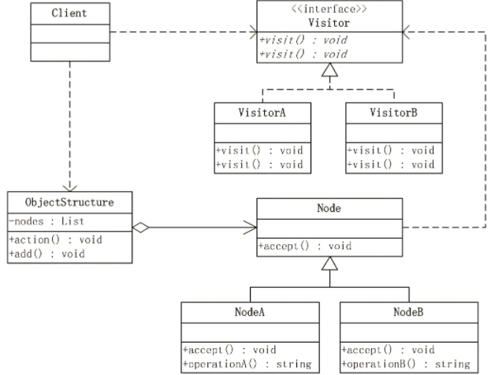

- [Concept](#sec-1)
- [Design Template](#sec-2)
- [Example](#sec-3)

# Concept<a id="sec-1"></a>

The Visitor pattern encapsulates operations that act on the elements of a data structure, so that new operations on those elements can be defined without changing the data structure. The pattern has three main roles:

-   Visitor: responsible for visiting and operating on data nodes
-   DataNode: the data object being operated on
-   ObjectStructure: the manager class of the data structure, and also the container of the data objects

The class diagram of the Visitor pattern is as follows:



Advantages:

-   Data and operations are separated, which lowers coupling and keeps responsibilities clear
-   Adding new visiting operations is convenient, conforms to the open-closed principle, and does not require changing the data structure

Disadvantages:

-   Adding element classes is difficult: adding an element class affects the concrete operations of the visitor classes, which violates the open-closed principle
-   It breaks the encapsulation of data objects to some extent, because visitors need to access/call elements directly, which means elements must expose some internal operations and internal state

Applicable scenarios:

-   The object structure contains few objects, is relatively fixed and rarely changes, but new operations are often defined on that data structure
-   Each type of data needs specific visiting operations, and the operations are numerous and unrelated
-   You do not want object operations to pollute the object classes, and you need to separate the object classes from the classes that visit them

# Design Template<a id="sec-2"></a>

The framework model of the Visitor pattern is as follows:

```python
from abc import ABCMeta, abstractmethod


class DataNode(metaclass=ABCMeta):
    """数据结构类"""
    def accept(self, visitor):
        """接收访问者的访问"""
        visitor.visit(self)


class Visitor(metaclass=ABCMeta):
    """访问者"""
    def visit(self, data):
        """对数据对象的访问操作"""
        pass


class ObjectStructure():
    """数据结构管理类"""
    def __init__(self):
        self.__datas = []

    def add(self, data_element):
        self.__datas.append(data_element)

    def action(self, visitor):
        """进行数据的访问操作"""
        for data in self.__datas:
            data.accept(visitor)
```

# Example<a id="sec-3"></a>

Scenario: a pet shop has pets such as cats and dogs, and statistics are needed on the number, weight, age, and gender of the cats and dogs:

```python
class Animal(DataNode):
    """动物类"""
    def __init__(self, name, is_male, age, weight):
        self.__name = name
        self.__is_male = is_male
        self.__age = age
        self.__weight = weight

    def get_name(self):
        return self.__name

    def ismale(self):
        return self.__is_male

    def get_age(self):
        return self.__age

    def get_weight(self):
        return self.__weight


class Cat(Animal):
    """猫"""
    def speak(self):
        print("miao~")


class Dog(Animal):
    """狗"""
    def speak(self):
        print("wang~")


class GenderCounter(self):
    """性别统计"""
    def __init__(self):
        self.__male_cat = 0
        self.__female_cat = 0
        self.__male_dog = 0
        self.__female_dog = 0

    def visit(self, data):
        if isinstance(data, Cat):
            if data.ismale():
                self.__male_cat += 1
            else:
                self.__female_cat += 1
        elif isinstance(data, Dog):
            if data.ismale():
                self.__male_dog += 1
            else:
                self.__female_dog += 1
        else:
            print("Not support this type!")

    def get_info(self):
        print("%d只雄猫，%d只雌猫，%d雄狗，%d只雌狗。"
              % (self.__male_cat, self.__female_cat, self.__male_dog, self.__female_dog))


class WeightCounter(self):
    """体重统计"""
    def __init__(self):
        self.__cat_num = 0
        self.__cat_weight = 0
        self.__dog_num = 0
        self.__dog_weight = 0

    def visit(self, data):
        if isinstance(data, Cat):
            self.__cat_num += 1
            self.__cat_weight += data.get_weight()
        elif isinstance(data, Dog):
            self.__dog_num += 1
            self.__dog_weight += data.get_weight()
        else:
            print("Not support this type!")

    def get_info(self):
        print("猫的平均体重：%d，狗的平均体重：%d。"
              % (self.__cat_weight / self.__cat_num, self.__dog_weight / self.__dog_num))


class AgeCounter(self):
    """年龄统计"""
    def __init__(self):
        self.__cat_max_age = 0
        self.__dog_max_age = 0

    def visit(self, data):
        if isinstance(data, Cat):
            if self.__cat_max_age < data.get_age():
                self.__cat_max_age = data.get_age()
        elif isinstance(data, Dog):
            if self.__dog_max_age < data.get_age():
                self.__dog_max_age = data.get_age()
        else:
            print("Not support this type!")

    def get_info(self):
        print("猫的最大年龄：%d，狗的最大年龄：%d。"
              % (self.__cat_max_age, self.__dog_max_age))


def test_animal():
    animals = ObjectStructure()
    animals.add(Cat("Cat1", True, 1, 5))
    animals.add(Cat("Cat2", False, 0.5, 3))
    animals.add(Cat("Cat3", False, 1.2, 4.2))
    animals.add(Dog("Dog1", True, 0.5, 8))
    animals.add(Dog("Dog2", True, 3, 52))
    animals.add(Dog("Dog3", False, 1, 21))
    animals.add(Dog("Dog4", False, 2, 25))
    gender_counter = GenderCounter()
    # 进行性别统计
    animals.action(gender_counter)
    gender_counter.get_info()
    # 进行重量统计
    weight_counter = WeightCounter()
    animals.action(weight_counter)
    weight_counter.get_info()
    # 进行年龄统计
    age_counter = AgeCounter()
    animals.action(age_counter)
    age_counter.get_info()
    """
    测试结果：
    1只雄猫，2只雌猫，2只雄狗，2只雌狗
    猫的平均体重是：4.07kg，狗的平均体重是：26.50kg
    猫的最大年龄：1.2，狗的最大年龄是：3
    """
```
