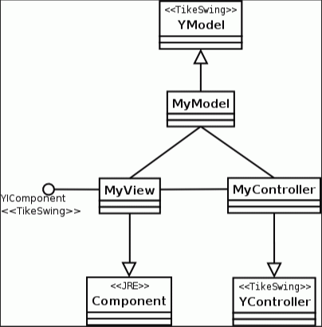

- [Concept](#sec-1)
- [Example](#sec-2)

# Concept<a id="sec-1"></a>

MVC is a commonly used software architecture pattern in software engineering. It has no single standard definition, but it generally divides a software system into three basic parts: Model, View, and Controller.

-   M: responsible for data storage
-   V: responsible for data display
-   C: responsible for the logic of interaction with the user.

The class diagram of the MVC pattern is as follows:



Advantages:

-   Low coupling: the software is layered, the layers can evolve independently, which makes teamwork and rapid development easier
-   High reusability and applicability: it fits all kinds of scenarios, such as web, mobile, and desktop
-   Fast development and deployment: many ready-made frameworks are based on the MVC pattern

Application scenarios:

-   It is widely used on the internet, for example in the separation of front end and back end, and even in the separation within the front end and within the back end themselves
-   Extensions based on MVC: the MVP (Model-View-Presenter) pattern, where P is the presenter and all interaction between Model and View goes through the P role, giving more thorough decoupling; and the MVVM (Model-View-ViewModel) pattern, where the ViewModel is the "Model of View", characterized by "two-way data binding" that makes the synchronization of View and Model data "automatic".

# Example<a id="sec-2"></a>

Here is a simple example, a camera design: data storage is implemented by the SD card module, data visualization by the display, and the camera body controls the overall camera functions:

```python
import random


class Camera():
    """相机机身"""

    # 相机基本参数
    single_focus = "单点对焦"
    area_focus = "区域对焦"
    big_area_focus = "大区域对焦"
    focus45  = "45点自动对焦"

    def __init__(self, name):
        self.__name = name
        sefl.__apertune = 0.0  # 光圈
        self.__shutter_speed = 0  # 快门速度
        self.__light_sensitivity = 0  # 感光度
        self.__lens = Lens()  # 静态
        self.__sd_card = SDCard()  # SD卡
        self.__display = Display()  # 显示器

    def shooting(self):
        """拍照"""
        print("[开始拍摄中")
        image_lighting = self.__lens.collecting()
        image = self.__transfer_image(image_lighting)
        self.__sd_card.add_image(image)
        print("拍摄完成]")

    def view_image(self, index):
        """查看图像"""
        print("查看第%d张图像：" % (index + 1))
        image = self.__sd_card.get_image(index)
        self.__display.show_image(image)

    def __transfer_image(self, image_lighting):
        """将光线信号存储为数字信号：简单模拟"""
        print("接收光线并处理成数字信号")
        return Image(6000, 4000, image_lighting)

    def setting(self, aperture, shutter_speed, light_sensitivity):
        """设置相机的拍摄属性：光圈、快门、感光度"""
        self.__aperture = aperture
        self.__shutter_speed = shutter_speed
        self.__light_sensitivity = light_sensitivity

    def focusing(self, focus_mode):
        """对焦:通过镜头组件实现"""
        self.__lens.set_focus(focus_mode)

    def show_info(self):
        """显示相机属性"""
        print("%s 的设置 光圈：F%0.1f 快门：1/%d 感光度：ISO %d" %
              (self.__name, self.__aperture, self.__shutter_speed, self.__light_sensitivity))


class Lens():
    """镜头"""
    def __init__(self):
        self.__focus_mode = ''
        self.__scenes = {
            0: '风光',
            1: '生态',
            2: '人文',
            3: '纪实',
            4: '人像',
            5: '建筑',
        }

    def set_focus(self, focus_mode):
        self.__focus_mode = focus_mode

    def collect(self):
        """图像采集：随机模拟"""
        print("采集光线：%s" % self.__focus_mode)
        index = random.randint(0, len(self.__scenes) - 1)
        scene = self.__scenes[index]
        return "美丽的" + scene + " 图像"


class Display():
    """显示器"""
    def show_image(self, image):
        print("图片大小: %d x %d 图片内容：%s" % (image.get_width(), image.get_height(), image.get_pix()))


class SDCard():
    """SD存储卡"""
    def __init__(self):
        self.__images = []

    def add_image(self, image):
        print("存储图像")
        self.__images.append(image)

    def get_image(self, index):
        if index >= 0 and index < len(self.__images):
            return self.__images[index]
        else:
            return None


class Image():
    """图像：字符串替代像素内容"""
    def __init__(self, width, height, pixels):
        self.__width = width
        self.__height = height
        self.__pixels = pixels

    def get_width(self):
        return self.__width

    def get_height(self):
        return self.__height

    def get_pix(self):
        return self.__pixels


def test_camera():
    camera = Camera("EOS 80D")
    camera.setting(3.5, 60, 200)
    camera.show_info()
    camera.focusing(Camera.big_area_focus)
    camera.shooting()

    camera.setting(5.6, 720, 100)
    camera.show_info()
    camera.focusing(Camera.focus45)
    camera.shooting()

    camera.view_image(0)
    camera.view_image(1)

    """
    测试结果：
    EOS 80D的设置 光圈：F3.5 快门：1/60 感光度：ISO 200
    [开始拍摄中
    采集光线，大区域对焦
    接收光线并处理成数字信号
    存储图像
    拍摄完成
    ]

    EOS 80D的设置 光圈：F5.6 快门：1/720 感光度：ISO 100
    [开始拍摄中
    采集光线，45点自动对焦
    接收光线并处理成数字信号
    存储图像
    拍摄完成
    ]

    查看第1张图像：
    图片大小：6000 x 4000，图像内容：美丽的风光图像
    查看第2张图像：
    图片大小：6000 x 4000，图像内容：美丽的建筑图像
    """
```
