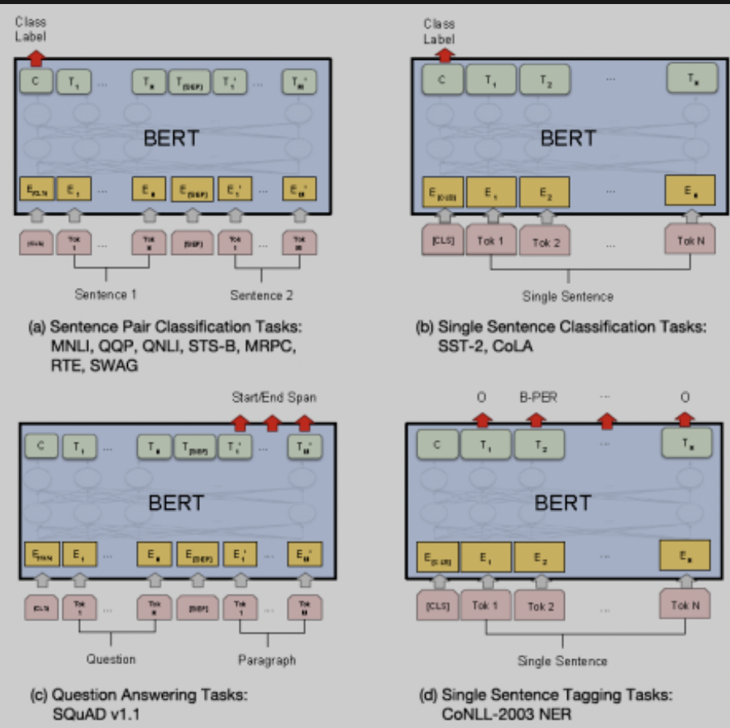

- [Preface](#sec-1)
- [Development History of BERT](#sec-2)
- [BERT Algorithm Details](#sec-3)
- [Later Development of BERT](#sec-4)
- [References](#sec-5)

# Preface

A brief discussion of the `BERT` family of networks, introduced along three dimensions: development history, algorithm details, and later developments. Background: Natural language processing (NLP) has the ultimate goal of understanding complex language/text, and its main tasks include:

-   Sequence labeling: such as Chinese word segmentation, part-of-speech tagging, named entity recognition, semantic role labeling, etc.
-   Classification tasks: text classification, sentiment analysis, etc.
-   Sentence relation judgment: such as QA, natural language inference, etc.
-   Generative tasks: machine translation, text summarization, writing poems and sentences, etc.

# Development History of BERT

At its core, NLP is about giving language/text a reasonable mathematical representation that machines can understand; the central problem is how to convert language and text into a reasonable "mathematical space representation". From the simplest one-hot encoding to today's BERT, everything revolves around this problem: how to learn from existing corpora (most of which may be unlabeled data) and perform the mathematical conversion or feature extraction of language/text for specific NLP tasks, where the specific tasks can be regarded as downstream tasks built on these features. Feature extraction in NLP is analogous to the "pre-training process" in CV: a base network pre-trained on `ImageNet` can continue to be `finetune`d for other downstream tasks. The pre-training process in NLP usually uses language model technology (Language Model, whose core is the quantitative estimation of words/sentences by analyzing context). This technology went through several stages of development:

1.  NNLM (Neural Network Language Model): the most primitive model that applied neural networks to NLP problems. Its algorithmic idea is: one-hot encode the words of the input sentence, multiply by a matrix Q to convert them into vectors C, feed the concatenated sentence vector into a `hiddedn layer` followed by `softmax`, and predict the probability of the next word. The vector C here is in fact the result of `word embedding`. Compared with one-hot encoding, this result has the advantages of lower dimension, and the converted vectors contain semantic information; for example, words that are semantically closer usually have smaller distances.
2.  Word2Vec: Word2Vec goes a step further than NNLM. NNLM itself is a language-task model for word prediction and is not dedicated to `word embedding`. Word2Vec uses a network structure similar to NNLM but a different training method: `CBOW(Continuous Bag-of-Words Model)` and `Skip-gram(Continuous Skip-gram Model)`. CBOW removes a word from a sentence and predicts it from the context, while Skip-gram predicts the context from a single word.
3.  ELMO (Embedding from Language Models): the limitation of language models such as Word2Vec/Glove is that they cannot handle polysemy; that is, the vector obtained for a single word is constant and cannot reflect multiple meanings according to context. For example, in `play music` and `play football`, the meaning of `play` is not the same. ELMO's idea is to add embedding features of the surrounding words' semantics to supplement the single word embedding feature. Its basic structure is as follows:
    
    
    
    The ELMO input is the word embedding of the corresponding word, and the training network contains left and right parts, each a "two-layer LSTM structure". The left part takes the sentence as input from front to back (forward), and the right part takes it from back to front (backward). The two LSTM layers correspond to the syntactic features and the semantic features of the sentence. In actual use, ELMO first produces three kinds of embedding features of the sentence, then the weights of the three kinds of features can be learned, and the weighted final features can be used by downstream tasks. ELMO's advantages are obvious: it introduces LSTM/RNN and supplements the preceding and following context through bidirectional input to solve polysemy. Its disadvantages are that the LSTM/RNN structure cannot be parallelized, so training/inference efficiency is low, and combining multiple embedding features is a non-`end-to-end` approach, which performs worse than the later integrated, unified schemes.
4.  GPT (Generative Pre-Training): GPT was the first to apply the `Transformer` structure to language models. For an introduction to the `Transformer`, see [Applications of Transformer in CV](https://johneyzheng.top//posts/Transformer%E5%9C%A8CV%E9%A2%86%E5%9F%9F%E7%9A%84%E5%BA%94%E7%94%A8%E4%B8%8E%E9%83%A8%E7%BD%B2/#sec-2). Its advantages are better extraction of long-range dependency features and higher parallel efficiency. The structure of GPT is as follows: 
    
    Structurally, GPT differs from ELMO in that it uses a Transformer instead of an RNN; it uses a unidirectional structure (that is, it only uses the preceding context); and it abandons ELMO's separate multiple embedding features, with GPT taking an end-to-end approach. The last point means that downstream tasks of GPT need to be designed on top of GPT's original structure and re-"finetune"d with the weights obtained from GPT pre-training, which is very similar to CV scenarios. Recommended downstream task networks for GPT: 

5.  BERT: BERT can be considered an upgraded version of GPT, as can be seen from the structure: 
    
    The difference is that BERT uses a bidirectional language model structure (through masking, similar to CBOW in design), adds the `Next Sentence Prediction` multi-task objective, and is trained at a larger scale.

# BERT Algorithm Details

The basic building block of the BERT network is the `Transformer` structure; the [earlier article](https://johneyzheng.top//posts/Transformer%E5%9C%A8CV%E9%A2%86%E5%9F%9F%E7%9A%84%E5%BA%94%E7%94%A8%E4%B8%8E%E9%83%A8%E7%BD%B2/#sec-2) introduced the basic principles and structure of the Transformer. Here is a supplementary note on the Attention mechanism: the q/k/v Attention mechanism in the Transformer actually comes from the concept of `Addressing`. Given a task-related Query vector q, the attention distribution over the Keys is computed and applied to the Values to get the final Attention value. The difference with `self-Attention` is that the q/k/v values are all transformations of the input itself (obtained by matrix multiplication). The encoder-decoder structure in the Transformer contains `self Attention` and `encoder-decoder-attention`, and also adds positional encoding information and mask information (to make bidirectional training convenient): 

BERT's improvements over the Transformer are:

1.  Unsupervised training: the original transformer model did not consider unsupervised training. With the Masked LM method, 15% of the words are randomly masked for BERT to predict, which also solves the problem of only having the preceding context. 

2.  Multi-task training: the BERT input is two sentences, separated by the separator sep and distinguished by adding a segment embedding. Sentences are selected during training as follows: with 50% probability the next consecutive sentence is taken as a positive sample; with 50% probability a random sentence is taken as a negative sample. This task is well suited to question-answering scenarios. Adapting BERT to downstream tasks: different NLP tasks use it in different ways, as shown in the figure below. BERT's advantages are: it achieves true bidirectionality and solves polysemy; its computation is parallel and very efficient; and it transfers well and is easy to adapt to downstream tasks. 

# Later Development of BERT

After BERT, various improved versions of BERT emerged, along dimensions that mainly include improving the training method, optimizing the model structure, and making the model smaller. Several classic models are introduced below:

1.  XL-Net: mainly uses a better training method: it adopts the AR approach, avoiding the mask token (whose inconsistency between finetune and pretrain training introduces error), and replaces the transformer with transformer-XL.
2.  ELECTRA: proposes a new pre-training task and framework: the original Masked LM approach is replaced by a discriminative Replaced token detection task, using adversarial training.
3.  ERNIE: uses a better mask design and more corpora (knowledge-type Chinese corpora) for pre-training.
4.  RoBERTA: improves the training method: changes the way of masking; drops the NSP task; tunes hyperparameters; and uses larger-scale training data.
5.  ALBERT: focuses on a network design that reduces memory: factorizes the Embedding; shares parameters across layers (both the fully connected layers and the attention layers share parameters); and optimizes the training method (removes some tasks and the dropout layers).
6.  TinyBERT: designs a smaller transformer structure and specially designs a transformer distillation method to maintain accuracy.

# References

[From Word Embedding to the BERT Model: A History of Pre-training Techniques in Natural Language Processing](https://mp.weixin.qq.com/s/p16IEzlaDGRNt8h6WkP-dQ)

[Attention Mechanism in NLP + A Detailed Explanation of the Transformer](https://zhuanlan.zhihu.com/p/53682800)

[Understanding BERT Step by Step](https://mp.weixin.qq.com/s/H4at_BDLwZWqlBHLjMZWRQ)

[The Story After BERT](https://mp.weixin.qq.com/s/wWlPWYlwZn7s749XhVrdwg)
