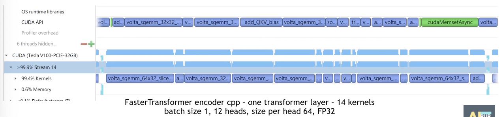

- [Preface](#sec-1)
- [Model Structure Analysis](#sec-2)
- [Specific Optimization Measures](#sec-3)
- [References](#sec-4)

# Preface

This article introduces the key points for optimizing the deployment of Transformer-style networks on GPU devices. It focuses mainly on NVIDIA's open-source [FasterTransformer](https://github.com/NVIDIA/FasterTransformer).

# Model Structure Analysis

The standard Transformer structure consists mainly of an `Encoder` and a `Decoder`. For a detailed analysis of the structure, see [Applications and Deployment of Transformer in CV](https://johneyzheng.top//posts/Transformer%E5%9C%A8CV%E9%A2%86%E5%9F%9F%E7%9A%84%E5%BA%94%E7%94%A8%E4%B8%8E%E9%83%A8%E7%BD%B2/):

 

The kernel structure of the Encoder is:

 

The kernel structure of the Decoder is:

 

We can see that:

The basic structures of the Encoder and Decoder are consistent. The main kernels (the bulk of the compute throughput) are the GEMM/Softmax kernels; in addition, there are many add bias/normalization operations (consisting of many small kernels). From the pipeline diagram of the `Encoder` model below, we can see that the large number of small kernels lengthens the kernel "Launch" time on the CPU side, producing a "Launch Bound" phenomenon, so the GPU's compute throughput cannot be fully exploited. 

# Specific Optimization Measures

Based on the basic structure of Transformer-style networks, NVIDIA has made a series of optimizations. The first is at the kernel fusion level, where a series of small kernels can be fused:

1.  LayerNorm small-kernel fusion: add bias + layernorm
2.  Activation function small-kernel fusion: add bias + relu/gelu
3.  Softmax small-kernel fusion: add bias + Softmax

At the core kernel level:

1.  GEMM is the main time-consuming kernel, and cuBLAS has focused on optimizing its performance: QKV GEMM fusion, automatic selection of the GEMM configuration, etc.
2.  An optimized Softmax kernel is used, with different FP32/FP16 implementations

Other optimization points:

1.  The half2 data type is used, which reduces the space needed for data copies
2.  At the instruction level:
    1.  Replace the expf operation with \_expf: lower precision, but better performance (mainly to speed up softmax?)
    2.  Use `__shfl_xor_sync` to accelerate the `reduce` operation (Layernorm)

The pipeline diagram of the optimized `Encoder` structure is shown below. There are basically no gaps between kernels, which improves GPU utilization; at the same time, the optimization of the core kernels also greatly improves model performance.

# References

[FasterTransformer Presentation-YouTube](https://www.youtube.com/watch?v=MDqNwSTLimU)
