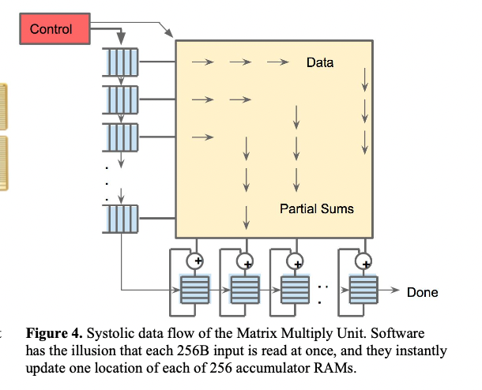

- [Background](#sec-1)
- [Abstract](#sec-2)
- [Design](#sec-3)
- [Performance Results](#sec-4)
- [Discussion && Conclusion](#sec-5)
- [Personal Views](#sec-6)
- [References](#sec-7)

# Background

[In-Datacenter Performance Analysis of a Tensor Processing Unit](https://arxiv.org/abs/1704.04760) was published at ISCA 2017 and mainly introduces the architecture of Google's TPU.

# Abstract

Since 2013, Google found that the many DNNs used for speech recognition and search required twice the compute throughput of the data centers at the time. Meanwhile, the large-scale demand for running deep learning networks was costly for the CPUs/GPUs of that time.

Tensor Processing Unit (TPU): developed by Google since 2015 and focused on accelerating neural network inference, it is an ASIC (application-specific integrated circuit).

Basic chip specifications:

-   MAC matrix unit: 65,535 8-bit
-   Accumulator: 4MiB 32bit, used to handle the 16bit results obtained after the MMU multiplication
-   Weight FIFO: the MMU gets data from the on-chip Weight FIFO, and the FIFO data comes from the off-chip DRAM Weight Memory (inferred to hold read-only weights). The FIFO depth is 4 tiles. Intermediate values of the computation are stored in the 24MB on-chip Unified Buffer (UB), and the UB can also serve as input to the MMU. The UB and main memory transfer data over DMA.
-   On-chip memory: 28 MiB of on-chip memory

`The heart of the TPU is a 65,536 8-bit MAC matrix multiply unit that offers a peak throughput of 92 TeraOps/second (TOPS) and a large (28 MiB) software-managed on-chip memory.`

Performance comparison: apart from a few networks, the TPU's throughput is 15X - 30X that of the corresponding GPU/CPU, and its energy efficiency (TOPS/Watt) reaches 30X - 80X.

`Despite low utilization for some applications, the TPU is on average about 15X - 30X faster than its contemporary GPU or CPU, with TOPS/Watt about 30X - 80X higher.`

Detailed comparison results:

The comparison covers three types of networks: MLP/LSTM/CNN

Comparison results:

-   The focus is on inference response time, and the comparison targets are the K80 GPU and the Haswell CPU

-   With lower power consumption and a smaller chip, the TPU has 25 times the MACs (8-bit mul) of the K80 and 3.5 times its on-chip memory, and its inference speed is 15X - 30X that of the K80 GPU and the Haswell CPU

-   On the TPU, 4 of 6 NN apps are memory-bandwidth limited. If a memory system similar to the K80 GPU's were implemented, performance could reach 30X - 50X.

# Design

Original design intent: like a GPU, it integrates a PCIe/IO bus and can be plugged directly into existing server equipment, but the TPU cannot fetch instructions from memory; instead, the server sends instructions into on-chip storage. The figure below shows the architecture diagram and the hardware layout. 

Architecture design: the main compute unit is the Matrix Multiply unit, whose input has two parts: the FIFO (weight matrix) and the UB (input data), and whose output goes to the accumulator unit (Accumulators). There are also dedicated nonlinear/Normalize/Pool units. 

Hardware layout: the UB takes up 29% of the area, the compute units (Matrix/Activation) take up 30%, and the rest is mainly other data buses, interface ports, and accumulators. Key features: double buffering, and sparsity is not supported for now; the DRAM/FIFO form the storage unit for matrix weight data, and the UB is the storage unit for matrix input data. The core idea is to hide other computation and data movement pipelines behind the compute pipeline.

The design philosophy of the TPU architecture: `The philosophy of the TPU microarchitecture is to keep the matrix unit busy.`

However, because reading data from SRAM consumes much more power than arithmetic operations, the TPU uses a unified buffer to reduce reads and writes. It uses "systolic execution" to reduce energy consumption: data arrives from different directions at fixed time intervals at the cells in the array, and the data is combined in the cells. The data flow is shown in the figure below: 

In the data flow above, a given 256-element (data size has an alignment restriction) multiply-accumulate operation moves forward through the matrix as a diagonal wavefront. The weights are preloaded and can immediately update every position of each 256 accumulators. The matrix's systolic array is transparent to software, which makes writing code easier.

TPU instructions are delivered over PCI, and the design follows a CISC approach, with an average CPI between 10 and 20 and roughly 10+ instructions in total. The key instructions are as follows:

1.  Read_Host_Memory: read data from CPU main memory into the UB
2.  Read_Weights: read data from the Weight Memory into the Weight FIFO as input to the MMU
3.  MatrixMultiply/Convolve: make the MMU perform one matrix multiplication/convolution, with data coming from the UB and results stored in the Accumulators. A matrix operation fetches B\*256 inputs (B is variable) and produces B\*256 outputs, completing within B pipeline cycles.
4.  Activate: perform the nonlinear activation operations of the neural network, including ReLU/Sigmoid, etc. The input comes from the Accumulators and the output is written to the UB; pooling can also be performed.
5.  Write_Host_Memory: write data in the UB to main memory.

The idea behind the instruction design is to raise the utilization of the MMU as much as possible, so CISC instructions with a 4-stage pipeline are used, with each instruction stage working independently.

# Performance Results

On specific network applications: the advantage is large on the Inception V2 network, but performance is poor on the AlexNet/VGG networks.

`Ironically, deploying and measuring popular small DNNs like AlexNet or VGG is difficult on production machines. However, one of our CNNs derives from Inception V2, which is widely used.`

The table below compares the parameters/performance/power consumption of the CPU/GPU (Boost mode disabled)/TPU: 

The figure below shows the roof-line of the models; for operational intensity, see [Introduction to Tops - Zhihu](https://zhuanlan.zhihu.com/p/343191353). Key points:

1.  The horizontal axis is operational intensity, i.e. how many operations can be supported per unit of data read in
2.  The vertical axis is the amount of computation per unit time, or equivalently the throughput per second
3.  There are two regions. The left is the rising region, which means throughput keeps increasing as operational intensity increases, and the slope represents bandwidth; the right is the saturation region, which means that even if operational intensity keeps increasing, performance does not improve, and the compute throughput bottleneck has been reached.

The paper gives the roofline model of 6 models, from which we can see: MLP/LSTM both perform poorly because of low operational intensity, whereas CNN1's performance problem is mainly that its feature map depth is small, so the compute units have to wait for weights to be loaded (35% of the time) and do not fully use the compute throughput.

The figure below compares TPU/CPU/GPU on roofline, performance && Watt/Watts && Workload. In addition, chip power consumption differs under different loads, and in most cases chips are not at 100% workload: 

Analyzing the performance bottlenecks of the current networks also shows that increasing memory bandwidth brings the greatest benefit to performance: 

# Discussion && Conclusion

The paper stresses the importance of `reponse time` and argues that the TPU has an advantage over the GPU:

`Given their throughput-oriented architectural approach, it may be more challenging for GPUs to meet the strict latency limits.`

Summary views:

1.  Advantages of the TPU: although bandwidth is limited, thanks to its architecture the TPU still has a performance advantage: it integrates more compute throughput and on-chip memory in a relatively small chip area, while consuming less than half the power of the GPU (K80). The core features of the current TPU architecture are:
    -   A matrix compute unit of appropriate size
    -   An inference process that is independent on the device side, reducing dependence on the CPU
    -   Omitting some general-purpose design (instruction fetch, multithreading, etc.), saving area for the datapath and storage
    -   Application of 8bit integer quantization

2.  CNNs account for only 5% of the actual workload, and MLPs/LSTMs need more attention.

3.  In practical applications, latency on both the host side and the device side needs attention

Finally, to summarize the overall advantages of the TPU: a relatively larger matrix compute unit / larger software-controllable on-chip storage / fully device-side model inference capability (reducing dependence on the host CPU). That is, it is positioned as a dedicated chip that gives up general-purpose features but achieves a smaller size and low power consumption, with a larger datapath/memory, and it can serve as a chip prototype for "domain-specific architectures".

# Personal Views

1.  The GPU compared against is the K80, which is not a high-performing GPU, so the comparison results lack sufficient persuasiveness. The TPU also has later v2 and v3 versions; the later chip development is shown in the figure below
2.  The paper also mentions that increasing memory bandwidth is key to the TPU's growth
3.  The paper stresses response time, but with the latest GPU frameworks it seems to matter very little now

# References

[Google TPU Architecture (Zhihu)](https://zhuanlan.zhihu.com/p/31488261)

 [Google AI Cloud Chip: TPU Architecture Analysis](https://zhuanlan.zhihu.com/p/61762517) [AI Chips: Google TPU Analysis](https://blog.csdn.net/qq_37719487/article/details/113405103)
