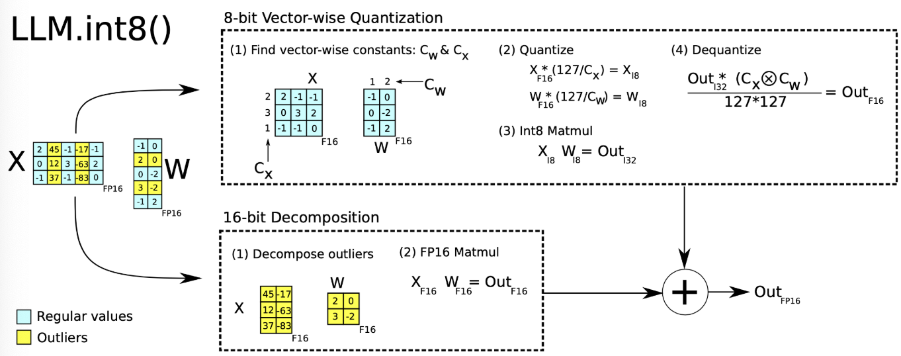

## An Overview of LLM Quantization Algorithms

### Quantization Basics

INT8 quantization converts a model's weights and activations from FP16/FP32 to the INT8 format. The simplest approach is to use a `linear mapping` to map the floating-point range onto the integer range:

$$x_{int8} = \text clip\left(\text{round}\left(\frac{x_{float} - z}{s}\right), qmin, qmax\right)$$

+ $z$ : the zero point, used for the offset.
+ $s$ : the scaling factor, which controls the mapping between the floating-point and integer ranges.
+ $qmin,qmax$: the minimum/maximum quantized values.

Depending on whether retraining is required, there are two approaches:

+ **Post-training Quantization (PTQ)**:

  + Quantizes the weights of an already trained model offline.

  + Commonly uses symmetric or asymmetric quantization.

+ **Quantization-aware Training (QAT)**:
  + Simulates the effect of quantization during training so that the model adapts to the quantized weights and activations.

**Quantization granularity**

In terms of granularity, quantization can be distinguished along the following dimensions:

+ Per-tensor: a single layer or tensor has only one scaling factor.
+ Per-channel: each channel has its own scaling factor. For example, if $W$ has shape $d \times h$, the scaling factor has shape $d \times 1$.
+ Per-token: usually used for activation quantization, quantizing along the token dimension, with shape $L \times 1$.
+ Per-group / group-wise: quantizes in groups, for example combined with channel-wise.

**What to quantize**

+ `Weight`: Weight quantization is the most common target. Quantizing weights reduces the model's memory footprint. Weights are fixed after training and their value range is independent of the input, so they can be quantized offline and are usually relatively easy to quantize. Typical schemes are W8A16 (MinMax) and W4A16 (AWQ, GPTQ).

+ `Activation`: In practice, activations often account for most of the memory use, so quantizing them can substantially reduce memory use. More importantly, combined with weight quantization it can make full use of integer arithmetic to improve inference performance. But activation outputs vary with the input, so their dynamic range has to be gathered from data, and they are usually harder to quantize. Typical schemes are W8A8 (LLM.int8, SmoothQuant).

+ `KV Cache`: Besides weights and activations, the KV cache in LLMs also consumes a lot of memory. Quantizing the KV cache is therefore essential for improving the throughput of long-sequence generation. Typical schemes are KV8 (INT8 in TensorRT-LLM, FP8 in vLLM) and KV4 (Atom).

### Main Algorithms

**[LLM.int8](https://arxiv.org/abs/2208.07339)**

`LLM.int8` is a quantization method based on mixed-precision decomposition. It first decomposes the matrix and quantizes the vast majority of weights and activations to 8 bits (vector-wise). For the few dimensions that carry outlier features, it keeps 16 bits and performs the matrix multiplication at higher precision.

`LLM.int8` completes a matrix multiplication in three steps:

- From the input hidden states, extract outliers by column (outlier features, i.e., values above some threshold).
- Perform FP16 matrix multiplication on the outlier features, and quantize the non-outlier features and perform INT8 matrix multiplication on them.
- Dequantize the matrix multiplication result for the non-outliers and add it to the outlier matrix multiplication result to obtain the final FP16 result.

**[GPTQ](https://arxiv.org/abs/2210.17323)**

`GPTQ` generally comes in two schemes, W4A16 and W8A16, and generally requires a calibration dataset:

By decomposing the Hessian matrix and quantizing iteratively, GPTQ groups the weights (for example, 128 columns per group) into multiple sub-matrices (blocks). It quantizes all parameters within a block one by one, and after each parameter is quantized, the other not-yet-quantized parameters in the block must be adjusted appropriately to compensate for the accuracy loss caused by quantization. This is why GPTQ quantization requires a calibration dataset.

The GPTQ quantization process is shown in the figure below. First, a `Cholesky` decomposition is used to solve for the inverse of the `Hessian` matrix. Then, in a given step, a block of consecutive columns is quantized, and at the end of that step the remaining weights (blue) are updated. The quantization process is applied recursively within each block, and the white middle columns indicate the ones currently being quantized.

{: .img-small }

The pseudocode for updating the weights is as follows:

**[AWQ](https://arxiv.org/pdf/2306.00978)**

Supports W4A16 and W8A16. It is activation-aware quantization and performs fully INT4/INT8 weight quantization.

**Core idea**: It stems from the observation that "weights are not equally important to an LLM's performance." About 0.1%-1% of the weights are salient and have an outsized effect on the model's performance, so skipping quantization for this 1% of important weights (salient weights) can greatly reduce quantization error.

**Algorithm steps**:

1. Salient weights are identified by analyzing the activation distribution. The top 1% is taken as the salient weights. Keeping those channels in FP16 (mixed precision) would be inefficient to implement in hardware.
2. After a salient weight is multiplied by a scaling factor, its quantization error becomes smaller than before, and different salient weights also receive different degrees of protection: the paper searches the search space for the optimal scaling by minimizing the difference of the layer's output before and after quantization.

**[SmoothQuant](https://arxiv.org/abs/2211.10438)**

Supports W8A8 and joint weight/activation quantization (per-tensor or per-channel for weights, and per-token or per-tensor for activations).

Its motivation is the finding that activations need channel-wise quantization to retain accuracy, but channel-wise activation quantization is very inefficient, so it instead:

smoothly shifts the difficulty of activation quantization onto weight quantization. `SmoothQuant` proposes a mathematically equivalent per-channel scaling transformation (`per-channel scaling transformation`) that significantly smooths out the magnitudes across channels, making the model easy to quantize. 

{: .img-mid }

**[KV_Quant](https://arxiv.org/pdf/2401.18079)**

KVQuant mitigates the accuracy loss of KV cache quantization by combining several novel methods. The specific optimization techniques are as follows:

1. Per-channel quantization of Keys (`Per-Channel`): by adjusting the quantization dimension of Key activations to better match their distribution. Per-channel quantization of Keys was also explored in the concurrent work KIVI, which groups large-magnitude values in the same channel together to minimize quantization error. Their per-channel approach needs fine-grained grouping while keeping part of the KV cache in FP16 precision. This work instead shows that, by using an offline calibration set, per-channel quantization can be performed accurately without grouping.
2. Quantizing Keys before the `Position Embedding`: Key activations are quantized before the rotary positional embedding is applied, to mitigate the embedding's effect on quantization.
3. Non-uniform KV cache quantization: a per-layer, sensitivity-weighted non-uniform data type is derived to represent the distribution better.
4. Per-vector dense-and-sparse quantization: the outliers of each vector are isolated separately to minimize the skew in the quantization range.
5. Attention Sink-aware quantization: because of the Attention Sink phenomenon, the model is unusually sensitive to quantization error in some tokens. Keeping only those tokens in FP16 preserves the model's accuracy.
6. With per-channel quantization, updating the scaling factors online is challenging, because the scaling factor for each incoming channel may need to be updated whenever a new token is added to the KV cache. The statistics are therefore computed offline (that is, using calibration data before inference runs). Per-channel quantization makes offline calibration effective, which avoids the need to update scaling factors online. For per-token quantization, calibrating scaling factors offline is challenging because of outlier Value tokens. Each incoming token therefore has its scaling factor and outlier threshold computed online. The per-token outlier threshold is computed efficiently online by offloading to the CPU. With a custom quantization function implementation to compress activations, per-token Value quantization can be performed online without hurting performance.

## References

[Principles of LLM quantization: a summary](https://zhuanlan.zhihu.com/p/11886909512)

[Large Transformer Model Inference Optimization](https://lilianweng.github.io/posts/2023-01-10-inference-optimization/)
