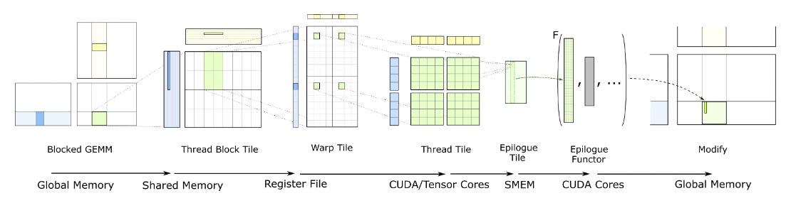

## GEMM Kernel Optimization

The core of GEMM optimization is:

1.  Improve the cache hit rate by designing a better data layout (tiling).
2.  Improve parallelism by making full use of instruction vectorization and multi-core parallelism.

First, look at a naive implementation:

```c++
void naive_row_major_sgemm(const float* A, const float* B, float* C, const int M,
                           const int N, const int K) {
    for (int m = 0; m < M; ++m) {
        for (int n = 0; n < N; ++n) {
            for (int k = 0; k < K; ++k) {
                C[m * N + n] += A[m * K + k] * B[k * N + n];
            }
        }
    }
}
```

Its floating-point operation count is 2xMxNxK, with 2xMxNxK cache reads and MxN writes. But this way of writing it causes many cache misses: 

A simple loop reorder already gives a speedup:

```c++
void optimize_row_major_sgemm(const float* A, const float* B, float* C, const int M,
                              const int N, const int K) {
    for (int m = 0; m < M; ++m) {
        for (int k = 0; k < K; ++k) {
            for (int n = 0; n < N; ++n) {
                C[m * N + n] += A[m * K + k] * B[k * N + n];
            }
        }
    }
}
```

To improve performance further, matrices A and B need to be computed in blocks. For CUDA, this means designing the tiling logic from Global Memory to Shared Memory to Register, and the key is to improve the cache hit rate. 



Introducing shared memory to cache sub-matrix blocks reduces accesses to global memory:

+ Each thread block is responsible for computing one sub-matrix block of C.
+ Each time, one sub-block is loaded from global memory into shared memory.

```c++
#define TILE_M 16
#define TILE_N 16
#define TILE_K 16

__global__ void gemm_tiled(float *A, float *B, float *C, int M, int N, int K) {
    // 定义共享内存
    __shared__ float tile_A[TILE_M][TILE_K];
    __shared__ float tile_B[TILE_K][TILE_N];

    // 计算当前线程块的位置
    int block_row = blockIdx.y;
    int block_col = blockIdx.x;

    // 计算当前线程的位置
    int thread_row = threadIdx.y;
    int thread_col = threadIdx.x;

    // 结果存储到寄存器
    float value = 0.0f;

    // 遍历所有子块
    for (int k = 0; k < (K + TILE_K - 1) / TILE_K; ++k) {
        // 加载 A 的子块到共享内存
        if (block_row * TILE_M + thread_row < M && k * TILE_K + thread_col < K) {
            tile_A[thread_row][thread_col] = A[(block_row * TILE_M + thread_row) * K + (k * TILE_K + thread_col)];
        } else {
            tile_A[thread_row][thread_col] = 0.0f;
        }

        // 加载 B 的子块到共享内存
        if (k * TILE_K + thread_row < K && block_col * TILE_N + thread_col < N) {
            tile_B[thread_row][thread_col] = B[(k * TILE_K + thread_row) * N + (block_col * TILE_N + thread_col)];
        } else {
            tile_B[thread_row][thread_col] = 0.0f;
        }

        __syncthreads();

        // 从共享内存加载到寄存器并计算
        for (int t = 0; t < TILE_K; ++t) {
            value += tile_A[thread_row][t] * tile_B[t][thread_col];
        }

        __syncthreads();
    }

    // 写回全局内存
    if (block_row * TILE_M + thread_row < M && block_col * TILE_N + thread_col < N) {
        C[(block_row * TILE_M + thread_row) * N + (block_col * TILE_N + thread_col)] = value;
    }
}
```

In addition, to reduce the overhead of loop control, the loop can be unrolled by hand to improve performance. Assuming the matrix dimension is a multiple of the unroll size, the loop iterations are divided into fixed-size unroll steps.

```c++
#define UNROLL_FACTOR 4  // 展开因子
// 原始实现：从共享内存加载到寄存器并计算
//        for (int t = 0; t < TILE_K; ++t) {
//            value += tile_A[thread_row][t] * tile_B[t][thread_col];
//        }
for (int t = 0; t < TILE_K; t += UNROLL_FACTOR) {
    value += tile_A[thread_row][t] * tile_B[t][thread_col];
    value += tile_A[thread_row][t + 1] * tile_B[t + 1][thread_col];
    value += tile_A[thread_row][t + 2] * tile_B[t + 2][thread_col];
    value += tile_A[thread_row][t + 3] * tile_B[t + 3][thread_col];
}
```
