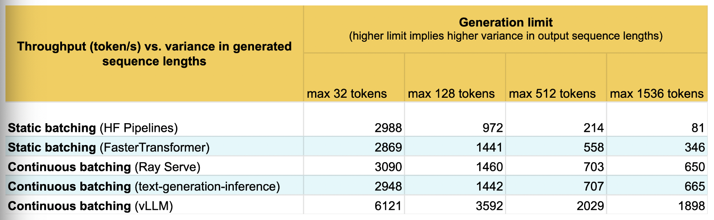

#### Orca: The Continuous Batching Strategy

**Paper**

[Orca: A Distributed Serving System for Transformer-Based Generative Models](https://www.usenix.org/system/files/osdi22-yu.pdf)

 LLM inference is mainly divided into the prefill and decode phases. Prefill is compute-bound, while decode is memory-I/O-bound, which means the GPU memory bandwidth needs to be fully used. But GPU memory is limited. On an A100-40GB with a 13B model, for example, the weights take 26GB and each token consumes about 1MB of GPU memory (activations, cache, and so on), so at a sequence length of 2048 only 7 batches can be served, and compute utilization is very low. To improve compute utilization, one option is to reduce memory through quantization, or to reduce memory I/O by optimizing kernels such as FlashAttention. Another is to improve batching efficiency at the scheduling level through continuous batching.

**Motivation**

Traditional `static batching` looks like this: 

Clearly, because different requests in the batch produce different numbers of output tokens, requests 1, 3, and 4 have empty slots, which means that for a period only request 2 is computing. `Continuous batching` uses an `iteration-level` scheduling strategy: 

**Key Points**

The core ideas of `ORCA` are `iteration-level scheduling` and `selective batching`.

+ `iteration-level scheduling`: The task execution order is adjusted dynamically at every iteration. Hardware utilization can be improved through task priorities and micro-batch pipelining.

  {: .img-small }

+ `selective batching`: The model input has shape $[B,L,H]$. `Non-Attention` operators, such as matrix multiplication and `LayerNorm`, support merging $B \times H$, but the `Attention` operator needs the B and L dimensions kept separate. `Selective batching` handles the dimensions by splitting and merging before and after `Attention`, which supports ORCA's dynamic batching.

  {: .img-small }

**Statistics**

