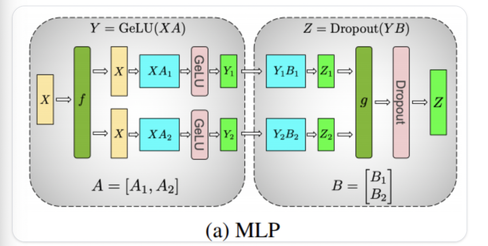

#### Deploying LLMs with Pipeline and Tensor Parallelism

For training, the parallelism strategies include DP, TP, PP, and EP, combinations of these strategies, and offload strategies such as ZeRO.

For inference, the most commonly used strategies are TP and PP. The most common TP strategy splits the `MLP/Self-Attention` (splitting by num_head), following the overall pattern `col-spllit->row-split->all-reduce`.

In terms of parameter count, each GPU holds $\frac {1}{TP}$ of the weights, $\frac {1}{TP}$ of the computation, and $\frac {1}{TP}$ of the activations, but since the input is the full seqlen, the KV cache is held in full. The communication volume is $2 \times b \times s \times h + 2 \times b \times s \times h$, which is large, so TP generally needs high communication bandwidth. 

{: .img-mid }

{: .img-mid }

The PP partitioning strategy is relatively simple. It usually splits by Transformer Block (`num_layers/pp_world_size`), with different blocks communicating through send/recv. Since inference involves only the forward phase, pipeline bubbles are not significant either, as long as the Transformer Block computation is balanced across GPUs. In terms of parameter count, each GPU holds $\frac1{PP}$ of the weights, $\frac {1}{PP}$ of the computation, $\frac1{PP}$ of the activations, and $\frac1{PP}$ of the KV cache. The communication volume is $b \times s \times h$.

**Micro-Batch**: A large batch (Global Batch) is split into multiple small batches that are passed along the pipeline batch by batch. While each device processes one micro-batch, it can receive the data of another, so execution proceeds in parallel, which reduces PP bubbles:

