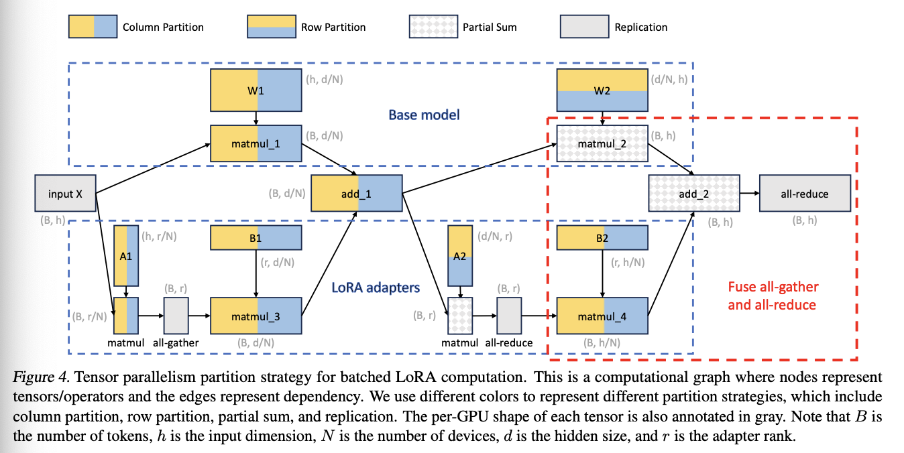
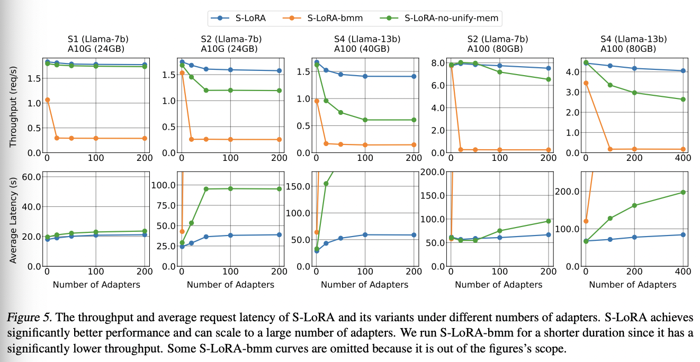

## LoRA and Multi-LoRA

**Paper**

[MULTILORA: DEMOCRATIZING LORA FOR BETTER MULTI-TASK LEARNING](https://arxiv.org/pdf/2311.11501)

[S-LoRA: SERVING THOUSANDS OF CONCURRENT LORA ADAPTERS](https://arxiv.org/pdf/2311.03285)

**Motivation**

PEFT lowers the hardware compute requirements of fine-tuning large models, and a common example is LoRA. For multi-task PEFT, earlier work could not integrate seamlessly with the base model's parameters the way LoRA does. The difficulties of deploying multi-LoRA for inference are:

1.  A single LoRA can merge its weights into the base model for LoRA inference with no overhead, but for multi-LoRA this approach is inefficient.
2.  There may be many multi-LoRA adapters, and loading all of them may use too much GPU memory, so adapters need to be loaded and offloaded between host and device memory.
3.  Problem 2 requires solving memory fragmentation and the latency overhead of dynamic loading and offloading.

**Key Points**

The core flow is as follows:

The multiple LoRAs are independent, but during the forward pass they share the forward computation over all the training data, and when the loss is updated, each task's LoRA weights are updated individually according to a mask matrix. 

 {: .img-small }

For inference deployment, the key is to solve the problem of dynamically loading multi-LoRA adapters described above. The main solutions are:

1. Specified CUDA kernels: Custom batched GEMM kernels are written to compute LoRA. 

   {: .img-small }

2. Memory allocator design: Host memory stores all adapter weights, and during inference the required adapter weights must be fetched into GPU memory in real time.

   {: .img-mid }

3. Unified Paging: It extends PagedAttention's memory management approach by giving LoRA weights a dedicated memory pool to reduce memory fragmentation, and prefetches weights so that computation and weight loading run in parallel.

   

4. Tensor parallelism: The parallelism strategy on the LoRA side is as follows: 

   

**Statistics**

With the S-LoRA approach, thousands of LoRA adapters can be deployed on a single GPU or multiple GPUs. The following are some results for Llama-7B/13B/30B/70B:

