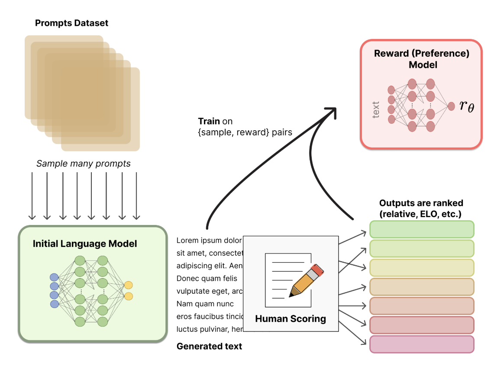

## Overview

`RLHF` (Reinforcement Learning from Human Feedback) is a new training paradigm in the field of Large Language Model (LLM) generation. It optimizes a language model with reinforcement learning, guided by human feedback.

The significance of `RLHF` is that it combines human preferences with reinforcement learning techniques to optimize the model's output, so that the model better matches human expectations and avoids problems of traditional training methods. For example, the output may only consider grammatical correctness and coherence without considering whether it makes sense, which leads to meaningless answers that are completely off the point, and the output cannot satisfy the constraints of various rules and values.

`RLHF` brings human feedback into the training process through a `reward model`, and optimizes the policy with a reinforcement learning strategy, so that the trained result better matches user needs and can also adapt to new scenarios faster.

Reinforcement learning (RL) consists of several components:

1. State space: the state space is all the information available for the current task that is relevant to the decisions an AI agent may make, including known and unknown variables. The state space usually changes with each decision the agent makes.
2. Action space: the action space contains all the decisions an AI agent may make. In a board game, for example, the action space is discrete and well defined: it consists of all the legal moves the AI player can make at a given moment. In a text generation task, the action space is enormous, covering the entire `token` vocabulary available to the LLM.
3. Reward function: a reward is a measure that motivates the AI agent's success or progress. In some cases, such as board games, the definition of success (here, winning the game) is objective and direct. But when the definition of "success" is vague, designing an effective reward function can be a significant challenge. In a mathematical framework, this feedback must be converted into a reward signal: a scalar quantification of positive (or negative) feedback.
4. Constraints: the reward function can be supplemented with penalties (negative rewards), that is, penalties for behavior considered counterproductive to the current task. For example, a company may want to prohibit a chatbot from using profanity or other vulgar language; a self-driving car model may be penalized for collisions or for leaving its lane.
5. Policy: in essence, the *policy* is the strategy or "thought process" that drives the AI agent's behavior. In simple mathematical terms, a policy ("*π*") is a function that takes a state ("*s*") as input and returns an action ("*a*"): *π(s)→a.*


## Algorithm Framework

The framework for training an LLM with `RLHF` consists mainly of the following parts:


1. `Actor Model`

   **Needs training.** The `Actor Model` (the policy model) is the target language model that training should finally produce. It is continually updated through the reward signal (provided by the `Reward Model`) and a policy optimization algorithm (such as PPO). It is usually initialized from a pretrained LLM.

2. `Critic Model`

   **Needs training.** The `Critic Model` estimates the value of a given state (the Value Function). In the `Actor-Critic` reinforcement learning framework, the `Critic Model` assists the `Actor Model` by computing the advantage function to guide policy updates.

3. `Reward Model`

   **Does not need training; it is trained in advance.**

   The reward model evaluates generated results, quantifies their quality, and guides policy optimization. It is the core of RLHF and directly determines the optimization objective of reinforcement learning. It has to be trained in advance, and usually covers different dimensions: safety, evaluation of values, reasonableness, and so on.

4. `Reference Model`

   **Does not need training; it is trained in advance.** The `Reference Model` is the baseline for comparison during training, used to keep the behavior of the `Actor Model` from drifting too far from the pretrained model. It provides a comparison between the new and old policies, and is usually used to compute the KL divergence constraint.

   $$D_{\text{KL}}(P \| Q) = \sum_x P(x) \log \frac{P(x)}{Q(x)}$$


   + P is usually the distribution of the current policy $\pi_\theta$ (the `Actor Model`).

   + Q is usually the distribution of the baseline policy $\pi_{\text{reference}}$ (the `Reference Model`).

   

Training an LLM with RLHF usually involves the following stages:

1. Pretrained model training

   This usually uses the traditional `LLM Pretrain` and `SFT` (optional). The process produces the initialization model for the subsequent RLHF training.

   

2. Reward Model training

   The RM is usually a fine-tuned LLM, and the fine-tuning data comes from human annotation. There are generally two annotation methods:

   1. **Ranking data** (`Pairwise Preference`): annotators choose the better output, for example "output y_1 is better than y_2".
   2. **Absolute scores** (Optional): assign a score to each output y, for example "output y_1 scores 4 and y_2 scores 2".

   Absolute scores are usually quite noisy because of "standards that are hard to unify" and "differences in personal values". Therefore, ranking data is usually used, and the reward model is trained and optimized with a `pair wiss loss`: the model is given two answers to the same question at the same time, and learns which of the two sentences should score higher and which lower.

   Structurally, the `Reward Model` extends the original LLM, usually by adding a linear regression head:

   ```plaintext
   Pre-trained LM (Transformer)
             ↓
   Pooling / Last Hidden State
             ↓
   Linear Layer (Reward Head)
             ↓
   Softmax: Scalar Reward Score R(y|x)
   ```

   

3. Policy optimization

   Once the pretrained model and the Reward Model are available, the model can be trained with an RL strategy. The SFT task is turned into an RL problem: the policy's action space (`action space`) is all the raw tokens of the LM, the observation space (`observation space`) is the possible input token sequences, and the reward function is a combination of the Reward Model and a constraint on how far the policy shifts.

   The core RL strategy is Proximal Policy Optimization (`PPO`). Its reward function combines the difference between the output texts of the initial LLM and the fine-tuned LLM (for example the KL divergence) with the scalar reward obtained by feeding the fine-tuned LLM's text into the RM.

   

## RL Algorithms

As mentioned above, the core of an RL algorithm is the process of obtaining the best $a_t$ from $s_t$, where $s_t$ comes from the state space, $a_t$ comes from the action space, the mapping from $s_t$ to $a_t$ is given by the policy function, and $r_t$ comes from the reward function (including the negative rewards of penalty terms) and is used to update the policy function. The core steps are as follows:

1. The agent observes the environment state $s_t$ .
2. According to the current policy $\pi$ , it selects an action $a_t$ .
3. The environment receives the action $a_t$ and returns a reward $r_t$ and the next state $s_{t+1}$ .
4. The agent learns from the reward $r_t$ and $s_{t+1}$ and updates the policy $\pi$ .
5. Repeat the above process until the task is complete or a termination condition is reached.

The core logic of policy learning is to guide the agent toward the optimal policy through value functions (`Value Function`). Value functions usually fall into two kinds:

1. On-Policy Value Function

   The value function $V^{\pi}(s)$ based on the state value $s$
   
   $$V^{\pi}(s) = \mathop{E}\limits_{\tau \sim \pi}[{R(\tau)\left| s_0 = s\right.}]$$

   
   Here $\pi$ is the policy function, and $\tau$ is the corresponding trajectory, a collection of states and actions:
   
   $$\tau = (s_0, a_0, s_1, a_1, ...).$$

   
   $R(\tau)$ is the cumulative `Reward` of the corresponding $\tau$:
   
   $$R(\tau) = \sum_{t=0}^{\infty} \gamma^t r_t.$$


   $$r_t = R(s_t, a_t, s_{t+1})$$


2. On-Policy Action-Value Function

   The state-action value function $Q^{\pi}(s,a)$

   $$Q^{\pi}(s,a) = \mathop{E}\limits_{\tau \sim \pi}[{R(\tau)\left| s_0 = s, a_0 = a\right.}]$$


3. 

​	Ideally, the value function should be maximized:

$$Q^*(s,a) = \max_{\pi} \mathop{E}\limits_{\tau \sim \pi}{[R(\tau)\left| s_0 = s, a_0 = a\right.}]$$

​	If $Q^\*$ is known, the optimal $a^\*(s)$ can be obtained directly:

$$a^*(s) = \arg \max_a Q^* (s,a)$$

In some scenarios, you also need to look at the relative advantage of a specific action ($Advantage\ Function$):

$$A^{\pi}(s,a) = Q^{\pi}(s,a) - V^{\pi}(s)$$

Value functions follow the `Bellman equations`, which describe the recursive relationship between the values of states and of state-action pairs:

> The value of your starting point is the reward you expect to get from being there, plus the value of wherever you land next.

The `Bellman equations` of the value functions are:

$$\begin{align*}
V^a{\pi}(s) &= \mathop{E}\limits_{a \sim \pi , \\ s'\sim P}{[r(s,a) + \gamma V^{\pi}(s')}], \\
Q^{\pi}(s,a) &= \mathop{E}\limits_{s'\sim P}[{r(s,a) + \gamma \mathop{E}\limits_{a'\sim \pi}{Q^{\pi}(s',a')}}],
\end{align*}$$

Here $r$ is the current immediate reward, $ \gamma \in [0,1] $ is the discount factor that controls the trade-off between short-term and long-term rewards, and $P$ describes the generation probability of $\tau$. A policy trajectory over T steps can be expressed as:

$$P(\tau|\pi) = \rho_0 (s_0) \prod_{t=0}^{T-1} P(s_{t+1} | s_t, a_t) \pi(a_t | s_t).$$

This means that each policy choice $a_t$ needs to achieve as high a $Q^\pi$ as possible.

The whole process is in essence a `Markov Decision Process (MDP)`. A single `MDP` is a 5-tuple, $\langle S, A, R, P, \rho_0 \rangle$, where:

- $S$ is the set of all valid states,
- $A$ is the set of all actions,
- $R : S \times A \times S \to \mathbb{R} $ is the `Reward Function`, that is: $r_t = R(s_t, a_t, s_{t+1})$,
- $P:S \times A \to \mathcal{P}(S)$ is the transition probability function, where $P(s'\|s,a)]$ is the probability of transitioning to $s'$ given $s$ and $a$,
- $\rho_0$ is the initial state distribution.


## The PPO Algorithm

[PPO](https://arxiv.org/pdf/1707.06347) (``Proximal Policy Optimization`) was proposed by OpenAI in 2017 as an optimization of the TRPO algorithm. Both belong to the family of policy optimization (`Policy Optimization`) algorithms, which generally include two kinds of methods:

- Policy Gradient Methods

  These optimize an objective function using the policy gradient. The most commonly used form of the objective function ($Loss$) is:

$$L^\text{PG}(\theta) = \mathbb{E}log{\pi}_{\theta}(a_t | s_t) A_t].$$

- Trust Region Methods

  The core idea is to control the size of policy updates by limiting the difference between the new and old policies, such as the KL divergence constraint in `TRPO`:

$$\max_\theta \mathbb{E}_{t} \left[ \frac{\pi\theta(a_t|s_t)}{\pi_{\text{old}}(a_t|s_t)} A_t \right]$$

$$\text{subject to } E_{t}[\text{KL}[\pi_{\theta_\text{old}}(\cdot|s_t),\pi_\theta(\cdot|s_t)]] \leq \delta$$

On top of the above, the core optimization ideas PPO proposes are:

- PPO-Clip

  It clips the range of $r_t(\theta)$​ to avoid overly large updates. The objective function is:
  
  $$L^\text{CLIP}(\theta) = \mathbb{E}_t \left[ \min \left( r_t(\theta) A_t, \text{clip}(r_t(\theta), 1-\epsilon, 1+\epsilon) A_t \right) \right]$$

  where:

  - $r_t(\theta) = \frac{\pi_\theta(a_t \| s_t)}{\pi_{\text{old}}(a_t \| s_t)}$ is the probability ratio.
  - $ \epsilon$ is the clipping range (generally 0.1 or 0.2).

  How clipping works:

  - When $r_t(\theta) $ moves outside $ [1-\epsilon, 1+\epsilon] $, it is restricted to the clipping range, which avoids overly large updates.
  - It ensures that during optimization the new policy does not deviate too far from the old policy, which improves training stability.

- PPO-KL

  It adds the KL divergence to the objective function as a regularization term. The objective function is:

  $$L^\text{KL}(\theta) = \mathbb{E}t \left[ L^\text{PG}(\theta) - \beta {\text{KL}} \left[ \pi_{\text{old}}(\cdot | s_t),\pi_\theta(\cdot | s_t) \right] \right]$$

  where:

  - $D_{\text{KL}}$ is the KL divergence between the new and old policies.
  - $\beta$ is the regularization coefficient that controls the influence of the KL divergence, and it needs to be adjusted dynamically:
    - $d=E_t\left[{\text{KL}} \left[ \pi_{\text{old}}(\cdot \| s_t), \pi_\theta(\cdot \| s_t) \right] \right]$
    - $If\ d < d_{targ}/1.5, \beta \leftarrow \beta/2$
    - $If\ d > d_{targ}/1.5, \beta \leftarrow \beta \times2$

PPO policy iteration is still based on the policy gradient optimization process. Each iteration includes the following steps:

**Step 1: Sampling**

Use the current policy $\pi_\theta$ to interact with the environment and generate a batch of trajectories $\tau$ :

$$\tau = \{(s_1, a_1, r_1), (s_2, a_2, r_2), \dots\}$$

**Step 2: Compute the advantage function**

Compute the advantage function $A_t$ with the following formula:

$$A_t = \delta_t + \gamma \delta_{t+1} + \gamma^2 \delta_{t+2} + \dots$$

where $\delta_t$ is the TD error at time step t:

$$\delta_t = r_t + \gamma V_\phi(s_{t+1}) - V_\phi(s_t)$$

**Step 3: Policy update**

Optimize the objective function (PPO-Clip or PPO-KL) to update the policy parameters $\theta$ :

$$\theta \leftarrow \arg\max_\theta L^\text{CLIP}(\theta) \quad \text{or} \quad L^\text{KL}(\theta)$$

**Step 4: Value function update**

Optimize the mean squared error (MSE) objective function to update the value function parameters $\phi$ :

$$L^\text{VF}(\phi) = \mathbb{E}t \left[ \left( V\phi(s_t) - \hat{R}_t \right)^2 \right]$$

where $\hat{R}_t$ is the return estimated from the sampled trajectories.

**Step 5: Repeat**

Repeat the sampling and update process until the convergence condition is reached.

## Engineering Details

Take the implementation of [OpenRLHF](https://github.com/OpenRLHF/OpenRLHF) as an example. In this implementation, the training framework is based on DeepSpeed, the model library is based on

HuggingFace, distributed scaling is based on ray, and the inference framework is boosted by vLLM. The overall framework is as follows:


The data flow is as follows:


## References

[The "Unsung Hero" Behind ChatGPT: RLHF Explained in Detail](https://zhuanlan.zhihu.com/p/599016986)

[Reinforcement Learning from Zero to RLHF (8): One Diagram Breaking Down PPO in RLHF](https://zhuanlan.zhihu.com/p/635757674)

[Understanding the Proximal Policy Optimization (PPO) Algorithm: Starting from Policy Gradients](https://zhuanlan.zhihu.com/p/614115887)

[OpenRLHF | A Lightweight, High-Performance RLHF Framework](https://hub.baai.ac.cn/view/35434)
