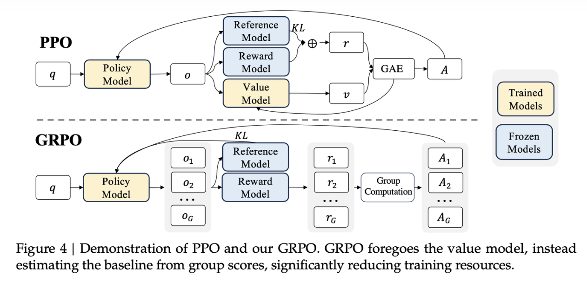

## Preface

This article discusses what the O1, O3, R1, and Kimi 1.5 models imply for AI infrastructure, mainly thinking and challenges at the inference-framework and infrastructure layer.

In their behavior, these models share one trait: all of them have a long chain of thought. Inference cost goes up, and at the same time the results improve markedly (especially on code, math, and similar tasks). DeepSeek R1 and Kimi 1.5 have both open-sourced the model and a fairly detailed technical report. DeepSeek R1 emphasizes the training process and the different technical paths tried along the way. Kimi 1.5 discloses more detail on the engineering side. OpenAI has not disclosed an official technical approach, so one can only make a shallow guess from the model's behavior and the team's earlier technical path.

## The Long-CoT Technical Path

`Long CoT` (long chain-of-thought) is a reasoning-enhancement technique based on chain-of-thought (`CoT`). It aims to improve a large language model's (LLM) performance on complex reasoning tasks by generating a longer reasoning chain. Compared with a traditional short reasoning chain (`Short CoT`), `Long CoT` can handle more complex tasks, because it lets the model think more deeply before it produces the final answer.

Below are the answers DeepSeek R1 and Kimi 1.5 give to the same question, DeepSeek R1 (left) and Kimi 1.5 (right):

Even for the simple question `1+1=?`, a `Long CoT` model still has a long intermediate thinking process. On this output, Kimi 1.5's chain of thought is much longer (I tried some other math problems, and all of them showed a similar pattern).

### The O1 Technical Path (a Guess)

Looking at the training process of GPT-4, the predecessor of O1: GPT-4 is Pre-Training + Post-Training (SFT + RLHF) → Inference (token by token). On that basis O1 strengthens `Long CoT`, which can be sketched as O1: Pre-Training + CoT Training (CoT SFT + RLHF) + Post-Training (SFT + RLHF) → Inference (CoT + Summary). The core technical detail is the `CoT Training` stage. What is fairly clear about that stage is:

1. CoT pretraining + SFT:

   Whether it is pretraining or SFT, CoT data has to be added to fill in CoT ability and to lay a foundation for the later RL training (R1-Zero also showed that training with RL directly can lengthen the CoT, but few training details are given, and my impression is that the run is easy to destabilize). CoT data can be human-annotated (expensive, and more expensive still if the annotation is based on PRM training), distilled from another CoT model, or synthesized (prompt engineering that uses an LLM to generate it).

2. CoT + summary inference:

   For a CoT model, the `hidden CoT` is not shown directly to the user (it is visible for R1 / K1.5), so the final output includes a summary stage. The inference process is `<Think/Reflection...>
`. Whether different stages are produced by different models is still debated (I personally lean toward a single model).

Points still in dispute:

1. How the CoT is generated:

   1. Inference-time scaling law and RL:

      A CoT can also be built on top of an LLM. The idea is prompt engineering (add a Think stage) plus a sampling scheme (enlarge the search dimension) plus verify (a human, or a verify model). [Inference-time Scaling Law](https://arxiv.org/pdf/2408.03314) studies strengthening a model by spending more time or more dimensions at inference. The basic conclusion is: for easy or medium logical-reasoning problems, adding compute throughput at inference time, for example with tree search, is clearly more effective than strengthening logical reasoning in the "pretraining" stage; for hard logical-reasoning problems, inference-time methods alone rarely help and can even hurt, and it is better to strengthen logical ability in the "pretraining" stage. That work does not introduce a CoT process. It is a search scheme based on the next token:

      

      CoT SFT can be carried out by building an instruction format, such as Planning, Evaluation, Reflection, and Exploration, and by building a corresponding warm-up dataset. That can effectively lead the model to internalize these CoT reasoning strategies.

   2. MCTS:

      Monte Carlo tree search (MCTS) can produce complex reasoning samples from different search strategies (also called thinking factors), and in theory it can raise the model's performance ceiling.

      An MCTS reasoning trace, however, becomes very long, so the inference cost is also high, and as the amount of data grows, training gets harder. Tree search itself depends on a verify at every node, that is, every step has to be judged. The cost of the standard is higher, and it is in fact hard to evaluate an intermediate step quantitatively.

2. The training strategy for CoT RLHF:

   1. `ORM` or `PRM`:

      ORM (`Optimal Reward Model`) and PRM (`Preference Reward Model`) are two ways of building the reward during `RLHF`. ORM scores only the final generated result, while PRM provides a reward for every intermediate step, as shown below. Comparing the two: ORM asks less of the training data, especially data with a definite answer (such as math or code), while PRM annotation is very expensive. There is more data, and many intermediate steps are hard to judge quantitatively. PRM, because it has more training feedback, has an advantage in raising the model's ceiling and its generalization.

      

      Worth mentioning: [MATH-SHEPHERD](https://arxiv.org/pdf/2312.08935) proposes an automatic data-annotation method. The core idea is to define the quality of a reasoning step as "its potential to derive the correct answer", and to annotate automatically through two steps, "completion" and "estimation":

      1. Completion: for a given reasoning step $s_i$​, a "completer" starts from that step and finishes N subsequent reasoning traces. From those completed traces, the potential of step $s_i$ can be assessed.

      2. Estimation: from the answers of the N completed traces produced by the completion step, estimate the quality $y_{s_i}$ of step $s_i$:

         1. Hard estimation: as long as one completed trace has an answer ${a_i}$ equal to the correct answer ${a^*}$, step $s_i$ is treated as good and its label is set to 1. Otherwise the label is set to 0.

         2. Soft estimation: the quality of step $s_i$ is defined as the frequency with which the completed trace's answer equals the correct answer ${a^*}$.

            

   2. `PPO` or `GRPO`:

      PPO (`Proximal Policy Optimization`) and GRPO (`Generalized Reinforcement Learning with Policy Optimization`) are both optimization algorithms used in `RLHF`. PPO is a reinforcement-learning algorithm first proposed in 2017. GRPO, building on PPO, uses group-relative advantage computation and an adaptive KL constraint to optimize more efficiently, further reducing computational complexity and resource demand. The two are compared below.

      A detailed account of PPO is in this [blog](https://johneyzheng.top/posts/RLHF%E7%AE%97%E6%B3%95%E4%BB%A5%E5%8F%8A%E9%83%A8%E7%BD%B2%E6%A6%82%E8%BF%B0/). Its core is importance sampling and the clip mechanism:

      $$
      J_\text{PPO}(\theta) = \mathbb{E}_{q\text{～}P(Q),o\text{～}\pi_{\theta_{old}}(Q|q)} \left[ \min \left( \frac{\pi_\theta(o|q,o_{<t})}{\pi_{\theta_{old}}(o|q,o_{<t})} A_t, \text{clip}(\frac{\pi_\theta(o|q,o_{<t})}{\pi_{\theta_{old}}(o|q,o_{<t})}, 1-\epsilon, 1+\epsilon) A_t \right) \right]
      $$

      The advantage function $A_t$ is estimated from the `Value Model` and the `Reward Model`. GRPO removes the `Value Model`. The purpose of the `Value Model` is to locate the answer the model has just produced more accurately: it has to measure how good the model is in absolute terms, and also how good it is relative to other answers. GRPO's idea is: for each question, sample a batch of answers and rewards, $r_1，...，r_G$, and compute the advantage from the relative advantage among those rewards, $A_i=\frac{r_i-\text{mean}(r_1...r_G)}{\text{std}(r_1...r_G)}$. That removes the `value model`, and at the same time a KL divergence between the trained model and the reference model limits the gap between them:

      $$
      J_\text{GRPO}(\theta) = \mathbb{E}[q\text{～}P(Q),\{o_i\}^G_{i=1}\text{～}\pi_{\theta_{old}}(O|q)]\\\frac{1}{G}\sum\limits^G_{i=1}\frac{1}{|o_i|}\sum\limits^{|o_i|}_{t=1} \left[ \min \left( \frac{\pi_\theta(o_{i,t}|q,o_{i,<t})}{\pi_{\theta_{old}}(o_{i,t}|q,o_{i,<t})} A_{i,t}, \text{clip}(\frac{\pi_\theta(o_{i,t}|q,o_{i,<t})}{\pi_{\theta_{old}}(o_{i,t}|q,o_{i,<t})}, 1-\epsilon, 1+\epsilon) A_{i,t} \right) -\beta\mathbb{D}_{KL}(\pi_\theta||\pi_{ref})\right]
      $$

      

### DeepSeek R1

The model structure of [DeepSeekR1](https://github.com/deepseek-ai/DeepSeek-R1/blob/main/README.md) is the same as DeepSeek-V3, and most of the training and inference techniques are essentially the same. See [[LLM technical report] The DeepSeek-V3 technical report (full text)](https://zhuanlan.zhihu.com/p/14890557782). The DeepSeek-R1 technical report discloses a large amount of training detail and attempts along the way that did not work. The work falls mainly into three parts:

1. DeepSeek-R1-Zero:

   With no SFT data, RL alone produces long-CoT reasoning and reflection. The core is the design of the reward function, which has two parts: an accuracy reward (judged directly from the math or code result) and a format reward (format rules such as <think></think>...<anwser></anwser>). The idea can be stated as: whether the intermediate reasoning is correct cannot be checked, so only a rule-based reward is possible. The report notes that as training continues, the model's output tokens increase markedly, which triggers "deep thinking", and an "aha moment" also appears:

   

2. DeepSeek-R1:

   A cold start on a small amount of high-quality CoT data, then RL, then SFT, then RL across all scenarios, further improves the readability and accuracy of the model's output.

   The ideas for generating the cold-start data include guiding generation with few-shot prompts, and having people annotate and refine the Zero model's output. The data format is: ｜special_token<reasoning_process>|special_token
. The later RL training emphasizes language consistency: it lowers model performance to some extent, but improves readability. The third-stage SFT focuses on the model's overall ability. The key step is generating the reasoning data. After the R1 model generates data, rejection sampling is applied, and chains of thought that mix languages, long paragraphs, and code blocks are filtered out, which raises data quality. Some simple question-answer data that is answered without a chain of thought is also added (800,000 examples in total; 600,000 reasoning examples, including concrete reward results, and 200,000 non-reasoning examples). Finally, one more RL stage is run on the SFT model from the previous stage. Besides raising performance in each scenario, it emphasizes the model's safety and harmlessness.

3. Distillation:

   This shows that distilling a small model from a CoT model can raise performance. Training a small model with RL directly can run into insufficient capability: the long-CoT reasoning pattern is too hard for a small model to learn. Distillation transfers "the large model's reasoning trace" directly to the small model. The small model only has to imitate the large model's relatively complete reasoning procedure, and at a smaller training and inference cost it can far outperform reinforcement learning done on its own.

   In the report, the 800,000 examples from R1 SFT are used directly to fine-tune QWen and Llama models, which markedly improves the small models' reasoning. Worth noting: distillation at the RL stage is not covered in the report. DeepSeek's statement is that they hope to leave deeper exploration of the RL stage to the broader research community.

4. Failed attempts:

   1. PRM:

      Three aspects: fine-grained reasoning steps are hard to define; labeling or judging intermediate steps is demanding and difficult, and hard to scale up; a learned PRM is easy to reward-hack.

   2. MCST:

      Two difficulties: the reasoning search space is too large, and training struggles to reach a global optimum; the value model is hard to train.

### Kimi 1.5

[Kimi_1.5](https://github.com/MoonshotAI/Kimi-k1.5/blob/main/Kimi_k1.5.pdf) likewise open-sources its technical approach. Compared with DeepSeek R1, it gives more training and deployment detail. In the overall idea, Kimi 1.5 and DeepSeek R1 converge:

Both drop the `value model`, which raises training efficiency, and both use multiple samples to assess relative generation quality (Kimi 1.5 argues that this favors generating a longer CoT and improves generalization). Neither uses PRM; the reward is computed only from the final result. Both guide the model to construct a CoT with a fixed prompt format, rather than relying on MCST.

In detail, Kimi 1.5's training has several parts: pretraining, SFT, long-CoT SFT, and RL. The core is clearly long-CoT SFT and RL:

1. RL data generation: diversity, balanced difficulty (easy/moderate/difficult), and evaluability are taken into account. The data is filtered by sampling from the SFT model and filtering on the pass rate.

2. Long-CoT SFT

   The prompt format contains several cognitive processes: Planning / Evaluation / Reflection / Exploration. The SFT dataset is built around these key cognitive processes.

3. RL policy: the aim is not to build a search tree explicitly, but to train the model to approximate that process. The policy optimization objective is:

   $$
   \mathop{\text{max}}\limits_\theta\mathbb{E}_{(x,y^*)～\mathbb{D}}[\mathbb{E}_{(y,z)～\pi_{\theta}}[r(x,y,y^*)]-\tau\text{KL}(\pi_{\theta}(x)|\pi_{\theta_i}(x))]
   $$

   The final model gradient is:

   $$
   \frac{1}{k}\sum^{k}_{j=1}\lgroup\nabla_{\theta}\text{log}\pi_{\theta}(y_i,z_i|x)(r(x,y_i,y^*)-\mathop{r}\limits^{-})-\frac{\tau}{2}\nabla_{\theta}(\text{log}\frac{\pi_\theta(y_j,z_j|x)}{\pi_{\theta_i}(y_j,z_j|x)})^2\rgroup
   $$

   where $\mathop{r}\limits^{-}=\text{mean}(r(x,y_1,y^*),...,r(x,y_k,y^*))$ is the mean of the rewards of multiple samples of the same question, and it replaces the value model. Other constraints are also introduced to keep training stable and effective:

   1. Length penalty: the study finds an overthinking phenomenon during RL training, and the response length increases markedly. That improves model performance, but an overly long reasoning process raises both training and inference cost, and it does not match how people prefer to use the model. A length penalty is therefore introduced to control the rapid growth in token length and to improve the model's token efficiency.
   2. A better sample-sampling strategy: although the RL algorithm has a favorable sampling property (a hard problem can provide more gradient information), training efficiency is still limited. The study indicates that a well-designed prioritized sampling method may bring a clearer gain in performance:
      1. Curriculum Sampling: start training on easy tasks, then move gradually to more challenging tasks.
      2. Prioritized Sampling: track each question's success rate $s_i$, and sample questions in proportion to $1-s_i$, so a question with a lower success rate is sampled with higher probability.
   3. Long2short: transfer the reasoning pattern of a long-CoT model to a short-CoT model, improving performance under a limited token budget. The methods are model merging, shortest rejection sampling, DPO, and Long2short RL.

4. Deployment engineering:

   1. partial rollout

      Partial rollouts are a key technique in the Kimi k1.5 system for optimizing reinforcement-learning training on long context. They address the difficulty of handling long chain-of-thought features and improve training efficiency and system performance.

      + Fixed token budget: during the rollout stage, each rollout trajectory is given a fixed output-token budget that limits its length.
      + Asynchronous operation: rollout workers run asynchronously. While some workers handle long trajectories, others can independently handle new short rollouts, so every rollout worker can take an active part in training. That raises utilization of the compute resources and, in turn, overall system performance.
      + Iterative segmentation: a long response is processed in segments across iterations (from iteration n - m to iteration n). A replay buffer stores these response segments. Only the current iteration (iteration n) needs an on-policy computation. Earlier segments (iteration n - m through n - 1) can be reused from the buffer, with no repeated rollout.
      + Repetition detection and a penalty: the system can recognize a repeated sequence in the generated content and stop early, which cuts unnecessary computation. Detected repetition also receives an extra penalty, which suppresses redundant content in the prompt set and improves training.

      

   2. Hybrid deployment

      Training and inference are deployed together. Kubernetes sidecar containers share all available GPUs, and the training and inference workloads are placed in the same pod. The Checkpoint Engine manages the vLLM process lifecycle and provides an HTTP API that triggers vLLM operations. The system uses a global metadata system managed by the etcd service to broadcast operations and state, so the whole system stays consistent and reliable.

      

## Requirements and Challenges for AI Infrastructure

1. Data transfer: this includes the intermediate CoT, the KV cache, the model input prompt, the model output logits, and checkpoint outputs.
2. Training and inference acceleration: under hybrid deployment, how to switch between inference and training tasks, and how to run different training and inference tasks asynchronously.
3. Data generation: the data preparation upstream is essentially an offline inference task. It has to consider how to maximize data throughput and how to support diverse sampling strategies such as rejection sampling.
4. Evaluation: code needs a code sandbox, and other web APIs need to be supported, such as a weather query.

## Some Thoughts Looking Ahead

1. Unifying long and short CoT: both R1 and Kimi 1.5 have a problem with CoT that is too long. DeepSeek R1 added some data that does not use a chain of thought, and Kimi also introduced a good deal of work to shorten the CoT, but in use the CoT is still too long.
2. Speculative decoding: DeepSeek introduced MTP. Adding speculative decoding on that basis can, in theory, raise inference efficiency and lower cost.
3. The need for longer context: a longer CoT may scale up to stronger performance, and it also asks more of AI infrastructure.
4. Heterogeneous and disaggregated deployment: mainstream prefill/decode deployment already uses different deployment schemes. Heterogeneous and disaggregated deployment is inevitable for lowering deployment cost and providing flexibility.

## References

[Reverse-o1: a reverse-engineering diagram of how OpenAI o1 works](https://zhuanlan.zhihu.com/p/721952915)

[A panorama of the stack for reproducing OpenAI o1](https://zhuanlan.zhihu.com/p/14677438854)

[Inferring the technical path of OpenAI o1 self-play RL](https://zhuanlan.zhihu.com/p/720106482)

[[Notes on the DeepSeek-V3 technical report] 4. GRPO](https://zhuanlan.zhihu.com/p/15922703850)

[[LLM] GRPO: improving PPO to strengthen reasoning](https://zhuanlan.zhihu.com/p/15677409107)

[A reading of the DeepSeek-R1 technical report](https://zhuanlan.zhihu.com/p/19868935152)

[[LLM technical report] "Kimi k1.5: Scaling Reinforcement Learning with LLMs" — the Kimi k1.5 technical report (full text)](https://zhuanlan.zhihu.com/p/19832470405)

[A reading of the Kimi-k1.5 technical report](https://zhuanlan.zhihu.com/p/20669698580)
