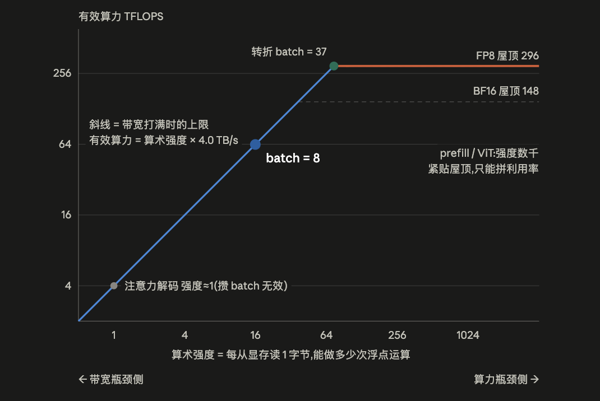

Start from arithmetic intensity, the ridge point, and measured HBM traffic to decide whether GEMM and attention are compute-bound or bandwidth-bound, and when quantization, batching, or fusion applies.

Any piece of computation on a GPU spends its time on two things: **computing** (executing floating-point operations) and **moving** (moving data between memory and the compute units; communication also counts as moving). The hardware has a ceiling for each: compute throughput F (FLOP/s) and bandwidth BW (Byte/s). With an ideal pipeline the two overlap:
```bash
T ≥ max( W/F , Q/BW )
        ↑ compute time  ↑ memory time
```
Before optimizing a model, you usually need to answer a few questions:

**① What is the physical upper bound on performance?** P ≤ min(F, I×BW), where P is the effective compute throughput, F is the peak compute throughput, and I×BW is the bandwidth-side bound (the kernel's arithmetic intensity × bandwidth); the latency lower bound is T ≥ max(W/F, Q/BW). Once measurements hug this line, stop; only when they are far from it is there room to optimize. It also lets you budget latency before writing a single line of code — for example, "given this compute throughput and bandwidth, how long does this model need at minimum to generate one token" can be worked out on paper, which feeds directly into setting the service-level objective (SLO, the committed latency target).

**② Which lever should you pull?** The effective techniques on the two sides are completely different; pull the wrong one and the gain is zero. On the bandwidth-bound side, adding compute throughput does nothing; what works is reducing memory traffic Q (operator fusion), lowering the bytes per value bpp (quantization), and batching (merging multiple requests into one computation to raise I). The compute-bound side is the reverse: quantizing only the weights without changing the compute precision brings no gain; what works is switching to lower-precision compute units to raise F. Roofline translates "I think it's slow" into "here is exactly what to do".

**③ Which metric do you use for acceptance?** For a bandwidth-bound kernel, the acceptance metric is "measured transfer rate ÷ peak bandwidth", and its **compute utilization is supposed to be low** (3% compute utilization for the attention kernel in the decode phase is not a fault); only compute-bound kernels are judged on compute utilization (MFU, model FLOPs utilization: the fraction of peak compute throughput spent on useful operations). Looking at utilization without triaging first makes you mistake normal behavior for a fault, and a fault for normal behavior.

## Theoretical model

The following uses the public specifications of the H20-96GB to illustrate the Roofline model; for the source of the specifications, see [SGLang's public technical article](https://www.lmsys.org/blog/2025-09-26-sglang-ant-group/). The curve illustrates how compute and bandwidth constrain each other.

<p align="center">
  
</p>

The figure above is based on the following definitions:

| Symbol     | Definition             | Unit      | Key point                                   |
| ---------- | ---------------------- | --------- | ------------------------------------------- |
| `W`        | Number of floating-point operations (a multiply-add counts as 2) | FLOP      | An **algorithmic** quantity; basically fixed |
| `Q`        | Actual bytes moved to and from HBM | Byte      | An **implementation** quantity, not the algorithm's data volume; changes with tiling/fusion |
| `F`        | Peak compute throughput | FLOP/s    | Rated hardware value; depends on numeric precision |
| `BW`       | GPU memory bandwidth   | Byte/s    | Models should distinguish rated bandwidth from effective bandwidth; e.g. the measured 3.33 TB/s is about 83–85% of the corresponding rated value |
| `I = W/Q`  | Arithmetic intensity   | FLOP/Byte | A **workload** property; contains no time; depends on the kernel implementation |
| `R = F/BW` | Ridge point            | FLOP/Byte | A **hardware** property; the ratio of two rates, so time cancels out |

So the execution efficiency of a kernel can be described along different dimensions:

| Form       | Formula                               | When to use                  |
| ---------- | ------------------------------------- | ---------------------------- |
| Time       | `T ≥ max(W/F, Q/BW)`                  | Latency budgets, setting SLOs |
| Performance | `P = W/T ≤ min(F, I×BW)`             | Effective compute throughput as plotted on the Roofline chart |
| **Utilization** | `compute utilization ≤ min(1, I/R)`,`bandwidth utilization ≤ min(1, R/I)` | **Day-to-day judgment of whether a kernel is doing its job well** |

So overall optimization can revolve around two goals:

1. Lower T: since W is an algorithmic quantity and basically fixed, you can usually only lower Q or raise F (lower precision, or a different execution unit)
2. Raise performance W/T: usually by batching to increase throughput, which raises I

## From parameter count to compute and capacity

The forward compute of the weight matrix multiplications is about `2·N_active` FLOPs/token. For MoE, estimate compute from the activated parameters, capacity from the total weights, and weight-read traffic from the union of experts hit in the current step; the three must not be mixed. Non-weight matrix multiplications, such as attention's QKᵀ/PV and GDN state updates, must be counted separately.

For a single standard multi-head attention (MHA) layer with sequence length s: the Q/K/V/O projections are about `8sd²`, the three SwiGLU matrices about `6sd·d_ff`, and dense QKᵀ/PV about `4s²d` (without subtracting the causal triangle). The classic `24sd²` weight term corresponds to a two-matrix FFN with `d_ff=4d`, or a three-matrix SwiGLU with `d_ff≈8d/3`; do not combine three matrices with `d_ff=4d`.

For MHA and grouped-query attention (GQA), `KV bytes/token = 2·L·n_kv·h_d·bpp`. Multi-head latent attention (MLA) stores a shared latent, and hybrid linear attention adds a fixed-size state on top; capacity accounting must also include TP replication of the KV, the graph pool, peak activations, and communication buffers.

## Practical evaluation

The theoretical evaluation assumes that compute and memory access overlap completely:

```bash
T = t_compute + t_mem − t_overlap ,  0 ≤ t_overlap ≤ min(t_c, t_m)
  perfect overlap  → T = max(t_c, t_m)     ← Roofline assumption
  no overlap       → T = t_c + t_m         ← worst case, 2× slower
```

If measurements come in slow, check double buffering/prefetching first; don't rush to blame the algorithm.
For example, the 910B has no hardware cache coherence and moves data with explicit MTE instructions; without orchestration it degrades straight to t_c + t_m — this is the mathematical origin of "fusion and pipelining are requirements, not optimizations".

`Q` is variable — this is the entire mathematical content of operator fusion: FlashAttention compresses the `O(s²)` round trips of the `[s,s]` matrix back to `O(s)`, which amounts to moving right along this line segment.

```bash
Q_min    = (inputs and outputs each read or written once; theoretical minimum)
Q_actual = Q_min + intermediate round trips + repeated reads (poor tile reuse, cache misses)
⟹ I_actual = W/Q_actual ≤ W/Q_min = I_max
```

Actual kernel execution also has to account for launch time, so the full time can be summarized as:

```bash
T_step = Σᵢ max(Wᵢ/F, Qᵢ/BW)     classify each kernel, then sum

A full step also adds three terms Roofline does not see:
       + N_kernel × t_launch        launch tax (measured Qwen3.5 decode ~1770 kernels/step; eager TPOT 143 ms vs CUDA Graph 5.6 ms)
       + (communication time − the part hidden by overlap)
       + t_sync                     intra-layer sync points and CPU-GPU round trips
```

The effect of numeric precision, comparing the same kernel ([B,7168]×[7168,2048]):

- W8A8 — halving Q makes the bandwidth side 2× faster, and doubling F makes the compute side 2× faster as well. Regardless of batch size, prefill or decode, the gain is 2×, and there is no need to determine which side you are on. This is the core reason it is the default path — the gain is predictable and there is no range where it fails. The precondition is that kernel time is much larger than the fixed overhead (in this test a single GEMM had 2–4 μs of splitK/tail-wave overhead): at N=18432 the measured ratio is 0.48–0.53× throughout, but at the N=2048 used here, small batches get only 1.2–1.4×.

- W4A16 — theoretically 4×, but it falls off a cliff. B* = 9.3; beyond that it drops back to BF16 level (the 1.0× in the B=64 row of the table). It shrinks the free range to less than a quarter of BF16's, in exchange for a speedup inside that range (an advantage at small batch). The measured small-batch speedup is only about 2×: the W4 kernel reaches only ~1.7 TB/s (the dequantization + memory-access pipeline cannot saturate bandwidth); past the ridge point Humming ≈ BF16, while Marlin is actually 1.5× slower (an Ampere-era design that does not use WGMMA).

- W4A8 — in an idealized model with the same effective bandwidth, doubled compute throughput, and no extra overhead, it can reach 4× over BF16 at small batch and 2× at compute-dominated large batch. Compared with W4A16, weight traffic at small batch is the same, so performance is comparable; at large batch it can be about 2× faster. This raises the compute-side performance ceiling; it is not a strict improvement for every shape.

Let C denote the GEMM compute and Q₄ the INT4 weight bytes; ignoring activation, output, and quantization-metadata traffic:

```text
T_W4A16,ideal = max(Q₄ / BW, C / F₁₆)
T_W4A8,ideal  = max(Q₄ / BW, C / F₈), F₈ ≈ 2F₁₆
```

Measurements on the wide matrix (N=18432) follow this trend: at B=1, W4A16/W4A8 take 39.2/39.0 μs, and at B=256 they take 488.5/255.2 μs, the latter being 1.91× faster. But the 4× small-batch speedup over BF16 does not materialize: the W4 path's effective bandwidth, computed from weight bytes, is about 1.7 TB/s, below BF16's roughly 3.3 TB/s, so in practice it is only about 2× faster. On the small matrix (N=2048) at B=1, W4A8 is actually slower (12.7 vs 11.3 μs); at B=256 it is 1.63× faster (38.1 vs 62.1 μs). Actual time is also affected by effective compute throughput, effective bandwidth, activation quantization, and other kernel overheads; total-time data cannot attribute the whole difference to activation quantization. On wide matrices W4A8 takes about the same time as W8A8; its main benefit over W8A8 is halving the weight memory.

The table below is an idealized Roofline estimate and does not include the implementation overheads above:

| Path                         | F     | bpp  | B*   | Time at B=8        | Time at B=64             |
| ---------------------------- | ----- | ---- | ---- | ------------------ | ------------------------ |
| BF16 storage + BF16 compute  | 148 T | 2    | 37   | 7.38 μs(1.00×)     | 12.70 μs(1.00×)          |
| **FP8 storage + FP8 compute (W8A8)** | 296 T | 1    | 37   | **3.69 μs(0.50×)** | **6.35 μs(0.50×)**       |
| INT4 weights (W4A16)         | 148 T | 0.5  | 9.3  | 1.87 μs(0.25×)     | 12.70 μs(**1.00×**) |
| **INT4 weights + FP8 compute (W4A8)** | 296 T | 0.5  | 18.5 | **1.85 μs(0.25×)** | **6.35 μs(0.50×)**       |

Measured (widened to [B,7168]×[7168,18432] so the fixed overhead is amortized; kernel time, with the ratio to BF16 in parentheses):

| Path | B=1 | B=8 | B=64 | B=256 |
| --- | --- | --- | --- | --- |
| BF16 cuBLAS | 81 μs | 84 μs | 135 μs | 519 μs |
| W8A8 FP8 cuBLASLt | 41(0.50×) | 41(0.49×) | 69(0.51×) | 247(0.48×) |
| W4A16 Marlin g128 | 44(0.54×) | 44(0.53×) | 200(1.49×) | 776(1.49×) |
| W4A16 Humming g128 | 39(0.48×) | 39(0.47×) | 136(1.01×) | 489(0.94×) |
| W4A8 Humming g128 | 39(0.48×) | 39(0.46×) | 71(0.53×) | 255(0.49×) |

Choices for different workloads:

```bash
prefill / large batch (compute-bound side)
  the gain comes only from F ⟹ W8A8 and W4A8 are both 2×, W4A16 gains nothing (0%)
  ★ weight-only quantization does not help prefill; on this side only lower-precision compute helps

decode / MoE (bandwidth-bound side)
  the gain comes only from bpp ⟹ in theory W4A16 ≈ W4A8 ≈ 4×, and W8A8 is 2× (measured W4 is only ~2×)
  ★ MoE in particular: M per expert = B·k/E is only a few rows, always in the bandwidth region, so the B* constraint is never reached
     the 2× of W4 over W8 on MoE decode is therefore actually realized

mixed traffic (chunked prefill, prefill and decode not disaggregated)
  the batch straddles both sides of B* ⟹ W4A16 is the least stable; W4A8 or W8A8 is more predictable
```

To judge in the end whether a kernel implementation is good, you can follow this procedure:

```bash
① Compute I = W/Q. Q is the actual HBM round trip, not the algorithm's data volume
② Compute R_eff = F(of the compute path)×MFU_max / (BW×0.85)    measured: BF16 138T, FP8 282T, BW 3.33 TB/s ⟹ R_eff ≈ 42 / 85
③ I < R → accept on measured GB/s ÷ peak. Levers: batching, lower bpp, fusion to cut Q
   I > R → accept on compute utilization, and whether tensor-core utilization can still rise. Levers: tiling, pipelining, tensor-core occupancy
④ Measured ≫ max(t_c, t_m)? Check in order: no overlap (≤2×) → host-bound (up to 10×) → communication not hidden
⑤ Only two ways to move which side the bottleneck is on:
   cut Q (fusion) — helps every workload
   raise W (batching) — helps only workloads whose bytes are shared across the batch
       weight GEMM ✅ (weight bytes do not depend on B; one read serves B tokens)
       attention ❌ (KV is private to each request, so numerator and denominator grow together; I ≈ 2g/bpp, where g is the number of Q heads sharing one KV)
```

## Kernel case studies

Taking GEMM as an example, estimate from the M/N/K shape:

```bash
W = 2·M·N·K
Q = (M·K + K·N + M·N) · bpp        ← this is Q_min (each block read or written once); measurements can be larger
```

The theoretical estimates below use the public FP8 specifications of the H20: F=296T, BW=4TB/s, R=F/BW=74, bpp=1. Actual runs still need the effective compute throughput and bandwidth plugged in.

| Shape (example)                              | What dominates traffic → approximate I                  | P / saturation point                                         | Does batching help?                                          | Bottleneck                                            | Typical scenario                     | Optimization techniques                                      |
| -------------------------------------------- | ------------------------------------------------------- | ------------------------------------------------------------ | ------------------------------------------------------------ | ----------------------------------------------------- | ------------------------------------ | ------------------------------------------------------------ |
| **Square** [4096,7168]×[7168,2048]           | All three terms are the same order of magnitude; none can be dropped **I = (2/3)·n/bpp**, example ≈2340 | P ≈ F (always saturated); saturation point long since passed | Doesn't matter (already in the compute region)              | Compute                                               | Prefill projection layers, training  | ① Compute at lower precision to raise F (FP8/FP4) ② Tiling + double-buffered pipelining to hide memory traffic ③ Tune tile size / striped scheduling to avoid idle tail waves (wave quantization) ❌ Weight quantization |
| **Tall-skinny** [8,7168]×[7168,2048]         | **Reading weights**: K·N is 99% **I = 2M/bpp = 2M**, M=8 → 16 | P = min(296, 8M); M=8: 64T, 22% utilization **M\* = R·bpp/2 = 37** | ✅ **Primary technique**: weight bytes are shared across the batch, so I grows linearly with M with no ceiling | Bandwidth                                             | Decode weight GEMM (M=batch), lm_head | ① Batch up to M* (throughput is free until then) ② Weight quantization to lower bpp (W4/W8) ③ Mark weight reads as "evict after use" so streaming data does not pollute L2 ❌ Splitting N/K (not in I), raising F, chasing MFU |
| **Flat (thin K)** [4096,32]×[32,4096]        | **Writing output**: M·N dominates **I = 2K/bpp = 2K**, K=32 → 64 | P = min(296, 8K); K=32: I=64<R, bandwidth side; K=128: I=256, back to the compute side **K\* = 37** | ❌ M is not in I: adding a batch row = one more row computed + one more row written, so numerator and denominator grow together | Determined by K; K<37 is bandwidth-bound             | QKᵀ of unfused attention (K=h_d, output s×s) | ① Fuse into FlashAttention: the output stays in registers and the kernel disappears entirely ② If it cannot be eliminated, lower bpp ❌ Batching, enlarging K (locked by SMEM capacity) |
| **Both small** [8,16]×[16,7168]              | M·K and K·N are comparable **I = 2MK/((M+K)·bpp)**, M=8,K=16 → 10.7 | P = 8MK/(M+K) = 42.7T, 14% utilization **saturation point unreachable** | ⚠️ Helps, but has a ceiling: as M→∞, I → 2K/bpp = 32 < R, so it never leaves the bandwidth region | Bandwidth + fixed overhead (theoretical T≈0.04μs; measured, a single kernel takes ~2μs) | LoRA decode, small-rank adapters     | ① Merge weights offline (W′=W+BA) so the kernel disappears ② Grouped batching across multiple adapters ③ Use CUDA Graph to absorb launch overhead ⚠️ Batching is possible but don't count on it; in-kernel optimization is pointless |

Measured (FP8 / BF16, cuBLASLt): square 264T (89%) / 135T; tall-skinny 35T — at the measured 3.33 TB/s the theory gives 53T, and the gap is ~2μs of fixed overhead such as the splitK reduce; flat 46T / 52T — the real kernel writes BF16 output, so I is only 31.8, the measurement reaches only 43% of theory, and FP8 is no faster than BF16; both-small 0.72T, with a single kernel itself taking 2.1–2.5μs. The P in the table is the roofline bound; on small shapes, fixed overhead is the dominant term.


Taking attention as an example:

```bash
O = softmax(Q·Kᵀ / scale) · V
    └─GEMM(cube)─┘ └vector┘ └─GEMM(cube)─┘
```

Attention is computed in three steps: two matrix multiplications sandwiching a softmax.

```
S = Q·Kᵀ / scale     [s,h_d]×[h_d,s] → [s,s]      runs on cube/tensor core
P = softmax(S)        element-wise normalization      runs on vector units
O = P·V              [s,s]×[s,h_d] → [s,h_d]      runs on cube/tensor core
```

Notation: s = sequence length; h_d = the vector dimension of each attention head (128 in this article); bpp = bytes per value. Everything below is computed per head (I is an intensity, so multiplying numerator and denominator by the number of heads leaves it unchanged; per head is the cleanest).

The difference between the two phases:

| Phase              | FLOPs (per head)            | HBM bytes (per head, fused implementation) | I = W/Q         | Bottleneck |
| ------------------ | --------------------------- | ----------------------------- | --------------- | ---------- |
| prefill (q_len=s)  | 4·s²·h_d = 2×(QKᵀ) + 2×(PV) | 4·s·h_d·bpp (read QKV + write O) | s/bpp           | Compute when s is large |
| decode (q_len=1)   | 4·s·h_d·g (g Q heads share one set of KV) | 2·s·h_d·bpp (read K and V once each) | 2g/bpp (MHA g=1, BF16≈1) | MHA is always bandwidth-bound; for GQA/MLA see below |

Where the FLOPs come from: a matrix multiplication [m,k]×[k,n] counts as 2·m·k·n (k multiplies + k adds per output element). Each of the two matrix multiplications contributes 2·s·s·h_d (prefill) or 2·s·h_d (decode, where q_len=1 degrades the matrix multiplication to a matrix-vector product); the element-wise softmax is about 5s², roughly 50× smaller than the matrix multiplications, and is ignored. The coefficient 4 in the table = 2 (a multiply-add counts as 2) × 2 (two matrix multiplications).

The most important fact in the decode row is that **s cancels out of I**: each byte of the KV cache that is read in takes part in exactly 2 operations (one multiply and one add) and is never used again — zero reuse. So neither longer context nor batching (each request's KV is private, so numerator and denominator grow together) can change I; the only things that can change it are "how many Q heads share the same KV" (g) and the number of queries per step (q_len in speculative decoding).

**MHA decode attention: there is only one thing to do**

With the hardware parameters used here, I≈1, far below the ridge point of 37, so the model predicts that this workload is bandwidth-bound. There is only one optimization goal: **push the rate of "reading KV from GPU memory" up to the hardware limit**. That is exactly what FlashDecoding does: decode processes only 1 query at a time, so under the default parallelization only a few SMs have work; FlashDecoding splits the KV into segments distributed to all SMs to read simultaneously, each SM computes a partial result, and the partials are merged — with more hands moving data together, bandwidth gets saturated. Beyond that, the remaining technique is to reduce Q itself (KV quantization lowers bpp).

**GQA / MLA: sharing KV also raises I**

Sharing KV does not just save memory: each KV byte is reused by g heads, so I is multiplied by g. With MLA after absorption, 128 heads share one 576-dimensional latent, so I ≈ 2·128·(576+512)/(576·bpp) ≈ 242 (BF16), already above the ridge point of this test configuration. Measured (FlashInfer 0.7.1, BF16 KV, single layer):

| Structure | I | Measured | Bottleneck |
| --- | --- | --- | --- |
| MHA (32/32) | 1 | 3.5–3.6 TB/s | Bandwidth |
| GQA-8, CUDA core decode kernel (default) | 8 | 0.9 TB/s, 7 TFLOPS | CUDA core compute |
| GQA-8, tensor core kernel | 8 | 3.0 TB/s, 24 TFLOPS | Bandwidth |
| MLA absorbed, 128 heads | 242 | 85–106 TFLOPS, using only 0.4 TB/s | **Compute** |
| MLA 128 heads, q_len=2 (MTP) | 484 | Time ×2.0–2.2 | Compute |

Two corollaries: in this GQA experiment, only the tensor core decode kernel brings it back to being bandwidth-bound; the MLA configuration with 128 heads per GPU is mainly compute-bound in these measurements, and verification with q_len=2 measurably raises attention time to 2.0–2.2×. Once TP8 splits it down to 16 heads per GPU, neither compute nor bandwidth is saturated, and you have to re-evaluate based on heads per GPU and kernel utilization; KV compression still brings a capacity benefit, but latency does not necessarily drop in proportion to the byte reduction (see [Chapter 4]()).

**Why it must be fused into one kernel**

If the three steps are written as three separate kernels, every intermediate result between steps has to be "written back to GPU memory and read out again":

```
QKᵀ produces the [s,s] score matrix → write to GPU memory
softmax                  → read once, write once
PV                       → read once more
```

This intermediate matrix is s×s: at s=4K it holds 16 million values, **hundreds of times larger than the inputs Q/K/V combined (on the order of s×h_d)** — without fusion, most of the memory traffic is not the data itself but these "passing-through" intermediate results. Plug them into the formula to see the intensity collapse:

```
I_unfused ≈ 4s²·h_d / 4s²·bpp = h_d/bpp = 64      ← constant, does not grow with s
I_fused   = s/bpp                                  ← grows without bound as s grows
```

Measuring DRAM bytes with ncu: unfused, I≈42 (the same at s=4K and 16K; the separate scale adds one more s² read and write, so it is h_d/3 rather than h_d/2); fused, I=2612 / 8359. But I≈42 is close to the ridge point of this test configuration, so the unfused version is only 1.25–1.4× slower. In this configuration, the main benefit of fusion is avoiding materializing the s² intermediate matrix, which lowers the memory footprint (about 4.3GB per 8 heads at 16K); the latency benefit is relatively limited.

FlashAttention's solution comes down to two tricks: **tiling** — cut the matrices into blocks small enough to fit in on-chip memory, so intermediate results are computed and consumed on chip without touching GPU memory; and **online softmax** — softmax normally has to see an entire row before it can normalize, and this trick lets it compute block by block, correcting as it goes, which is what makes tiling possible. The effect: memory traffic drops from O(s²) back to O(s).

**What "on chip" means concretely: the two kinds of hardware implement it differently**

**NVIDIA GPUs: on chip = the shared memory private to each SM (SMEM, 228KB/SM, at most 227KB per block; see the table in [Chapter 3]()) + registers.** The block size is not a rule of thumb; it is derived backward from SMEM capacity:

```
Take block sizes Br (row tile) = Bc (column tile) = 128, h_d=128, BF16 as an example; one SM must hold at the same time:
  Q block / K block / V block    each 128×128×2B = 32 KB ×3
  second copy of K/V for double buffering    32 KB ×2
  ────────────────────────────────────────
  ≈ 160 KB, close to the 227KB limit → blocks can only be 64~128
  S/P blocks (FP32 accumulation) and the O accumulator live in registers in FA2/FA3 (the WGMMA accumulator is in registers) and take no SMEM
```

Once data moves from HBM into SMEM, the hardware maintains coherence across the cache hierarchy, and keeping intermediate results on chip is the default state.

**910B: on chip means several separate levels of buffers, and "staying on chip" must be orchestrated by hand.** In the DaVinci architecture, cube and vector are physically separate execution units, each with its own buffers — the cube has L0A/L0B (inputs) and L0C (accumulated output), the vector uses the Unified Buffer (UB), and L1 sits above them; **there is no hardware cache coherence between the levels, and all data movement relies on explicit MTE (Memory Transfer Engine) instructions**. So the QKᵀ result lands in L0C; for softmax to use it, it must be explicitly moved into the UB, and after the computation it must be moved out again to feed PV — the intermediate results indeed never touch HBM (consistent with the NVIDIA conclusion), but even on chip they have to "cross a bridge", and the bridge is MTE transfers.

Comparison of the two hardware paths:

```
NVIDIA: tiling + online softmax → intermediate results stay in SMEM, hardware manages coherence → done
910B:   tiling + online softmax → intermediate results shuttle between L0C ⇄ UB (explicit MTE moves)
        ├→ shuttling and compute must be double-buffered and pipelined, otherwise it degrades to t_c + t_m (see "Practical evaluation" in this chapter)
        └→ cube/vector are physically separate → naturally pipelineable, and must be pipelined
```

The shape of the pipeline: while the cube computes QKᵀ for block i+1, the vector simultaneously does the online softmax for block i. Without orchestration they sit waiting on each other; and since the 910B's vector compute throughput is much weaker than its cube's, once they wait, the weaker side becomes the global bottleneck. Overlapping tensor cores and CUDA cores holds on H-series GPUs too, but the 910B's weak vector unit turns this from "nice to have" into "must do". (Ascend 950 raises the cube:vector ratio to 8:1 and adds a fused cube-vector datapath.)

## Series navigation

| Chapter | Article | Scheduled date |
| --- | --- | --- |
| 0 | **Roofline: Performance Budgets from Compute and Bandwidth (this post)** | 2026-01-01 |
| 1 | [Communication: From Collective Primitives to Cross-Node Topology]() | 2026-02-13 |
| 2 | [Distributed Inference: Choosing TP, DP, EP, CP, and PP]() | 2026-03-29 |
| 3 | [Inference Hardware: GPUs, NPUs, and the Memory Hierarchy]() | 2026-05-11 |
| 4 | [Attention: From GQA and MLA to Hybrid State]() | 2026-06-24 |
| 5 | [MoE Inference: Batching, DeepEP, DeepGEMM, and Load Balancing]() | 2026-08-06 |
| 6 | [PD and EPD: Disaggregation, State Transfer, and Resource Allocation]() | 2026-09-19 |
| 7 | [Execution: CUDA Graph, Speculative Decoding, Overlap, and Quantization]() | 2026-11-01 |

Next: [Communication: From Collective Primitives to Cross-Node Topology]()
