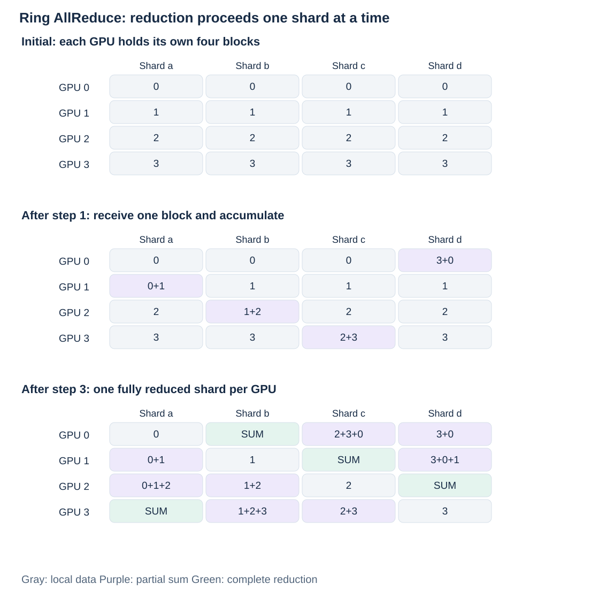
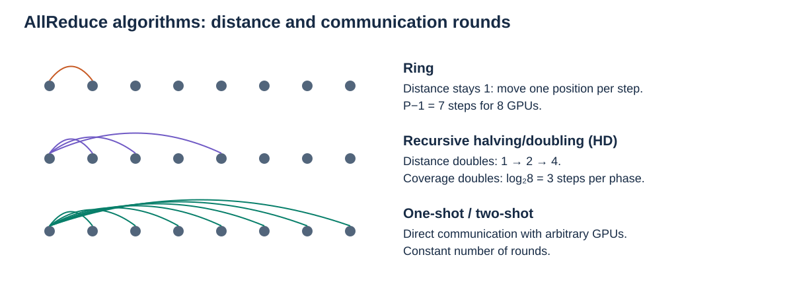
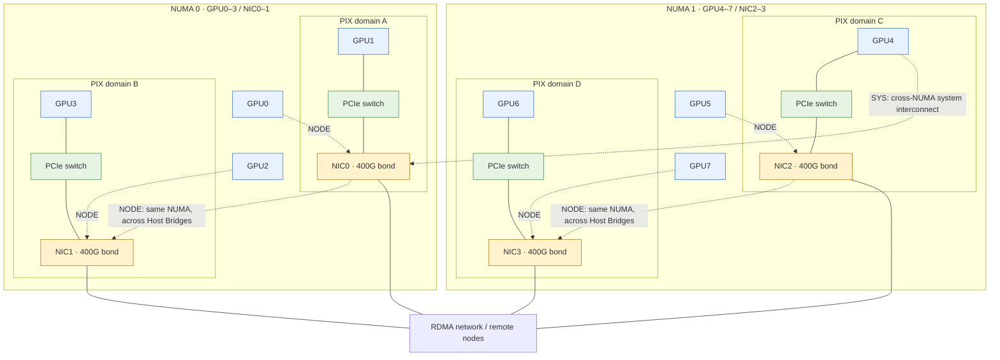
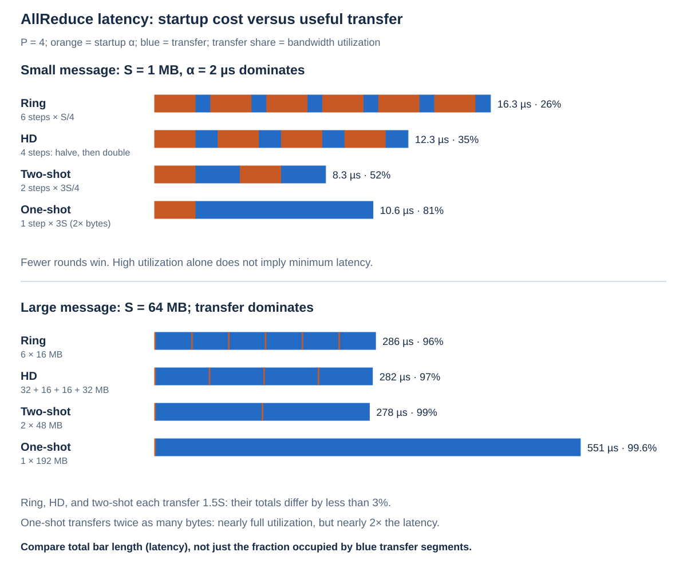
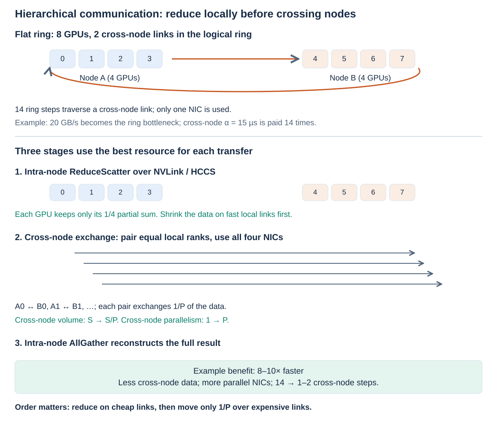

Decompose collective communication into step count, launch latency, and bytes per GPU, then use NVLink, RDMA, NUMA, and PCIe topology to explain measured differences.

## Common communication algorithms

<p align="center">
  
</p>

| Category   | Primitive / algorithm | Semantics or mechanism     | Bytes per GPU                    | Steps          | Notes                       |
| ---------- | --------------- | -------------------------------- | -------------------------------- | -------------- | --------------------------- |
| **Many-to-many** | ★ ReduceScatter | Each GPU gets 1/P of the reduced result | (P−1)/P·S ✓lower bound      | P−1 (ring)     | Every GPU sends; P NICs work in parallel |
|            | ★ AllGather     | Each GPU gets the full concatenation | (P−1)/P·S ✓lower bound       | P−1 (ring)     | = the reverse of ReduceScatter |
|            | ★ AllReduce     | Each GPU gets the full reduction | 2(P−1)/P·S ✓lower bound          | 2(P−1) (ring)  | = RS + AG; see the variants below |
|            | ★ AllToAll      | Each GPU sends different data to every GPU (block transpose) | (P−1)/P·S ✓lower bound | 1 (all pairs concurrently) | Bytes are fixed by the semantics and cannot be saved |
| **Single endpoint** | Broadcast | root sends the same content to all GPUs | root sends (P−1)·S (naive); each GPU receives S | log₂P (tree) | The naive implementation bottlenecks on root egress |
|            | Scatter         | root sends a different slice to each GPU | root sends (P−1)/P·S; each GPU receives S/P | 1  | Same bytes as RS, but all squeezed through one NIC |
|            | Gather          | Each GPU's data is collected and concatenated at root | root receives (P−1)/P·S; each GPU sends S/P | 1 | incast: P−1 GPUs hit root at the same time |
|            | Reduce          | Each GPU's data is collected and reduced at root | each GPU sends ≈S       | log₂P (tree)   | The reduction compute is concentrated at root |

AllReduce variants:

- Ring: 2(P−1) steps, each exchanging S/P with a fixed neighbor. Byte-optimal; each GPU always keeps 2 connections, and the reduction is spread over small chunks in every step → the easiest to overlap with compute and the easiest to pipeline. It has only one weakness: the step count is O(P), so α accumulates for small messages (14 α at P=8).

  <p align="center">
    
  </p>

- Halving-Doubling: 2·log₂P steps, with the same bytes as ring. The mechanism: the pairing distance doubles each step while the exchange volume halves each step (S/2→S/4→S/8, then back the same way) — larger chunks make up for the saved steps, and the load is perfectly balanced across GPUs. It requires P to be a power of 2; otherwise, after the padding steps are added, it often loses to ring.

- two-shot: 2 steps (each GPU pulls and reduces the 1/P slice it owns → broadcasts it back); the bytes are still at the lower bound. This is the step-count limit without redundant transfer — the reduced result cannot be spread before it has been computed. Cost: P−1 connections per GPU (O(P²) resources), the reduction compute concentrated in one step, and it is only truly efficient with hardware multicast such as NVLS/multimem.

- one-shot: 1 step; each GPU sends the full S to every peer, and each performs the full reduction locally (this needs more compute resources). The only way to go below 2 steps is to transfer redundantly: the bytes are (P−1)·S, P/2 times the lower bound. Applicable domain = small messages and small P (crossover point S* = α·BW/(P−1−lower-bound coefficient), about 130 KB within an 8-GPU node).

<p align="center">
  
</p>

## Public topology example: NUMA and PCIe relationships with 8 GPUs / 4 NICs

**8 GPUs + 4×400G NICs: NUMA / PCIe switch architecture sketch**

The figure below is redrawn from [the real 8×H20 machine topology published in SGLang #5186](https://github.com/sgl-project/sglang/issues/5186) to illustrate topological distance: GPU0–3 and NIC0–1 belong to NUMA0; GPU4–7 and NIC2–3 belong to NUMA1. The device numbering and PIX pairings in the figure follow the public example. NIC0–3 correspond to `mlx5_bond_0` through `mlx5_bond_3`; the 400G in the figure follows this article's aggregate convention (2×200G).

The figure highlights NUMA affinity and the shared PCIe switches; dashed lines indicate topological distance, and the internal levels of the Host Bridge and the NVLink interconnect between GPUs are omitted.



The full GPU–NIC distances are as follows (consistent with the public real-machine matrix above):

| GPU | NUMA | NIC0 | NIC1 | NIC2 | NIC3 |
|---|---|---|---|---|---|
| GPU0 | 0 | NODE | NODE | SYS | SYS |
| GPU1 | 0 | PIX | NODE | SYS | SYS |
| GPU2 | 0 | NODE | NODE | SYS | SYS |
| GPU3 | 0 | NODE | PIX | SYS | SYS |
| GPU4 | 1 | SYS | SYS | PIX | NODE |
| GPU5 | 1 | SYS | SYS | NODE | NODE |
| GPU6 | 1 | SYS | SYS | NODE | PIX |
| GPU7 | 1 | SYS | SYS | NODE | NODE |

Taking **NIC0** as the reference, the three kinds of path differ as follows:

- **PIX**: GPU1 → shared PCIe switch → NIC0.
- **NODE**: GPU0 → Host Bridge A → inter-bridge interconnect within the same NUMA node → Host Bridge B → the branch where NIC0 sits. The key is crossing Host Bridges; "different switch" alone is not enough to call it NODE.
- **SYS**: GPU4's PCIe branch → cross-NUMA system interconnect → NIC0's PCIe branch.

For the definitions, see [NVIDIA's topo documentation](https://docs.nvidia.com/deploy/nvidia-smi/index.html#topology). Passing through the CPU-side I/O interconnect does not mean the CPU has to memcpy the data or stage it through host memory. The four switch nodes in the figure represent four PIX sharing groups and are not meant to count every PCIe switch in the machine; the table below gives this article's measured performance comparison.

| Protocol | Source/destination GPU relative to NIC0 | 16 KB chunks | 256 KB chunks |
|---|---|---|---|
| RDMA | GPU1 (same PCIe switch, PIX) | 41.9 GB/s | **48.9 GB/s** (saturates a single NIC) |
| RDMA | GPU0 (same NUMA, different switch, NODE) | 46.0 GB/s | 48.9 GB/s |
| RDMA | GPU4 (cross-NUMA, SYS) | 23.9 GB/s | **24.0 GB/s (halved)** |
| TCP | GPU1 | **0.39 GB/s** | **1.65 GB/s** |

## Communication latency model

```bash
T = steps × α + bytes per GPU / busBW
```

| Parameter        | GPU-side modeling parameters and measured reference | 910B                         |
|------------------|------------------------------------------|------------------------------|
| Intra-node busBW | NVLink ~350-400 GB/s effective (measured AllReduce 128 MB busBW 336 GB/s, P2P copy 395 GB/s) | HCCS 56×7 = 392 GB/s (full-mesh) |
| Inter-node busBW per GPU | 20 GB/s (4×400G NICs, 2 GPUs share 1 NIC; measured raw RDMA with NUMA binding 24.5, NCCL 8-pair cross-node P2P 15.1) | 25 GB/s (200G RoCE, 1:1)      |
| Intra-node α     | ~2 μs (a single NVLink write; measured floor for one complete collective is ~10 μs with a custom kernel / ~20 μs with NCCL) | ~2 μs                        |
| Inter-node α     | ~15 μs (measured RDMA verbs one-way 9 μs; NCCL cross-node 64 KB AllReduce 74 μs) | ~20 μs                       |

Latency of the different AllReduce algorithms:

<p align="center">
  
</p>

For the cross-node case, since intra-node bandwidth is higher than inter-node bandwidth, the communication scheme is:

1. Intra-node ReduceScatter first: inside each node the data is reduced and split into P_intra parts, and each GPU keeps only the 1/P slice it owns — the data slims down before it enters the expensive channel.

2. Cross-node AllReduce on the slices only: same-index GPUs across nodes are paired (each communication group runs reduce_scatter+all_gather) and exchange only this 1/P slice — the only bytes that cross the network in the whole process, about 1/P_intra of the flat algorithm.

3. Intra-node AllGather last: the completed slices are broadcast back within the node, and each GPU collects the full result — more intra-node bytes, but intra-node bandwidth is much higher.

   <p align="center">
     
   </p>

| S      | Ring intra-node | HD intra-node | two-shot intra-node | one-shot intra-node | Ring cross-node | HD cross-node | two-shot cross-node | one-shot cross-node | **Hierarchical cross-node** |
| ------ | --------- | ------- | ------------- | ------------- | --------- | ------- | ------------- | ------------- | ------------- |
| 64 KB  | 28.3      | 12.3    | 4.3           | **3.3**       | 213       | 93      | 33            | **31**      | ~40           |
| 1 MB   | 33        | 17      | **9**         | 22            | 297       | 178     | 118           | 365           | **63**        |
| 16 MB  | 108       | 92      | **84**        | 322           | 1610      | 1490    | 1430          | 5615          | **480**       |
| 128 MB | 668       | 652     | **644**       | 2562          | 11400     | 11290   | 11210         | 44815         | **2100**      |

The table above shows model values. Measured (μs; intra-node with 8 GPUs, averaged over back-to-back launches inside a CUDA Graph; cross-node with 2×8 GPUs, NCCL + GDR):

| S | NCCL intra-node | two-shot intra-node (symm-mem) | one-shot intra-node (symm-mem) | NCCL cross-node (hierarchical) |
| --- | --- | --- | --- | --- |
| 64 KB | 23.2 | 10.5 | 10.6 | 74 |
| 1 MB | 29.0 | 13.9 | 34.1 | 128 |
| 16 MB | 117 | 106 | 395 | 421 |
| 128 MB | 700 (nccl-tests) | ~790 (395 at 64 MB) | — | 2068 |

Three conclusions:

- Small messages (≲1 MB) compete on step count: α accumulation dominates (ring's 14 steps = 28 μs, while transferring 1 MB takes only 5 μs). two-shot's 2 steps is the lower bound without redundancy; one-shot's 1 step is one notch faster but only holds up to ≈130 KB. Typical workload: TP's per-layer AllReduce is ~56 KB, run more than a hundred times per decode step — exactly this regime. The measured ordering holds (the custom kernels take about half the time of NCCL), but the absolute values are 2.5–3× higher: flag synchronization and barriers put the floor at ~10 μs; one-shot and two-shot tie below 64 KB, and from 256 KB on two-shot is clearly faster
- Large messages have nothing to compete on: Ring/HD/two-shot move the same bytes → their times converge (measured difference <10%) — on a switched topology the bottleneck is each GPU's egress (which cannot be parallelized), not the number of links. Choose by the costs outside the chart: if you need overlap / large P / heterogeneous topology → ring has the advantage; when NVLS is supported, two-shot-style algorithms are worth evaluating; if NVLS initialization fails, first confirm hardware and software support, then evaluate the `NCCL_NVLS_ENABLE=0` fallback path. Note that the 910B's HCCS is a point-to-point full-mesh rather than a switched fabric: ring uses only 1 of the 7 links, so even large messages are 7× slower.
- Cross-node competes on bytes: egress ÷17.5, α ×7.5 → the only effective cross-node optimization is to cut inter-node traffic — the hierarchical scheme reduces inter-node traffic to 1/P_intra, and the extra intra-node traffic is nearly free because of the 17.5× bandwidth gap.

Cross-node transfers must use RDMA; TCP is suitable only for the control plane. Measured two-node comparison:

| Item | RDMA (RoCE, GPUDirect) | TCP (container network eth0, 200 Gb/s) |
| --- | --- | --- |
| Bandwidth | 392 Gb/s per NIC; 4 NICs bound by NUMA give 196 GB/s/node (74% without binding) | iperf3 with 32 streams 16.4 GB/s/node; 16 streams consume more than 3 CPU cores |
| Small-message one-way latency | 9 μs | 56 μs |
| NCCL cross-node (2×8 GPUs) | AllReduce 128 MB 2.07 ms; 8-pair P2P 15.1 GB/s/GPU | 12–28× slower (requires `NCCL_NET_PLUGIN=none NCCL_NET=Socket` to actually go over TCP; `NCCL_IB_DISABLE` is ignored by external plugins) |
| Affinity | Cross-NUMA GPU→NIC pairing halves bandwidth (49→24 GB/s); disabling GDR drops P2P from 15.1→7.3 GB/s | — |

AllToAll likewise has several algorithms:

<p align="center">
  
</p>

**① Direct send**: each GPU sends its 3 blocks to their respective destinations at the same time, done in one step. Optimal in both steps and bytes; the weakness is that P−1 messages hit one NIC at once, which easily causes incast across nodes (congestion, many-to-one).

**② Pairwise exchange**: in round t, a GPU exchanges one block only with GPU i⊕t, for P−1 rounds in total. The bytes are still at the lower bound, and only 1 message is in flight at any moment, so there is no incast; the cost is slow serial execution, with α accumulated P−1 times.

**③ Bruck**: blocks take detours by binary distance, hitching rides with other blocks along the way and being relayed by neighboring GPUs, so all transfers finish in log₂P steps — the fewest steps; but the extra relayed blocks are bytes **on the network**, and a local reordering is needed at the end, so it pays off only for very small messages × very large P.

**④ Two-level hierarchical**: first, within the node, blocks are grouped by rail (over NVLink); then same-rail GPUs send one large packet across nodes, and after the large packet lands, NVLink splits it and forwards the pieces to each destination GPU. The number of cross-node messages drops from P_intra² to P_intra (8-GPU node: 64 → 8), and the bytes on the network do not change at all; the cost is extra **intra-node** bytes, an overhead that does not amortize as messages grow, so for large messages (≥16 MB) it is actually worse than direct send.

| S      | Direct intra-node | pairwise intra-node | Bruck intra-node | Direct cross-node | pairwise cross-node | **Hierarchical cross-node** |
| ------ | --------- | ------------- | ---------- | --------- | ------------- | ------------- |
| 64 KB  | **2.2**   | 16.2          | 6.3        | 62        | 68            | **17**        |
| 1 MB   | **4.5**   | 18.5          | 10.3       | 86        | 92            | **44**        |
| 16 MB  | **42**    | 56            | 75         | 477       | 484           | 484           |
| 128 MB | **322**   | 336           | 555        | **3397**  | 3403          | 3764          |

Measured NCCL AllToAll (μs): intra-node with 8 GPUs, 64 KB 9.5, 1 MB 14.8, 16 MB 72, 64 MB 216 (busBW 272 GB/s); cross-node with 2×8 GPUs, 1 MB 173, 16 MB 733, 128 MB 4409. This is 1.3–4× slower than the model values; recomputing with α≈10 μs (intra-node) and BW≈280 GB/s gets closer.

## Series navigation

| Chapter | Article | Scheduled date |
| --- | --- | --- |
| 0 | [Roofline: Performance Budgets from Compute and Bandwidth]() | 2026-01-01 |
| 1 | **Communication: From Collective Primitives to Cross-Node Topology (this post)** | 2026-02-13 |
| 2 | [Distributed Inference: Choosing TP, DP, EP, CP, and PP]() | 2026-03-29 |
| 3 | [Inference Hardware: GPUs, NPUs, and the Memory Hierarchy]() | 2026-05-11 |
| 4 | [Attention: From GQA and MLA to Hybrid State]() | 2026-06-24 |
| 5 | [MoE Inference: Batching, DeepEP, DeepGEMM, and Load Balancing]() | 2026-08-06 |
| 6 | [PD and EPD: Disaggregation, State Transfer, and Resource Allocation]() | 2026-09-19 |
| 7 | [Execution: CUDA Graph, Speculative Decoding, Overlap, and Quantization]() | 2026-11-01 |

Previous: [Roofline: Performance Budgets from Compute and Bandwidth]() · Next: [Distributed Inference: Choosing TP, DP, EP, CP, and PP]()
