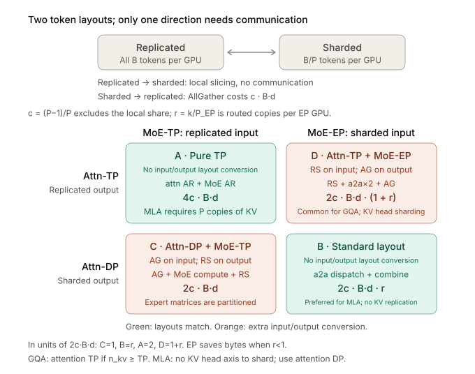

Reason about parallel layouts for attention and MoE from the budgets for weights, the KV cache, activations, and communication, including the extra constraints of long context and pipeline parallelism.

## Combining attention and MoE parallelism

How Attention-TP/DP relates to MLA:

```bash
GQA: KV is split along the n_kv heads → TP ≤ n_kv (with 8 KV heads, TP8 fits exactly), and TP also spreads the KV memory ✅
MLA: KV is a single latent shared by all heads → no head dimension to split → under TP it can only be [replicated], although TP can still shard the weights to cut compute
     TP8 = the same KV stored 8 times → GPU memory blows up ❌
⟹ attention in MLA models must use DP: each GPU owns its own requests and KV, with no replication
```

How the communication mechanism differs across combinations of Attention-DP/TP and MoE-TP/EP:

<p align="center">
  
</p>
Here dispatch/combine are built on all2all:

| Operation | Underlying primitive | Extra non-communication work |
| -------- | --------- | ------------------------ |
| dispatch | AllToAllv | routing computation, token permute |
| combine  | AllToAllv | weighted sum of k copies (local on the source GPU) |

Attn-TP/Attn-DP can also often be combined with MoE-EP (32 GPUs, EP32, k=8, MLA, d is the hidden size, B is the global batch):

<p align="center">
  
</p>

| Dimension | Pure Attn-TP32 | **TP4 × DP8** | Pure Attn-DP32 |
| --------------- | ------------------ | -------------- | ---------------- |
| KV replicas | 32 copies | 4 copies | 1 copy |
| KV read bandwidth/GPU | B·ctx·35KB | (B/8)·ctx·35KB | (B/32)·ctx·35KB |
| MLA projection weights/GPU | W/32 | W/4 | full W |
| attn communication domain | 32 GPUs (c=31/32) | 4 GPUs (c=3/4) | — |
| attn tokens per GPU | B | B/8 | B/32 |
| ①④ layout conversion | 0.969×2 = 1.94 B·d | 0.19 B·d | 0 |
| ②③ MoE a2a | 0.48 B·d | 0.48 B·d | 0.48 B·d |
| **Total communication** | **2.42 B·d** | **0.67 B·d** | **0.484 B·d** |
| attn compute/GPU | B/32 | B/32 | B/32 (same for all three) |

For MoE, the differences between MoE-TP and MoE-EP (with Attn-DP) are:

| Dimension | MoE-TP32 |      | MoE-EP32 | Winner |
| -------------------------- | --------------------------------------------------- | ---- | --------------------------------------------------------- | --------------------------------- |
| **gate/up shape** | [B·k, 7168] × [7168, **64**] |      | [B·k/32, 7168] × [7168, 2048] | **EP** |
| **down shape** | [B·k, **64**] × [64, 7168], followed by an AllReduce |      | [B·k/32, 2048] × [2048, 7168] | **EP** |
| Tiles along N (BN=128) | 1, and 64 of its 128 columns are padding |      | 16, all full | **EP** |
| Total tiles / 78 SMs (B=512) | 32 → 41% utilization × 50% padding inside each tile ≈ **20%** |      | 16 → 21%, but every tile is full | Both fall short, for different reasons |
| **Can batching fix the shape?** | N/K are model dimensions, independent of B |      | M_e=B·k/32 grows with B, and the tile count grows with it | **EP, the most fundamental difference** |
| **Expert weight reads/GPU** | u(B)/256 × W_e/32 (the kernel skips experts that receive no tokens) |      | u(B)/256 × W_e/32 u(B)=256(1−e^(−Bk/256)) | Equal in expectation; EP only has higher variance |
| **Activation memory/GPU** | full [B·k, d], about **59 MB** at B=512 (BF16) |      | [B·k/32, d], about **1.8 MB** at B=512 | **EP, 32× smaller**, but only MB-scale in decode |
| **Communication primitives** | AllGather on entry + ReduceScatter on exit |      | a2a dispatch + combine |                                   |
| **Communication bytes/GPU** | 2c·B'·d |      | 2c·(B'/P_EP)·k·d | Ratio **r = k/P_EP** |
| **Token permute volume** | 4 × B·k·d (full reorder) |      | 4 × (B·k/32)·d, and it can be fused into the a2a | **EP, 32× less** |
| **L2 reuse** | The B matrix is only 459KB and stays fully resident, so repeated reads are free, but that does not recover the wasted compute |      | 8 experts per GPU are 352MB ≫ 60MB, and the experts hit change every step, so the hit rate is inherently low | Neither is ideal |
| **Load balancing** | ✅ Naturally balanced; step time is predictable |      | Needs EPLB; hot experts slow everyone down | **TP** |
| **Static shapes** | ✅ Fixed; CUDA Graph works directly |      | M_e is dynamic; needs masked GEMM | **TP** |
| **Deployment complexity** | ✅ Single stack, no routing, no permute |      | routing + permute + EPLB + two kernels | **TP** |

Measured (DeepGEMM masked, fused gate_up, 235 MB of weights per GPU in both cases): the EP32 shape takes 129 μs and the TP32 shape (256 experts × N=128) takes 153 μs, so TP is only 18% slower. With gate/up fused, N=128 has no padding; the half-empty tiles in the table above appear only when gate/up are kept separate (N=64).

A few key parameters explained:

**Communication ratio r = k / P_EP**

+ `k` = the number of experts each token is routed to (top-k)

+ `P` = the number of GPUs taking part in the communication, `c = (P−1)/P` (the discount for the local share that is not sent)

| EP domain | r (k=8) | Conclusion |
| ----- | -------- | --------------------------------- |
| EP8   | 1.0      | **Same** as MoE-TP; EP has no communication advantage |
| EP32  | 0.25     | EP saves 4× |
| EP144 | 0.055    | EP saves 18× |

★ EP's communication advantage comes **entirely from the EP domain being larger than k**; there is nothing magical about EP itself.

**② The upper limit on MoE-TP sharding (the watershed is N = BN)**

| TP degree | N of gate/up | Tiles along N | Full? | Verdict |
| ----- | ------------ | ----------- | -------- | ---- |
| TP4   | 512          | 4           | Full | Usable |
| TP8   | 256          | 2           | Full | Barely acceptable |
| TP16  | 128          | 1           | Just full | Borderline |
| TP32  | **64**       | 1           | **Half empty** | Breaks down |

★ Switching to BN=64 removes the padding, but halves the reuse along K and doubles the memory traffic — **both paths are blocked**.

**③ The union effect on expert weight reads (EP32, 8 experts/GPU)**

| B    | Experts hit u(B) | EP reads per GPU (expected) | TP reads per GPU (skipping empty experts) |
| ---- | ------------- | ----------------- | ----------------------- |
| 8    | 57            | ≈1.8 experts | 57/32 ≈ 1.8 experts |
| 128  | 251.6         | ≈7.9 experts | ≈7.9 experts |
| 512  | ≈256          | 8 experts | 8 experts |

★ As long as the TP-side kernel also skips experts that receive no tokens (fused_moe already does), the expected bytes read per GPU are the same on both sides, so "the two sides are byte-for-byte identical" holds. The difference is that EP places only 8 experts on each GPU, so the number of experts hit has higher variance, and the slowest GPU determines the whole layer.

In terms of GPU memory, the distributed strategies differ as follows:

**Baseline**: DeepSeek V3 figures, 32 GPUs (96 GB/GPU), FP8, KV 35 KB/token, MLA projection weights 11.4 GB, expert weights W_e.

| Memory item | Sharded by | Not sharded by | Attn-TP32 | **TP4×DP8** | Attn-DP32 | MoE-TP32 | MoE-EP32 |
| ------------------------------------- | ------------------ | ----------------------------- | ----------- | ----------- | --------- | ------------ | ---------- |
| **MLA projection weights** | the attn TP degree | the attn DP degree | 0.36 GB     | 2.85 GB     | 11.4 GB   | —            | —          |
| **KV cache** | the attn DP degree | the attn TP degree (MLA must replicate) | full 73 GB | 9.2 GB      | 2.3 GB    | —            | —          |
| **Weights + KV per GPU** (B=256, ctx=8K) | —                  | —                             | **73.4 GB** | **12.0 GB** | 13.7 GB   | —            | —          |
| **Expert weights** | the MoE TP or EP degree | —                             | —           | —           | —         | W_e/32       | W_e/32     |
| **Peak MoE activations/GPU** (B=512, k=8) | **only EP can shard it** | complete on every GPU under MoE-TP | —           | —           | —         | **≈59 MB**   | **≈1.8 MB** |

**Three rules for GPU memory:**

1. **KV and MLA weights are the two ends of the same knob**. Which way to turn the TP degree depends on `TP* = √(W_MLA × P ÷ KV_total)`: short context pushes toward TP, long context toward DP, and the optimum is a flat-bottomed valley (anything from TP2 to TP8 is acceptable).
2. **Only EP can shard MoE activations, but they are not the memory bottleneck in decode**: at B=512, MoE-TP holds [B·k,d] at about 59 MB per GPU versus about 1.8 MB for EP; that is 32× apart, but both are MB-scale. Only large prefills (tens of thousands of tokens) reach GB scale; what really consumes memory is expert weights and KV.
3. **The two decisions are fully decoupled in communication and compute, and share only one per-GPU memory budget.** Weight memory saved by the attention-side TP degree turns directly into more KV (a larger B or a longer ctx) rather than affecting the EP domain, whose size is essentially set by the number of GPUs deployed. The only place memory affects EP is "whether to add replicas" (EP16×2 vs EP32): only with spare memory can you afford replicas to buy balance, at the cost of doubling r.

1. **On the attention side, look at the model architecture**: grouped-query attention (GQA) can split KV along the head dimension, so pure TP works directly; multi-head latent attention (MLA) cannot, so fix TP at 2 to 4 (within one node) and add DP, which makes attention a constant module independent of scale.
2. **On the expert side, look at scale**: with few GPUs (8 or fewer), use TP; it is simple and loses nothing. With many GPUs you must use EP, because TP chops the intermediate dimension into fragments (half-empty tiles appear when N is smaller than the tile width), and token-side communication and reordering grow linearly with P — batching cannot win these back.
3. **The two are linked by batch size**: the larger the expert-parallel domain, the bigger the batch needed to saturate the expert GEMMs and suppress load variance, and a big batch pushes up KV read bandwidth and capacity, which in turn forces Attn-TP to shrink. So large EP, small Attn-TP, and a large batch are one package, not three independent choices.

## Choose capacity, batch size, and EP size together

```text
Usable request memory per GPU = HBM − this GPU's weights − graph/communication/temporary buffers − safety margin
B_memory ≈ usable request memory per GPU / bytes of state and KV per request on this GPU
B_run ≤ min(B_memory, B_SLO, available concurrency)
```

Take two per-GPU capacities, 96GB and 141GB, as examples: 8 GPUs total 768GB and 1128GB respectively. That is raw capacity and cannot be treated directly as the KV pool. Using about 397GB of FP8 weights as a rough estimate, 8×96GB leaves only about 371GB of raw headroom, before subtracting the runtime overheads above. Low-bit models must also account for scales, unquantized layers, and the post-load layout; you cannot substitute parameter count times 0.5B for the actual footprint.

Growing EP lowers expert weights per GPU, frees KV capacity, and raises `M_e=B_local·P·k/E`. This chain of benefits is complete only if the freed capacity turns into usable batch. If the batch is already limited by the SLO or by traffic, the capacity benefit of large EP may never materialize, and you still pay the cross-node communication cost. `P≈BM·E/(k·B_local)` is only a reference point at which the average M_e fills a tile; the final comparison is throughput versus GPU cost under the same SLO.

## Why CP is necessary

**Notation**: N = degree of parallelism, T = sequence length, B = batch, H = number of heads, D = head dimension, d = H·D (hidden dimension), E = KV bytes per token, c = (N−1)/N (the discount for the local share that is not sent).

**Why split along the sequence:**

Tensor parallelism splits weights and KV along the **head** dimension, but there are two cases it cannot split:

- **GQA**: once TP exceeds the number of KV heads, the extra GPUs can only replicate the same KV
- **MLA**: the latent vector is effectively a single head, so pure TP **cannot shrink** the KV at all

So a third dimension comes in — the **sequence**. But the motivation is completely different in the two phases:

|         | Bottleneck | What to split |
| ------- | ----------------------------------- | ---------------------- |
| Prefill | O(T²) compute + O(T·d) activations; TTFT explodes | **Compute** (Q / hidden) |
| Decode  | Q is tiny and KV is very long; KV capacity caps concurrency | **Storage** (KV cache) |

**Three routes for prefill CP:**

<p align="center">
  
</p>

**Communication patterns compared**

|                         | Communication within each layer | Head-count limit | Activations/GPU | Communication per GPU |
| ----------------------- | -------------------- | --------------- | --------------- | ------------------------------------ |
| **Ring** (Pass-KV) | block by block around a ring, N−1 iterative steps | None | T·d/N | `2c · T · d`, linear in T |
| **Ulysses** (switch the split dimension) | two all-to-alls | **N ≤ number of heads** | T·d/N | `4c · T · d / N`, **2/N** of Ring |
| **Split + AllGather** | one gather between layers / at the end | None | **T·d (no saving)** | on the order of `c · T · d` |

**Ring**: each GPU holds T/N each of Q_i, K_i, and V_i. KV blocks travel once around the ring; each received block is combined with the local Q in one partial attention, accumulated with online softmax. It has no head-count limit, and communication can overlap with compute; the cost is a serial chain of N−1 steps and communication that grows with T.

**Ulysses**: first split along the sequence. After the QKV projection, one all-to-all **switches the split dimension from sequence to head** (`[T/N, H, D] → [T, H/N, D]`). Each GPU then runs full attention over "the full sequence × a subset of heads", **with no communication at all in between**, and switches back afterwards. Communication is only 2/N of Ring, but H has to be split into N parts, so `N ≤ number of heads` — **multi-head latent attention has a single head, so this is simply unusable**.

**Split + AllGather** (the form used by SGLang zigzag/interleave): split Q so that each GPU computes only its own T/N tokens; attention completes locally in one pass, and an all-gather between layers or at the end restores the full sequence, which is then reordered by the inverse index. **Communication is the cheapest (one AG instead of a full pass around the ring), but activations do not shrink with N** — each GPU still materializes the hidden states for the full sequence. In exchange it has no head limit, so it covers multi-head latent attention and sparse-attention paths.

**Sharding strategy: load balancing under the causal mask**

(This corresponds to the triangle figure above.)

This is not a communication scheme but "how the sequence is assigned to GPUs", orthogonal to the three routes above:

```
Compute of block j ∝ (j+1) (under the causal mask, later blocks attend to more KV)
Contiguous split: the slowest GPU gets 4N−1 units, the average is 2N+1 → about 2× apart
zigzag: each GPU takes one early and one late block, (j+1) + (2N−j) = 2N+1, independent of j → perfectly balanced
interleave: tokens assigned round-robin by modulo, equally balanced, and isomorphic to the DCP ownership rule
```

**This 2× is free** — no extra communication and no extra compute, only a different assignment. It should be on by default for causal workloads; sparse-attention paths (DSA/NSA) use interleave.

**Compute and cost**

```
Compute/GPU: after balancing = total / N (under the causal mask, total ≈ 2T²·d)
Wrap-up cost: gather back the full sequence and materialize KV, a one-time O(T · d)
```

**DCP design details**

Position p is owned by `p mod N`, at physical slot `p ÷ N`. **Using modulo rather than contiguous blocks** means new decode tokens naturally land on the right GPU, with no rebalancing.

In engineering terms: the allocator is built with `size × N` and `page_size × N`, the index table stores virtual indices, and the kernel filters on the fly with integer division and modulo. The same physical GPU memory can then logically serve about N× the total capacity, and the radix tree and page management above it barely need to change.

**Three-step pipeline**

<p align="center">
  
</p>

**① AllGather Q**: each GPU originally holds Q only for its own slice of heads, but its KV shard covers all heads, so Q must first be gathered within the group. In decode Q is only 1 token, so this communication is small; enabling Q replication (replicating the Q projection weights at load time) **eliminates this step entirely**.

**② Local attention**: compute with the full Q against the local KV shard, returning the partial output and the LSE.

**③ Merge by LSE**: this is essentially a **transpose** of `[KV shard × head group]`. Before the transpose, each GPU has "local shard × all heads"; after it, each GPU has "its own head group × all shards", and a local weighted sum finishes the job. Two implementations:

| Backend | Approach | Number of collectives |
| ------------------------- | -------------------------------------------------------- | --------------------- |
| AllGather + ReduceScatter | AG the LSE → local correction → RS along heads (the MHA path uses AR and then slices) | about 3 per layer (including the Q AG) |
| Packed All-to-All | pack the output and LSE into one tensor, **one a2a performs the transpose** | Q AG + 1 a2a |

★ The two **move the same order of bytes; they differ in the number of collectives and in tail latency** — the same principle as hierarchical All2All, where "the bytes are locked in by the semantics, and only the number of operations can be cut". The a2a requires the head count to be divisible by N, because the transpose reshapes `[B, H, D]` into `[N, B, H/N, D]`.

**Why the LSE cannot be skipped**: each GPU computes a softmax over only its own 1/N of the positions, with a different denominator, so adding the outputs directly is wrong; they must be renormalized with the global logsumexp. **This is the same math as FlashDecoding's split-KV merge: one runs across SMs, the other across GPUs.**

**Compute: not a single extra FLOP**

```
Without DCP (pure tensor parallelism): per GPU (H/N) heads × KV of all T   ∝ H·T/N
With DCP:                              per GPU H heads × local T/N of KV   ∝ H·T/N
```

**DCP is a pure redistribution of storage and introduces no redundant compute** — the exact opposite of one-shot AllReduce (which trades redundant compute for fewer steps).

**Communication, memory, and cost**

```
Q AllGather:      c · B·H·D           independent of T, removable with Q replication
merge:            O(B·H·D)            independent of T
KV storage/GPU:   O((T/N) · E)        the core benefit
extend path:      O(T · E) temporary  ← the main cost
```

**The cost is concentrated in extend**: after decode has written KV in interleaved fashion, an extend that looks only at the local shard is missing the prefix, so the full prefix KV must be temporarily gathered and materialized. **Steady-state decode does not pay this, but each new extend briefly raises memory and bandwidth usage.**

**Upper bound on the degree of parallelism**

```
Grouped-query attention:     N ≤ tensor-parallel degree ÷ number of KV heads   (4 KV heads, TP 8 → N ≤ 2)
Multi-head latent attention: N can equal the tensor-parallel degree            (single head, the largest replication factor)
```

**Overall comparison:**

| Scheme | What is sent | Communication per GPU per layer | Compute/GPU | Memory benefit | Hard constraint |
| ------------------- | ------------- | ------------------------- | ------------------ | --------------- | ----------------------------- |
| Ring                | KV blocks around a ring | `2c·T·d`, linear in T | total/N after balancing | activations `O(T·d/N)` | N−1 serial steps; no head limit |
| Ulysses             | two dimension-switching a2a | `4c·T·d/N` (2/N of Ring) | same as above | activations `O(T·d/N)` | **N ≤ number of heads**; MLA unusable |
| Split + AG          | gather at the end | on the order of `c·T·d` | same as above | **no activation saving** | no head limit; a single GPU must hold the full sequence |
| zigzag / interleave | — (sharding strategy) | no increase | **slowest GPU 2× → 1×** | —               | none; should be on by default |
| DCP                 | Q + partial results | `O(B·H·D)`, **independent of T** | same as without DCP | KV `O(T·E/N)` | GQA: N ≤ TP ÷ number of KV heads |


| Scenario | Scheme | Reason |
| ------------------------------------- | ---------------------------- | -------------------------------------- |
| Long prefill, TTFT-bound, activations do not fit on one GPU | Prefill CP | compute and activations are spread across N GPUs |
| ↳ enough heads, high intra-node bandwidth | **Ulysses** | communication is only 2/N of Ring, in just 2 steps |
| ↳ too few heads / MLA / extremely long sequences | **Ring** | no head limit; communication can overlap with compute |
| ↳ only need to spread compute, activations fit | **Split + AG** | the cheapest communication; covers MLA and sparse paths |
| ↳ any causal workload | **Add zigzag / interleave** | a free 2×; sparse paths use interleave |
| Decode KV capacity caps concurrency | **DCP** | per-GPU KV drops to 1/N; communication is decoupled from T |
| ↳ multi-head latent attention | DCP pays off the most | tensor parallelism cannot split it at all; N can go up to the TP degree |
| ↳ GQA with TP degree > number of KV heads | DCP | turns the excess replication into sequence shards |

**Enabling both**: possible in principle with separate communication groups and metadata, but how KV materialization semantics interact with disaggregated deployment and hierarchical caching must be verified case by case (cache keys usually do not yet know about the shard rank).

**In three sentences:**

1. **CP and DCP solve two different bottlenecks along the same dimension (the sequence)**: prefill splits compute and activations, decode splits KV storage. When tensor parallelism cannot split by head (single-head MLA, too few GQA heads), the sequence is the only dimension left.
2. **The single selection criterion is "send whichever of Q and KV is smaller"**: in prefill both are long, so sending KV can be pipelined and overlapped (Ring), or the split dimension can be switched in one shot (Ulysses, with only 2/N of Ring's communication but a head limit); in decode Q is a single token, so Q must be sent, and communication is therefore completely decoupled from context length.
3. **Their costs take different forms**: prefill CP pays a one-time `O(T·d)` for the wrap-up gather, and under the causal mask it needs zigzag/interleave to get the full N×; DCP adds no compute at all and steady-state decode communication is tiny, with the cost concentrated in temporarily materializing the full prefix KV during extend, plus the hard limit `N ≤ TP degree ÷ number of KV heads` under GQA.

## The complexity PP introduces

**What PP is for: the dimension with the least communication**

Each stage boundary sends the hidden state `[B, d]` only once (B=48, d=7168, about 0.69 MB in BF16), and the whole model pays this only (stage−1) times. Compared with TP's two AllReduces per layer and EP's two all-to-alls per layer, PP's communication is two to three orders of magnitude smaller — **this is the only viable form of model parallelism over weak interconnects such as Ethernet/PCIe**.

**PP's scheduling unit**

```
One beat = one target forward pass + sampling one token
  PP0 already knows its input (the single token from the previous round)
  Each stage runs only one forward pass
  Only the last rank has logits, and it samples one token
  seq_lens grows by exactly 1, each stage writes that one KV slot, no rollback needed
```

PP turns off the generic overlap scheduler and uses its own event loop: `pp_size + async_batch_depth` slots, each holding a fixed group of requests. Note that **"overlap" refers to three different things**:

| Mechanism | What overlaps | Unit of work |
| ----------------- | --------------------------------- | ----------------------------- |
| PP micro-batch pipelining | different request groups on different stages | one target forward pass + one sampled token |
| overlap scheduler | CPU post-processing of batch N with the GPU work of batch N+1 | one run_batch |
| Two-batch overlap (TBO) | two micro-batches within the same forward pass | unrelated to PP |

**Prefill and decode behave completely differently in the pipeline**

<p align="center">
  
</p>

|                | Prefill (chunk) | Decode (micro-batch) |
| -------------- | -------------------------- | ------------------------------- |
| Pipeline unit | consecutive chunks of the same request | **different request groups** |
| Input of the next unit | **known** (the whole prompt is already in hand) | **unknown** (must wait for the token to come back around to PP0) |
| Can it be filled? | yes, apart from fill/drain at the ends | yes, but only with **other groups** |
| Effect on latency | **TTFT really is reduced** | **TPOT is not reduced** |

**The bubble is not the fatal flaw; TPOT is**

**There is only one way to fill bubbles** — find in-flight work with no dependency: training uses micro-batches (bubble <5% at m=64), prefill uses chunks, and decode uses cross-request groups. Async depth works the same way: it only hides the last rank's D2H and CPU post-processing inside the next micro-batch's GPU time, and **it does not start the next step of the same slot early**.

```
PP: p stages take turns, so times add up — it still reads one full pass of the weights, TPOT ≈ single-GPU level
TP: p GPUs work at the same time, so time is one share — TPOT really is ÷ p
```

The decode SLA constrains exactly this summed time, and **adding concurrency cannot fill it**. Throughput comes from "other slots occupying the other stages".

**Three kinds of imbalance**

| Type | Phase | Source | Nature |
| ------------------ | -------- | --------------------------------------- | -------------------- |
| **Uneven stage partitioning** | both | embedding at the head; lm_head + sampling + output ring at the tail | **systematic, paid every beat** |
| Uneven chunk time | prefill | under the causal mask, later chunks attend to more KV | random, accumulates across stages |
| Length spread within a group | decode | requests naturally differ in length | random, accumulates across stages |

★ **First even out the layer split, then talk about balancing.**

**Uneven stage partitioning**

On large-vocabulary models lm_head is not small (129K × 7168, about 0.9 GB in FP8), and sampling and D2H are a pure CPU tail. Splitting the layers evenly makes the last stage systematically slower, and the pipeline runs at the pace of the slowest stage. **Fix**: split the layers unevenly (give the first and last stages a few fewer layers) + async depth (meaningful only for decode).

**Uneven chunk time**

With equal-length chunks, `t_k ∝ (1−α) + α·(2k+1)/m` (α = attention's share of the time). With T=32K, m=8, and α≈0.3, the first and last chunks differ by 1.7×, which under PP accumulates into gaps of 30/60/90.

<p align="center">
  
</p>

| Fix | Approach | Cost |
| ----------------- | ----------------------------------------- | -------------------------------------------------------- |
| Equal-time splitting | `s_k = T·√(k/m)`, longer chunks first, shorter later | the first chunk takes 35% of the sequence, which is unfriendly to memory and kernel sizes; α must also be estimated |
| **Mixed-batch filling** | equal-length chunks, with decode requests making up the difference | the scheduler must track a time budget rather than a token budget |
| **More chunks** | with m ≥ 4×pp_size, the time difference between adjacent chunks is negligible | smaller chunks make GEMMs tall and thin, which lowers MFU |
| Mixed budget | whichever comes first of a token budget and an attention-work budget | an engineering approximation of equal-time splitting that avoids a long first chunk |

**Parameters**: chunks no smaller than 512~1024 tokens. In practice, **mixed batching + a larger m** is the most common combination.

**Compatibility with other features:**

| Combination | Status | Reason |
| ----------------- | -------- | --------------------------------------------------- |
| PP + hierarchical KV cache | **Supported** | PP0 counts DMA acknowledgments and broadcasts along the pipeline; CI covers MHA-style models |
| PP + speculative decoding | Rejected at startup | causal inversion; see below |
| PP + DSA layer splitting | Rejected at startup | layer splitting depends on prefill CP, and CP+PP is unverified |
| L3 cache + DCP | Rejected at startup | the L3 key does not include the shard rank |
| PP for PD disaggregation | Restricted | the decode-side pp_size must equal the prefill side's, or be 1 |

**PP and speculative decoding: why they conflict, and what supporting them together would require:**

**The root cause is that they define the unit of work differently**:

```
One PP beat:          one target forward pass + sampling one token, seq_lens grows by exactly 1, no rollback needed
One speculative step: draft → verify → extend, three forward passes, two sets of weights
          verify has q_len = gamma+1, and the accepted length is known only after the last rank produces logits
```

**The data flows in opposite directions**: draft tokens flow from the last stage to the first, while verify's hidden states flow from the first stage to the last. Squeezed into one beat, PP0 would have to embed the tokens the draft produces before the draft has even run.

**Supporting it requires splitting the step across two beats:**

```
Previous beat, last rank:  tail of verify + accept + extend + draft
Next beat, all ranks:      verify only, using the proposals brought back by the output ring
```

The four categories of accompanying changes:

| Category | What changes |
| ------ | ------------------------------------------------------------ |
| Protocol | the output ring carries `accept_len`, the accepted token ids, and the next round's proposals, instead of a single token id |
| Timing | the next verify must wait until **all ranks** have trimmed `gamma+1−k` KV slots → **async depth drops to zero** |
| Execution layer | each stage needs a CUDA graph with `q_len=gamma+1`; non-last ranks cannot call `draft()`; verify hidden states must be able to cross stages |
| State | temporary slots of hybrid-architecture models must be rolled back on every rank |

**Performance cost: the last rank becomes a systematic bottleneck:**

```
PP0~PP2: 1 unit per slot (verify only)
PP3:     2 units per slot (verify + tail)
⟹ throughput roughly halves
```

It also conflicts with async depth — async depth exists precisely to hide the last rank's tail, yet speculative decoding requires it to be zero. **Deep PP wants point-to-point communication to cover "another micro-batch"; speculative decoding turns the tail into "the next verify of the same slot", which no other stage can fill.**

**A workable mitigation**: rebalance the layers. If the tail costs about as much as β stages' worth of forward time (β≈0.3~0.8 with EAGLE), the last rank gets `(total layers/p)×(1−β)` layers and the savings are spread across the earlier stages. With 61 layers, p=4, and β=0.5: PP0~PP2 get 17 layers each, and PP3 gets only 10.

**A cache barrier is also needed:**

Speculative decoding + hierarchical caching must insert only the accepted prefix:

```
Last rank produces logits → computes accept_len = k → broadcasts k
  → all ranks trim gamma+1−k slots → only then is writing to the radix tree / writing back to the host allowed
```

Otherwise, because PP defers result processing to the next beat and overlaps it with another micro-batch's GPU work, **the cache gets written with tokens that were never accepted**, polluting later requests. Hybrid-architecture models are stricter: their state is one track per request rather than one page per token, and the extra slots occupied by verify must be freed after accept.

The gain is the speculative acceptance multiplier; the cost is double load on the last rank, zero async depth, and five engineering changes. **And PP is fundamentally a throughput tool while speculative decoding is a latency tool: their objective functions are orthogonal.**

The scenarios where it is truly worth doing are narrow: the model is so large that it needs cross-node PP, and there is also a decode latency requirement. In that case, the more common approach is not to make PP support speculative decoding but to use **prefill–decode (PD) disaggregation** — deep PP on the prefill side for capacity, and TP + speculative decoding on the decode side for latency. This is also why, in the constraint "the decode pp_size must equal the prefill pp_size or be 1", **1 is the value normally used**.

**Where PP fits in inference:**

**A pure throughput tool.** It is usable in three scenarios:

```
High-concurrency offline batch inference — only throughput matters, TPOT is not sensitive
Weak interconnect (Ethernet/PCIe) — the communication volume leaves PP as the only choice
The model does not fit on one node — the only scheme that splits across nodes with acceptable communication
```

The practical division: **deep PP for prefill capacity, giving up speculative decoding; speculative decoding for decode latency, flattening PP into TP.**

**In three sentences:**

1. **PP is the parallel dimension with the least communication**: each stage boundary sends the hidden state only once and the whole model pays only (stage−1) times, so with weak interconnects or when "it does not fit on one node" it is the only option.
2. **Bubbles can be filled; TPOT cannot**: prefill chunk inputs are known, so the pipeline can always be filled and TTFT really is reduced; in decode each step depends on the previous step's output, so the same slot must wait for the token to come back to the first stage — **PP adds times together while TP divides the time**, and this structural difference makes PP ineffective for decode latency.
3. **Treat the three imbalances according to their nature**: uneven stage partitioning is systematic (paid every beat; first even out the layers, and with speculative decoding rebalance again for the last rank's tail), while uneven chunk time and length spread within a group are random (they accumulate linearly across stages; treat them with mixed-batch filling and time-based grouping).

## Series navigation

| Part | Article | Date |
| --- | --- | --- |
| 0 | [Roofline: Performance Budgets from Compute and Bandwidth]() | 2026-01-01 |
| 1 | [Communication: From Collective Primitives to Cross-Node Topology]() | 2026-02-13 |
| 2 | **Distributed Inference: Choosing TP, DP, EP, CP, and PP (this post)** | 2026-03-29 |
| 3 | [Inference Hardware: GPUs, NPUs, and the Memory Hierarchy]() | 2026-05-11 |
| 4 | [Attention: From GQA and MLA to Hybrid State]() | 2026-06-24 |
| 5 | [MoE Inference: Batching, DeepEP, DeepGEMM, and Load Balancing]() | 2026-08-06 |
| 6 | [PD and EPD: Disaggregation, State Transfer, and Resource Allocation]() | 2026-09-19 |
| 7 | [Execution: CUDA Graph, Speculative Decoding, Overlap, and Quantization]() | 2026-11-01 |

Previous: [Communication: From Collective Primitives to Cross-Node Topology]() · Next: [Inference Hardware: GPUs, NPUs, and the Memory Hierarchy]()
