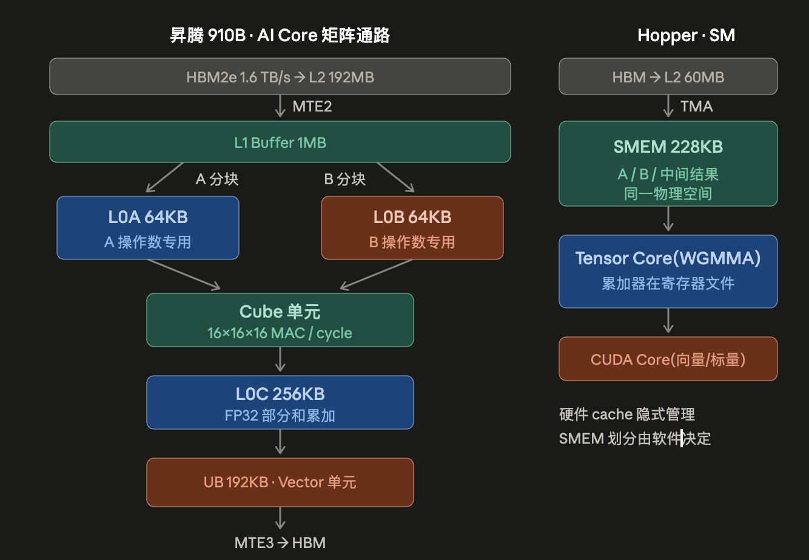
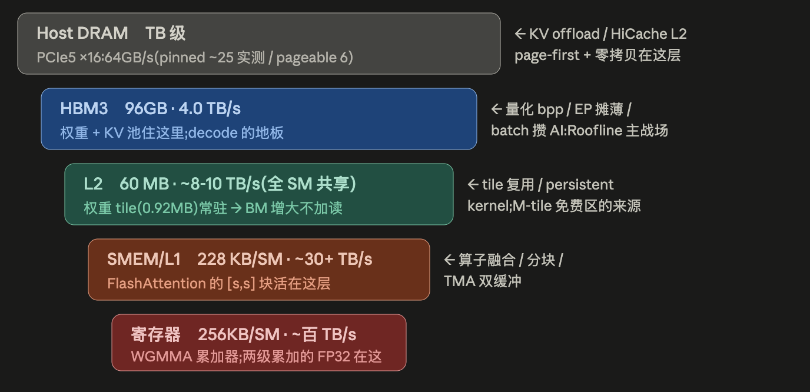
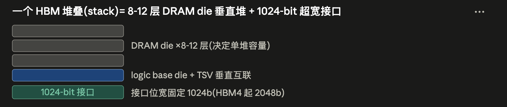

Put compute throughput, HBM, on-chip memory, and interconnect on one budget, and see why different hardware needs different kernels and deployment choices.

Chip architecture comparison:

  

Memory hierarchy:

  

HBM stacking diagram:

  

HBM generations compared:

- HBM2e: spec 3.6Gbps, 910B actually runs at 3.2 → 0.40TB/s per stack × 4 stacks = 64GB · 1.6TB/s
- HBM3: spec 6.4Gbps, H100/H800 actually run at 5.2 → 0.67 per stack × 5 stacks = 80GB · 3.35TB/s
        (the public H20-96GB spec is 96GB, 4.0TB/s, which can be used to compare capacity and bandwidth at different stack counts)
- HBM3e: spec 8–9.6Gbps; working back from the H200's public capacity and bandwidth, the data rate per stack is about 6.25 → 0.80 per stack × 6 stacks = 141GB · 4.8TB/s
        B200 pushes it to 7.8 → 1.0 per stack × 8 stacks = 192GB · 8.0TB/s
        B300 at the same rate, switched to 12-high die stacks → 288GB · 8.0TB/s (bandwidth unchanged)
- HBM4: interface width doubles from 1024→2048-bit, Rubin generation, ~2TB/s class per stack

Notes:
> Capacity, bandwidth, and compute throughput should be compared separately. Taking public specs as an example, the H20-96GB has 96GB of GPU memory and 4.0TB/s of bandwidth, and the H200 has 141GB and 4.8TB/s; more capacity does not mean the peak of every compute path changes in the same proportion.
> B200→B300 only adds die layers: capacity +50%, bandwidth unchanged → the ridge point is unchanged; it exists purely for the KV pool / large models

## GPU: public specifications compared

For the capacity, bandwidth, and compute peaks of the H20-96GB and H800, see the [SGLang public report](https://www.lmsys.org/blog/2025-09-26-sglang-ant-group/); for the H200's capacity and bandwidth, see [NVIDIA's product page](https://www.nvidia.com/en-us/data-center/h200/). The models in the table are listed for specification comparison; interpret the measured results under the conditions given in each of the following sections.

| Chip           | Memory type       | Stacks×per stack | Capacity | HBM bandwidth | L2  | SMEM/SM (SM count) | 8-GPU node | Derived per-stack bandwidth | BF16 (dense) | FP8          | FP4         | Ridge (BF16/FP8)         |
|:--------------:|:----------------:|:-------------:|:--------:|:----------:|:------:|:----------------:|:----------:|:--------------:|:-------------------:|:----------------:|:-----------:|:------------------------:|
| H20-96GB       | HBM3             | 6×16GB        | 96 GB    | 4.0 TB/s   | 60 MB  | 228KB(78)¹        | 768 GB     | 0.67 TB/s      | 148 T               | 296 T            | —           | 37 / 74                  |
| H200           | HBM3e            | 6×24GB        | 141 GB   | 4.8 TB/s   | 50 MB  | 228KB(132)       | 1128 GB    | 0.80 TB/s      | 990 T²              | 1979             | —           | 206 / 412                |
| H800/H100      | HBM3             | 5×16GB        | 80 GB    | 3.35 TB/s  | 50 MB  | 228KB(132)        | 640 GB     | 0.67 TB/s      | 990 T               | 1979 T           | —           | 296 / 591                |
| B200           | HBM3e            | 8×24GB        | 192 GB   | 8.0 TB/s   | 126 MB | 228KB (dual die)³ | 1536 GB    | 1.00 TB/s      | 2250 T              | 4500 T           | 9000 T      | 281 / 562 (FP4 1125)     |
| B300           | HBM3e 12-Hi      | 8×36GB        | 288 GB   | 8.0 TB/s   | 126 MB | Same as above     | 2304 GB    | 1.00 TB/s      | 2500 T              | 5000 T           | 15000 T     | 312 / 625 (FP4 1875)     |

> ¹ Do not infer compute peaks from SM count alone: Tensor Core throughput configurations can differ between SKUs. The H20's public BF16 peak is 148T and should be used directly in budgets at that precision.
>
> ² Devices with similar memory capacity and bandwidth can still have different compute peaks. When selecting hardware, evaluate capacity, effective bandwidth, and throughput at the target precision separately rather than ranking by a single metric.
>
> ³ How to read the compute columns for B300 vs B200: FP4 +67%, FP8/BF16 only +11% — a lopsided upgrade, an inference SKU specialized for FP4 (it also cuts FP64 to 1.2TF and doubles the attention units; these don't fit in the table, so they are noted here).

## Measured: compute, memory access, and data transfer

The following records measurements from a single test configuration (96GB of GPU memory per GPU, driver 550, SM clock about 1980MHz, peak power about 300W). These results are for analyzing effective throughput and fixed overhead, and are not a performance commitment for every device.

| Item | Measured |
| --- | --- |
| Compute throughput | BF16 138T (93%), FP8 282T (95%), DeepGEMM blockwise FP8 264–272T |
| HBM | copy 3.33 TB/s, read-only 3.2–3.3, write-only 3.4 (83–85%) ⟹ R_eff ≈ 42 / 85 |
| On-chip | 78 SMs, L2 60 MB, SMEM 228 KB/SM (227 KB per block) |
| NVLink | 18 × 26.56 GB/s = 478 GB/s per direction; P2P copy 395 GB/s |
| PCIe | Gen5 ×16, pinned H2D/D2H 54–55 GB/s, preallocated pageable 13–16 GB/s |
| NIC | 4 × 400G RoCE bond (NIC0–3 share a PCIe switch with GPU1/3/4/6 respectively), single-NIC RDMA 392 Gb/s |
| Kernel launch | raw `cudaLaunchKernel` 1.9 μs; PyTorch eager 4.5–12 μs/op; `cudaGraphLaunch` 2.9 μs on the host side, 0.76 μs per node on the GPU side |

## NPU

| Chip           | Dies per package | Per die (usable compute units)  | Per-card aggregate (sum of the two dies working independently) | Ridge (per die) | Intra-node interconnect / scale-up domain | Inter-node                  |
|:--------------:|:----------:|:------------------------------------:|:---------------------------------------:|:--------------:|:------------------------------------:|:--------------------------:|
| 910B           | 1          | 64 GB / 1.6 TB/s / 376T¹             | = per die                              | 235            | HCCS 392 GB/s (56×7 full-mesh)     | 8 cards 200G RoCE, 1:1 (25 GB/s) |
| 910C           | 2          | 64 GB / 1.6 TB/s / ~376T | 128 GB / 3.2 TB/s / ~800T             | 235      | Inter-die bandwidth not disclosed 384 cards (CloudMatrix, UB optical interconnect) | Not disclosed               |
| 950PR (26Q1)   | Not disclosed | —                                 | 112 GB / 1.4 TB/s / FP4 1.56P      | —              | 8192 cards (Atlas 950 SuperPoD) | UnifiedBus (Lingqu) ~2TB/s |
| 950DT (26Q4)   | Not disclosed | —                                 | Not disclosed (HiZQ memory, in-house)   | —              | Not disclosed Same as above           | Same as above               |

NPU deployments should still be diagnosed separately for compute, memory access, and kernel launch: matrix operations go to the Cube, while fragmented vector/scalar operations can limit the pipeline; graph mode reduces host-side launches, and fusion reduces intermediate tensors and fragmented operations, but it cannot turn arbitrary Vector operations into Cube operations. HCCS within a node and RoCE across nodes must be modeled separately, and with 8-card nodes, EP16 already crosses nodes; confirm the actual topology and available links first, then choose the collective communication algorithm, and do not carry over the fixed 7× speedup from the simulated table.

## Series navigation

| Chapter | Article | Scheduled date |
| --- | --- | --- |
| 0 | [Roofline: Performance Budgets from Compute and Bandwidth]() | 2026-01-01 |
| 1 | [Communication: From Collective Primitives to Cross-Node Topology]() | 2026-02-13 |
| 2 | [Distributed Inference: Choosing TP, DP, EP, CP, and PP]() | 2026-03-29 |
| 3 | **Inference Hardware: GPUs, NPUs, and the Memory Hierarchy (this post)** | 2026-05-11 |
| 4 | [Attention: From GQA and MLA to Hybrid State]() | 2026-06-24 |
| 5 | [MoE Inference: Batching, DeepEP, DeepGEMM, and Load Balancing]() | 2026-08-06 |
| 6 | [PD and EPD: Disaggregation, State Transfer, and Resource Allocation]() | 2026-09-19 |
| 7 | [Execution: CUDA Graph, Speculative Decoding, Overlap, and Quantization]() | 2026-11-01 |

Previous: [Distributed Inference: Choosing TP, DP, EP, CP, and PP]() · Next: [Attention: From GQA and MLA to Hybrid State]()
