Use KV capacity, bytes read per step, and how the operator can be split to see how MLA, GDN, and compressed attention change the inference system.

## 2026 models compared: only the differences that matter for deployment

| Model | Size or configuration | Attention / state | Impact on deployment |
|---|---|---|---|
| [Qwen3.5-397B-A17B](https://huggingface.co/Qwen/Qwen3.5-397B-A17B) | 397B total parameters, 17B active; 60 layers, d=4096 | 45 GDN layers + 15 full-attention layers | two budgets, for fixed-size state and for KV; natively multimodal, so the encoder stage is budgeted separately |
| [DeepSeek-V4-Pro](https://huggingface.co/deepseek-ai/DeepSeek-V4-Pro) | 1.6T total parameters, 49B active | CSA/HCA hybrid compressed attention | compression granularity, tail state, and the indexer all enter the cache/transfer layout; long-context cost drops, but it is not independent of length |
| [Kimi K2.6](https://huggingface.co/moonshotai/Kimi-K2.6) | 1T total parameters, 32B active; 384 experts, top-8 | MLA, MoonViT 400M | latent sharing is decoupled from multimodal encoding; evaluate INT4 weight capacity and actual kernel throughput separately |
| [GLM-5.1 config](https://huggingface.co/zai-org/GLM-5.1/blob/main/config.json) | 78 layers, d=6144; 256 routed + 1 shared, top-8 | `glm_moe_dsa`, latent 512, RoPE 64, index top-2048 | plan for MLA+DSA; do not carry over the earlier draft's conflicting claim about GDN |

KV sizes are derived estimates and are not the amount a framework finally allocates: the full-attention part of Qwen is about 30 KiB/token, and Kimi's `61×576×2` is about 68.6 KiB/token; GLM's `78×576×2`, about 87.8 KiB/token, covers only latent+RoPE, and state such as the indexer must be counted separately. The figure of about 10KB/token for DS-V4 is an earlier order-of-magnitude estimate based on the compressed layout and is not to be used as a fixed constant. Mixed precision, page alignment, and extra cache fields all change the actual footprint.

## Two family lineages

```text
Qwen line:  MHA → GQA (all of Qwen2) → 3:1 GDN+GQA hybrid (validated in Qwen3-Next → scaled up in Qwen3.5)
           Philosophy: replace 75% of the attention layers outright (linearize to bypass KV)
DS line:    MHA → MLA (V2, channel-dimension compression) → +DSA (V3.2, sparse reads) → CSA/HCA (V4, sequence-dimension compression)
           Philosophy: keep softmax and compress internally one dimension at a time (channel → reads → sequence, three orthogonal dimensions)
```

## What attention demands of compute, bandwidth, and communication

| Structure | KV/token (uniform L=61, h_d=128) | Read per decode step (s=32K) | prefill FLOPs | TP splittability |
|---------------------|---------------------------------------------------------------------------------------------------|----------------------------------------------|----------------------------------------------|------------------------------------------------------------------------------|
| MHA (n_h=64)        | 2·L·64·h_d·2B ≈ 1.9 MB                                                                           | 62 GB 💀                                     | O(s²)                                       | split along 64 heads, TP≤64 |
| GQA-8               | 2·L·8·h_d·2B ≈ 244 KB                                                                            | 8.0 GB                                      | O(s²)                                       | split along n_kv, TP≤8 |
| MLA                 | L·(512+64)·2B ≈ 70 KB<br>(K/V share the latent, so no factor of 2) | 2.3 GB                                      | O(s²)<br>decode needs matrix absorption | ❌ the latent is shared by all heads and can only be replicated → attention must use DP |
| GDN (linear)        | 0;<br>fixed-size state ~94 MB/request ⚠️ (Qwen3.5, 45 layers, assuming d_k=d_v=128;<br>24–40 MB if organized by QK head groups) | independent of s | O(s)                                        | state can be split along V heads;<br>prefix caching needs state checkpoints (the state cannot be truncated) |
| DS-V4 (CSA+HCA)     | ~10 KB ⚠️ estimate<br>(alternating CSA 4:1 + HCA 128:1, plus indexer KV;<br>mixed precision: RoPE dims in BF16, the rest in FP8) | ~0.33 GB                                    | CSA O(s·k) k=1024 / HCA O((s/128)²)<br>coefficient ÷16384 | same as the MLA family, must use DP |


## Attention variants in depth

### MLA: compress the channel dimension

Approach: K and V share one low-rank intermediate, which is not stored per head.

```
x ──W_DKV──→ c_KV(512-dim)──┬──W_UK──→ K_nope
                            └──W_UV──→ V
K_rope stored separately (64-dim, position-dependent, cannot be absorbed)

KV/token = L × (512 + 64) × bpp = 61 × 576 × 2 = 70 KB
vs. MHA's 61 × 16384 × 2 = 1.9 MB → 28× smaller
```

★ Matrix absorption (mandatory for decode): if you decompress back to the full K before computing attention, you save GPU memory but pay for a huge decompression matmul every step. Absorption = fold W_UK into W_UQ ahead of time, so the query takes its dot product directly in latent space. In essence this is amortization: preprocess whichever side has fewer tokens. In decode there is only 1 query, so absorption is a clear win; in prefill both sides are equally long, and absorption instead pays the per-pair overhead of going from 128 to 512 dimensions, so prefill uses the non-absorbed MHA form:

```
q_nope · k_nope^T = (x·W_UQ)·(c_KV·W_UK)^T = x·(W_UQ·W_UK^T)·c_KV^T
                                              └──── merged in advance ────┘
```

The cost of not absorbing: at 128K context, each step wastes about 4400 GFLOPs, 60× more than the compute of the whole model's active parameters (about 74 GFLOPs).

System consequences:

The latent is shared by all heads, so there is no head dimension to split → under TP it can only be replicated, not split → attention must use data parallelism; this in turn scatters tokens across GPUs, so the MoE layer needs an all-to-all to gather them again. In P/D transfer, the lack of a head dimension actually means no reordering is needed.

Measurements also show the bottleneck shifting: after absorption, 128 heads share the 576-dim latent, and decode has I≈242 (BF16), above this configuration's ridge point of 37–42, so **decode attention is mainly compute-bound here**. Measured FlashInfer MLA reaches 85–106 TFLOPS while using only 0.4 TB/s of bandwidth; at B=32 and s=32K a single layer takes 3.2 ms, with time ∝ number of heads × context. This conclusion applies to the 128-heads-per-GPU configuration measured here; KV compression still brings a capacity benefit, but latency does not fall in proportion to the reduction in bytes. In this configuration, attention time for verify (q_len=2) rises to 2.0–2.2×. When TP8 splits it down to 16 heads per GPU, I≈30, the M dimension of WGMMA cannot be filled, and it reaches only 23–26 TFLOPS with neither compute nor bandwidth saturated, so the 128-head bottleneck conclusion does not carry over.

### GDN: no compression, just go around it

Approach: GDN (Gated DeltaNet) replaces the quadratic complexity of softmax(QK^T)V with a recurrent update of a fixed-size state.

```
Basic linear attention:  S_t = S_{t-1} + k_t v_t^T,        o_t = q_t^T S_t
Gated DeltaNet:          S_t = α_t·S_{t-1} + β_t·k_t(v_t − k_t^T S_{t-1})^T
                               └gated forget┘  └─── delta rule: write only the prediction residual ───┘
```

The two mechanisms each have their own job:

Gate α: controls how much history is forgotten, so the state does not accumulate without bound
Delta rule: writes only "the part that was predicted wrong". Without it, the same key appearing repeatedly makes the state norm explode (measured with 12 repetitions: the state norm of basic linear attention reaches 18.5, while GDN stays at 3.2)

GDN layers keep no standard KV that grows with the sequence, but they do hold a fixed-size state (about 94 MB/request for Qwen3.5 is a layout estimate; the actual figure depends on state precision, convolution state, and checkpoint policy).

Two system consequences:

The memory curve has two segments. Qwen3.5's 45 GDN layers hold fixed-size state, and only the 15 full-attention layers have KV:
Mem(req) = 94 MB + s × 30 KB
By the layout estimate above, the crossover is at about 3K tokens; for short requests the fixed-size state can be larger than the KV

Capacity-planning formulas must have two segments; a single s×KV term badly underestimates short requests.

★ Prefix caching partly stops working. Standard KV is append-only, so the K/V of a prefix stays intact and can be reused; GDN state, by contrast, is a lossy compressed summary of the entire prefix and cannot be truncated back to the n-th token. The compromise is to keep multiple checkpoints, but these are also windowed rather than continuous.

### CSA/HCA

<p align="center">
  
</p>

## Series navigation

| Part | Article | Date |
| --- | --- | --- |
| 0 | [Roofline: Performance Budgets from Compute and Bandwidth]() | 2026-01-01 |
| 1 | [Communication: From Collective Primitives to Cross-Node Topology]() | 2026-02-13 |
| 2 | [Distributed Inference: Choosing TP, DP, EP, CP, and PP]() | 2026-03-29 |
| 3 | [Inference Hardware: GPUs, NPUs, and the Memory Hierarchy]() | 2026-05-11 |
| 4 | **Attention: From GQA and MLA to Hybrid State (this post)** | 2026-06-24 |
| 5 | [MoE Inference: Batching, DeepEP, DeepGEMM, and Load Balancing]() | 2026-08-06 |
| 6 | [PD and EPD: Disaggregation, State Transfer, and Resource Allocation]() | 2026-09-19 |
| 7 | [Execution: CUDA Graph, Speculative Decoding, Overlap, and Quantization]() | 2026-11-01 |

Previous: [Inference Hardware: GPUs, NPUs, and the Memory Hierarchy]() · Next: [MoE Inference: Batching, DeepEP, DeepGEMM, and Load Balancing]()
