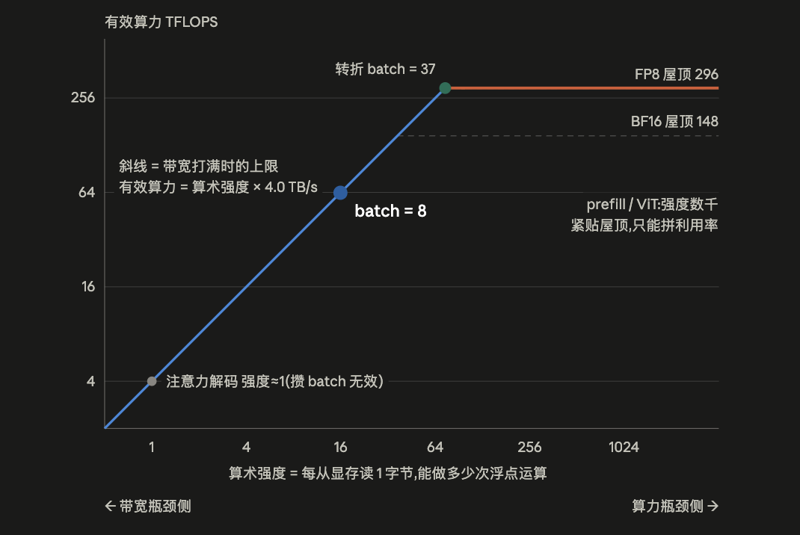

从算术强度、硬件转折点和实际 HBM 流量出发，判断 GEMM 与 Attention 的瓶颈，并区分量化、合批和融合的适用条件。

> 本文为「推理 INFRA 方法论」系列第 1/8 篇。发布日期按 2026 年 1–11 月编排；内容统一整理于 2026-11-01，包含年内后续更新的模型与实验资料。

任何一段 GPU 上的计算，时间都花在两件事上：**算**（执行浮点运算）和**搬**（把数据在存储单元和计算单元之间搬运，通信也算在搬运内）。硬件对这两件事各有一个上限：算力 F（FLOP/s）和带宽 BW（Byte/s）。理想流水下两者重叠
```bash
T ≥ max( W/F , Q/BW )
        ↑算的时间  ↑搬的时间
```
通常来说在优化模型之前，需要解答几个问题：

**① 性能的物理上限是多少？** P ≤ min(F, I×BW)，P为有效算力，F为算力上限，I×BW为带宽侧上限（算子的算术强度×带宽），时延下限 T ≥ max(W/F, Q/BW)。实测贴到这条线就该收手；离得远才有优化空间。它还能在没写一行代码时做时延预算——比如“给定算力与带宽，这个模型生成一个 token 至少需要多久”是可以纸面算出来的，这直接服务于服务质量目标（SLO，Service Level Objective，即对时延的承诺指标）的制定。

**② 该拉哪根杠杆？** 两侧的有效手段完全不同，用错了收益为零。带宽瓶颈侧，堆算力没用，有效的是：减少访存量 Q（算子融合）、降低每个数的字节数 bpp（量化）、攒批次（batch，把多个请求合并计算，提高 I）。算力瓶颈侧反过来：只量化权重、不改计算精度毫无收益，有效的是换低精度计算单元来提高 F。Roofline 把"我觉得慢"翻译成"具体该干什么"。

**③ 验收看哪个指标？** 带宽瓶颈的算子，验收指标是"实测搬运速度 ÷ 峰值带宽"，它的**算力利用率本来就应该很低**（解码阶段注意力算子的算力利用率 3% 不是故障）；算力瓶颈的算子才看算力利用率（MFU，Model FLOPs Utilization，实际有效运算占峰值算力的比例）。不先分诊就看利用率，会把正常当故障、把故障当正常。

## 理论模型

以下以 H20-96GB 的公开规格演示 Roofline 模型；规格来源见 [SGLang 的公开技术文章](https://www.lmsys.org/blog/2025-09-26-sglang-ant-group/)。曲线用于说明计算与带宽的约束关系。

<p align="center">
  
</p>

以上图主要基于如下背景：

| 符号       | 定义                   | 单位      | 关键点                                      |
| ---------- | ---------------------- | --------- | ------------------------------------------- |
| `W`        | 浮点运算次数(乘加算 2) | FLOP      | **算法**量,基本改不动                       |
| `Q`        | HBM 实际往返字节   | Byte      | **实现**量,不是算法数据量,随分块/融合而变 |
| `F`        | 峰值算力               | FLOP/s    | 硬件标称值，和数值精度有关                      |
| `BW`       | 显存带宽               | Byte/s    | 建模时应区分标称带宽与有效带宽；例如实测 3.33 TB/s，约为对应标称值的 83–85% |
| `I = W/Q`  | 算术强度               | FLOP/Byte | **负载**属性,不含时间,和算子实现相关        |
| `R = F/BW` | 转折点(Ridge)          | FLOP/Byte | **硬件**属性,两个速率相除,时间约掉          |

所以，从不同维度来描述算子的执行效率：

| 写法       | 公式                                  | 什么时候用                   |
| ---------- | ------------------------------------- | ---------------------------- |
| 时间       | `T ≥ max(W/F, Q/BW)`                  | 算时延预算、排 SLO           |
| 性能       | `P = W/T ≤ min(F, I×BW)`              | Roofline 图对应的有效算力|
| **利用率** | `算力利用率 ≤ min(1, I/R)`,`带宽利用率 ≤ min(1, R/I)` | **日常判活干得好不好**       |

所以整体优化可以围绕两个目标：

1. 降低T，因为 W 是算法量、基本固定，所以通常只能降低Q或者提高F（低精度或者换执行单元）
2. 提升性能W/T：通常通过攒batch来提升吞吐，提高I

## 从参数量到计算量与容量

权重矩阵乘的 forward 计算量约为 `2·N_active` FLOPs/token；MoE 用激活参数估计算量，用总权重估容量，用本步命中专家的并集估读权重流量，三者不能混用。注意力的 QKᵀ/PV、GDN 状态更新等非权重矩阵乘还要单独计算。

标准 MHA 单层、序列长 s：Q/K/V/O 投影约 `8sd²`，SwiGLU 三矩阵约 `6sd·d_ff`，稠密 QKᵀ/PV 约 `4s²d`（未扣 causal 三角区）。`24sd²` 的经典权重项对应两矩阵 FFN 的 `d_ff=4d`，或三矩阵 SwiGLU 的 `d_ff≈8d/3`，不能把三矩阵与 `d_ff=4d` 混用。

MHA/GQA 的 `KV bytes/token = 2·L·n_kv·h_d·bpp`。MLA 存共享 latent，混合线性注意力另加定长状态；容量计算还要计入 KV 的 TP 复制、graph pool、激活峰值及通信 buffer。

## 实际评估

理论评估的结果是计算和存取时间能完全overlap：

```bash
T = t_compute + t_mem − t_overlap ,  0 ≤ t_overlap ≤ min(t_c, t_m)
  完美流水  → T = max(t_c, t_m)     ← Roofline 假设
  完全不流水 → T = t_c + t_m         ← 最差差 2×
```

实测偏慢先查双缓冲/预取,别急着怪算法。
比如910B 无硬件缓存一致性、搬运靠显式 MTE 指令,不编排就直接退化到 t_c + t_m——这是"融合与流水是刚需不是优化"的数学来源。

`Q`是可变的——这是算子融合的全部数学内容: FlashAttention 把 `[s,s]` 的 `O(s²)` 往返压回 `O(s)`,就是沿这条线段右移。

```bash
Q_min  = (输入 + 输出各读写一次,理论最小)
Q_实际 = Q_min + 中间结果往返 + 重复读取(分块没复用好、缓存没命中)
⟹ I_实际 = W/Q_实际 ≤ W/Q_min = I_max
```

实际算子执行还需要考虑下发的时间, 所以完整的时间可以归结为：

```bash
T_step = Σᵢ max(Wᵢ/F, Qᵢ/BW)     逐 kernel 判瓶颈再求和

完整一步还要加 Roofline 看不见的三项:
       + N_kernel × t_launch        下发税(实测 Qwen3.5 decode ~1770 kernel/步;eager TPOT 143 ms vs CUDA Graph 5.6 ms)
       + (通信时间 − 被 overlap 藏掉的)
       + t_sync                     层内同步点、CPU-GPU 往返
```

数值精度的影响，以同一个 kernel([B,7168]×[7168,2048])对比：

- W8A8 —— Q 减半让带宽侧快 2×,F 翻倍让算力侧也快 2×。无论 batch 多大、prefill 还是 decode,收益都是 2×,不需要判断在哪一侧。 这是它作为默认路径的核心理由——收益可预测,没有失效区间。前提是 kernel 时间远大于固定开销(本次测试中单个 GEMM 有 2–4 μs 的 splitK/尾波开销):N=18432 时实测全程 0.48–0.53×,但这里的 N=2048 小 batch 只有 1.2–1.4×。

- W4A16 —— 理论 4×,但会断崖。 B* = 9.3,过了就退回 BF16 水平(表里 B=64 那行 1.0×)。它把免费区间砍到不足 BF16 的四分之一,换来区间内的加速(小batch有优势)。实测小 batch 只有约 2×:W4 kernel 只跑到 ~1.7 TB/s(反量化 + 访存流水打不满);过拐点后 Humming ≈ BF16,Marlin 反而慢 1.5×(Ampere 路线,不用 WGMMA)。

- W4A8 —— 在有效带宽相同、计算吞吐翻倍且忽略额外开销的理想模型下，相对 BF16 小 batch 可达 4×、计算主导的大 batch 可达 2×。相对 W4A16，小 batch 的权重流量相同，因此性能相当；大 batch 则可快约 2×。这是计算侧性能上限的提升，不是所有形状下的严格改进。

用 C 表示 GEMM 计算量、Q₄ 表示 INT4 权重字节数，忽略激活、输出和量化元数据流量时：

```text
T_W4A16,ideal = max(Q₄ / BW, C / F₁₆)
T_W4A8,ideal  = max(Q₄ / BW, C / F₈)，F₈ ≈ 2F₁₆
```

宽矩阵（N=18432）实测符合这一趋势：B=1 时 W4A16/W4A8 为 39.2/39.0 μs，B=256 时为 488.5/255.2 μs，后者快 1.91×。但相对 BF16 的小 batch 4× 未兑现：W4 路径按权重字节折算的有效带宽约 1.7 TB/s，低于 BF16 的约 3.3 TB/s，实际只快约 2×。小矩阵（N=2048）B=1 时 W4A8 反而更慢（12.7 vs 11.3 μs）；B=256 时快 1.63×（38.1 vs 62.1 μs）。实际耗时还受有效算力、有效带宽、激活量化和其他 kernel 开销影响；总耗时数据不能把差值全部归因于激活量化。W4A8 在宽矩阵上与 W8A8 的耗时接近，相对 W8A8 的主要收益是权重显存减半。

下表是理想 Roofline 估算，不包含上述实现开销：

| 路径                         | F     | bpp  | B*   | B=8 耗时           | B=64 耗时                |
| ---------------------------- | ----- | ---- | ---- | ------------------ | ------------------------ |
| BF16 存 + BF16 算            | 148 T | 2    | 37   | 7.38 μs(1.00×)     | 12.70 μs(1.00×)          |
| **FP8 存 + FP8 算(W8A8)**    | 296 T | 1    | 37   | **3.69 μs(0.50×)** | **6.35 μs(0.50×)**       |
| INT4 权重(W4A16)             | 148 T | 0.5  | 9.3  | 1.87 μs(0.25×)     | 12.70 μs(**1.00×**) |
| **INT4 权重 + FP8 算(W4A8)** | 296 T | 0.5  | 18.5 | **1.85 μs(0.25×)** | **6.35 μs(0.50×)**       |

实测(加宽到 [B,7168]×[7168,18432],固定开销被摊薄;kernel 时间,括号内为相对 BF16):

| 路径 | B=1 | B=8 | B=64 | B=256 |
| --- | --- | --- | --- | --- |
| BF16 cuBLAS | 81 μs | 84 μs | 135 μs | 519 μs |
| W8A8 FP8 cuBLASLt | 41(0.50×) | 41(0.49×) | 69(0.51×) | 247(0.48×) |
| W4A16 Marlin g128 | 44(0.54×) | 44(0.53×) | 200(1.49×) | 776(1.49×) |
| W4A16 Humming g128 | 39(0.48×) | 39(0.47×) | 136(1.01×) | 489(0.94×) |
| W4A8 Humming g128 | 39(0.48×) | 39(0.46×) | 71(0.53×) | 255(0.49×) |

对应不同workload的选择：

```bash
prefill / 大 batch(算力瓶颈侧)
  收益只来自 F ⟹ W8A8 与 W4A8 同为 2×,W4A16 完全无收益(0%)
  ★ 权重量化对 prefill 没用,这一侧只有降精度算才有用

decode / MoE(带宽瓶颈侧)
  收益只来自 bpp ⟹ 理论 W4A16 ≈ W4A8 ≈ 4×,W8A8 为 2×(实测 W4 只有 ~2×)
  ★ MoE 尤其:单专家 M = B·k/E 只有几行,永远在带宽区,B* 约束根本碰不到
     所以 MoE decode 上 W4 相对 W8 的那 2× 是实打实兑现的

混合流量(chunked prefill、PD 未分离)
  batch 跨越 B* 两侧 ⟹ W4A16 表现最不稳定,W4A8 或 W8A8 更可预测
```

最终如何判断kernel实现的好坏，可以参考这个流程：

```bash
① 算 I = W/Q,Q 用【实际 HBM 往返】不是算法数据量
② 算 R_eff = F(计算路径)×MFU_max / (BW×0.85)    实测:BF16 138T、FP8 282T、BW 3.33 TB/s ⟹ R_eff ≈ 42 / 85
③ I < R → 验收看【实测 GB/s ÷ 峰值】,手段:攒 batch、降 bpp、融合减 Q
   I > R → 验收看【算力利用率】, tensor core实际利用率是不是还可以提升    手段:分块、流水、tensor core 占用
④ 实测 ≫ max(t_c,t_m)?依次排查:没流水(≤2×)→ host-bound(可达 10×)→ 通信没藏住
⑤ 想改变瓶颈归属只有两条路:
   降 Q(融合)  —— 对所有负载有效
   涨 W(攒 batch)—— 只对【字节被 batch 共享】的负载有效
       权重 GEMM ✅(权重字节与 B 无关,读一遍服务 B 个 token)
       attention ❌(KV 每请求私有,分子分母同步涨,I ≈ 2g/bpp,g = 共享同一份 KV 的 Q 头数)
```

## 算子实例分析

以GEMM为例，按照M/N/K shape来预估：

```bash
W = 2·M·N·K
Q = (M·K + K·N + M·N) · bpp        ← 这是 Q_min(每块只读写一次),实测可能更大
```

下面的理论估算采用公开 H20 的 FP8 规格：F=296T，BW=4TB/s，R=F/BW=74，bpp=1。实际运行仍需代入有效算力和带宽。

| 形态（shape 样例）                           | 谁支配搬运 → I 近似                                     | P / 饱和点                                                   | 攒 batch 有效吗                                              | 瓶颈                                                  | 具体场景                             | 优化手段                                                     |
| -------------------------------------------- | ------------------------------------------------------- | ------------------------------------------------------------ | ------------------------------------------------------------ | ----------------------------------------------------- | ------------------------------------ | ------------------------------------------------------------ |
| **方阵** [4096,7168]×[7168,2048]             | 三项同量级，都不能扔 **I = (2/3)·n/bpp** 样例 ≈2340     | P ≈ F（恒饱和） 饱和点早已越过                               | 无所谓（已在算力区）                                         | 算力                                                  | prefill 各投影层、训练               | ①降精度算，提 F（FP8/FP4） ②分块 + 双缓冲流水，掩住搬运 ③调 tile 尺寸/条带化调度，避免尾波空转（波次量化） ❌ 权重量化 |
| **瘦长（tall-skinny）** [8,7168]×[7168,2048] | **读权重** K·N 占 99% **I = 2M/bpp = 2M** M=8 → 16      | P = min(296, 8M) M=8：64T，利用率 22% **M\* = R·bpp/2 = 37** | ✅ **主力手段** 权重字节被 batch 共享，I 随 M 线性涨、无上限  | 带宽                                                  | decode 权重 GEMM（M=batch）、lm_head | ①攒 batch 到 M*（此前吞吐免费） ②权重量化降 bpp（W4/W8） ③权重读取标"用完即弃"，防 L2 被流式数据污染 ❌ 切 N/K（不在 I 里）、提 F、拼 MFU |
| **扁平（瘦 K）** [4096,32]×[32,4096]         | **写输出** M·N 独大 **I = 2K/bpp = 2K** K=32 → 64       | P = min(296, 8K) K=32：I=64<R，带宽侧 K=128：I=256，翻回算力侧 **K\* = 37** | ❌ M 不在 I 里 加一行 batch = 多算一行 + 多写一行，分子分母同涨 | 由 K 定 K<37 带宽                                     | 不融合 attention 的 QKᵀ（K=h_d，输出 s×s）  | ①融合进 FlashAttention，输出留寄存器，算子整体消失 ②消不掉则降 bpp ❌ 攒 batch、加大 K（受 SMEM 容量锁死） |
| **双小** [8,16]×[16,7168]                    | M·K 与 K·N 相当 **I = 2MK/((M+K)·bpp)** M=8,K=16 → 10.7 | P = 8MK/(M+K) = 42.7T 利用率 14% **饱和点够不着**              | ⚠️ 有效但有天花板 M→∞ 时 I → 2K/bpp = 32 < R，永远出不了带宽区 | 带宽 + 固定开销（理论 T≈0.04μs，实测单个 kernel 就要 ~2μs） | LoRA decode、小 rank 适配器          | ①离线合并权重（W′=W+BA），算子消失 ②多适配器 grouped 合批 ③CUDA Graph 兜住下发开销 ⚠️ 攒 batch 可做但别指望；核内优化无意义 |

实测（FP8 / BF16，cuBLASLt）：方阵 264T（89%）/ 135T；瘦长 35T，理论按实测 3.33 TB/s 应为 53T，差的部分是 splitK reduce 等 ~2μs 固定开销；扁平 46T / 52T，真实 kernel 输出写 BF16，I 只有 31.8，实测只到理论的 43%，FP8 不比 BF16 快；双小 0.72T，单个 kernel 本身 2.1–2.5μs。表里的 P 是 roofline 上限，小形状上固定开销才是主项。


以Attention为例：

```bash
O = softmax(Q·Kᵀ / scale) · V
    └─GEMM(cube)─┘ └vector┘ └─GEMM(cube)─┘
```

Attention 的计算分三步：两个矩阵乘夹一个 softmax。

```
S = Q·Kᵀ / scale     [s,h_d]×[h_d,s] → [s,s]      跑在 cube/tensor core
P = softmax(S)        逐元素归一化                   跑在 vector 单元
O = P·V              [s,s]×[s,h_d] → [s,h_d]      跑在 cube/tensor core
```

记号：s = 序列长度；h_d = 每个注意力头的向量维度（本文取 128）；bpp = 每个数的字节数。以下按单头计算（I 是强度，分子分母同乘头数不变，按单头最干净）。

两个阶段的区别：

| 阶段               | FLOPs（单头）               | HBM 字节（单头，融合实现）    | I = W/Q         | 瓶颈       |
| ------------------ | --------------------------- | ----------------------------- | --------------- | ---------- |
| prefill（q_len=s） | 4·s²·h_d = 2×(QKᵀ) + 2×(PV) | 4·s·h_d·bpp（读QKV+写O）      | s/bpp           | s 大时算力 |
| decode（q_len=1）  | 4·s·h_d·g（g 个 Q 头共享一组 KV） | 2·s·h_d·bpp（读 K、V 各一遍） | 2g/bpp（MHA g=1，BF16≈1） | MHA 恒为带宽；GQA/MLA 见下 |

FLOPs 的来源：矩阵乘 [m,k]×[k,n] 记 2·m·k·n（每个输出元素 k 次乘 + k 次加），两个矩阵乘各贡献 2·s·s·h_d（prefill）或 2·s·h_d（decode，q_len=1 使矩阵乘退化为矩阵-向量乘）；softmax 逐元素约 5s²，相对矩阵乘小 ~50 倍，忽略。表中的系数 4 = 2（乘加记 2）× 2（两个矩阵乘）。

decode 行最关键的事实是 **s 在 I 里被约掉了**：KV 缓存的每个字节读进来恰好参与 2 次运算（一乘一加）就再也不用——零复用。所以上下文变长、攒 batch（各请求 KV 私有，分子分母同涨）都改变不了 I 这个数；能改变它的只有"同一份 KV 被几个 Q 头共享"（g）和每步 query 数（投机解码的 q_len）。

**MHA decode attention：只有一件事可做**

在这里采用的硬件参数下，I≈1，远低于转折点 37，因此模型预测该负载受带宽限制。优化目标只有一个：**把"从显存读 KV"的速度拉到硬件上限**。FlashDecoding 就是干这个的：decode 每次只处理 1 个 query，默认并行下只有少数 SM 有活干；它把 KV 切成多段分给所有 SM 同时读、各算局部再合并——人多一起搬，带宽才打得满。此外的手段是降 Q 本身（KV 量化降 bpp）。

**GQA / MLA：共享 KV 同时抬高 I**

共享 KV 不只是省显存，每个 KV 字节被 g 个头复用，I 跟着乘 g。MLA 吸收后 128 个头共享一份 576 维 latent，I ≈ 2·128·(576+512)/(576·bpp) ≈ 242（BF16），已超过该测试配置的算力与带宽转折点。实测（FlashInfer 0.7.1，BF16 KV，单层）：

| 结构 | I | 实测 | 瓶颈 |
| --- | --- | --- | --- |
| MHA（32/32） | 1 | 3.5–3.6 TB/s | 带宽 |
| GQA-8，CUDA core decode kernel（默认） | 8 | 0.9 TB/s，7 TFLOPS | CUDA core 算力 |
| GQA-8，tensor core kernel | 8 | 3.0 TB/s，24 TFLOPS | 带宽 |
| MLA 吸收，128 头 | 242 | 85–106 TFLOPS，只用 0.4 TB/s | **算力** |
| MLA 128 头，q_len=2（MTP） | 484 | 时间 ×2.0–2.2 | 算力 |

两个推论：本次 GQA 实验使用 tensor core 版 decode kernel 才回到带宽瓶颈；每卡 128 头的 MLA 配置在本次实测中主要受算力限制，q_len=2 的 verify 实测让 attention 时间增加到 2.0–2.2 倍。TP8 切到每卡 16 头后，算力和带宽均未吃满，需按每卡头数与 kernel 利用率重新判断；KV 压缩仍有容量收益，但时延不一定按字节缩减比例下降（详见[第四章]()）。

**为什么必须融合成一个 kernel**

三步若写成三个独立 kernel，步与步之间的中间结果都要"写回显存、再读出来"：

```
QKᵀ 算出 [s,s] 分数矩阵 → 写显存
softmax                  → 读一遍、写一遍
PV                       → 再读一遍
```

这个中间矩阵是 s×s 的：s=4K 时 1600 万个数，**比输入 Q/K/V 加起来（s×h_d 量级）大上百倍**——不融合时，显存流量的大头不是数据本身，而是这些"过路"的中间结果。代入公式看强度的塌缩：

```
I_不融合 ≈ 4s²·h_d / 4s²·bpp = h_d/bpp = 64      ← 常数，不随 s 涨
I_融合   = s/bpp                                  ← 随 s 无限涨
```

用 ncu 实测 DRAM 字节：不融合时 I≈42（s=4K、16K 都一样；单独的 scale 又多一次 s² 读写，所以是 h_d/3 而不是 h_d/2），融合后 I=2612 / 8359。但 I≈42 接近该测试配置的转折点，不融合时仅慢 1.25–1.4×。在这一配置下，融合的主要收益是避免物化 s² 中间矩阵，降低显存占用（16K 时每 8 个头约 4.3GB），耗时收益则相对有限。

FlashAttention 的解法就两招：**分块**——把矩阵切成小到能塞进片上缓存的块，中间结果在片上算完直接用掉，不碰显存；**online softmax**——softmax 本来要看到整行才能归一化，这一招让它一块一块算、边算边修正，分块才得以成立。效果：显存流量从 O(s²) 降回 O(s)。

**"片上"具体指什么：两种硬件的落地方式不同**

**N 卡：片上 = 每个 SM 私有的共享内存（SMEM，228KB/SM，单 block 最多 227KB，见[第三章]()表）+ 寄存器。** 块尺寸不是经验值，是 SMEM 容量反推出来的：

```
以块尺寸 Br（row分块）=Bc（col分块）=128、h_d=128、BF16 为例，一个 SM 内需同时驻留：
  Q 块 / K 块 / V 块         各 128×128×2B = 32 KB ×3
  双缓冲的第二份 K/V          32 KB ×2
  ────────────────────────────────────────
  ≈ 160 KB，贴着 227KB 上限 → 块只能切 64~128
  S/P 块（FP32 累加）与 O 累加器在 FA2/FA3 里放寄存器（WGMMA 的累加器就在寄存器），不占 SMEM
```

数据从 HBM 进 SMEM 后，缓存层次由硬件维护一致性，中间结果留在片上是默认状态。

**910B：片上是多级分离的缓冲，"留在片上"必须手工编排。** DaVinci 架构中 cube 与 vector 是物理分离的执行单元，各配各的缓冲——cube 挂 L0A/L0B（输入）与 L0C（累加输出），vector 用 Unified Buffer（UB），其上还有 L1；**各级之间无硬件缓存一致性，搬运全靠显式 MTE（Memory Transfer Engine）指令**。于是 QKᵀ 的结果落在 L0C，softmax 要用就得显式搬进 UB，算完再搬出去喂 PV——中间结果确实不碰 HBM（与 N 卡结论一致），但在片上也要"过桥"，桥就是 MTE 搬运。

两条硬件路径对比：

```
N 卡：  分块 + online softmax → 中间结果留 SMEM，硬件管一致性 → 完事
910B： 分块 + online softmax → 中间结果在 L0C ⇄ UB 间摆渡（MTE 显式搬）
        ├→ 摆渡与计算必须双缓冲流水，否则退化到 t_c + t_m（见本章"实际评估"）
        └→ cube/vector 物理分离 → 天然可流水，也必须流水
```

流水的形态：cube 算第 i+1 块的 QKᵀ 时，vector 同时做第 i 块的 online softmax。不编排就互相干等；而 910B 的 vector 算力相对 cube 弱得多，一旦干等，弱的一方直接成为全局瓶颈。H 卡上 tensor core/CUDA core 重叠同样成立，只是 910B 的 vector 短板把这件事从"锦上添花"变成"必做"。（昇腾 950 将 cube:vector 配比提至 8:1 并新增 cube-vector 融合通路。）

## 先算物理下限，再解释实测差距

性能诊断先区分计算、访存和固定开销。权重 GEMM 的 batch 能复用权重，decode Attention 的 batch 却未必能复用 KV；同一个合批动作，不会对所有算子产生相同收益。验收时应同时记录 shape、精度、有效带宽和计时范围。

## 系列导航

| 章节 | 文章 | 编排日期 |
| --- | --- | --- |
| 0 | **Roofline：用算力与带宽建立性能预算（本篇）** | 2026-01-01 |
| 1 | [通信模型：从集合原语到跨机拓扑]() | 2026-02-13 |
| 2 | [分布式推理：TP、DP、EP、CP 与 PP 的取舍]() | 2026-03-29 |
| 3 | [推理硬件：GPU、NPU 与存储层级]() | 2026-05-11 |
| 4 | [Attention 演变：从 GQA、MLA 到混合状态]() | 2026-06-24 |
| 5 | [MoE 推理：Batch、DeepEP、DeepGEMM 与负载均衡]() | 2026-08-06 |
| 6 | [PD 与 EPD：阶段分离、状态传输与资源配比]() | 2026-09-19 |
| 7 | [核心优化：CUDA Graph、投机推理、Overlap 与量化]() | 2026-11-01 |

下一篇：[通信模型：从集合原语到跨机拓扑]()
