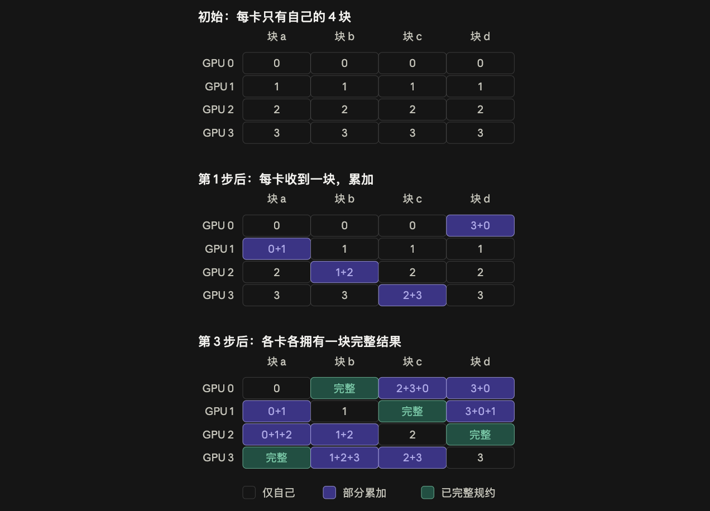
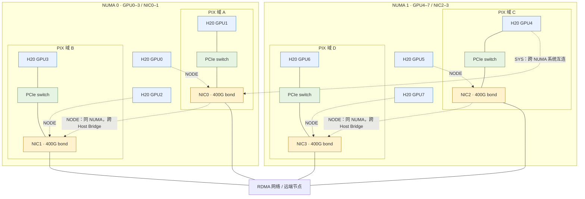
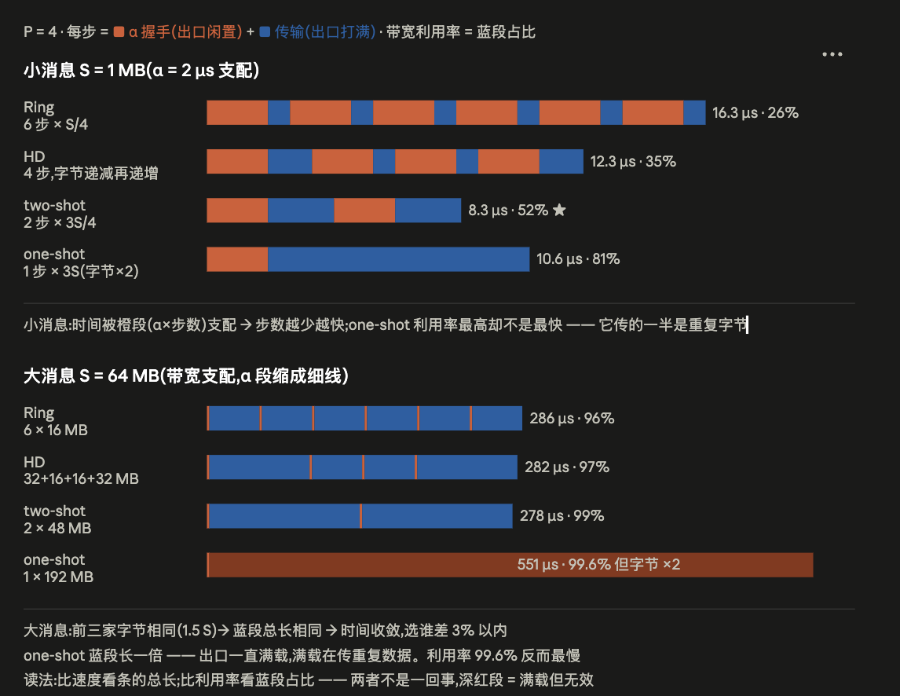
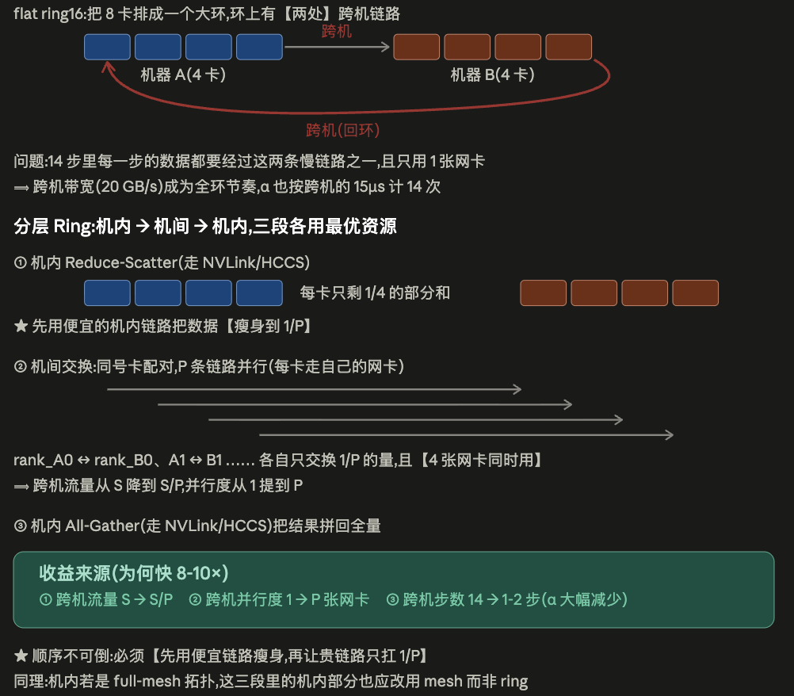

把集合通信拆成步数、启动时延和每卡字节数，再结合 NVLink、RDMA、NUMA 与 PCIe 拓扑解释实测差异。

> 本文为「推理 INFRA 方法论」系列第 2/8 篇。发布日期按 2026 年 1–11 月编排；内容统一整理于 2026-11-01，包含年内后续更新的模型与实验资料。

## 常见通信算法

<p align="center">
  
</p>

| 类别       | 原语 / 算法     | 语义或机制                       | 每卡字节                         | 步数           | 备注                        |
| ---------- | --------------- | -------------------------------- | -------------------------------- | -------------- | --------------------------- |
| **多对多** | ★ ReduceScatter | 各卡拿到 1/P 的规约结果          | (P−1)/P·S ✓下界                  | P−1（ring）    | 每卡各发，P 张网卡并行      |
|            | ★ AllGather     | 各卡拿到全量拼接                 | (P−1)/P·S ✓下界                  | P−1（ring）    | = ReduceScatter 的逆向      |
|            | ★ AllReduce     | 各卡拿到全量规约                 | 2(P−1)/P·S ✓下界                 | 2(P−1)（ring） | = RS + AG，见下方变体       |
|            | ★ AllToAll      | 每卡给每卡发不同数据（分块转置） | (P−1)/P·S ✓下界                  | 1（全对并发）  | 字节由语义锁死，省不掉      |
| **单端点** | Broadcast       | root 发给所有卡，内容相同        | root 出 (P−1)·S（朴素） 每卡收 S | log₂P（树）    | 朴素实现 root 出口瓶颈      |
|            | Scatter         | root 切片发给各卡，内容不同      | root 出 (P−1)/P·S 每卡收 S/P     | 1              | 字节数同 RS，但全压一张网卡 |
|            | Gather          | 各卡数据汇到 root 拼接           | root 入 (P−1)/P·S 每卡发 S/P     | 1              | incast：P−1 卡同时打 root   |
|            | Reduce          | 各卡数据汇到 root 规约           | 每卡发 ≈S                        | log₂P（树）    | 规约计算集中在 root         |

AllReduce 的变体:

- Ring:2(P−1) 步,每步与固定邻居交换 S/P。字节最优;每卡恒 2 条连接、规约摊在每步的小块上 → 最易与计算 overlap、最易切流水。短板只有一个:步数 O(P),小消息 α 累积(P=8 时 14 个 α)。

  <p align="center">
    
  </p>

- Halving-Doubling:2·log₂P 步,字节与 ring 相同。机制是配对距离每步翻倍、交换量每步减半(S/2→S/4→S/8,再原路返回)——用更大的块补上省掉的步,各卡之间完全均衡。要求 P 为 2 的幂,否则补步后常输给 ring。

- two-shot:2 步(每卡拉取自己负责的 1/P 切片规约 → 广播回去),字节仍是下界。这是"不传冗余"下的步数极限——规约结果没算出来之前无法扩散。代价:每卡 P−1 条连接(资源 O(P²))、规约计算集中在一步、依赖 NVLS/multimem 类硬件多播才真正高效。

- one-shot:1 步,每卡把完整 S 发给所有对端、各自本地全量规约（需要更多计算资源）。突破 2 步的唯一方式是传冗余:字节 (P−1)·S,是下界的 P/2 倍。适用域 = 小消息 且 小 P(交叉点 S* = α·BW/(P−1−下界系数),8 卡机内约 130 KB)。

<p align="center">
  
</p>

## H20 8 卡 / 4 NIC 的 NUMA 与 PCIe 拓扑

**8×H20 + 4×400G NIC：NUMA / PCIe switch 架构示意**

采用 [SGLang #5186 公布的 8×H20 实机拓扑](https://github.com/sgl-project/sglang/issues/5186)作为参考：GPU0–3、NIC0–1 属于 NUMA0；GPU4–7、NIC2–3 属于 NUMA1。四组 PIX 配对与本文实验记录一致。NIC0–3 对应 `mlx5_bond_0` 至 `mlx5_bond_3`；图中 400G 沿用本文的聚合口径（2×200G）。

下图突出 NUMA 归属和共享 PCIe switch 的关系；虚线表示拓扑距离，省略 Host Bridge 内部层级和 GPU 间 NVLink 互联。



完整 GPU–NIC 距离如下（与上述公开实机矩阵一致）：

| GPU | NUMA | NIC0 | NIC1 | NIC2 | NIC3 |
|---|---|---|---|---|---|
| GPU0 | 0 | NODE | NODE | SYS | SYS |
| GPU1 | 0 | PIX | NODE | SYS | SYS |
| GPU2 | 0 | NODE | NODE | SYS | SYS |
| GPU3 | 0 | NODE | PIX | SYS | SYS |
| GPU4 | 1 | SYS | SYS | PIX | NODE |
| GPU5 | 1 | SYS | SYS | NODE | NODE |
| GPU6 | 1 | SYS | SYS | NODE | PIX |
| GPU7 | 1 | SYS | SYS | NODE | NODE |

以 **NIC0** 为参照，三类路径的区别是：

- **PIX**：GPU1 → 共享 PCIe switch → NIC0。
- **NODE**：GPU0 → Host Bridge A → 同 NUMA 内的桥间互连 → Host Bridge B → NIC0 所在分支。关键是跨 Host Bridge，不能仅凭“不同 switch”判断为 NODE。
- **SYS**：GPU4 所在 PCIe 分支 → 跨 NUMA 的系统互连 → NIC0 所在 PCIe 分支。

定义参考 [NVIDIA 的 topo 说明](https://docs.nvidia.com/deploy/nvidia-smi/index.html#topology)。经过 CPU 侧 I/O 互连不等于必须由 CPU memcpy 或通过 host 内存中转。图中四个 switch 节点表示四组 PIX 共享关系，不用于统计整机全部 PCIe switch；下表给出本文的实测性能对比。

| 协议 | 源/目的 GPU 与 NIC0 的关系 | 16 KB 块 | 256 KB 块 |
|---|---|---|---|
| RDMA | GPU1（同 PCIe switch，PIX） | 41.9 GB/s | **48.9 GB/s**（打满单网卡） |
| RDMA | GPU0（同 NUMA，不同 switch，NODE） | 46.0 GB/s | 48.9 GB/s |
| RDMA | GPU4（跨 NUMA，SYS） | 23.9 GB/s | **24.0 GB/s（减半）** |
| TCP | GPU1 | **0.39 GB/s** | **1.65 GB/s** |

## 通信时延建模

```bash
T = 步数 × α + 每卡字节 / busBW
```

| 参数             | H20                                      | 910B                         |
|------------------|------------------------------------------|------------------------------|
| 机内 busBW       | NVLink ~350-400 GB/s 有效(实测 AllReduce 128 MB busBW 336 GB/s,P2P 拷贝 395 GB/s) | HCCS 56×7 = 392 GB/s (full-mesh) |
| 跨机 busBW/卡    | 20 GB/s (4×400G NIC,2 卡共享 1 卡;实测裸 RDMA 绑 NUMA 后 24.5,NCCL 8 对跨机 P2P 15.1) | 25 GB/s (200G RoCE,1:1)      |
| 机内 α           | ~2 μs(单次 NVLink 写;一次完整集合通信实测下限 ~10 μs 自定义 kernel / ~20 μs NCCL) | ~2 μs                        |
| 跨机 α           | ~15 μs(实测 RDMA verbs 单向 9 μs;NCCL 跨机 64 KB AllReduce 74 μs) | ~20 μs                       |

对All-Reduce下不同算法时延如下：

<p align="center">
  
</p>

对于跨机场景，因为机内带宽高于机间带宽，所以通信方案为：

1. 机内先 ReduceScatter:每台机内部把数据规约并切成 P_机内 份,每卡只留自己负责的那 1/P 切片——数据在进贵通道之前先瘦身。

2. 跨机只对切片做 AllReduce:各机的同号卡两两配对（各自通信域做reduce_scatter+all_gather）,只交换这 1/P 切片——全程唯一过网的字节,是 flat 算法的约 1/P_机内。

3. 机内再 AllGather:把各卡凑齐的完整切片在机内广播回去,每卡集齐全量结果——机内字节多但机内带宽高得多。

   <p align="center">
     
   </p>

| S      | Ring 机内 | HD 机内 | two-shot 机内 | one-shot 机内 | Ring 跨机 | HD 跨机 | two-shot 跨机 | one-shot 跨机 | **分层 跨机** |
| ------ | --------- | ------- | ------------- | ------------- | --------- | ------- | ------------- | ------------- | ------------- |
| 64 KB  | 28.3      | 12.3    | 4.3           | **3.3**       | 213       | 93      | 33            | **31**      | ~40           |
| 1 MB   | 33        | 17      | **9**         | 22            | 297       | 178     | 118           | 365           | **63**        |
| 16 MB  | 108       | 92      | **84**        | 322           | 1610      | 1490    | 1430          | 5615          | **480**       |
| 128 MB | 668       | 652     | **644**       | 2562          | 11400     | 11290   | 11210         | 44815         | **2100**      |

上表是模型值。H20 实测(μs;机内 8 卡,CUDA Graph 内连放取平均;跨机 2×8 卡,NCCL + GDR):

| S | NCCL 机内 | two-shot 机内(symm-mem) | one-shot 机内(symm-mem) | NCCL 跨机(分层) |
| --- | --- | --- | --- | --- |
| 64 KB | 23.2 | 10.5 | 10.6 | 74 |
| 1 MB | 29.0 | 13.9 | 34.1 | 128 |
| 16 MB | 117 | 106 | 395 | 421 |
| 128 MB | 700(nccl-tests) | ~790(64 MB 时 395) | — | 2068 |

三条结论:

- 小消息(≲1 MB)拼步数:α 累积支配(ring 14 步 = 28 μs,1 MB 传输仅 5 μs)。two-shot 2 步是无冗余下界;one-shot 1 步再快一档但只到 ≈130 KB。典型负载:TP 每层 AllReduce ~56 KB,一步 decode 上百次,正是这一档。H20 实测排序成立(自定义 kernel 约为 NCCL 的一半),但绝对值高 2.5–3 倍:flag 同步和屏障让下限在 ~10 μs;one-shot 与 two-shot 在 64 KB 以下就打平,256 KB 起 two-shot 明显更快
- 大消息没得拼:Ring/HD/two-shot 字节相同 → 时间收敛(H20 实测差 <10%)——交换式拓扑上瓶颈是每卡出口(没法并发)而非链路条。选型看图外成本:要 overlap / P 大 / 拓扑异构 → ring更有优势;有 NVLS → two-shot 类(本集群 H20 的 NVLS 不可用,NCCL 需 `NCCL_NVLS_ENABLE=0` 才能初始化)。注意 910B 的 HCCS 是点对点 full-mesh 而不是交换式,ring 只用 7 条链路中的 1 条,大消息也会慢 7×。
- 跨机拼字节:出口 ÷17.5、α ×7.5 → 跨机唯一有效的优化是砍机间通信量——分层把机间通信量压到 1/P_机内,机内多搬的部分因带宽差 17.5 倍近乎免费。

跨机传输必须走 RDMA,TCP 只适合控制面。H20 两机实测对比:

| 项 | RDMA(RoCE,GPUDirect) | TCP(容器网络 eth0,200 Gb/s) |
| --- | --- | --- |
| 带宽 | 单网卡 392 Gb/s;4 张按 NUMA 绑定 196 GB/s/节点(不绑 74%) | iperf3 32 流 16.4 GB/s/节点,16 流吃掉 3 个以上 CPU 核 |
| 小消息单向延迟 | 9 μs | 56 μs |
| NCCL 跨机(2×8 卡) | AllReduce 128 MB 2.07 ms;8 对 P2P 15.1 GB/s/卡 | 慢 12–28×(需 `NCCL_NET_PLUGIN=none NCCL_NET=Socket` 才真正走 TCP,`NCCL_IB_DISABLE` 被外部插件忽略) |
| 亲和 | 跨 NUMA 配对 GPU→网卡带宽减半(49→24 GB/s);关掉 GDR 后 P2P 15.1→7.3 GB/s | — |

对于ALL2ALL来说，同样有不同算法：

<p align="center">
  
</p>

**① 直发**：每卡把 3 个块同时发给各自目的地，一步到位。步数和字节双最优；短板是 P−1 条消息同时打到一张网卡，跨机时容易 incast（拥塞，多打一）。

**② 成对交换**：第 t 轮只和卡 i⊕t 换一块，共 P−1 轮。字节仍在下界、任一时刻只有 1 条在途所以不会 incast；代价是串行慢，α 累加 P−1 次。

**③ Bruck**：块按二进制距离绕路，中途搭别人的车、被邻卡代转，log₂P 步走完，步数最少；但多出的中转块是**过网**字节，还要末尾本地重排，只在极小消息 × 超大 P 才划算。

**④ 分层两级**：先在机内把块按 rail 归堆（走 NVLink），再同 rail 卡跨机发一条大包，大包落地后由 NVLink 拆分转发到各目的卡。跨机通信次数 P机内²→P机内（8 卡机：64 条 → 8 条）、过网字节一字不变；代价是多搬**机内**字节，这笔开销不随消息变大而摊薄，所以大消息（≥16 MB）反而不如直发。

| S      | 直发 机内 | pairwise 机内 | Bruck 机内 | 直发 跨机 | pairwise 跨机 | **分层 跨机** |
| ------ | --------- | ------------- | ---------- | --------- | ------------- | ------------- |
| 64 KB  | **2.2**   | 16.2          | 6.3        | 62        | 68            | **17**        |
| 1 MB   | **4.5**   | 18.5          | 10.3       | 86        | 92            | **44**        |
| 16 MB  | **42**    | 56            | 75         | 477       | 484           | 484           |
| 128 MB | **322**   | 336           | 555        | **3397**  | 3403          | 3764          |

H20 实测 NCCL AllToAll(μs):机内 8 卡 64 KB 9.5、1 MB 14.8、16 MB 72、64 MB 216(busBW 272 GB/s);跨机 2×8 卡 1 MB 173、16 MB 733、128 MB 4409。比模型值慢 1.3–4 倍,按 α≈10 μs(机内)、BW≈280 GB/s 重算更接近。

## 先明确通信语义，再选择算法

小消息优先减少同步步数，大消息优先接近有效带宽。跨机还要区分每卡流量与整机出口流量，并验证 GPU 与 NIC 的亲和关系；模型值用于定位问题，实际部署仍以目标拓扑的测量结果为准。

## 系列导航

| 章节 | 文章 | 编排日期 |
| --- | --- | --- |
| 0 | [Roofline：用算力与带宽建立性能预算]() | 2026-01-01 |
| 1 | **通信模型：从集合原语到跨机拓扑（本篇）** | 2026-02-13 |
| 2 | [分布式推理：TP、DP、EP、CP 与 PP 的取舍]() | 2026-03-29 |
| 3 | [推理硬件：GPU、NPU 与存储层级]() | 2026-05-11 |
| 4 | [Attention 演变：从 GQA、MLA 到混合状态]() | 2026-06-24 |
| 5 | [MoE 推理：Batch、DeepEP、DeepGEMM 与负载均衡]() | 2026-08-06 |
| 6 | [PD 与 EPD：阶段分离、状态传输与资源配比]() | 2026-09-19 |
| 7 | [核心优化：CUDA Graph、投机推理、Overlap 与量化]() | 2026-11-01 |

上一篇：[Roofline：用算力与带宽建立性能预算]() · 下一篇：[分布式推理：TP、DP、EP、CP 与 PP 的取舍]()
