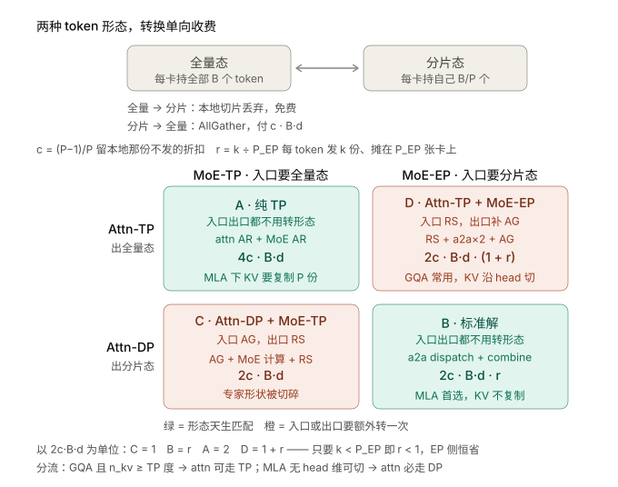

围绕权重、KV、激活和通信预算，推演 Attention 与 MoE 的并行组合，并分析长上下文和流水线的额外约束。

> 本文为「推理 INFRA 方法论」系列第 3/8 篇。发布日期按 2026 年 1–11 月编排；内容统一整理于 2026-11-01，包含年内后续更新的模型与实验资料。

## Attention/MoE组合方式

Attention-TP/DP和MLA的关系:

```bash
GQA:KV 沿 n_kv 个头切 → TP ≤ n_kv(=8 时 TP8 正好),TP 同时摊薄 KV 显存 ✅
MLA:KV 是全头共享的一个 latent → 无 head 维可切 → TP 下只能【复制】,但是tp能切weight降低计算量
     TP8 = 同一份 KV 存 8 遍 → 显存爆炸 ❌
⟹ MLA 模型 attention 必走 DP:每卡管自己的请求和 KV,不复制
```

Attention-DP/TP和MoE-TP/EP组合下通信机制区别：

<p align="center">
  
</p>
其中dispatch/combine源于all2all：

| 业务名   | 底层原语  | 额外的非通信部分         |
| -------- | --------- | ------------------------ |
| dispatch | AllToAllv | 路由计算、token permute  |
| combine  | AllToAllv | k 份加权求和（源卡本地） |

同时，Attn-TP/Attn-DP往往可以和MoE-EP组合使用（32 卡、EP32、k=8、MLA、d 为 hidden、B 为全局 batch）：

<p align="center">
  
</p>

| 维度            | 纯 Attn-TP32       | **TP4 × DP8**  | 纯 Attn-DP32     |
| --------------- | ------------------ | -------------- | ---------------- |
| KV 复制份数     | 32 份              | 4 份           | 1 份             |
| KV 读带宽/卡    | B·ctx·35KB         | (B/8)·ctx·35KB | (B/32)·ctx·35KB  |
| MLA 投影权重/卡 | W/32               | W/4            | W 完整           |
| attn 通信域     | 32 卡（c=31/32）   | 4 卡（c=3/4）  | —                |
| attn 每卡 token | B                  | B/8            | B/32             |
| ①④ 形态转换     | 0.969×2 = 1.94 B·d | 0.19 B·d       | 0                |
| ②③ MoE a2a      | 0.48 B·d           | 0.48 B·d       | 0.48 B·d         |
| **通信合计**    | **2.42 B·d**       | **0.67 B·d**   | **0.484 B·d**    |
| attn 计算/卡    | B/32               | B/32           | B/32（三者相同） |

同时对于MoE来说，MoE-TP/MoE-EP的区别(Attn-Dp)在于：

| 维度                       | MoE-TP32                                            |      | MoE-EP32                                                  | 谁赢                              |
| -------------------------- | --------------------------------------------------- | ---- | --------------------------------------------------------- | --------------------------------- |
| **gate/up 形状**           | [B·k, 7168] × [7168, **64**]                        |      | [B·k/32, 7168] × [7168, 2048]                             | **EP**                            |
| **down 形状**              | [B·k, **64**] × [64, 7168] 算完还需 AllReduce       |      | [B·k/32, 2048] × [2048, 7168]                             | **EP**                            |
| N 方向 tile 数（BN=128）   | 1 个，且 128 列里 64 列是 padding                   |      | 16 个，全满                                               | **EP**                            |
| tile 总数 / 78 SM（B=512） | 32 个 → 利用率 41% × tile 内 50% padding ≈ **20%**  |      | 16 个 → 21%，但 tile 全满                                 | 都不足，性质不同                  |
| **形状能否靠攒 batch 救**  | N/K 是模型维，与 B 无关                             |      | M_e=B·k/32 随 B 涨，tile 数随之增加                       | **EP，最本质的差别**              |
| **专家权重读/卡**          | u(B)/256 × W_e/32（kernel 跳过没被命中的专家）      |      | u(B)/256 × W_e/32 u(B)=256(1−e^(−Bk/256))                 | 期望打平，EP 只是方差更大          |
| **激活显存/卡**            | 完整 [B·k, d]，B=512 时约 **59 MB**（BF16）           |      | [B·k/32, d] B=512 时约 **1.8 MB**                         | **EP，差 32 倍**，但 decode 下只有 MB 级 |
| **通信原语**               | 入口 AllGather + 出口 ReduceScatter                 |      | a2a dispatch + combine                                    |                                   |
| **通信字节/卡**            | 2c·B'·d                                             |      | 2c·(B'/P_EP)·k·d                                          | 比值 **r = k/P_EP**               |
| **token permute 量**       | 4 × B·k·d（完整重排）                               |      | 4 × (B·k/32)·d，且可融进 a2a                              | **EP，差 32 倍**                  |
| **L2 复用**                | B 矩阵仅 459KB，全驻留、重复读免费 但救不了算力浪费 |      | 每卡 8 专家 352MB ≫ 60MB 且每步命中专家在变，命中率天然低 | 都不理想                          |
| **负载均衡**               | ✅ 天然均衡，步时间可预测                            |      | 需 EPLB，热专家拖慢全体                                   | **TP**                            |
| **静态 shape**             | ✅ 固定，CUDA Graph 直接可用                         |      | M_e 动态，需 masked GEMM                                  | **TP**                            |
| **部署复杂度**             | ✅ 单栈，无路由无 permute                            |      | 路由 + permute + EPLB + 双 kernel                         | **TP**                            |

Hxx 卡实测（DeepGEMM masked，gate_up 融合，每卡权重同为 235 MB）：EP32 形状 129 μs，TP32 形状（256 专家 × N=128）153 μs，TP 只慢 18%。gate/up 融合时 N=128 没有 padding；gate/up 分开（N=64）才会出现上表的半空 tile。

其中几个关键参数解释：

**通信比 r = k / P_EP**

+ `k` = 每个 token 路由到的专家数（top-k）

+ `P` = 参与通信的卡数，`c = (P−1)/P`（留本地那份不发的折扣）

| EP 域 | r（k=8） | 结论                              |
| ----- | -------- | --------------------------------- |
| EP8   | 1.0      | 与 MoE-TP **持平**，EP 无通信优势 |
| EP32  | 0.25     | EP 省 4×                          |
| EP144 | 0.055    | EP 省 18×                         |

★ EP 的通信优势**完全来自 EP 域大于 k**，不是 EP 本身有魔力。

**② MoE-TP 的切分度上限（分水岭在 N = BN）**

| TP 度 | gate/up 的 N | N 方向 tile | 是否满   | 评价 |
| ----- | ------------ | ----------- | -------- | ---- |
| TP4   | 512          | 4           | 满       | 可用 |
| TP8   | 256          | 2           | 满       | 勉强 |
| TP16  | 128          | 1           | 刚好满   | 边缘 |
| TP32  | **64**       | 1           | **半空** | 崩   |

★ 换 BN=64 能消 padding，但 K 维复用度腰斩、访存翻倍——**两条路都堵**。

**③ 专家权重读的并集效应（EP32，8 专家/卡）**

| B    | 命中专家 u(B) | EP 每卡读（期望） | TP 每卡读（跳过空专家） |
| ---- | ------------- | ----------------- | ----------------------- |
| 8    | 57            | ≈1.8 个           | 57/32 ≈ 1.8 个          |
| 128  | 251.6         | ≈7.9 个           | ≈7.9 个                 |
| 512  | ≈256          | 8 个              | 8 个                    |

★ 只要 TP 侧的 kernel 也跳过没被命中的专家（fused_moe 本来就会跳），两边每卡读的字节期望相同，"两边逐字节相同"成立。差别在于 EP 每卡只放 8 个专家，命中数的方差更大，最慢的卡决定整层。

显存层面，不同分布式策略区别如下：

**基准**：DeepSeek V3 口径，32 卡 Hxx 卡（96 GB/卡），FP8，KV 35 KB/token，MLA 投影权重 11.4 GB，专家权重 W_e。

| 显存项                                | 被谁切             | 不被谁切                      | Attn-TP32   | **TP4×DP8** | Attn-DP32 | MoE-TP32     | MoE-EP32   |
| ------------------------------------- | ------------------ | ----------------------------- | ----------- | ----------- | --------- | ------------ | ---------- |
| **MLA 投影权重**                      | attn 的 TP 度      | attn 的 DP 度                 | 0.36 GB     | 2.85 GB     | 11.4 GB   | —            | —          |
| **KV cache**                          | attn 的 DP 度      | attn 的 TP 度（MLA 必须复制） | 全量 73 GB  | 9.2 GB      | 2.3 GB    | —            | —          |
| **权重+KV 合计/卡** （B=256, ctx=8K） | —                  | —                             | **73.4 GB** | **12.0 GB** | 13.7 GB   | —            | —          |
| **专家权重**                          | MoE 的 TP 或 EP 度 | —                             | —           | —           | —         | W_e/32       | W_e/32     |
| **MoE 激活峰值/卡** （B=512, k=8）    | **只有 EP 能切**   | MoE-TP 下每卡完整             | —           | —           | —         | **≈59 MB**   | **≈1.8 MB** |

**三条显存规律：**

1. **KV 和 MLA 权重是同一个旋钮的两端**，TP 度往哪调取决于 `TP* = √(W_MLA × P ÷ KV_total)`——短上下文往 TP 走、长上下文往 DP 走，最优点是平底谷（TP2~8 都可接受）。
2. **MoE 激活只有 EP 能切，但 decode 下不是显存瓶颈**：B=512 时 MoE-TP 每卡 [B·k,d] 约 59 MB，EP 约 1.8 MB，差 32 倍但都是 MB 级。大 prefill（几万 token）时才会到 GB 级；真正吃显存的是专家权重和 KV。
3. **两个决策在通信和计算上完全解耦，只共享一个每卡显存总预算。** attn 侧 TP 度省下的权重直接转化为更多 KV（更大 B 或更长 ctx），而非影响 EP 域——EP 域大小基本由部署卡数决定。显存唯一能影响 EP 的地方是"要不要做副本"（EP16×2 vs EP32），显存宽裕才敢做副本换均衡，但代价是 r 翻倍。

1. **注意力侧看模型结构**：分组查询注意力能沿头维切KV，直接纯TP；多头潜在注意力（MLA）不能，固定TP 2 到 4（单机内）加DP，让注意力成为与规模无关的常数模块。
2. **专家层侧看规模**：卡数少（8 以内）用TP，简单且没损失；卡数多必须用EP，因为TP会把中间维切碎（N 小于 tile 宽时出现半空 tile），token 侧的通信和重排还随 P 线性涨——这些是攒批补不回来的。
3. **两者靠批大小连着**：专家并行域越大越需要大批来喂饱专家矩阵乘和压住负载方差，而大批会推高KV的读带宽和容量，反过来逼Attn-TP收小——所以大EP、小Attn-TP、大批是一套组合，不是三个独立选择。

## 容量、batch 与 EP 规模一起选

```text
每卡可用请求内存 = HBM − 本卡权重 − graph/通信/临时 buffer − 安全余量
B_memory ≈ 每卡可用请求内存 / 每请求在该卡的状态与 KV 字节数
B_run ≤ min(B_memory, B_SLO, 可获得的并发)
```

Hxx 卡 96GB 的 8 卡合计 768GB，141GB 版本合计 1128GB；这是原始容量，不能直接当 KV 池。以约 397GB 的 FP8 权重作粗估，8×96GB 只剩约 371GB 原始余量，尚未扣上述运行时开销；低比特模型还要计入 scale、未量化层和加载后的布局，不能用参数数乘 0.5B 代替实际占用。

扩大 EP 可以降低每卡专家权重、释放 KV 容量，并提高 `M_e=B_local·P·k/E`。只有释放的容量能转化成可用 batch，这条收益链才完整。若 batch 已被 SLO 或流量限制，大 EP 的容量收益可能兑现不了，还要支付跨机通信成本。`P≈BM·E/(k·B_local)` 只是让平均 M_e 填满 tile 的参考点，最终比较同 SLO 下的吞吐与卡数成本；不把“EP 必须局限单机”或“1T 模型必须某机型”当普遍结论。

## CP的必要性

**符号**：N = 并行度，T = 序列长，B = batch，H = head 数，D = head 维，d = H·D（hidden 维），E = 单 token 的 KV 字节，c = (N−1)/N（留本地不发的折扣）。

**为什么需要沿序列切：**

张量并行沿 **head** 维切权重和 KV，但两种情况切不动：

- **GQA**：TP超过键值头数时，多出来的卡只能复制同一套 KV
- **MLA**：潜在向量实质只有一个头，纯TP**完全无法**缩小 KV

于是启用第三个维度——**序列**。但两个阶段的动机完全不同：

|         | 瓶颈                                | 想切的东西             |
| ------- | ----------------------------------- | ---------------------- |
| Prefill | O(T²) 计算 + O(T·d) 激活，TTFT 爆炸 | **计算**（Q / hidden） |
| Decode  | Q 极短、KV 极长，KV 容量卡住并发    | **存储**（KV cache）   |

**Prefill CP 的三条路线：**

<p align="center">
  
</p>

**通信形态对比**

|                         | 每层内通信           | head 数限制     | 激活/卡         | 每卡通信量                           |
| ----------------------- | -------------------- | --------------- | --------------- | ------------------------------------ |
| **Ring**（Pass-KV）     | 环形逐块，N−1 步迭代 | 无              | T·d/N           | `2c · T · d`，随 T 线性              |
| **Ulysses**（换切分维） | 两次 all-to-all      | **N ≤ head 数** | T·d/N           | `4c · T · d / N`，是 Ring 的 **2/N** |
| **切分 + AllGather**    | 层间/末尾一次 gather | 无              | **T·d（不省）** | `c · T · d` 量级                     |

**Ring**：每卡持 Q_i、K_i、V_i 各 T/N，KV 块绕环走一圈，每收一块与本地 Q 算一次局部 attention，用 online softmax 累积。不受 head 数限制，通信能和计算重叠；代价是 N−1 步串行链、通信随 T 增长。

**Ulysses**：先沿序列切，QKV 投影后一次 all-to-all 把切分维**从序列换成 head**（`[T/N, H, D] → [T, H/N, D]`），之后每卡对"全序列 × 部分 head"做完整 attention，**中间一次通信都不需要**，算完再换回来。通信只有 Ring 的 2/N，但要把 H 切成 N 份，所以 `N ≤ head 数`——**多头潜在注意力单头，直接不可用**。

**切分 + AllGather**（SGLang zigzag/interleave 的形态）：切 Q 让每卡只算自己那 T/N 个 token，attention 本地一次算完，层间或末尾用 all-gather 把序列补齐再按逆序索引重排。**通信最省（一次 AG 而非绕环一圈），但激活不随 N 摊薄**——每卡仍要物化全序列的 hidden。它换来的是不受 head 限制，能覆盖多头潜在注意力和稀疏注意力路径。

**切分策略：因果 mask 下的负载均衡**

（对应上面那张三角形图）

这不是通信方案，而是"序列怎么分给各卡"，与上面三条路线正交：

```
第 j 块的计算量 ∝ (j+1)（因果下越靠后要看的 KV 越多）
连续切：最慢的卡拿 4N−1 份，平均 2N+1 份 → 差约 2 倍
zigzag：每卡一早一晚，(j+1) + (2N−j) = 2N+1，与 j 无关 → 完全均衡
interleave：按 token 取模轮流分，同样均衡，且与 DCP 所有权规则同构
```

**这个 2× 是免费的**——不增加通信、不增加计算，只改分配方式。因果场景应该默认开；稀疏注意力路径（DSA/NSA）用 interleave。

**计算量与代价**

```
计算量/卡：均衡后 = 总量 / N（因果下总量 ≈ 2T²·d）
收尾代价：gather 回完整序列并物化 KV，一次性 O(T · d)
```

**DCP 的方案细节**

位置 p 归 `p mod N` 持有，物理槽位 `p ÷ N`。**选取模而非连续分块**，是为了 decode 新 token 自然落到正确的卡，不需要重平衡。

工程上：分配器按 `size × N`、`page_size × N` 建，索引表存虚拟索引，kernel 现场用整除取模过滤。于是同样的物理显存逻辑上能服务约 N 倍总容量，上层的基数树、页管理几乎不用改。

**三步流水线**

<p align="center">
  
</p>

**① AllGather Q**：每卡本来只持有自己那份 head 切片的 Q，但它的 KV 分片覆盖所有 head，所以要先在组内把 Q 凑齐。decode 时 Q 只有 1 个 token，通信很小；开 Q 复制（加载时复制 Q 投影权重）可**彻底消掉这一步**。

**② 本地 attention**：用完整 Q 对本地 KV 分片算，返回局部输出和 LSE。

**③ 按 LSE 合并**：本质是一次 `[KV 分片 × head 组]` 的**转置**——转置前每卡有"本地分片 × 全部 head"，转置后每卡有"自己那组 head × 全部分片"，本地加权求和即完成。两种实现：

| 后端                      | 做法                                                     | 集合通信次数          |
| ------------------------- | -------------------------------------------------------- | --------------------- |
| AllGather + ReduceScatter | AG LSE → 本地校正 → 沿 head RS（MHA 路径改为 AR 后切片） | 约 3 次/层（含 Q AG） |
| Packed All-to-All         | 把输出与 LSE 打包成一个张量，**一次 a2a 完成转置**       | Q AG + 1 次 a2a       |

★ 两者**字节同阶，差的是集合通信次数和尾延迟**——和 All2All 分层"字节由语义锁死、只能砍条数"是同一个道理。a2a 要求 head 数能被 N 整除，因为转置要把 `[B, H, D]` 重排成 `[N, B, H/N, D]`。

**为什么 LSE 不能省**：各卡算的是只看自己那 1/N 个位置的 softmax，分母不同，直接相加是错的，必须用全局 logsumexp 重新归一化。**这和 FlashDecoding 的 split-KV 合并是同一个数学，一个跨 SM、一个跨卡。**

**计算量：一分不增**

```
不开 DCP（纯张量并行）：每卡 (H/N) 个 head × 全部 T 的 KV  ∝ H·T/N
开 DCP：                每卡 H 个 head × 本地 T/N 的 KV     ∝ H·T/N
```

**DCP 是纯粹的存储重分布，不引入任何冗余计算**——与 AllReduce 的 one-shot（用冗余计算换步数）正好相反。

**通信、显存与代价**

```
Q AllGather：   c · B·H·D      与 T 无关，可被 Q 复制消掉
merge：         O(B·H·D)       与 T 无关
本卡 KV 存储：  O((T/N) · E)   核心收益
extend 路径：   O(T · E) 临时  ← 主要代价
```

**代价集中在 extend**：decode 交错写完 KV 后，做 extend 时若只看本地分片会缺 prefix，必须临时把完整 prefix KV gather 出来物化。**稳态 decode 不付这笔钱，但每次新的 extend 会短暂拉高显存和带宽。**

**并行度上限**

```
分组查询注意力：N ≤ 张量并行度 ÷ 键值头数   （键值头 4、张量并行 8 → N ≤ 2）
多头潜在注意力：N 可以等于张量并行度        （单头，复制因子最大）
```

**整体对比：**

| 方案                | 传什么        | 每卡每层通信              | 计算量/卡          | 显存收益        | 硬约束                        |
| ------------------- | ------------- | ------------------------- | ------------------ | --------------- | ----------------------------- |
| Ring                | KV 块绕环     | `2c·T·d`，随 T 线性       | 均衡后 总量/N      | 激活 `O(T·d/N)` | N−1 步串行；不限 head         |
| Ulysses             | 两次换维 a2a  | `4c·T·d/N`（Ring 的 2/N） | 同上               | 激活 `O(T·d/N)` | **N ≤ head 数**，MLA 不可用   |
| 切分 + AG           | 末尾 gather   | `c·T·d` 量级              | 同上               | **激活不省**    | 不限 head，需单卡放得下全序列 |
| zigzag / interleave | —（切分策略） | 不增加                    | **最慢卡 2× → 1×** | —               | 无，应默认开                  |
| DCP                 | Q + 局部结果  | `O(B·H·D)`，**与 T 无关** | 与不开 DCP 相同    | KV `O(T·E/N)`   | GQA: N ≤ TP ÷ 键值头数        |


| 场景                                  | 方案                         | 理由                                   |
| ------------------------------------- | ---------------------------- | -------------------------------------- |
| 长 prefill、TTFT 卡住、单卡激活装不下 | Prefill CP                   | 计算和激活都摊到 N 卡                  |
| ↳ head 数够、机内高带宽               | **Ulysses**                  | 通信只有 Ring 的 2/N，且只有 2 步      |
| ↳ head 数不够 / MLA / 超长序列        | **Ring**                     | 不限 head，通信可与计算重叠            |
| ↳ 只想摊计算、激活装得下              | **切分 + AG**                | 通信最省，覆盖 MLA 和稀疏路径          |
| ↳ 任何因果场景                        | **叠加 zigzag / interleave** | 免费的 2×；稀疏路径用 interleave       |
| decode KV 容量卡住并发                | **DCP**                      | 每卡 KV 降到 1/N，通信与 T 解耦        |
| ↳ 多头潜在注意力                      | DCP 最划算                   | 张量并行完全切不动，N 可开到张量并行度 |
| ↳ GQA 且张量并行度 > 键值头数         | DCP                          | 把多余的复制度换成序列分片             |

**两者同开**：用不同通信组和元数据，理论可行，但 KV 物化语义与分离式部署、分层缓存的交互要逐案验证（缓存 key 通常还不感知分片 rank）。

**三句话：**

1. **CP 和 DCP 沿同一个维度（序列）解决两个不同瓶颈**：prefill 切计算和激活，decode 切 KV 存储；张量并行按 head 切不动时（MLA 单头、GQA 头数不够），序列是唯一剩下的维度。
2. **选型的唯一判据是"Q 和 KV 谁小传谁"**：prefill 两者都长，传 KV 可流水重叠（Ring）或换切分维一次解决（Ulysses，通信只有 Ring 的 2/N 但限 head）；decode 的 Q 只有一个 token，必须传 Q，通信因而与上下文长度完全解耦。
3. **两者代价形态不同**：Prefill CP 付收尾 gather 的一次性 `O(T·d)`，且因果下必须配 zigzag/interleave 才拿得满 N 倍；DCP 计算量一分不增、稳态 decode 通信极小，代价集中在 extend 时临时物化完整 prefix KV，以及 GQA 下 `N ≤ 张量并行度 ÷ 键值头数` 的硬上限。

## PP引入的复杂度

**PP 的意义：通信最省的维度**

stage 边界只传一次 hidden `[B, d]`（B=48、d=7168、BF16 约 0.69 MB），整个模型只付 (stage−1) 次。对比 TP 每层两次 AllReduce、EP 每层两次 all-to-all，PP 的通信量小两三个数量级——**这是以太网/PCIe 等弱互联下唯一可行的模型并行**。

**PP 的调度单元**

```
一个 beat = 一次 target 前向 + 采样一个 token
  PP0 已知输入（上一轮那一个 token）
  每个 stage 只跑一次前向
  只有末 rank 有 logits，采样出一个 token
  seq_lens 恰好 +1，每个 stage 写那一个 KV 槽，无需回滚
```

PP 关掉通用的 overlap scheduler，用自己的事件循环：`pp_size + async_batch_depth` 个槽位，每槽固定装一组请求。注意 **"overlap" 是三件不同的事**：

| 机制              | 重叠什么                          | 工作单元                      |
| ----------------- | --------------------------------- | ----------------------------- |
| PP 微批流水       | 不同请求组落在不同 stage          | 一次目标前向 + 一个采样 token |
| overlap scheduler | 批 N 的 CPU 后处理与批 N+1 的 GPU | 一次 run_batch                |
| 双微批重叠（TBO） | 同一次前向内的两个微批            | 与 PP 无关                    |

**Prefill 与 Decode 的流水行为完全不同**

<p align="center">
  
</p>

|                | Prefill（chunk）           | Decode（微批）                  |
| -------------- | -------------------------- | ------------------------------- |
| 流水单元       | 同一请求的连续 chunk       | **不同请求组**                  |
| 下一单元的输入 | **已知**（提示词全在手上） | **未知**（要等 token 绕回 PP0） |
| 能否填满       | 能，只受首尾填充/排空影响  | 能，但填的必须是**别的组**      |
| 对时延         | **TTFT 真的被摊薄**        | **TPOT 摊不薄**                 |

**bubble 不是死穴，TPOT 才是**

**填 bubble 只有一招**——找无依赖的在途工作：训练用微批（m=64 时 bubble <5%），prefill 用 chunk，decode 用跨请求分组。异步深度同理，它只让末 rank 的 D2H 和 CPU 后处理藏进下一个微批的 GPU 时间，**不会提前启动同一个槽的下一步**。

```
PP：p 个 stage 轮流干活，时间相加 —— 读的仍是完整一遍权重，TPOT ≈ 单卡水平
TP：p 张卡同时干活，时间取一份 —— TPOT 真的 ÷ p
```

decode 的 SLA 卡的正是这个相加出来的时间，**靠加并发填不掉**。吞吐来自"别的槽占着别的 stage"。

**三种失衡**

| 类型               | 阶段     | 来源                                    | 性质                 |
| ------------------ | -------- | --------------------------------------- | -------------------- |
| **stage 划分不均** | 两者共有 | embedding 在首、lm_head+采样+输出环在尾 | **系统性，每拍都付** |
| chunk 耗时不均     | prefill  | 因果 mask 下靠后 chunk attend 更多 KV   | 随机，沿 stage 累积  |
| 组内长度离散       | decode   | 请求天然不等长                          | 随机，沿 stage 累积  |

★ **先把层数切匀，再谈配平。**

**stage 划分不均**

lm_head 在大词表模型上不小（129K × 7168，FP8 约 0.9 GB），采样和 D2H 又是纯 CPU 尾巴。按层数均分会让末 stage 系统性偏慢，而流水按最慢的 stage 走。**修法**：层数不均分（首尾少分几层）＋ 异步深度（仅对 decode 有意义）。

**chunk 耗时不均**

等长切时 `t_k ∝ (1−α) + α·(2k+1)/m`（α = attention 占比）。T=32K、m=8、α≈0.3 时首尾差 1.7 倍，在 PP 下累积成 30/60/90 的空隙。

<p align="center">
  
</p>

| 修法              | 做法                                      | 代价                                                     |
| ----------------- | ----------------------------------------- | -------------------------------------------------------- |
| 等时切分          | `s_k = T·√(k/m)`，前重后轻                | 首 chunk 吞 35% 序列，显存与 kernel 尺寸不友好；还要估 α |
| **混批填沙**      | chunk 等长，用 decode 请求补差额          | 调度器要维护耗时预算而非 token 预算                      |
| **加大 chunk 数** | m ≥ 4×pp_size 时相邻块耗时差可忽略        | chunk 变小则 GEMM 瘦长、MFU 下降                         |
| 混合预算          | token 预算与 attention 工作量预算取先到者 | 等时切分的工程近似，避免长首块                           |

**参数**：chunk 不小于 512~1024 token。实践中 **混批 + 加大 m** 组合最常见。

**与其他特性的兼容性：**

| 组合              | 现状     | 原因                                                |
| ----------------- | -------- | --------------------------------------------------- |
| PP + 分层 KV 缓存 | **支持** | PP0 统计 DMA 确认数后沿管道广播；CI 覆盖 MHA 类模型 |
| PP + 投机解码     | 启动即拒 | 因果倒置，见下                                      |
| PP + DSA 层切分   | 启动即拒 | 层切分依赖 prefill CP，CP+PP 未验证                 |
| L3 缓存 + DCP     | 启动即拒 | L3 的 key 不含分片 rank                             |
| PP 用于 PD 分离   | 受限     | decode 侧 pp_size 必须等于 prefill 侧的，或为 1     |

**PP 与投机解码：为什么冲突，以及要支持得改什么：**

**根源是工作单元定义不同**：

```
PP 一拍：  一次目标前向 + 采样一个 token，seq_lens 恰好 +1，无需回滚
投机一步：draft → verify → extend 三次前向，两套权重
          verify 的 q_len = gamma+1，接受长度只有末 rank 出 logits 后才知道
```

**数据流方向相反**：draft token 从末 stage 流向首，verify 的 hidden 从首流向末。挤在一拍里，PP0 就要在 draft 跑之前 embed 它产出的 token。

**要支持的话，必须拆成两拍：**

```
前一拍，末 rank：  verify 尾段 + accept + extend + draft
后一拍，全体 rank：只做 verify，用输出环带回的提案
```

配套的四类改造：

| 类别   | 要改什么                                                     |
| ------ | ------------------------------------------------------------ |
| 协议   | 输出环携带 `accept_len`、接受的 token ids、下一轮提案，而非单个 token id |
| 时序   | 下一次 verify 必须等**所有 rank** 裁完 `gamma+1−k` 个 KV 槽 → **异步深度归零** |
| 执行层 | 每 stage 要 `q_len=gamma+1` 的 CUDA graph；非末 rank 不能调 `draft()`；verify hidden 要能跨 stage |
| 状态   | 混合结构模型的临时槽要在每个 rank 回滚                       |

**性能代价：末 rank 变成系统性瓶颈：**

```
PP0~PP2 每槽 1 个单位（只 verify）
PP3     每槽 2 个单位（verify + tail）
⟹ 吞吐大约减半
```

而且它和异步深度冲突——异步深度本来就是为掩盖末 rank 尾巴而设，投机却要求归零。**深 PP 想让点对点通信覆盖"另一个微批"，投机把尾巴变成"同一个槽的下一次 verify"，别的 stage 填不了。**

**可行的缓解**：层数再平衡。设 tail 耗时约等于 β 个 stage 的前向（EAGLE 下 β≈0.3~0.8），则末 rank 分到 `(总层数/p)×(1−β)` 层，省下的平摊给前面。61 层、p=4、β=0.5 时：PP0~PP2 各 17 层，PP3 只分 10 层。

**还要补一条缓存屏障：**

投机 + 分层缓存必须只插入被接受的前缀：

```
末 rank 出 logits → 算出 accept_len = k → 广播 k
  → 所有 rank 裁掉 gamma+1−k 个槽 → 才允许写入基数树 / 回写主机
```

否则 PP 把结果处理推迟到下一拍、还与另一个微批的 GPU 重叠，**缓存会写进未被接受的 token**，污染后续请求。混合结构模型更严：状态是每请求一条轨而非每 token 一页，verify 占的额外槽必须在 accept 后释放。

收益是投机的接受率倍数；代价是末 rank 翻倍负载、异步深度归零、五处工程改造。**而 PP 本来就是吞吐工具、投机是时延工具，目标函数正交。**

真正值得的场景很窄：模型大到必须跨机 PP、又有 decode 时延要求。这种情况下更常见的做法不是让 PP 支持投机，而是 **PD 分离**——prefill 侧用深 PP 拿容量，decode 侧用 TP + 投机拿时延。这也是"decode 的 pp_size 必须等于 prefill 的或为 1"这条约束里 **1 才是常用值**的原因。

**PP 在推理里的位置：**

**纯吞吐工具。** 三种场景可用：

```
高并发离线批推 —— 只看吞吐，TPOT 不敏感
弱互联（以太网/PCIe）—— 通信量决定了只能选 PP
模型单机装不下 —— 唯一能跨机切且通信可接受的方案
```

实践分野：**深 PP 用于 prefill 容量，此时放弃投机；投机用于 decode 时延，此时把 PP 摊平成 TP。**

**三句话：**

1. **PP 是通信最省的并行维度**，stage 边界只传一次 hidden、整个模型只付 (stage−1) 次，弱互联和"单机装不下"时它是唯一选项。
2. **bubble 能填，TPOT 填不掉**：prefill 的 chunk 输入已知，能无条件填满流水、TTFT 真的被摊薄；decode 的下一步依赖上一步输出，同一个槽必须等 token 绕回首 stage——**PP 是时间相加、TP 是时间取一份**，这条结构性差异让 PP 对 decode 时延无效。
3. **三种失衡按性质分治**：stage 划分不均是系统性的（每拍都付，先切匀层数，投机场景还要为末 rank 的 tail 再平衡），chunk 耗时不均和组内长度离散是随机的（沿 stage 线性累积，用混批填沙和按耗时分组来治）。

## 让并行策略服务于容量和 SLO

先确认每一项状态究竟被哪个维度切分，再核算每卡容量与通信。Prefill CP 主要摊计算，DCP 主要摊 KV 存储，PP 主要换容量和吞吐。实现兼容性取决于框架版本，本篇中的启动限制属于原文所讨论的实现路径。

## 系列导航

| 章节 | 文章 | 编排日期 |
| --- | --- | --- |
| 0 | [Roofline：用算力与带宽建立性能预算]() | 2026-01-01 |
| 1 | [通信模型：从集合原语到跨机拓扑]() | 2026-02-13 |
| 2 | **分布式推理：TP、DP、EP、CP 与 PP 的取舍（本篇）** | 2026-03-29 |
| 3 | [推理硬件：GPU、NPU 与存储层级]() | 2026-05-11 |
| 4 | [Attention 演变：从 GQA、MLA 到混合状态]() | 2026-06-24 |
| 5 | [MoE 推理：Batch、DeepEP、DeepGEMM 与负载均衡]() | 2026-08-06 |
| 6 | [PD 与 EPD：阶段分离、状态传输与资源配比]() | 2026-09-19 |
| 7 | [核心优化：CUDA Graph、投机推理、Overlap 与量化]() | 2026-11-01 |

上一篇：[通信模型：从集合原语到跨机拓扑]() · 下一篇：[推理硬件：GPU、NPU 与存储层级]()
