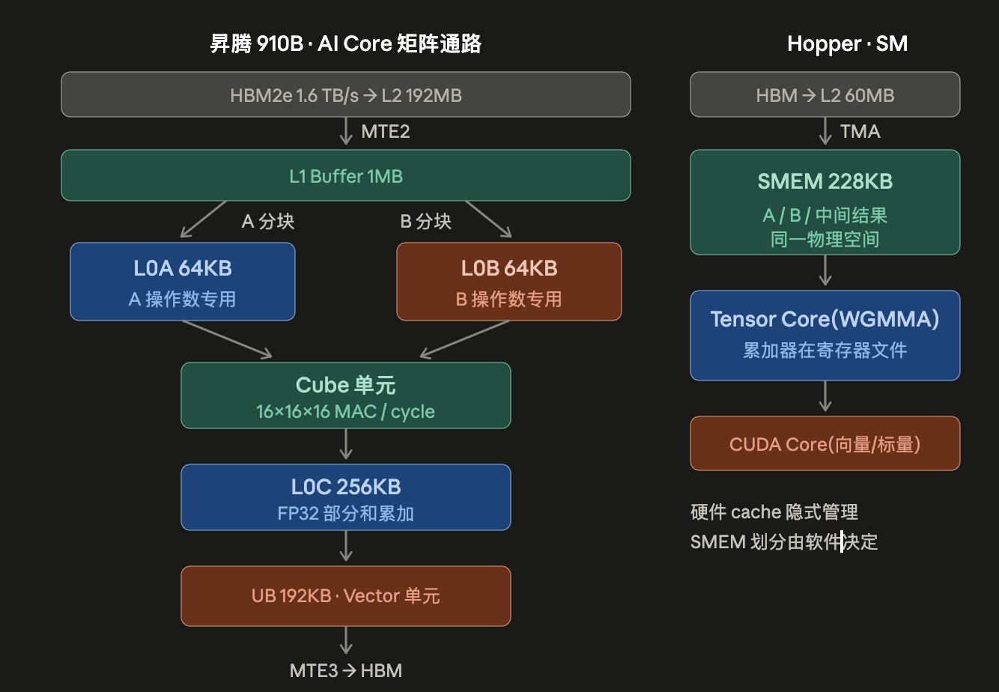
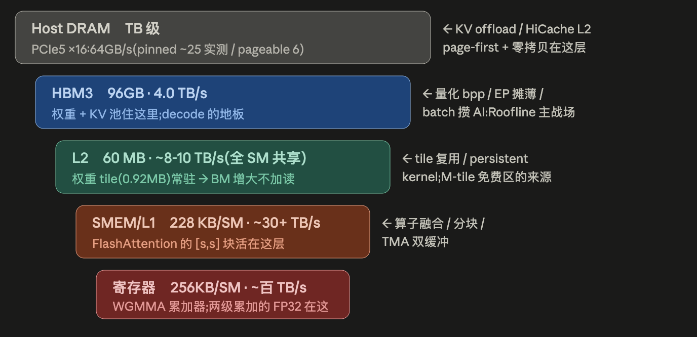

把算力、HBM、片上缓存和互联放在同一张预算表中，理解不同硬件为什么需要不同的算子与部署策略。

> 本文为「推理 INFRA 方法论」系列第 4/8 篇，对应原文第 3 章。发布日期按 2026 年 1–11 月编排；内容统一整理于 2026-11-01，包含年内后续更新的模型与实验资料。文中的“实测”均转引自[原始笔记](https://github.com/ZhengWG/notes/blob/b260dc65116a5453b70cac88eee0a5f2b56db12c/job_note/interview/2026/background/推理INFRA方法论-refactor.md)，并非本博客整理时重新测试。

芯片架构对比：

  

存储模型（以H20为例）：

  

HBM堆叠示意图：

  

HBM颗粒版本对比：

- HBM2e:规格 3.6Gbps,910B 实跑 3.2 → 单堆 0.40TB/s × 4堆 = 64GB · 1.6TB/s
- HBM3: 规格 6.4Gbps,H100/H800 实跑 5.2 → 单堆 0.67 × 5堆 = 80GB · 3.35TB/s
        (H20-96 同速率但 6 堆全开 → 96GB · 4.0TB/s)
- HBM3e:规格 8–9.6Gbps,H200/H20-3e 实跑仅 6.25 → 单堆 0.80 × 6堆 = 141GB · 4.8TB/s
        B200 拉到 7.8 → 单堆 1.0 × 8堆 = 192GB · 8.0TB/s
        B300 同速率、换 12 层 die → 288GB · 8.0TB/s(带宽不变
- HBM4: 接口 1024→2048-bit 位宽翻倍,Rubin 世代,单堆 ~2TB/s 级

说明：
> H20-96→H20-3e 就是换颗粒(HBM3→3e):带宽 4.0→4.8、容量 96→141,算力一字不动
> B200→B300 只加 die 层数:容量 +50% 带宽不变 → Ridge 不变,纯为 KV 池/大模型而生

## GPU

| 芯片           | 显存颗粒          | 堆数×单堆     | 容量     | HBM 带宽   | L2     | SMEM/SM(SM数)    | 8卡节点    | 反推单堆带宽  | BF16(dense)        | FP8              | FP4         | Ridge(BF16/FP8)         |
|:--------------:|:----------------:|:-------------:|:--------:|:----------:|:------:|:----------------:|:----------:|:--------------:|:-------------------:|:----------------:|:-----------:|:------------------------:|
| H20-96         | HBM3             | 6×16GB        | 96 GB    | 4.0 TB/s   | 60 MB  | 228KB(78)¹        | 768 GB     | 0.67 TB/s      | 148 T               | 296 T            | —           | 37 / 74                  |
| H20-3e/H200    | HBM3e            | 6×24GB        | 141 GB   | 4.8 TB/s   | 60/50 MB| 228KB(78/132)    | 1128 GB    | 0.80 TB/s      | 148 / 990 T²        | 296 / 1979       | —           | 31/62 · 206/412          |
| H800/H100      | HBM3             | 5×16GB        | 80 GB    | 3.35 TB/s  | 50 MB  | 228KB(132)        | 640 GB     | 0.67 TB/s      | 990 T               | 1979 T           | —           | 296 / 591                |
| B200           | HBM3e            | 8×24GB        | 192 GB   | 8.0 TB/s   | 126 MB | 228KB(双die)³     | 1536 GB    | 1.00 TB/s      | 2250 T              | 4500 T           | 9000 T      | 281 / 562 (FP4 1125)     |
| B300           | HBM3e 12-Hi      | 8×36GB        | 288 GB   | 8.0 TB/s   | 126 MB | 同上               | 2304 GB    | 1.00 TB/s      | 2500 T              | 5000 T           | 15000 T     | 312 / 625 (FP4 1875)     |

> ¹ H20 的 148T 不是 78 个 SM 能解释的：78/132 × 990 ≈ 585T，实际只有 148T → 每 SM Tensor 速率被额外砍到 1/4。
>
> ² 合并行在算力列必须拆开：H20-3e 与 H200 显存子系统完全相同（所以能合并），但算力差 6.7×（148 vs 990）——这一格正是"同带宽、Ridge 差 6.7 倍（31 vs 206）"的来源，一个是 decode 机、一个是通用机。
>
> ³ B300 vs B200 的算力列读法：FP4 +67%、FP8/BF16 只 +11% ——偏科升级，FP4 特化推理 SKU（另砍 FP64 到 1.2TF、attention 单元 2×，表里放不下写在备注）。

H20 96GB 实测（驱动 550，SM 时钟稳定 1980 MHz，功耗峰值约 300 W）：

| 项 | 实测 |
| --- | --- |
| 算力 | BF16 138T（93%）、FP8 282T（95%）、DeepGEMM blockwise FP8 264–272T |
| HBM | copy 3.33 TB/s、只读 3.2–3.3、只写 3.4（83–85%）⟹ R_eff ≈ 42 / 85 |
| 片上 | 78 SM、L2 60 MB、SMEM 228 KB/SM（单 block 227 KB） |
| NVLink | 18 × 26.56 GB/s = 478 GB/s/方向；P2P 拷贝 395 GB/s |
| PCIe | Gen5 ×16，pinned H2D/D2H 54–55 GB/s，预分配 pageable 13–16 GB/s |
| 网卡 | 4 × 400G RoCE bond（NIC0–3 分别与 GPU1/3/4/6 同 PCIe switch），单网卡 RDMA 392 Gb/s |
| 下发 | 裸 `cudaLaunchKernel` 1.9 μs；PyTorch eager 4.5–12 μs/op；`cudaGraphLaunch` 主机侧 2.9 μs，GPU 侧每节点 0.76 μs |

## NPU

| 芯片           | 封装内 die | 单 die (计算单元实际可用)           | 单卡聚合 (两 die 各干各的总和)         | Ridge (单 die) | 机内互联 / scale-up 域                 | 机间                        |
|:--------------:|:----------:|:------------------------------------:|:---------------------------------------:|:--------------:|:------------------------------------:|:--------------------------:|
| 910B           | 1          | 64 GB / 1.6 TB/s / 376T¹             | = 单 die                               | 235            | HCCS 392 GB/s (56×7 full-mesh)     | 8 卡 200G RoCE, 1:1 (25 GB/s) |
| 910C           | 2          | 64 GB / 1.6 TB/s / ~376T | 128 GB / 3.2 TB/s / ~800T             | 235      | die 间带宽未公 384 卡 (CloudMatrix, UB 光互联) | 未公布                        |
| 950PR (26Q1)   | 未公布      | —                                    | 112 GB / 1.4 TB/s / FP4 1.56P      | —              | 8192 卡 (Atlas 950 SuperPoD) | 灵衢 ~2TB/s             |
| 950DT (26Q4)   | 未公布      | —                                    | 未公布 (颗粒 HiZQ, 自研)                 | —              | 未公布 同上                                   | 同上                          |

NPU 部署仍按计算、访存、下发分别诊断：矩阵运算走 Cube，向量/标量碎操作可能限制流水；图模式降低 host 下发，融合减少中间张量与碎操作，但不能把任意 Vector 运算都变成 Cube 运算。HCCS 机内与 RoCE 跨机要分别建模，8 卡节点的 EP16 已跨机；先确认实际拓扑和可用链路，再选择集合通信算法，不沿用模拟表里的固定 7× 加速。

## 用负载需求解释硬件规格

容量决定能否装下权重与状态，带宽决定低算术强度负载的下限，计算单元和片上存储决定算子的实现路线。采购或迁移时应重新测量目标 SKU 与软件栈，本篇的规格与实验数字保留原始资料口径。

## 系列导航

| 章节 | 文章 | 编排日期 |
| --- | --- | --- |
| 0 | [Roofline：用算力与带宽建立性能预算]() | 2026-01-01 |
| 1 | [通信模型：从集合原语到跨机拓扑]() | 2026-02-13 |
| 2 | [分布式推理：TP、DP、EP、CP 与 PP 的取舍]() | 2026-03-29 |
| 3 | **推理硬件：GPU、NPU 与存储层级（本篇）** | 2026-05-11 |
| 4 | [Attention 演变：从 GQA、MLA 到混合状态]() | 2026-06-24 |
| 5 | [MoE 推理：Batch、DeepEP、DeepGEMM 与负载均衡]() | 2026-08-06 |
| 6 | [PD 与 EPD：阶段分离、状态传输与资源配比]() | 2026-09-19 |
| 7 | [核心优化：CUDA Graph、投机推理、Overlap 与量化]() | 2026-11-01 |

上一篇：[分布式推理：TP、DP、EP、CP 与 PP 的取舍]() · 下一篇：[Attention 演变：从 GQA、MLA 到混合状态]()
