从 KV 容量、每步读取量和并行可切性，理解 MLA、GDN 与压缩注意力对推理系统的影响。

> 本文为「推理 INFRA 方法论」系列第 5/8 篇。发布日期按 2026 年 1–11 月编排；内容统一整理于 2026-11-01，包含年内后续更新的模型与实验资料。

## 2026 模型对照：只保留影响部署的差异

| 模型 | 规模或配置 | 注意力 / 状态 | 对部署的影响 |
|---|---|---|---|
| [Qwen3.5-397B-A17B](https://huggingface.co/Qwen/Qwen3.5-397B-A17B) | 397B 总参、17B 激活；60 层、d=4096 | 45 层 GDN + 15 层全注意力 | 定长状态与 KV 双重预算；原生多模态另算编码阶段 |
| [DeepSeek-V4-Pro](https://huggingface.co/deepseek-ai/DeepSeek-V4-Pro) | 1.6T 总参、49B 激活 | CSA/HCA 混合压缩注意力 | 压缩粒度、尾部状态和 indexer 都进入缓存/传输布局；长上下文成本降低，但并非与长度无关 |
| [Kimi K2.6](https://huggingface.co/moonshotai/Kimi-K2.6) | 1T 总参、32B 激活；384 专家、top-8 | MLA，MoonViT 400M | latent 共享与多模态编码解耦；INT4 权重容量和实际 kernel 吞吐分别评估 |
| [GLM-5.1 配置](https://huggingface.co/zai-org/GLM-5.1/blob/main/config.json) | 78 层、d=6144；256 routed + 1 shared、top-8 | `glm_moe_dsa`，latent 512、RoPE 64、index top-2048 | 按 MLA+DSA 规划，不沿用旧稿中 GDN 的冲突说法 |

KV 大小是推算口径，不等于框架最终分配量：Qwen 全注意力部分约 30 KiB/token，Kimi 的 `61×576×2` 约 68.6 KiB/token；GLM 的 `78×576×2` 约 87.8 KiB/token 只含 latent+RoPE，还要另算 indexer 等状态。DS-V4 的约 10KB/token 是此前按压缩布局的量级估计，不作为统一固定常数。混合精度、页对齐和缓存额外字段均会改变实际占用。

## 两条家族路线

```text
Qwen 线:  MHA → GQA(Qwen2 全系) → 3:1 GDN+GQA 混合(Qwen3-Next 验证 → Qwen3.5 放大)
           哲学:直接换掉 75% 的注意力层(线性化绕开 KV)
DS 线:    MHA → MLA(V2,通道维压缩) → +DSA(V3.2,读取量稀疏) → CSA/HCA(V4,序列维压缩)
           哲学:保留 softmax,在内部逐维压缩(通道 → 读取 → 序列,三个正交维)
```

## Attention 对算力/带宽/通信的需求

| 结构                | KV/token (统一 L=61, h_d=128)                                                                    | decode 每步读 (s=32K)                       | prefill FLOPs                                | TP 可切性                                                                   |
|---------------------|---------------------------------------------------------------------------------------------------|----------------------------------------------|----------------------------------------------|------------------------------------------------------------------------------|
| MHA (n_h=64)        | 2·L·64·h_d·2B ≈ 1.9 MB                                                                           | 62 GB 💀                                     | O(s²)                                       | 沿 64 头切, TP≤64                                                           |
| GQA-8               | 2·L·8·h_d·2B ≈ 244 KB                                                                            | 8.0 GB                                      | O(s²)                                       | 沿 n_kv 切, TP≤8                                                            |
| MLA                 | L·(512+64)·2B ≈ 70 KB<br>(K/V 共享 latent，不乘 2)                                                | 2.3 GB                                      | O(s²)<br>decode 需矩阵吸收                 | ❌ latent 全头共享,只能复制 → attention 必 DP                                 |
| GDN (线性)          | 0;<br>定长状态 ~94 MB/请求 ⚠️ (Qwen3.5,45 层,d_k=d_v=128 假设;<br>若按 QK 头组织则 24–40 MB)        | 与 s 无关                                    | O(s)                                        | 状态沿 V 头可切;<br>prefix cache 需状态 checkpoint(状态不可截断)                           |
| DS-V4 (CSA+HCA)     | ~10 KB ⚠️推算<br>(CSA 4:1 + HCA 128:1 交替 + indexer KV;<br>混合精度 RoPE 维 BF16/其余 FP8)        | ~0.33 GB                                    | CSA O(s·k) k=1024 / HCA O((s/128)²)<br>系数÷16384 | 同 MLA 系, 必 DP                                                       |


## Attn变种精讲

### MLA：压通道维

做法:K 和 V 共享一个低秩中间量,不按头存。

```
x ──W_DKV──→ c_KV(512 维)──┬──W_UK──→ K_nope
                            └──W_UV──→ V
另存 K_rope(64 维,位置相关,无法吸收)

KV/token = L × (512 + 64) × bpp = 61 × 576 × 2 = 70 KB
对比 MHA 的 61 × 16384 × 2 = 1.9 MB → 压 28 倍
```

★ 矩阵吸收(decode 必做):若解压回完整 K 再算注意力,显存省了但每步要做巨大的解压矩阵乘。吸收 = 把 W_UK 预先融进 W_UQ,让 query 直接在 latent 空间点积。本质是摊销:哪边 token 少就预处理哪边——decode 时 query 只有 1 个,吸收血赚;prefill 时两边一样长,吸收反而多付 128→512 维的逐对开销,所以 prefill 走不吸收的 MHA 形式:

```
q_nope · k_nope^T = (x·W_UQ)·(c_KV·W_UK)^T = x·(W_UQ·W_UK^T)·c_KV^T
                                              └──── 预先合并 ────┘
```

不吸收的代价:128K 上下文每步白算约 4400 GFLOPs,比整个模型的激活计算(约 74 GFLOPs)还大 60 倍。

系统后果:

latent 是全头共享的,没有 head 维可切 → TP 下只能复制不能切 → attention 必须走数据并行;而这又导致 token 分散在各卡,MoE 层需要 all-to-all 重新汇聚。P/D 传输时因为没有 head 维,反而不需要重排。

实测中还观察到瓶颈的变化：吸收后 128 个头共享 576 维 latent，decode 的 I≈242（BF16），高于该配置的转折点 37–42，**此时 decode attention 主要受算力限制**。实测 FlashInfer MLA 85–106 TFLOPS、只用 0.4 TB/s 带宽;B=32、s=32K 单层 3.2 ms,耗时 ∝ 头数 × 上下文。这一结论适用于本次每卡 128 头配置；KV 压缩仍有容量收益，但时延不按字节缩减比例下降。该配置下 verify(q_len=2)的 attention 耗时增加到 2.0–2.2 倍。TP8 切到每卡 16 头时 I≈30，WGMMA 的 M 维填不满，只跑到 23–26 TFLOPS，算力和带宽均未吃满，不能沿用 128 头的瓶颈结论。

### GDN:不压,直接绕开

做法:把 softmax(QK^T)V 的二次复杂度换成一个定长状态的递归更新。

```
基础线性注意力:  S_t = S_{t-1} + k_t v_t^T,        o_t = q_t^T S_t
Gated DeltaNet:  S_t = α_t·S_{t-1} + β_t·k_t(v_t − k_t^T S_{t-1})^T
                       └门控遗忘┘    └─── delta rule:只写预测残差 ───┘
```

两个机制各司其职:

门控 α:控制忘掉多少历史,状态不无限累积
delta rule:只写"预测错的部分"。若不加,同一个 key 反复出现会让状态范数爆炸(实测重复 12 次:基础线性注意力状态范数 18.5,GDN 保持 3.2)

GDN 层不保留随序列增长的标准 KV，但有定长状态（Qwen3.5 约 94 MB/请求为布局估算，实际取决于状态精度、卷积状态与 checkpoint 策略）。

两个系统后果:

显存曲线是两段式。Qwen3.5 的 45 个 GDN 层持定长状态,15 个全注意力层才有 KV:
Mem(req) = 94 MB + s × 30 KB
按上述布局估算，交叉点约 3K token；短请求的定长状态可能比 KV 还大

容量规划公式必须写成两段,用单一 s×KV 会严重低估短请求。

★ 前缀缓存部分失效。标准 KV 是追加式的,前缀的 K/V 原封不动可复用;而 GDN 状态是整个前缀的有损压缩摘要,无法截断到第 n 个 token。折中的方式保留多checkpoints，但也是window方式非连续的。

### CSA/HCA

<p align="center">
  
</p>

## 注意力结构会改变整个状态管理系统

压缩 KV 不必然按比例降低时延，定长状态也不等于没有内存成本。规划缓存、前缀复用和跨阶段交接时，要同时保存 latent、位置、索引、循环状态与未完成压缩块，按实际布局计算预算。

## 系列导航

| 章节 | 文章 | 编排日期 |
| --- | --- | --- |
| 0 | [Roofline：用算力与带宽建立性能预算]() | 2026-01-01 |
| 1 | [通信模型：从集合原语到跨机拓扑]() | 2026-02-13 |
| 2 | [分布式推理：TP、DP、EP、CP 与 PP 的取舍]() | 2026-03-29 |
| 3 | [推理硬件：GPU、NPU 与存储层级]() | 2026-05-11 |
| 4 | **Attention 演变：从 GQA、MLA 到混合状态（本篇）** | 2026-06-24 |
| 5 | [MoE 推理：Batch、DeepEP、DeepGEMM 与负载均衡]() | 2026-08-06 |
| 6 | [PD 与 EPD：阶段分离、状态传输与资源配比]() | 2026-09-19 |
| 7 | [核心优化：CUDA Graph、投机推理、Overlap 与量化]() | 2026-11-01 |

上一篇：[推理硬件：GPU、NPU 与存储层级]() · 下一篇：[MoE 推理：Batch、DeepEP、DeepGEMM 与负载均衡]()
